# Documentación del MOD

Este documento es el catálogo funcional oficial de KomaEdit. Cada función nueva o cambio visible para el jugador debe añadirse aquí en el mismo Pull Request que introduce el código.

## Índice

- **Empezar:** [Procedural Studio](#procedural-studio) · [Trayectorias y hologramas](#trayectorias-y-hologramas) · [Ayuda y comandos](#ayuda-y-comandos) · [Diagnóstico antes de construir](#diagnóstico-antes-de-construir) · [Vista previa, progreso y cancelación](#vista-previa-progreso-y-cancelación) · [Colocar con gizmo](#colocar-con-gizmo) · [En el mundo: ajustes, teclas y mensajes](#en-el-mundo-ajustes-teclas-y-mensajes)
- **Figuras y tubos:** [Figuras procedurales](#figuras-procedurales) · [Red](#red) · [Rayos ramificados](#rayos-ramificados) · [Telarañas adaptativas](#telarañas-adaptativas) · [Figuras de espacio de tubo](#figuras-de-espacio-de-tubo) · [Motor exacto de las figuras clásicas](#motor-exacto-de-las-figuras-clásicas) · [Doblar estructuras del portapapeles](#doblar-estructuras-del-portapapeles) · [Escalar y girar el portapapeles](#escalar-y-girar-el-portapapeles) · [Figura Expresión](#figura-expresión) · [Spline de ezEdits (ezspline)](#spline-de-ezedits-ezspline) · [Variaciones de la figura](#variaciones-de-la-figura) · [Estructuras](#estructuras) · [Materiales y degradados](#materiales-y-degradados)
- **Sobre lo construido:** [Envejecer (orden avanzada)](#envejecer) · [Hiedra viva](#hiedra-viva) · [Retoques sobre la selección](#retoques-sobre-la-selección) · [Enredaderas, musgo, losas y estados](#enredaderas-musgo-losas-y-estados) · [Vidriera degradada](#vidriera-degradada)
- **Edificios y naturaleza:** [Árboles y rocas](#árboles-y-rocas) · [Tejados](#tejados) · [Loft entre curvas](#loft-entre-curvas)
- **Deformar, texturizar y suavizar:** [Deformar la selección](#deformar-la-selección) · [Superficie](#superficie) · [Texturizado](#texturizado) · [Máscaras de las operaciones de región](#máscaras-de-las-operaciones-de-región) · [Suavizado](#suavizado) · [Smoothblocks: perfiles de -w](#smoothblocks-perfiles-de--w)
- **Color e imagen:** [Color y sombreado](#color-y-sombreado) · [Imagen en bloques](#imagen-en-bloques)
- **Generadores y terreno:** [Formas sueltas](#formas-sueltas) · [Terreno con ruido](#terreno-con-ruido) · [Campos y líneas de flujo](#campos-y-líneas-de-flujo) · [Terraformado](#terraformado)
- **Construir a mano, pinceles y simetría:** [Construir a mano: capacidades](#construir-a-mano-capacidades) · [Pinceles](#pinceles) · [Pincel Desplazar paleta](#pincel-desplazar-paleta) · [Pinceles de degradado](#pinceles-de-degradado) · [Pintor de pétalos](#pintor-de-pétalos) · [Pincel de colocación](#pincel-de-colocación) · [Pinceles de modelado](#pinceles-de-modelado) · [Supervarita](#supervarita) · [Simetría](#simetría)
- **WorldEdit, paletas y selecciones:** [Máscaras y patrones en WorldEdit](#máscaras-y-patrones-en-worldedit) · [Paletas guardadas](#paletas-guardadas) · [Ruidos guardados](#ruidos-guardados) · [Selecciones](#selecciones)
- **Colocar estructuras:** [Colocar estructuras](#colocar-estructuras) · [Alineación primaria y secundaria](#alineación-primaria-y-secundaria) · [Estructuras colocables](#estructuras-colocables) · [Dispersión de estructuras](#dispersión-de-estructuras) · [Arrays a lo largo de la trayectoria](#arrays-a-lo-largo-de-la-trayectoria) · [Biblioteca de planos](#biblioteca-de-planos)
- **Utilidades:** [Utilidades de obra](#utilidades-de-obra) · [Imagen de referencia](#imagen-de-referencia)
- **Servidor y proyecto:** [Recetas, instancias y paquetes](#recetas-instancias-y-paquetes) · [Proyecto persistente y recuperación](#proyecto-persistente-y-recuperación) · [Permisos, cuotas y configuración](#permisos-cuotas-y-configuración) · [Rendimiento](#rendimiento) · [Versiones descargables](#versiones-descargables) · [Política de actualización](#política-de-actualización)

## Procedural Studio

Procedural Studio se abre con `K` y permite construir mientras el mundo sigue visible y activo. Tiene siete etapas repartidas en tres grupos: **Crear** (Herramientas, Trayectoria y Figuras), **Ajustar** (Color) y **Biblioteca** (Planos, Recetas e Instancias). Modificadores y Material ya no son etapas: solo valían para la figura y viven dentro de Figuras, como su [material](#tamaño-material-y-variaciones) y sus [variaciones](#tamaño-material-y-variaciones). Envejecer tampoco es una etapa: queda como la orden avanzada [`/komaedit weather`](#envejecer).

La primera vez que se abre, una [bienvenida guiada](#bienvenida-guiada) de cinco pasos lo enseña sobre el mundo. Todo se explica en la propia pantalla, sin leer esto: cada control dice al pasar el ratón qué le pasa a lo que construyes y, en los números, sus extremos en palabras («de estrecha a ancha»); el pie dice qué hace cada clic en el mundo en la etapa en la que estás, y al dejar quieto el ratón sobre el mundo sale la leyenda entera. Y todo se hace con el ratón sin cerrar el Studio: seleccionar arrastrando, poner y arrastrar puntos, pintar con el pincel, coger un material con Alt+clic y colocar con un clic (ver [El ratón en el mundo](#el-ratón-en-el-mundo)).

- El catálogo de materiales utiliza todos los bloques registrados por Minecraft y los mods cargados.
- La cámara puede desplazarse mientras el Studio permanece abierto.
- `Ctrl+Z`, `Ctrl+Y` y `Ctrl+Shift+Z` utilizan el historial de WorldEdit.
- Todo el Studio (etapas, controles, nombres de figuras y modos, mensajes de estado, holograma y el HUD de captura) sale en el idioma de Minecraft, español o inglés. Los comandos y el chat siguen en español.
- El panel no enseña órdenes del chat: lo que se elige viendo (especies, tipos de tejado y de roca, sellos, planos) se elige por su miniatura, y la orden exacta solo sale al copiarla.

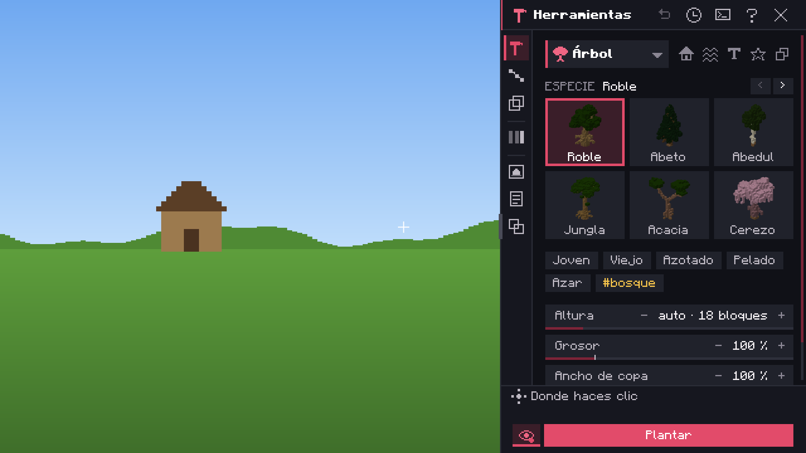

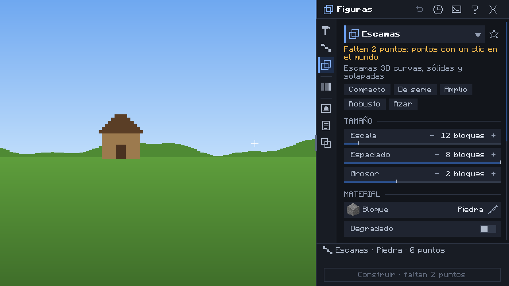

### Bienvenida guiada

La primera vez que alguien abre el Studio sale una tarjeta, **Primeros pasos en el Studio**: cinco pasos cortos sobre el mundo de verdad que en un par de minutos dejan hecho algo bonito (un árbol y una montaña nevada) y enseñan lo que se usa siempre: elegir una herramienta, ver antes de colocar, confirmar y deshacer. **Empezar** la lanza; **Ahora no** la cierra.

| Paso | Qué se hace | Qué enseña |
| --- | --- | --- |
| 1. Planta un árbol | Pulsar **Árbol** en la cuadrícula y hacer clic en el suelo: sale como fantasma, sin colocar. | Las herramientas se eligen en la cuadrícula; un clic en el mundo construye ahí. |
| 2. Muévelo y colócalo | Arrastrar una flecha del fantasma (o hacer clic en otro sitio) y pulsar **Colocar** (o `Intro`). | Nada se pone hasta confirmarlo, y el gizmo lo deja justo donde se quiere. |
| 3. Levanta una montaña | **Sello de relieve**, elegir un sello (Montaña, por ejemplo), **Al pincel**, clic en el suelo (se ve antes de cambiar nada), **Azar** y otro clic (otra montaña con la misma forma) y **Aplicar**. | La miniatura es la forma; la semilla da otra variante; el pincel enseña antes de aplicar. |
| 4. Píntala | **Pintar terreno**, el preset **Cumbres**, **Al pincel**, clic en la montaña y **Aplicar**. | Un preset deja la herramienta lista de un clic. |
| 5. Deshaz lo que quieras | Abrir el historial (el reloj de la barra) y pulsar **Deshacer** (o `Ctrl+Z`). | Todo lo del mundo se deshace, y se rehace. |

- **Cada golpe, una burbuja.** Junto a lo que hay que tocar sale una burbuja corta: en qué paso va («Paso 2 de 5», con un punto por paso), una frase de qué hacer y por qué y, abajo, **Saltar paso** y **Saltar bienvenida**. Lo que hay que pulsar lleva un borde de acento con una luz que le da la vuelta despacio. La burbuja va sobre el mundo, a la izquierda del panel y a la altura del control, así que no tapa ningún control; lo que se hace en el mundo (un clic en el suelo) va arriba, pegado al panel. Si el mundo no deja sitio (un panel muy ancho en una pantalla pequeña), va sobre el panel, debajo o encima del control. Mientras se ve, la leyenda del mundo no sale, y sus botones responden al primer clic aunque el historial esté abierto.
- **Avanza solo cuando lo haces.** Cada golpe espera a la acción de verdad: que la herramienta esté elegida, que salga el fantasma tras el clic, que se mueva, que se coloque, que llegue la orden del pincel, que se pinte en el mundo, que cambie la semilla o que se deshaga algo. Si a mitad de un paso vas a otra herramienta, la burbuja pide volver y luego sigue donde ibas. Si quitas el fantasma sin colocarlo (o el servidor no lo coloca), vuelve a pedir el clic: «Cancelado: no se colocó nada».
- **Prepara lo justo:** abre Herramientas con su cuadrícula para elegir, desplaza el panel hasta lo que hay que tocar y, en el modo compacto, abre **Más ajustes**, donde van los presets y **Azar**. Nunca elige nada por el jugador.

#### Segura en cualquier servidor

- **Nada se coloca sin que lo confirmes.** Mientras dura, Construir va siempre con vista previa (si la tenías apagada, pasa a en vivo) y los pinceles del sello y de la pintura, con la **vista previa en cada clic**: un clic enseña el resultado y la burbuja ofrece **Aplicar** (`/komaedit pincel aplicar`) o **Descartar** (`/komaedit pincel cancelar`). La bienvenida no manda nada que cambie el mundo salvo esos **Aplicar** que pulsa el jugador. Si se salta un paso o la bienvenida con una vista previa del pincel a medias, se descarta.
- **Se avisa de que todo se deshace:** lo dice la entrada, lo repite el paso de colocar y el último paso enseña a deshacer.
- **Al acabar, al saltarla o al cerrar el Studio** vuelve lo que tenías (la vista previa apagada, la de cada clic de los pinceles), salvo que lo cambiaras tú durante la bienvenida. En `studio.json` no se queda nada de lo que puso; al volver a abrir el Studio, sigue donde iba y lo vuelve a poner.
- **Sin el permiso de un paso, se salta solo** y la burbuja siguiente lo dice («Sin permiso para Sello de relieve: ese paso se salta»); sin el del árbol se saltan plantar y colocar. «Paso N de M» cuenta solo los que se hacen. Con un servidor que no contesta qué permisos tienes no se salta nada: decide el servidor al construir.
- **En supervivencia, o sin ningún permiso de construir, solo enseña**, y la entrada ya lo dice. Se elige igual (la herramienta, el sello, Azar, el preset, abrir el historial), pero lo que tocaría el mundo pasa a ser un golpe de mirar con **Siguiente**: la burbuja señala el botón, sin el borde animado, y explica qué haría. No se manda ninguna orden de construir. Son cuatro pasos (colocar va dentro del primero).

#### Una vez por jugador, y siempre que quieras

- Sale sola **una vez**: al enseñar la entrada queda apuntada en `config/komaedit/studio.json` (`"welcome": 1`), aunque se cierre a medias. Un `studio.json` de una versión anterior no lo tiene, así que a quien ya usaba el Studio también le sale una vez.
- Se vuelve a lanzar desde la chuleta (`F1` o `?`), con **Bienvenida guiada** arriba a la derecha, y con **`/komaedit tutorial`** o **`/komaedit bienvenida`**, que abren el Studio (si no estaba abierto) con la bienvenida desde la entrada. La orden necesita KomaEdit en el cliente; sin él, lo dice.
- En español o en inglés, según el idioma del juego, con el mismo tono que la ayuda de los controles.

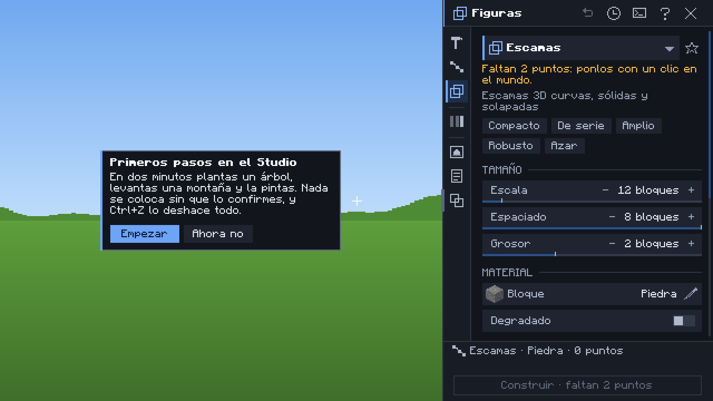

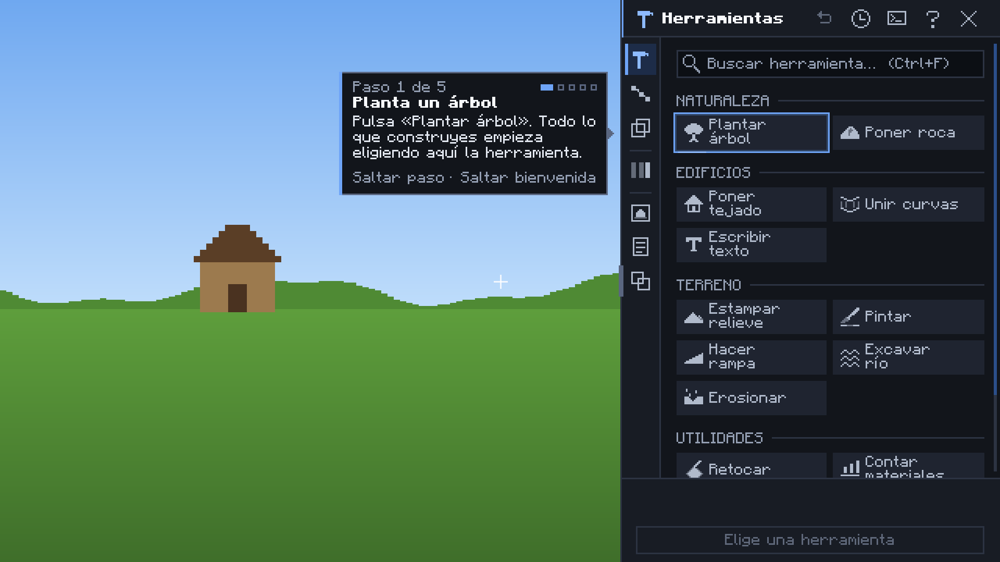

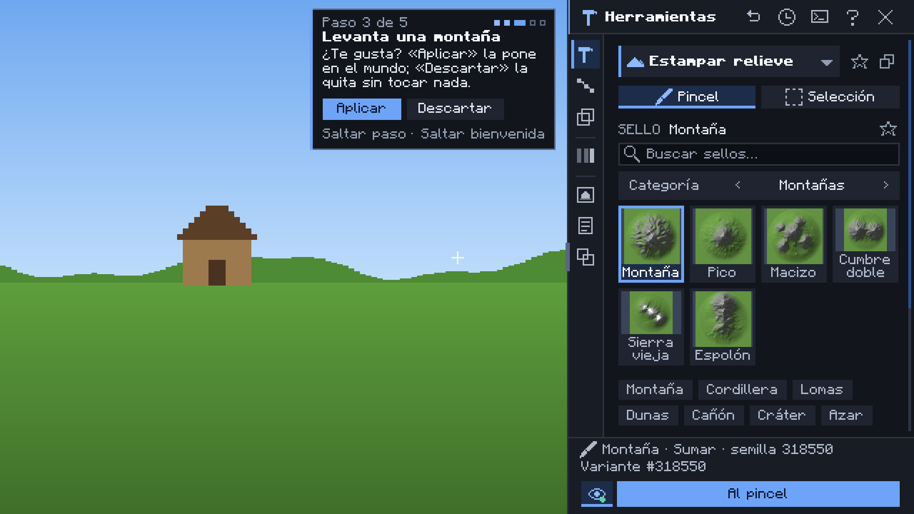

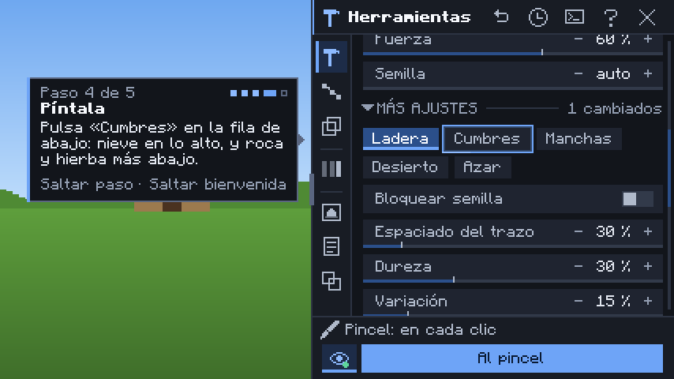

Las maquetas de todos los pasos, a 1080p con GUI 3 y a 854×480 con GUI 2, en español e inglés (y en supervivencia), están en `docs/renders/studio/bienvenida/`.

- **Limitaciones:** la vista previa de los pinceles se aplica desde la burbuja; fuera de la bienvenida es `/komaedit pincel aplicar`. Con «Colocar con gizmo: Nunca» (`/kegui ajustes`) el árbol sale como vista previa de bloques, que no se mueve, y el paso 2 pide solo **Confirmar**. Con puntos de trayectoria, el árbol va en cada punto y el paso 1 pide **Plantar**. Si se sale del mundo a mitad, la vista previa queda en vivo (la de serie). Nada se ha probado aún dentro de Minecraft.

### Disposición de la pantalla

Todo el Studio vive en un único panel opaco pegado a la derecha; el resto de la pantalla es el mundo, sin nada encima, así que el chat de abajo a la izquierda queda a la vista y el marcador del servidor no se transparenta por detrás del panel. El panel se lee de arriba abajo: **qué haces** (la barra con la etapa), **qué ajustas** (el contenido) y **qué pasa al pulsar** (el pie).

- **Barra de arriba:** el icono y el nombre de la etapa y, a la derecha, deshacer y rehacer ajustes, el holograma, el **historial del mundo**, la **paleta de órdenes**, la chuleta de atajos y cerrar. Cada botón dice su atajo al pasar el ratón. Con el panel estrecho (menos de 300 píxeles) se quedan los cinco imprescindibles.
- **Etapas** (columna izquierda): los tres grupos con su nombre encima y cada etapa con su icono, su nombre y su tecla (`1` Herramientas, `2` Trayectoria, `3` Figuras, `4` Color, `5` Planos, `6` Recetas y `7` Instancias). Quien tenía guardada la etapa Modificadores o Material abre en Figuras. Si el panel no da para los nombres, se quedan los iconos con una raya entre grupo y grupo, y al pasar el ratón por la columna sale a su lado la lista con el nombre y la tecla de cada etapa, a la altura de su icono (un clic en un nombre abre la etapa). La etapa **Color** (degradados, bloques parecidos y sombreado) se explica en [Color y sombreado](#color-y-sombreado), y **Planos**, en [Etapa Planos del Studio](#etapa-planos-del-studio).
- **Contenido:** las secciones de la etapa, desplazables con la rueda (una barra fina a la derecha indica cuánto queda). Las secciones plegables (**Más ajustes**, **Cómo se usa**…) recuerdan si estaban abiertas.
- **Pie** (abajo, siempre visible): sobre qué se trabaja (la selección con su tamaño, los puntos de la trayectoria o **donde haces clic**), la estimación **≈ N bloques**, el último mensaje unos segundos y el botón principal de la etapa: **Construir**, **Colocar plano** o **Sombrear selección**. Si falta algo, el botón sale apagado y dice qué («Faltan 2 puntos», «Falta la selección», «Elige una herramienta»). Mientras algo tuyo está en marcha, el pie enseña su progreso (ver [Progreso en el pie](#progreso-en-el-pie)). Los textos del pie se acortan quitando lo menos importante, nunca a medias.
- **Lo que hay bajo el ratón**, en la línea de debajo del pie (tras el último mensaje): sobre el mundo, qué hace cada clic en esta etapa («Clic: punto nuevo · arrastra un punto: moverlo…», «Arrastra: seleccionar…», «Clic: plantar ahí»); sobre un control, sus gestos («Rueda o − +: cambiar · arrastra el número…»). Lo más importante va primero, así que lo que cabe es lo que más ayuda.
- **Leyenda del mundo:** con el ratón quieto medio segundo sobre el mundo, arriba a la izquierda sale la lista entera de lo que hace el ratón ahí, una cosa por línea («Qué hace el ratón en el mundo»). Al moverlo se esconde.
- **Ancho del panel:** de serie, el 38 % de la pantalla, para dejar el mundo a la vista (a 1080p con GUI 3, 243 de 640 píxeles de GUI; antes era la mitad). El borde izquierdo, con un asa a media altura, se arrastra entre 230 píxeles y el 45 % de la pantalla (470 como mucho); lo elegido se guarda en `studio.json` como parte de la pantalla, así que vale igual con otra escala de GUI. Clic derecho en el borde: el de serie.
- **Los nombres se leen enteros:** en las galerías, las cuadrículas de herramientas y figuras y la biblioteca de planos, un nombre que no cabe en una línea va en dos (partido por palabras; los planos, tras `_` o `-`), y si ni así cabe, la cuadrícula pone menos columnas.
- **Trayectoria** cuenta los nodos (`3 / 32 nodos`), dice si está abierta o cerrada y tiene **Añadir aquí**, **Deshacer punto**, **Cerrar / Abrir trayectoria** y **Limpiar**, la lista de nodos con sus coordenadas (un clic elige el nodo para moverlo con sus flechas) y **Usar con**: Figura, Río, Rampa, Árbol o Loft, que lleva a esa etapa o herramienta con los puntos ya puestos. «Cómo se usa» el puntero queda plegado.
- El nombre de la receta, **Guardar** y la exportación o importación de `.krecipe` están en la etapa **Recetas**; Construir usa ese mismo nombre.
- Los interruptores (Fusión, Kitbash, Cerrar huecos, Quitar bloques sueltos, Invertir dirección) son filas con un pulsador a la derecha. Fusión y Kitbash solo enseñan sus ajustes cuando están activados, y Alcance y Separación solo con un modo de superficie.

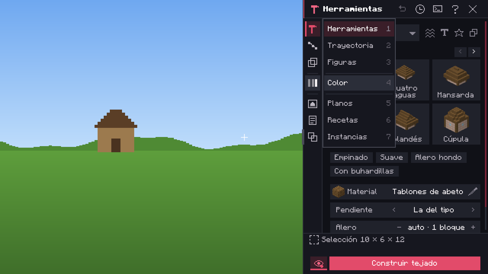

### Encontrar figuras

La etapa **Figuras** funciona como Herramientas: con una figura elegida, arriba sale plegada (icono, nombre y las recientes para volver de un clic) y debajo sus ajustes; al pulsar el nombre se abre la cuadrícula con todas.

- **Buscador** (`Ctrl+F` o `/` desde cualquier etapa): sin mayúsculas ni tildes, busca por nombre, id, alias del comando y descripción (`roca` encuentra Tubo erosionado; `chain`, Cadena). Cada palabra tiene que aparecer; el nombre pesa más que la descripción. `Intro` elige la primera y `Esc` borra la búsqueda.
- **Familias**, como grupos de la cuadrícula: ★ Favoritas, Tubo (Perfil 2D, Trenza, Tubo erosionado, Expresión), Eslabones (Cadena, Cuentas, Anillos, Nudos, Espiral, Noodles), Pieles (Escamas, Escamas espinadas, Cuadros 3D, Armadura hex, Celdas Voronoi, Panal, Red), Orgánicas (el resto) y **Estructuras** (lo que antes era una etapa aparte). Una figura nueva sin familia asignada aparece en Orgánicas.
- **Favoritas:** la ★ de cada botón la marca o la desmarca. **Recientes:** las últimas figuras elegidas, junto al nombre de la elegida.
- Favoritas y recientes son de cada jugador y se guardan en su equipo en `config/komaedit/studio.json` (no viajan con recetas ni paquetes). Un archivo roto se ignora y se empieza de cero.
- La descripción completa de cada figura sale en su tooltip; con sitio, la de la elegida se ve también bajo su nombre. En el modo compacto no hay descripciones.

### Tamaño, material y variaciones

Con una figura elegida, la etapa **Figuras** tiene, de arriba abajo, lo que se toca de verdad:

1. Su nombre (pulsarlo abre la cuadrícula), su descripción y los presets (**Compacto**, **De serie**, **Amplio**, **Robusto**, **Azar**). Si faltan puntos, encima, en amarillo: «Faltan 2 puntos: ponlos con un clic en el mundo.»
2. **Tamaño:** radio, espaciado y grosor (con el nombre que les da cada figura: «Paso de trenza», «Grosor de hebra»), y la altura en las que la tienen. En Perfil 2D, el perfil y si va hueco; en Expresión, la fórmula.
3. **Material:** el bloque, con su biblioteca y su cuentagotas, y el interruptor **Degradado**. Con él encendido, la fila del bloque pasa a ser la **Paleta** (‹ › o la rueda); al apagarlo vuelve el bloque y al encenderlo otra vez, la misma paleta.
4. **Variaciones** (ver [Variaciones de la figura](#variaciones-de-la-figura)). Cada una es una fila con su **dibujo**, su nombre, una frase de lo que hace y un interruptor; toda la fila la pone o la quita y el clic derecho la quita. Puesta, sus controles salen justo debajo. El título dice cuántas hay puestas.
5. **Más ajustes**, plegado (con cuántos ya no están de serie): el giro de la figura sobre el camino, el resto del tubo (motor, extremos, normales, piezas), **Cómo cambia** (si afinar o retorcer van parejos o se notan más al principio o al final), la dirección, mezcla, sentido y reparto del degradado, **Cerrar huecos**, **Quitar bloques sueltos** y **Quitar todas las variaciones**.

| Variación | Qué hace | Sus controles | Se pone con |
| --- | --- | --- | --- |
| **Afinar** | Más fina (o más gruesa) hacia el final del camino. | Tamaño al final (de más fina a más gruesa) y Separación al final (de más juntas a más separadas). | 40 % al final |
| **Retorcer** | Gira sobre sí misma a lo largo del camino. | Cuánto gira (de la izquierda a la derecha; 360° es una vuelta). | una vuelta |
| **Otra figura encima** | Cada pocos tramos, otra figura (anillos en una cuerda, nudos en un cable). | Qué figura (nunca la misma) y Cada (de a menudo a de tarde en tarde). | anillos cada 4 tramos |
| **Pegar al terreno** | Los puntos bajan al suelo (o suben al techo, o van a lo más cercano) y la figura sigue el relieve. | Suelo, Techo o Lo más cerca; Altura sobre el suelo (de hundida a en el aire) y Busca el suelo hasta. | al suelo |
| **Repetir lo copiado** | Lo que copiaste con `//copy` (una farola, un poste) a lo largo del camino. | Dónde (en las puntas, en cada punto, cada pocos bloques, doblado o estirado a lo largo) y Cada. | cada pocos bloques |

- **El dibujo** de cada fila sale del mismo generador que construye: un tubo de ejemplo con esa variación puesta, en el color del material de la figura (y unas lomas para «Pegar al terreno», unas farolas para «Repetir lo copiado»), pintado una vez en segundo plano. Lo que hace en **tu** figura se ve en su holograma al momento de encenderla y al mover cualquiera de sus controles; con la vista previa en vivo, también en su fantasma tras Construir.
- **Al momento** se ven todas menos dos: lo copiado (el portapapeles es del servidor) y «Lo más cerca», que busca en todas direcciones; esas dos se ven en el fantasma al construir y su ayuda lo dice. «Pegar al terreno» al suelo o al techo ya lo calcula el cliente con el mundo que tiene cargado.
- **Solo lo que sirve:** en las estructuras (pilares, arcos, puentes y torii) solo sale «Pegar al terreno»; afinarlas o retorcerlas las rompería. Si una receta ya lleva otra variación, sale igual, para poder quitarla.
- **Las recetas de antes** se leen igual: las variaciones son una forma de ver los mismos números. Si una receta cambiaba también el principio (escala o separación inicial), Afinar enseña además **Tamaño al principio** o **Separación al principio**, para poder devolverlos a 100 %.
- En el modo compacto las variaciones son filas con interruptor, sin dibujo ni frase (que salen en su ayuda).
- Deshacer ajustes (`Z`) vale también para las variaciones.

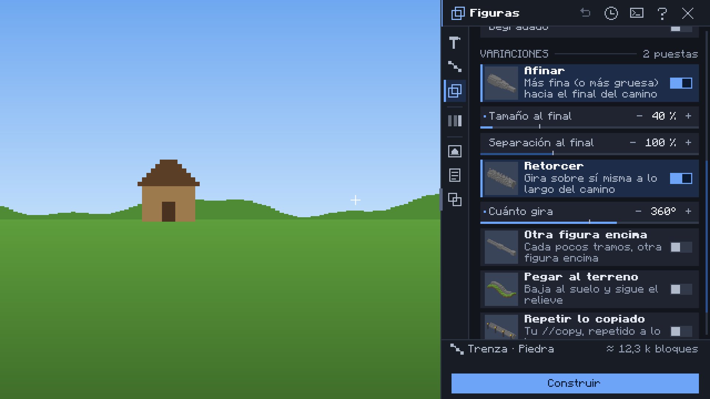

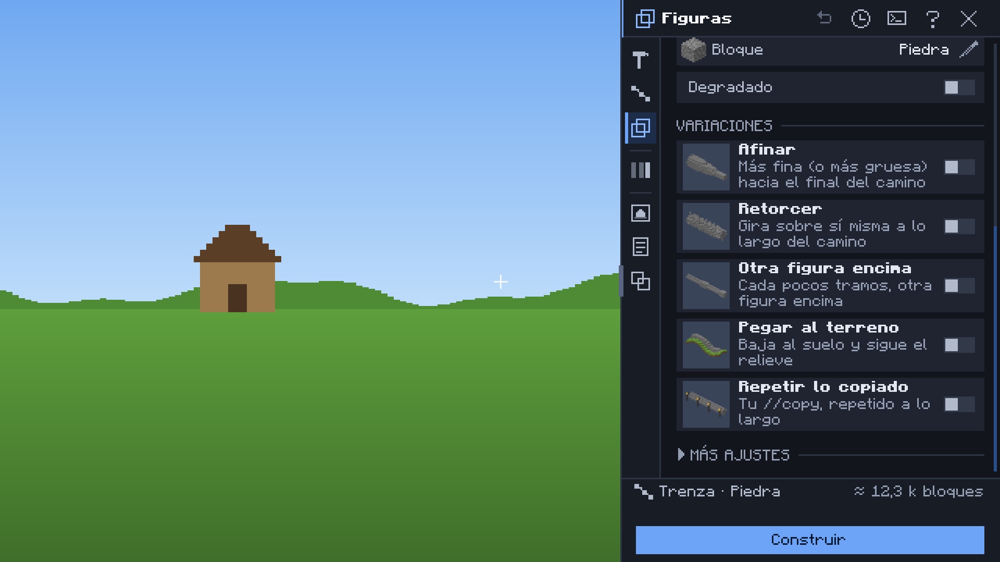

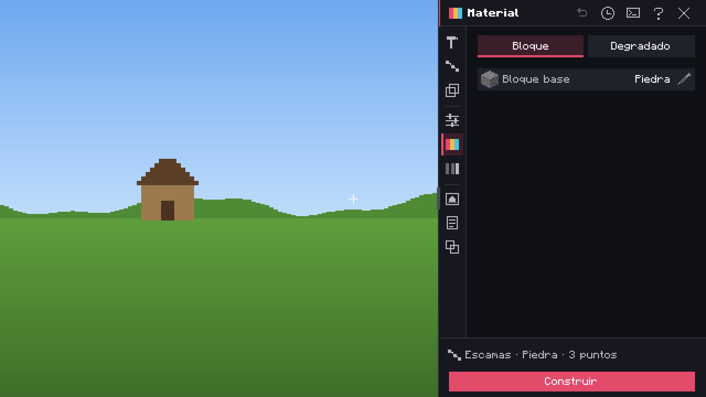

### Ajustar rápido

Todos los controles numéricos del Studio (figuras, variaciones, herramientas y color) son iguales: la etiqueta a la izquierda, el valor **con su unidad** (`18 bloques`, `50 %`, `45°`, `×1,5`, `Y 64`; en corto si no cabe, `18 bl.`) entre `−` y `+`, y debajo una barra con el rango, llena hasta el valor y con una marca en el de serie. Un punto del color del acento delante de la etiqueta dice que el valor ya no es el de serie.

- **Rueda** sobre los botones o el valor: sube o baja un paso. Sobre la etiqueta o fuera de los controles, la rueda desplaza el panel, para no cambiar valores sin querer. Con **Mayús**, `−` `+` y la rueda dan un paso grande (×5, o el propio del control: 45° el giro, 90° la torsión, 25 % las escalas).
- **Arrastrar** el número en horizontal lo cambia como un deslizador: recorrer el rango entero cuesta unos 240 píxeles, y nunca menos de 6 píxeles por paso. Con **Mayús**, fino: un paso cada 12 píxeles.
- **Un clic** sin mover abre el campo para escribirlo, con el rango al lado de la etiqueta; se puede escribir con la unidad o sin ella (`18`, `18 bloques`, `50 %`). `Intro` o pulsar fuera lo aplica (ajustado al rango), `Esc` lo cancela.
- **Clic derecho** lo devuelve al de serie: el de la figura para radio, espaciado, grosor, giro y altura; el de las variaciones para el resto; en las herramientas, el de la herramienta (o «auto»).
- **Qué hace, al pasar el ratón:** una frase de lo que le pasa a lo que construyes («Lo ancha que se abre la copa», «Cuántas ramas salen del tronco»), no el nombre del parámetro ni su bandera, y debajo sus extremos en palabras («de estrecha a ancha», «de pocas a muchas») y el rango con el de serie. Sobre el propio número sale la versión corta (qué hace y sus extremos), para no tapar la fila. Los gestos, iguales en todos, los dice la línea del pie.
- **Al arrastrar**, la etiqueta deja sitio a los extremos: a la izquierda hacia dónde va el valor bajo y a la derecha el alto («bajo … alto»), así se sabe hacia qué lado tirar sin mirar la ayuda.
- Lo mismo en las filas de ciclo y los interruptores: su ayuda dice qué hacen y el pie, sus gestos.
- Las filas de ciclo (‹ valor ›) cambian con un clic en ‹ o en el valor y con la rueda; en las herramientas, el clic derecho también las devuelve a la de serie.

### Presets y variantes

Debajo del nombre de la figura:

- **Compacto** (radio ×0,6, un paso menos de espaciado, altura ×0,7), **De serie**, **Amplio** (radio ×1,5, un paso más de espaciado, altura ×1,4) y **Robusto** (radio ×1,2 y un punto más de grosor). Parten siempre de las proporciones de serie de la figura y no tocan opciones, material ni modificadores.
- **Azar** (`R`): variante con semilla alrededor de las proporciones de serie (radio de ×0,6 a ×1,6, espaciado ±2, grosor ±1, giro ±45° y altura de ×0,7 a ×1,5). La semilla aparece en el pie (`Variante #4821`); la misma figura y semilla dan siempre la misma variante.
- Presets y variantes solo proponen valores dentro de los rangos del Studio y no cambian ningún generador.

### Deshacer ajustes

El Studio tiene su propio historial de ajustes, aparte del de WorldEdit:

- `Z` deshace y `Y` o `Mayús+Z` rehacen (también los botones de deshacer y rehacer de la barra). `Ctrl+Z` / `Ctrl+Y` siguen deshaciendo en el mundo.
- Guarda hasta 100 pasos. Los cambios seguidos del mismo control en menos de 0,8 s (arrastrar, la rueda o varios clics rápidos) cuentan como uno.
- Entran todos los cambios de la receta: figura, proporciones, opciones de tubo, modificadores, material, presets, variantes y cargar una receta o instancia. El nombre de la receta no entra. En Herramientas deshacen los ajustes de la herramienta elegida.
- Sobrevive a cerrar y abrir el Studio y se borra al salir del mundo.

### Historial del mundo

El botón del reloj de la barra abre la lista de los últimos cambios en el mundo (hasta 12), la más nueva arriba: qué fue (el nombre de la operación, como en la bossbar, o «Trazo», «Pegar», «Paleta», «Bioma»…) y cuántos bloques tocó. Lo deshecho sale atenuado.

- Un clic en una fila deshace (o rehace) hasta dejarla como la última hecha; **Deshacer** y **Rehacer** van paso a paso, igual que `Ctrl+Z` / `Ctrl+Y`.
- Es el historial de WorldEdit de tu sesión, así que también salen los `//set` y demás órdenes de WorldEdit (como «WorldEdit»). El servidor lo manda con el estado del Studio cada segundo mientras la lista está abierta.

### Paleta de órdenes

`Ctrl+K` (o el botón de la barra) abre un buscador encima de todo para ir a cualquier sitio sin recorrer etapas: **etapas**, **herramientas**, **presets** de cada herramienta, **figuras**, **planos** y **temas** de color. Busca sin tildes ni mayúsculas por nombre y por tipo (`tejado`, `azotado`, `planos`, `tema`); las flechas eligen, `Intro` abre y `Esc` cierra. Elegir un preset abre su herramienta con él aplicado; elegir un plano lo selecciona en Planos; elegir un tema lo pone.

### Vista previa

El ojo del pie elige qué hace el botón principal en las herramientas que admiten la vista previa universal; un clic pasa al siguiente modo y el clic derecho la apaga:

- **Vista previa en vivo** (la de serie): Construir enseña la vista previa (con el [fantasma del gizmo](#colocar-con-gizmo) si es un objeto: árbol, roca, texto, tejado…) y, **mientras se vea**, cada cambio de un ajuste la rehace sola con lo nuevo. El fantasma nuevo sale donde dejaste el anterior, con su giro y sus opciones: puedes moverlo con el ratón y seguir ajustando sin perder el sitio. Espera 0,35 s sin cambios, deja al menos 1 s entre dos envíos (más deprisa, el antispam de Minecraft acabaría echando a quien no es OP), no manda nada mientras el servidor calcula la anterior ni repite una orden igual, y solo vale en obras pequeñas: selecciones de hasta 64 000 bloques y, en Figuras, menos de 250 000 bloques en el holograma. Al arrastrar un número o escribir no se manda nada hasta soltar. No abre ninguna vista previa por su cuenta: solo rehace la que pediste; al colocarla o quitarla, se acaba hasta el próximo Construir.
- **Vista previa al construir:** Construir enseña la vista previa (en la orden, `-v` o `--preview`) y espera a **Confirmar** (`Intro`); cambiar un ajuste no la rehace.
- **Sin vista previa:** Construir cambia el mundo en el acto (lo que es un objeto sale igualmente como fantasma si **Colocar con gizmo** está en **Siempre**).

En **Figuras**, el holograma ya sigue cada cambio (también «Pegar al terreno» al suelo o al techo, que lo calcula el cliente); tras **Construir**, si la figura sale como fantasma, cambiar la figura, su tamaño, sus variaciones o su material rehace también el fantasma (con la vista previa en vivo encendida).

Al rehacerse el fantasma en vivo, el de antes sigue a la vista, quieto donde estaba, hasta que el nuevo llega y está armado; ya no parpadea un fotograma vacío entre los dos. Si el nuevo no llega en 3 s, el viejo se quita.

El modo se recuerda para todas las herramientas en `studio.json`. Quien tenía guardado «sin vista previa» de una versión anterior (era lo de serie y se guardaba igual que si se hubiera elegido) pasa una vez a en vivo; si se vuelve a apagar, se queda apagada. Sin vista previa: el sello (que va al pincel), Materiales, Bioma, Simetría y Capacidades.

### Antes de construir

- El pie muestra **≈ N bloques**, el recuento del último holograma (con `…` mientras se recalcula).
- A partir de **250 000 bloques** el recuento sale en amarillo y Construir pide una segunda pulsación en 5 s; si el recuento cambia entre medias, vuelve a pedirla. Por encima de **1 500 000** (el `maxBlocksPerOperation` de serie) sale en rojo: el servidor puede rechazarlo si no tienes `komaedit.limit.unrestricted` o si su configuración es más baja.
- `H` o el botón del holograma lo ocultan; se sigue calculando, así que el recuento sigue valiendo.

### Herramientas

La etapa **Herramientas** (`1`) lleva al Studio las herramientas que antes solo tenían orden. **Construir** manda exactamente la orden que se escribiría en el chat; el servidor la analiza, comprueba los permisos y la ejecuta como siempre: el Studio no repite ninguna lógica.

| Grupo | Herramientas | Orden que manda |
| --- | --- | --- |
| Naturaleza | Árbol, Roca | `tree`, `rock` (y `pincel tree`/`rock`, `tree save`) |
| Tejados | Tejado, Loft | `roof`, `loft` (y `-e` para estimar) |
| Terreno | Sello de relieve, Pintar terreno, Rampa, Río o cañón, Erosión, Pintar superficie | `pincel heightmap`, `pincel paint`, `terreno rampa`, `terreno rio\|arroyo\|canon\|barranco`, `terreno erosion`, `terreno pintar` |
| Utilidades | Texto, Materiales, Gravedad, Nieve, Drenar, Inundar, Bioma, Referencias | `text`, `analyze`, `gravity`, `snow`, `drain`, `waterlog`, `biome` (y `pincel biome`); Referencias abre `/keref`, del cliente (ver [Imagen de referencia](#imagen-de-referencia)) |
| Modos | Simetría, Capacidades | `symmetry on <modo>`, `off`, `center …`, `worldedit on\|off`; `capability <id> on\|off`, `capability option …` |

- **Elegir:** sin herramienta elegida, la etapa es una cuadrícula de iconos con su nombre entero (en dos líneas si hace falta), agrupada como en la tabla (con ★ Favoritas arriba si hay) y con un buscador (`Ctrl+F` o `/`) por nombre, orden, alias y descripción, sin tildes. Al elegir una, la cuadrícula se pliega en una fila con su icono y su nombre (pulsarla la vuelve a abrir), sus **recientes** para cambiar de un clic, la ★ y **copiar la orden** al portapapeles.
- **Miniaturas:** lo que se elige viendo sale como galería de miniaturas con el nombre debajo, dibujadas por el propio generador: las especies de árbol (con `TreeGrower`), los tipos de roca (`RockShaper`), los tipos de tejado sobre una casa de 9×7 (`RoofGenerator`) y los 80 sellos de relieve (con los colores de su categoría: nieve en las montañas, arena en las dunas, agua alrededor de las islas). Se pintan en segundo plano la primera vez y luego se reutilizan. Bajo cada una, su nombre entero: la galería pone tantas columnas como dejen caber cada nombre en dos líneas como mucho («Cuatro aguas», «Roble oscuro»). Con un panel alto (380 píxeles de contenido o más, como 1080p con GUI 2) se ven todas las opciones a la vez; si no, dos filas (una en compacto) y ‹ › para pasar de página, que empieza siempre por la elegida.
- **Ajustes esenciales** a la vista y el resto en **Más ajustes**, plegado, con cuántos hay o cuántos has cambiado («2 cambiados»). Solo salen los ajustes que usa la opción elegida (la altura de la cúpula no sale en un tejado a dos aguas). Los números **auto** no llevan bandera: vale el de la herramienta (la altura de la especie, el radio del tipo de roca…) y se ve en gris junto a «auto».
- **Presets** (una fila de pastillas: Joven, Viejo, Azotado, Pelado; Empinado, Con buhardillas…; el tooltip dice qué cambian). Cada preset deja la herramienta en un **estado completo y conocido**: lo que no define vuelve al de serie (el de la especie o el tipo), así que nada se queda con lo de un preset anterior («Pelado» y luego «Joven» vuelve a tener copa). Se conservan qué es (la especie, el tipo de roca o de tejado, el sello), los materiales, los textos (el del rótulo, la máscara, la paleta), la semilla y los interruptores de cómo se coloca que ningún preset toca (vista previa en cada clic, reemplazar, raíces). La pastilla del preset que hay puesto sale marcada. **Azar** (`R`) para una semilla nueva y, en árboles y rocas, los **presets guardados** del jugador (`#nombre`). En **Más ajustes**, las acciones: **Al pincel** (árbol, roca, bioma), **Estimar** (tejado, loft y terreno, con `-e`), **Guardar preset** y, en simetría, **Desactivar**, **Centro aquí**, **Entre bloques** y **Centro de la selección**.
- **Bloques:** cada bloque es una fila con su icono, su nombre traducido y un **cuentagotas** que pone el bloque que miras. Si no hay bloque elegido, la fila dice qué se usará («Como el tejado», «El de los muros», «De la familia del material»). Al pulsar la fila se abre la **biblioteca de bloques** (ver [Elegir bloques](#elegir-bloques)).
- **Sobre qué trabaja:** el pie dice si usa la selección (con su tamaño), los puntos de la trayectoria o **donde haces clic** (tras un clic, «Clic en 124, 64, -38»; ver [El ratón en el mundo](#el-ratón-en-el-mundo)). Si falta algo, Construir sale apagado y dice qué, y una franja encima de los ajustes lo explica con **Marcar puntos** cuando lo que falta son puntos.
- **Permisos:** al abrir la etapa (y cada segundo mientras se ve) el Studio pregunta al servidor qué nodos tiene el jugador. Una herramienta sin ningún permiso sale apagada con un candado y su ayuda dice qué nodo falta; dentro, un aviso rojo dice el nodo que pide la opción elegida (el cañón pide `terrain.canyon`, el río `terrain.river`) y Construir queda en «Sin permiso». Es solo para enseñarlo: al construir, el servidor vuelve a comprobarlo todo. Con un servidor que no contesta (sin esta versión de KomaEdit) no se apaga nada.
- **Validación antes de mandar:** texto vacío o con más de 16 líneas, espacios en máscaras o listas de bloques, caracteres que el chat no admite (`§` o de control: Minecraft echaría al jugador), nombres de sello, recorrido o bioma inválidos, más de 64 gotas en la erosión hidráulica o fuerza térmica de más de 2. Construir queda apagado y dice el motivo.
- **Sello de relieve:** la [biblioteca de sellos](#biblioteca-de-sellos) en una galería con buscador (busca en las 14 categorías a la vez por nombre o descripción; Intro elige el primero), la **categoría** a la vista (‹ Montañas › …, y **★ Favoritos** en cuanto marcas alguno) y una estrella en cada miniatura (también clic derecho) para guardarlo en favoritos, que se recuerdan en `studio.json`. Debajo, radio, **altura** (en automático, la natural del sello para ese radio) y **modo**; en **Más ajustes**, la **paleta** (de serie, la de la categoría), la **variación** (60 % de serie), **Bloquear semilla** y la semilla. **Azar** da otra semilla. Al pasar el ratón, el nombre y una frase salen debajo de la miniatura (sin tapar su fila), y el pie dice el sello, el modo y la semilla («Montaña · Sumar · semilla al azar», «semilla 4217 bloqueada») y qué hacen los clics. En modo compacto la galería enseña la categoría y sus páginas, sin el buscador. Un campo para un PNG propio de `config/komaedit/heightmaps/`. Construir deja el pincel en la mano, y lo que cambies después en la tarjeta le llega solo (ver [El pincel sigue al Studio](#el-pincel-sigue-al-studio)).
- **Pintar terreno:** dos galerías, la paleta con la muestra de su degradado y la huella con su miniatura, y debajo el degradado, el radio, la fuerza y la semilla (el candado, en Más ajustes; ver [Pincel de pintura](#pincel-de-pintura)). Cada número dice qué le pasa al terreno y sus extremos («de suave a de golpe», «de difuminado a cortado»). Las dos galerías van cortas (la de paletas en dos filas y la de huellas en una, con ‹ ›) para que todo eso quepa a la vista.
- **Texto:** campo de texto (`\n` parte líneas), fuente (las de serie y las del servidor, `config/komaedit/fonts/`) y tamaño a la vista; grosor, borde, orientación, alineación, espaciado, interlineado y losas y escaleras, en Más ajustes.
- **Materiales:** **Contar** lanza `analyze` y la lista llega a la herramienta: totales (bloques, tipos, objetos, huecos y cofres) y cada objeto con su cantidad y sus pilas, más **Copiar lista** (lo mismo que `[COPIAR]` del chat).
- **Bioma:** buscador con todos los biomas del registro del servidor (también de datapacks y mods), relleno vertical y radio del pincel.
- **Simetría:** enseña el estado del servidor (activa o apagada, modo y centro, avisando si el centro está en otra dimensión) y lo sigue si se cambia por el chat. Modo (X, Z, XZ, Y, XY, ZY, XZY y Radial), brazos y espejo arriba ↔ abajo del radial, e interruptor **Reflejar WorldEdit y KomaEdit**. Construir activa con ese modo (o lo aplica si ya estaba activa).
- **Capacidades:** un interruptor por capacidad (como el menú de la `Z`), apagado con candado y «sin permiso» si falta el nodo, y un aviso si no estás en creativo. Distancia en el aire, alcance, bloques por capa y velocidad de vuelo se mandan al dejar de tocarlos (0,6 s), para no llenar el chat; Reemplazar familia y lo que sigue Extruir, al momento.

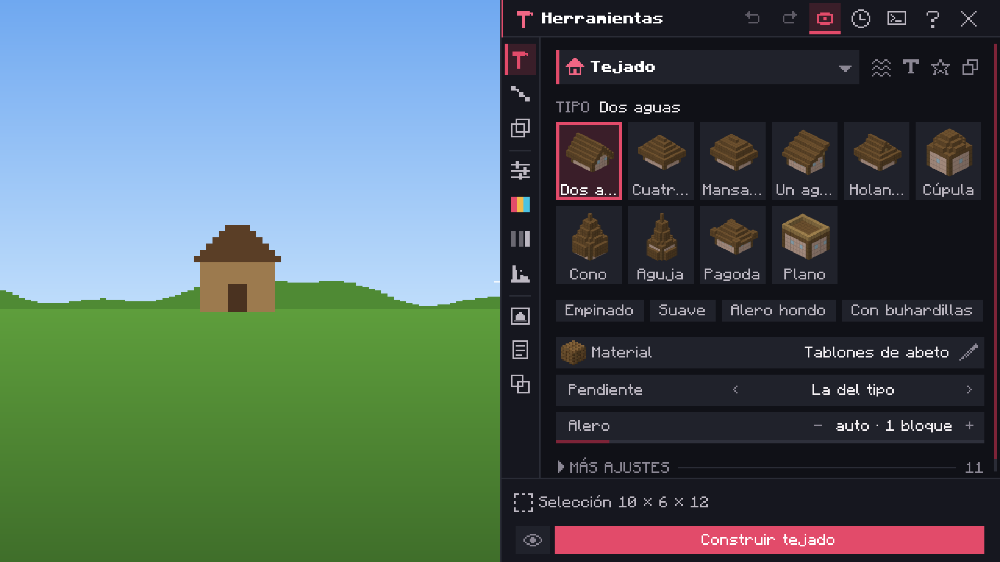


### El ratón en el mundo

Con el Studio abierto el ratón está suelto, así que lo que va «donde miras» pasa a ir **donde haces clic**: el rayo sale del cursor, no del centro de la pantalla. Lo que hace el botón izquierdo en el mundo depende de la etapa, y el pie lo dice siempre que el ratón está encima del mundo (con la leyenda entera si lo dejas quieto):

| Dónde estás | Clic en el mundo | Arrastrar |
| --- | --- | --- |
| **Trayectoria** y **Figuras** | Un punto nuevo al final; sobre un punto, lo elige; sobre un tramo, mete uno en medio | Lleva por el terreno el punto agarrado (también el que se acaba de poner o meter) |
| Herramienta que va **donde haces clic** (árbol, roca, texto) | La construye ahí | — |
| Herramienta sobre la **selección** (tejado, nieve, erosión…) y **Color** | Empieza una caja de un bloque; doble clic: selección mágica | Dibuja la caja; sobre una cara de la selección, tira de ella |
| **Planos**, con un plano elegido | Lo coloca ahí (con su fantasma) | — |
| Con un **pincel** de KomaEdit en la mano (sello, árbol o roca «al pincel», estampar planos…) | Pinta ahí | Sigue pintando mientras mantienes el botón |
| Con un **fantasma** a la vista (fuera de Trayectoria) | Lo lleva ahí | Lo mueve por el terreno |
| **Alt+clic**, en cualquier etapa | El bloque pulsado pasa a ser el material | — |
| **Clic derecho** | — | Gira la cámara |

Con puntos de trayectoria, las herramientas que los usan (árbol, roca, río, rampa…) hacen que el clic ponga y mueva puntos en vez de construir o seleccionar. Las de mano (sello de relieve) sin el pincel en la mano lo dicen: «“Al pincel” te da el pincel; luego, clic aquí para pintar».

- **Construir donde haces clic:** árbol, roca y texto (sin puntos) se construyen en el bloque pulsado, con la vista previa del ojo (de serie, en vivo y como fantasma). El pie dice «Clic en x, y, z» y **Construir** vuelve a usar ese mismo sitio hasta el próximo clic. Sin clic, Construir usa el centro de la pantalla, como antes.
- **Planos con clic:** en la etapa Planos, con un plano elegido, un clic lo coloca en ese bloque (con su fantasma, para moverlo, girarlo y confirmarlo), igual que los árboles. **Colocar plano** del pie usa también el último clic; sin clic, tu posición, como antes. Vale para cualquier `/komaedit place` mandado desde el Studio tras un clic.
- **Texto según la cara pulsada:** con la orientación **Según dónde apuntes** (la de serie), un clic en el Studio decide por la cara: en una pared, el texto queda pegado a ella; en un suelo, tumbado sobre él; bajo un techo, colgado de él. Antes salía según la inclinación de la cámara, que con el ratón suelto no dice a dónde apuntas. Fuera del Studio sigue siendo la mirada. **Tumbado** con un clic en un techo cuelga de él.
- **Seleccionar arrastrando** (como la Box Select de Axiom): se pulsa en un bloque y se arrastra hasta otro; la caja va de uno a otro y se ve al momento con sus medidas (la de WorldEdit se actualiza a la vez, como mucho cada 60 ms mientras se arrastra). Con una selección hecha, la cara bajo el cursor se resalta y, al pulsarla, se tira de ella: la caja crece o encoge por ese lado de bloque en bloque, siguiendo el cursor por su eje, sin darse la vuelta. Una cara tapada por el terreno no se agarra: el clic empieza otra caja. **Doble clic** en un bloque (sin arrastrar) selecciona lo pegado del mismo bloque (la selección mágica, hasta 20 000 bloques a 96 de distancia).
- **Puntos que se arrastran:** en Trayectoria y en Figuras se pulsa un punto y se arrastra por el terreno; pulsar en medio de un tramo mete un punto ahí y se arrastra igual; pulsar en el terreno añade uno al final, que también se puede arrastrar antes de soltar. Las flechas X, Y, Z del punto elegido siguen sirviendo para moverlo en un solo eje (para subirlo o bajarlo). El punto se ve en su sitio desde el primer momento, sin esperar al servidor.
- **Pintar con el pincel:** con un pincel de KomaEdit en la mano, un clic pinta en el bloque pulsado y, manteniendo el botón, cada 200 ms otra pasada si el cursor ya está en otro bloque (lo mismo que mantener el clic derecho con el pincel fuera del Studio). Con Mayús es la pasada de Mayús del pincel. El círculo del radio del pincel se dibuja bajo el cursor.
- **Cuentagotas con Alt:** Alt+clic en un bloque del mundo lo pone de material: en Figuras, el bloque de la figura; en Herramientas, el primer bloque de la herramienta (el material del tejado, el tronco del árbol, las letras del texto); en Color, el primero del degradado (con Mayús, el último). Se deshace con `Z` como cualquier ajuste.
- Fuera del Studio no cambia nada: todo va donde miras y el fantasma se mueve con el punto de mira.
- El cliente le dice al servidor en qué bloque se hizo clic justo antes de la orden o de la pasada del pincel (`studio_aim`); el servidor solo lo acepta en tu dimensión y al alcance de la mirada (160 bloques los árboles, las rocas y los planos; 192 los pinceles). Al cerrar el Studio se olvida.

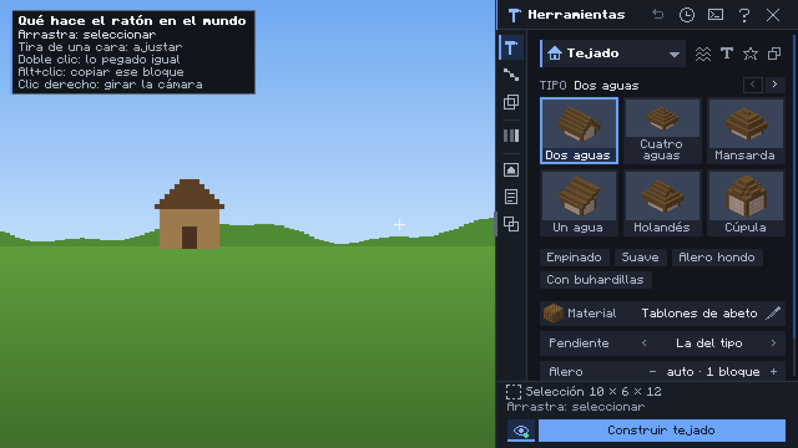

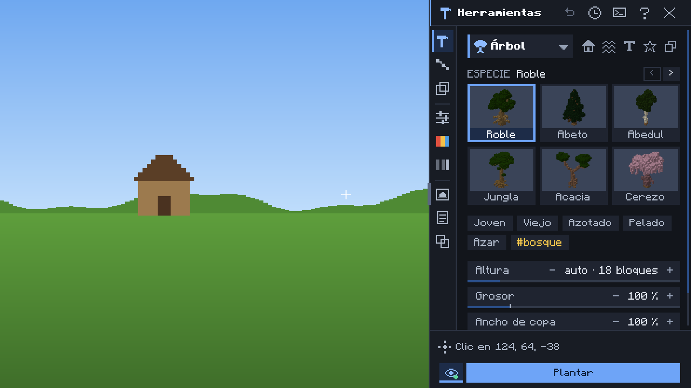

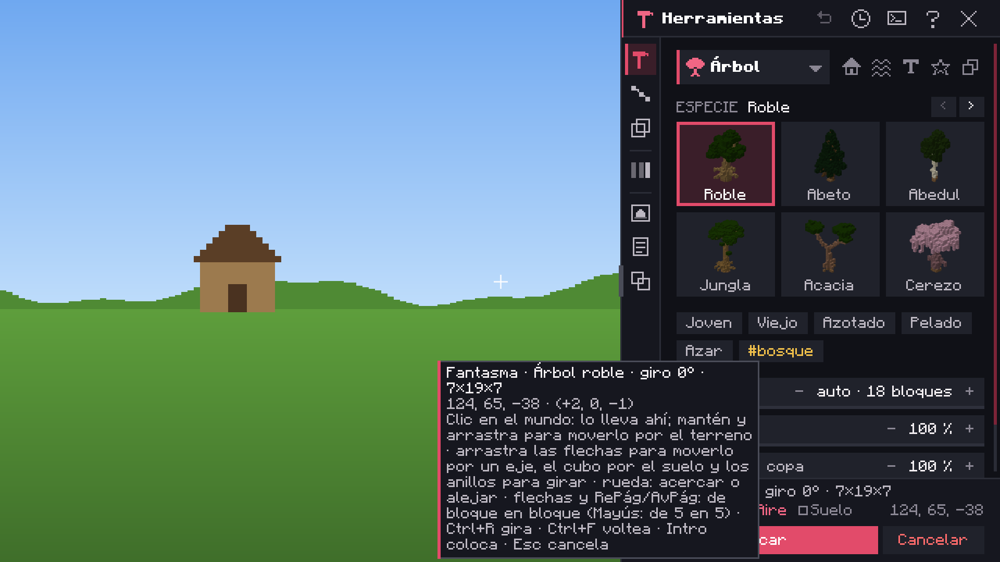

### El pincel sigue al Studio

**Al pincel** (árbol, roca, bioma), el **Sello de relieve** y **Pintar terreno** dejan un pincel en la mano. Desde entonces, cualquier cambio en esa tarjeta del Studio llega a ese pincel al momento (0,3 s después de dejar de tocarlo y, entre dos cambios seguidos, al menos 1 s, por el antispam de Minecraft), aunque luego mires otra herramienta: quitar **Vista previa en cada clic** la quita del pincel, cambiar el radio o la especie cambia lo que pinta el siguiente clic.

- El Studio manda `/komaedit pincel actualizar <tipo> <ajustes>`, que solo cambia el pincel que ya tienes en la mano y es de ese tipo: nunca marca ni entrega otro objeto, y lo dice en la barra de acción, sin llenar el chat.
- Si cambias de objeto en la mano, no se manda nada; al volver a coger el pincel le llega lo último.
- Con algo mal escrito en la tarjeta (un bloque con espacios), el pincel se queda como estaba.
- **Estampar planos** sigue igual a su etapa: tras **Estampar**, elegir otro plano o cambiar el **Radio** en Planos se lo pasa al pincel de la mano (o, si se estampó una etiqueta, la etiqueta que haya en el buscador).
- Con el Studio abierto, el pincel se usa ahí mismo: clic o mantener el botón en el mundo (ver [El ratón en el mundo](#el-ratón-en-el-mundo)).

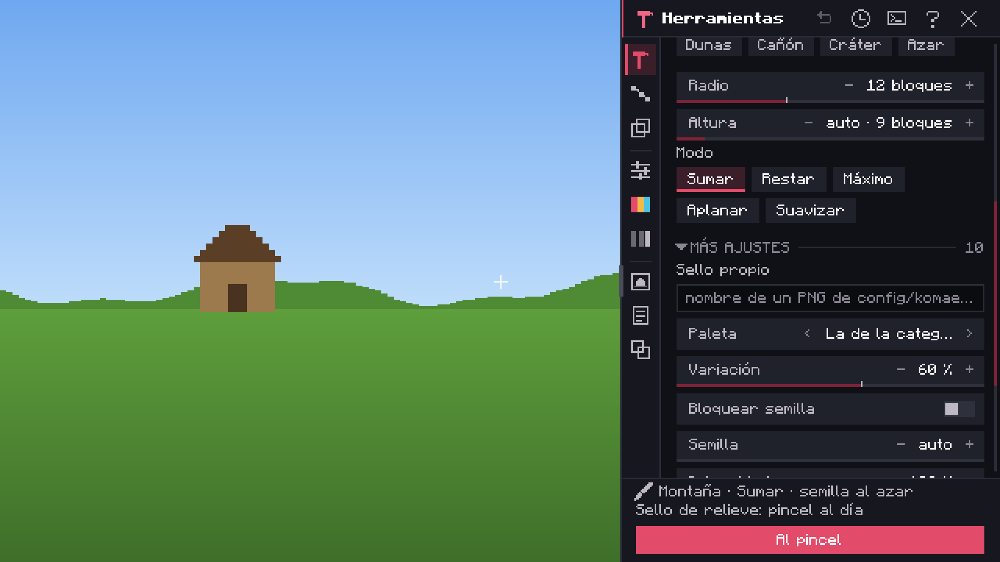

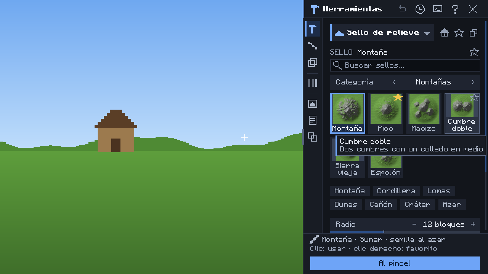

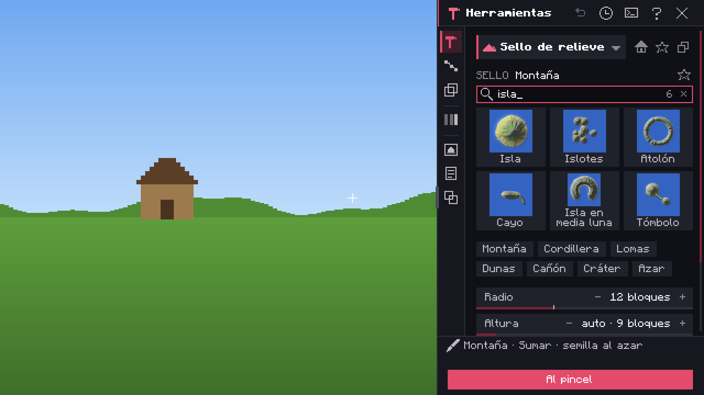

### Elegir bloques

La biblioteca de bloques se abre al pulsar cualquier fila de bloque (material de la figura, degradado de Color, bloques de las herramientas) y se pone encima del panel:

- **Buscar:** basta con escribir; busca por el nombre traducido y por el id (`roble`, `oak_planks`, `minecraft:stone`). `Intro` elige el primero y `Esc` cierra.
- **Usar el que miras** (cuentagotas), la **barra** (los bloques de tu barra rápida) y los **recientes** (los últimos elegidos, guardados en `studio.json`), encima de la cuadrícula.
- Cada bloque es su icono del juego; el nombre sale al pasar el ratón.
- Los nombres son los traducidos del juego. Un bloque sin traducción (pasa con algunos mods) sale con un nombre legible sacado de su id (`examplemod:mossy_slate_tiles` → «Mossy Slate Tiles»), nunca con el id ni con la clave de traducción.
- El **cuentagotas** de cada fila pone directamente el bloque que miras, sin abrir la biblioteca.

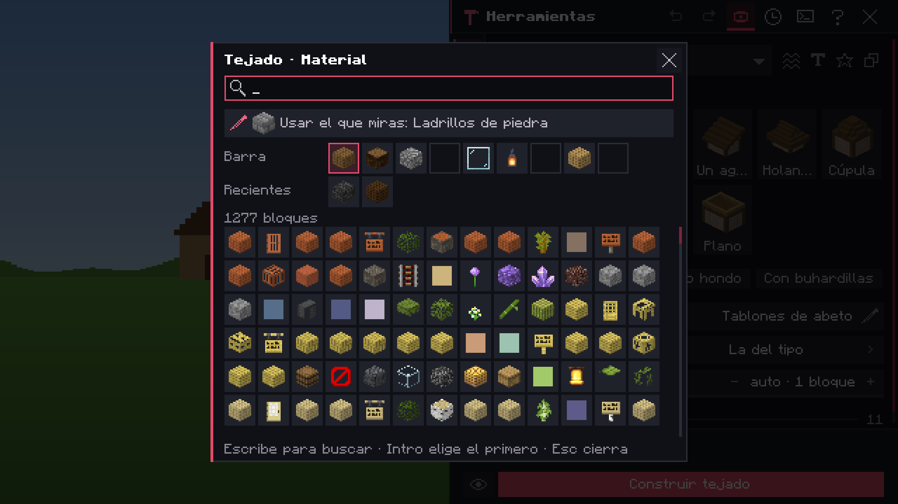

### Lo que se recuerda

En `config/komaedit/studio.json`, por jugador y en su equipo: la etapa y la herramienta en las que lo dejaste, **los ajustes de cada herramienta** (se guardan 2 s después del último cambio y al cerrar), el desplazamiento de cada etapa y de cada herramienta, las secciones abiertas, el modo de vista previa, las favoritas y las recientes (figuras, herramientas y bloques), la parte de la pantalla del panel y si ya salió la [bienvenida guiada](#bienvenida-guiada). Un archivo de una versión anterior se lee igual; uno roto se ignora.

### Progreso en el pie

En cualquier etapa, mientras algo tuyo está en marcha (leer la selección, calcular, preparar la vista previa, colocar…), el pie del Studio enseña lo mismo que la bossbar, sin esperar el segundo que tarda ella en salir: la fase con su porcentaje, ritmo y tiempo restante y una barra fina.

- **Vista previa esperando:** «N cambios en vista previa · caduca en …» y los botones **Confirmar** (`/komaedit confirm`, también `Intro`) y **Descartar** (`/komaedit cancel`).
- **En marcha:** el botón principal sigue a la izquierda y a su lado **Cancelar** (`/komaedit cancel`, también `Ctrl+Retroceso`).
- Si la línea no cabe, se quitan primero el ritmo y el tiempo restante; la fase y el porcentaje no se cortan nunca. El texto entero sale en el tooltip.
- El servidor lo cuenta cada 5 ticks con un paquete propio solo a los clientes con KomaEdit; si deja de llegar 3 s, el pie vuelve a lo normal.

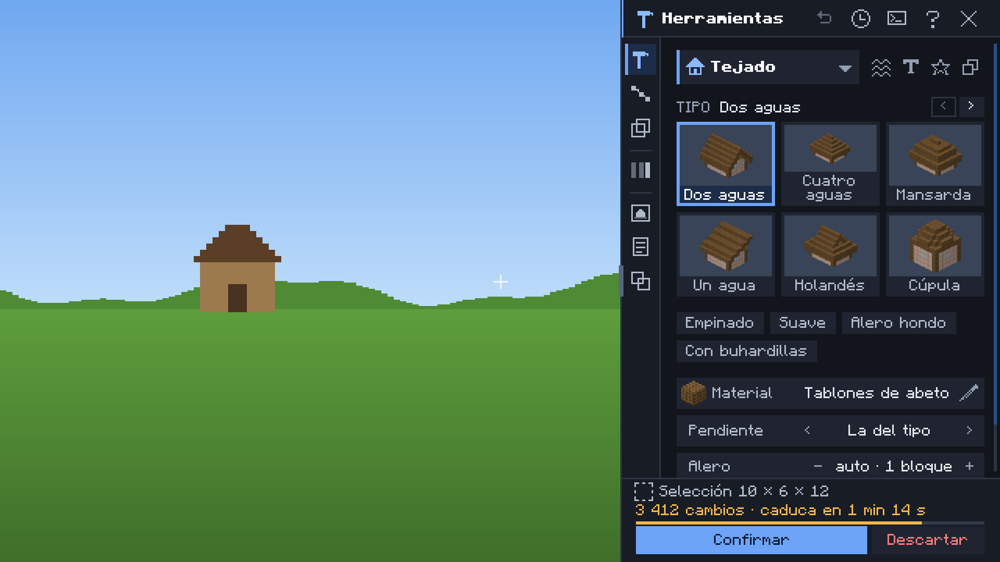

### Temas de color

El Studio tiene cuatro temas de color. El de serie es **Pizarra**; los demás se eligen en el propio Studio o en los ajustes del cliente, y cada jugador recuerda el suyo.

| Tema | Cómo es | Éxito |
| --- | --- | --- |
| **Pizarra** (de serie) | Grises azulados y acento azul lapislázuli | Verde menta |
| **Prismarina** | Azul de mar profundo y acento turquesa, como los templos del océano | Verde |
| **Bosque** | Verdes de musgo y abeto con acento verde salvia | Turquesa |
| **Clásico** | Claro: la piedra gris y el texto oscuro del inventario, con el morado de los encantamientos como acento | Verde oscuro |

- **Cambiarlo:** en la chuleta (`F1` o `?`), la fila **Tema** de abajo: un clic en un tema lo pone al momento y la chuleta sigue abierta para probar otro. También desde la paleta de órdenes (`Ctrl+K`, «tema») y en `/kegui ajustes` → **Tema del Studio**. Se guarda en `config/komaedit/studio.json` (`"theme": "forest"`); un nombre que no existe vuelve a Pizarra. Cambiar de tema no cuesta nada: no recarga texturas ni rehace miniaturas.
- **Por qué Pizarra de serie:** el azul no se confunde con ningún estado (rojo de peligro, ámbar de aviso, verde de éxito), queda lejos de los ocres, la madera y la hierba del mundo que hay al lado y es el acento que se espera en un editor. Prismarina y Bosque pegan más con el mundo, pero se acercan al verde del éxito (por eso Bosque lo pasa a turquesa), y Clásico es claro: va a gusto de cada uno, pero deslumbra de noche o en una cueva.
- **Reglas de todos los temas** (las comprueban las pruebas): todo el texto llega al contraste WCAG AA (4,5:1) con el fondo que tiene debajo, medido en el Studio pintado de verdad con cada tema, a 1080p y a 854×480; las marcas de selección y el borde del campo en el que se escribe, a 3:1. El **rojo** es solo peligro (borrar, cancelar, errores) y nunca acento; el **ámbar**, aviso; el **verde** o el **turquesa**, éxito. Ninguno de los tres se parece al acento.
- **Los estados se ven por la forma, no solo por el color:** lo elegido lleva relleno tintado y una marca de acento (barra o marco doble); lo que está bajo el ratón, un relleno más claro y, en botones, pastillas y miniaturas, un borde; un botón desactivado va hueco, solo con su contorno, y su clic sigue diciendo qué falta. Un interruptor encendido (también el de cada **variación** de Figuras) tiene el carril del acento y el pulsador a la derecha; apagado, el carril gris y el pulsador a la izquierda, y la tarjeta de una variación encendida va tintada y con su barra de acento.
- **Miniaturas:** las de especies, tejados, rocas, sellos, planos, variaciones y las huellas de **Pintar terreno** van sobre un fondo propio, más claro y neutro que la tarjeta, para que el abeto o el roble oscuro no se pierdan en un fondo oscuro ni las hojas en uno de su mismo verde. La huella del pincel de pintura es una mancha de hierba que se transparenta donde no pinta, así que se lee igual en los temas oscuros y en el claro.
- Los temas oscuros llevan el acento claro con el texto oscuro encima (el botón **Construir**, el interruptor encendido): un acento oscuro con texto blanco no se vería como marca de selección sobre las tarjetas.
- **Límites:** el tema cambia el Studio, su pie, sus avisos, sus tooltips y su leyenda del mundo. Lo que se dibuja en el mundo (fantasma, gizmo con sus ejes rojo, verde y azul, holograma, vista previa, la caja de selección y sus caras al cogerlas con el ratón, guías de simetría), la barra de acción y los mensajes del chat no cambian, a propósito: su fondo es el mundo y un acento turquesa o salvia se perdería en el agua o la hierba. Esos colores del mundo también son fichas, fijas, en `StudioTheme` (`WORLD_…`); el ámbar de las caras de la selección es el de la caja de la vista previa. No hay temas propios desde un archivo: para añadir uno se escribe en `StudioPalette`, con un color para cada ficha de `StudioTheme`.

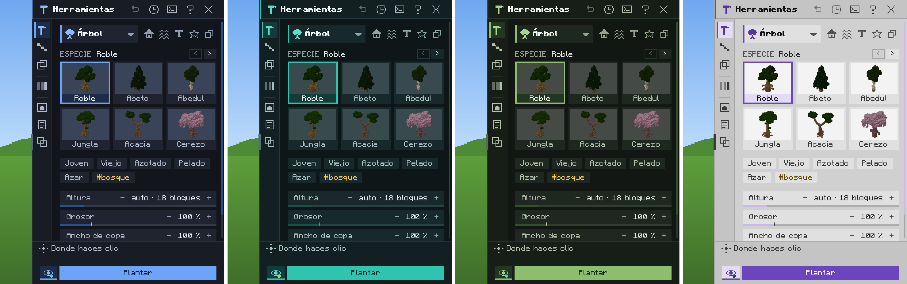

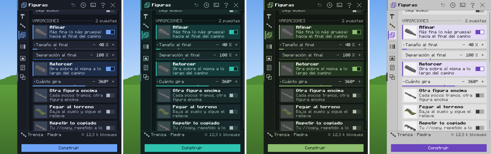

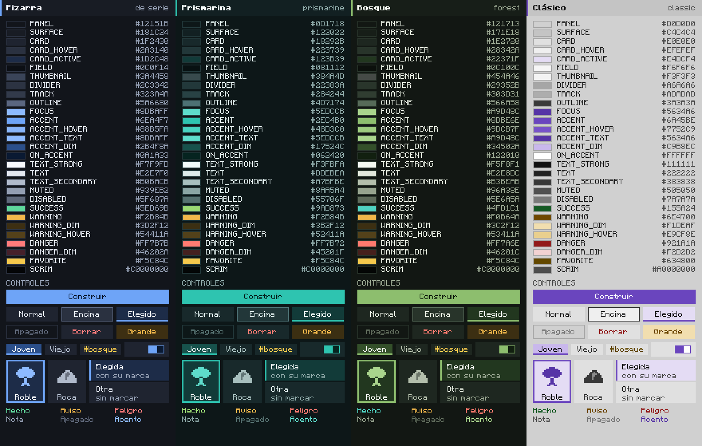

Hay más comparativas de los cuatro temas en `docs/renders/studio/temas/`: [Herramientas](renders/studio/temas/comparativa_herramientas.png), [Sello de relieve](renders/studio/temas/comparativa_sello.png) y [Pintar terreno](renders/studio/temas/comparativa_pintar.png). Las maquetas de Herramientas, Árbol, Tejado, Planos, Variaciones, Sello y Pintar terreno con cada tema, a 1080p con GUI 3 y a 854×480 con GUI 2, están en `docs/renders/studio/temas/<tema>/`.

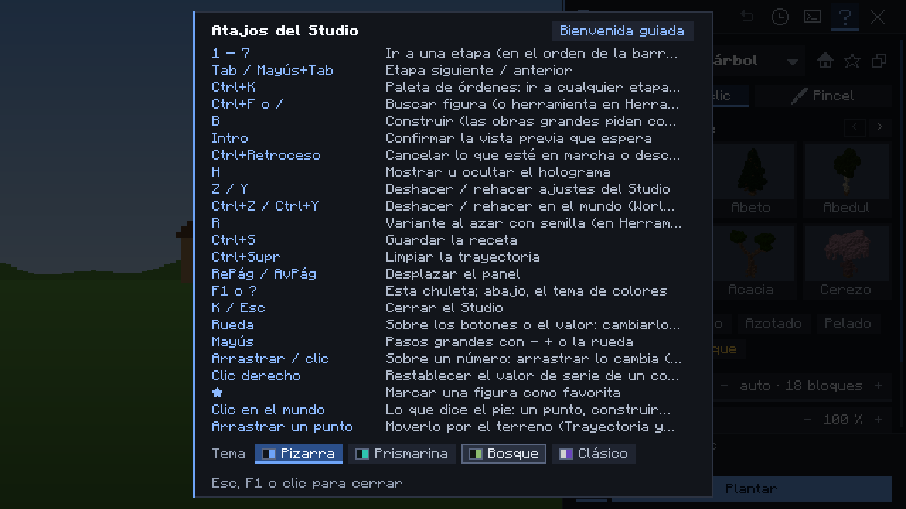

### Atajos de teclado

`F1` o `?` abren la chuleta dentro del Studio; abajo tiene el selector de [tema de color](#temas-de-color) y, arriba a la derecha, **Bienvenida guiada**, que vuelve a lanzar la [bienvenida](#bienvenida-guiada). Con un campo de texto abierto (nombre, fórmula, buscador, número o biblioteca de bloques) las letras se escriben y ningún atajo se dispara, y el personaje no se mueve con `W`, `A`, `S`, `D`.

| Tecla | Acción |
| --- | --- |
| `1` – `7` | Ir a una etapa, en el orden de la columna (`1` Herramientas … `7` Instancias) |
| `Tab` / `Mayús+Tab` | Etapa siguiente / anterior |
| `Ctrl+K` | Paleta de órdenes: etapas, herramientas, presets, figuras, planos y temas |
| `Ctrl+F` o `/` | Buscar figura (en Herramientas, herramienta; en Planos, plano) |
| `B` | Botón principal de la etapa: Construir (las obras grandes piden confirmar), Colocar plano… |
| `Intro` | Confirmar la vista previa que espera |
| `Ctrl+Retroceso` | Cancelar lo que esté en marcha o descartar la vista previa |
| `H` | Mostrar u ocultar el holograma |
| `Z` / `Y` (`Mayús+Z`) | Deshacer / rehacer ajustes del Studio (en Herramientas, los de la herramienta) |
| `Ctrl+Z` / `Ctrl+Y` (`Ctrl+Mayús+Z`) | Deshacer / rehacer en el mundo (WorldEdit) |
| `R` | Variante al azar con semilla (en Herramientas, semilla nueva) |
| `Ctrl+S` | Guardar la receta |
| `Ctrl+Supr` | Limpiar la trayectoria |
| `RePág` / `AvPág` | Desplazar el panel |
| `F1` / `?` | Chuleta de atajos y tema de colores |
| `K` / `Esc` | Cerrar el Studio (`Esc` cierra antes la paleta, la biblioteca de bloques, la chuleta o el campo abierto) |

La chuleta (`F1`) lista también los gestos del ratón en el mundo: clic, arrastrar un punto o un tramo, arrastrar una selección, tirar de una cara, doble clic, mantener el clic con un pincel, Alt+clic y el clic derecho.

### Pantallas pequeñas

Con menos de 300 píxeles de alto escalado (854×480 con GUI 2, 1080p con GUI 4) el Studio entra en **modo compacto**: sin descripciones, barra y pie más bajos, márgenes más pequeños, las galerías en una fila con páginas, las opciones de botones como un ciclo ‹ valor ›, los presets dentro de **Más ajustes** y una sola franja de aviso. Así, en cada herramienta de uso diario (árbol, roca, tejado, loft, sello, rampa, río, erosión, pintar, texto, gravedad, nieve, drenar, inundar y simetría) elegir, ajustar y construir se ve sin desplazar.

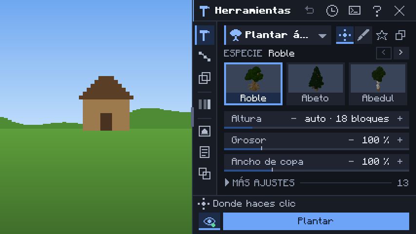

- Las etapas encogen su alto (hasta 12 píxeles, el de su icono) y, si hace falta, el hueco entre ellas (a 1 píxel) para que las siete quepan sin desplazarse con cualquier escala de GUI.
- Con menos de 600 píxeles de ancho escalado el panel se queda en 230 píxeles (el mínimo), para dejar al mundo al menos la mitad de la pantalla. Ahí el chat vanilla (320 píxeles) puede quedar en parte bajo el panel.
- Los textos que no caben se recortan con «…»; el texto completo sale en el tooltip.
- Con menos de 330 píxeles de alto la chuleta se muestra en dos columnas.
- Lo que queda desplazado bajo la barra o el pie del panel no responde a clics.
- El reparto lo calcula `StudioLayout` sin Minecraft y sus pruebas lo comprueban a 1080p, 1440p, 4K, 720p, 1366×768 y 854×480 con todas las escalas de GUI: nada se sale del panel, nada se solapa, las siete etapas y sus grupos caben, la barra de progreso y los dos botones del pie caben, el panel no pisa el chat cuando hay sitio y de serie no pasa del 40 % de una pantalla grande. `GalleryNamesTest` comprueba que ningún nombre de galería, herramienta o figura se corta a 1080p con GUI 2, 3 y 4, 1440p con GUI 3 y 854×480 con GUI 2, en los dos idiomas.

### Cómo está hecho

Todo el Studio (barra, etapas, contenido, pie, paleta, historial y biblioteca de bloques) es código común, sin Minecraft: `StudioView` guarda el estado y atiende el ratón y el teclado, `StudioLayout` reparte la pantalla y `StudioUi` dibuja sobre un `StudioCanvas`. En el juego, el lienzo es el `DrawContext` (`DrawContextCanvas`); en las pruebas, una imagen con la fuente de Minecraft y los iconos de los objetos del propio juego (`ImageCanvas`). Por eso las maquetas son el Studio de verdad y no un dibujo aparte:

- `StudioMockupsTest` pinta las maquetas PNG con `KOMAEDIT_STUDIO_MOCKUPS=<carpeta>`. Las revisadas están en `docs/renders/studio/` (1080p con GUI 3 y 4 y 854×480 con GUI 2, en español e inglés).
- `StudioDriver` maneja el Studio como un jugador (pulsar por texto, arrastrar, rueda, escribir, teclas) y lo usan `ToolsPanelTest`, `StudioViewTest`, `CompactModeTest`, `NumberControlTest`, `CommandPaletteTest`, `FigureClarityTest` y `TaskClicksTest`, que cuenta los clics de las tareas típicas.
- Las variaciones son `FigureVariation` (cuándo está puesta cada una, con qué se pone, qué deja al quitarla y dónde sirve) y sus dibujos, `VariationThumbnails`; «Pegar al terreno» es `SurfaceConform`, sin Minecraft, con un `Terrain` que dan el servidor, el cliente o las pruebas.
- Lo que explica cada control es `ControlHelp` (qué hace y sus extremos, de `gui.komaedit.tools.<herramienta>.ends.<ajuste>` o `gui.komaedit.ends.<control>`); `ControlHelpTest` exige que cada ajuste de herramienta diga lo que hace sin repetir su etiqueta, que los números lleven sus extremos (salvo semilla, rumbo y altura absoluta) y que ninguna herramienta enseñe más de cuatro ajustes antes de Más ajustes.
- La [bienvenida guiada](#bienvenida-guiada) es `WelcomeTour` (la máquina de estados, sin Minecraft ni dibujo: pasos, golpes, cuándo avanza, permisos y supervivencia), `WelcomeGuide` (la engancha a `StudioView`: le cuenta lo que se ve, prepara cada golpe y sostiene la vista previa) y `WelcomeBubble` (la burbuja, la tarjeta y el borde). Señala con **anclas con nombre** de `StudioUi` (`tool:tree`, `stamp:montana`, `preset:random`, `footer:build`, `ghost:place`, `top:history`, `history:undo`…), registradas enteras aunque el recorte las tape, para poder desplazar hasta ellas. `WelcomeTourTest` prueba la máquina (avanzar con la acción de verdad, saltar, sin permiso, en supervivencia y relanzar), `StudioWelcomeTest` la hace entera pulsando los controles del Studio (y comprueba que nada se manda sin vista previa ni sin Aplicar, que se guarda que ya se vio y que al cerrar vuelve lo de antes) y `StudioWelcomeMockupsTest` pinta sus maquetas; `StudioThemeContrastTest` mide sus textos en los cuatro temas.
- El ratón en el mundo son modelos sin Minecraft que usa la pantalla: `StudioView.worldAction` (qué hace un clic en cada etapa), `BoxSelect` (la caja, sus caras y el doble clic), `PathDrag` (agarrar, meter y añadir puntos) y `BrushStroke` (el ritmo del pincel). El relevo de mallas del fantasma en vivo es `MeshHandover`.

## Trayectorias y hologramas

Las trayectorias se crean con puntos colocados mediante `P` o desde Procedural Studio. Los nodos pueden moverse con el gizmo XYZ y la geometría se recalcula sin modificar el mundo.

- El raycast alcanza hasta 4096 bloques cargados.
- Cada punto lleva su número encima (el primero en verde, el último en naranja); ver [Trayectorias](#trayectorias).
- El holograma representa las posiciones exactas de la futura construcción.
- La previsualización permanece visible al cerrar la interfaz.
- El cálculo se ejecuta fuera del hilo de renderizado, admite cancelación y conserva temporalmente el último resultado válido.

### Captura y estado

Requiere el permiso `komaedit.path`. Todos los subcomandos aceptan también el alias `ruta` (`/komaedit ruta …`, `/ke ruta …`).

```text
/komaedit path mode toggle            captura con clic derecho (como la tecla P)
/komaedit path add                    punto en la cara del bloque que miras
/komaedit path here                   punto en tu posición
/komaedit path point 120 64 -40       punto en coordenadas exactas
/komaedit path status                 resumen con botones: puntos, deshacer, invertir, cerrar, guardar
/komaedit path points                 lista los puntos con [+] insertar, [−] quitar, [aquí] y [editar]
```

`status` indica el número de puntos, si el lazo está cerrado, la longitud en bloques y los pasos de deshacer y rehacer disponibles. Con menos de dos puntos, los comandos de construcción usan la selección de WorldEdit.

### Editar puntos

Los puntos se numeran desde 1, como en el HUD. El autocompletado de `<n>` muestra las coordenadas de cada punto.

| Comando | Efecto |
|---|---|
| `path insert <n>` | Inserta un punto a mitad entre el `n` y el siguiente. Tras el último punto, en un lazo cerrado va entre el último y el primero; en uno abierto prolonga medio tramo. Falla si los dos puntos están pegados. |
| `path insert <n> here` | Inserta tu posición después del punto `n`. |
| `path remove <n>` | Quita el punto `n`. |
| `path set <n> here` · `path set <n> <x> <y> <z>` | Mueve el punto `n`. |
| `path shift <dx> <dy> <dz>` · `path shift here` | Mueve todo el recorrido; `here` lo lleva para que el primer punto quede en tu posición. |
| `path reverse` | Invierte el sentido (importa en figuras con dirección, extremos o progresión de radio). |
| `path close [on/off]` · `path open` | Cierra o abre el lazo; sin argumento lo alterna. |
| `path mirror <x/y/z>` | Refleja el recorrido dentro de su propia caja. |
| `path mirror <x/y/z> append` | Añade al final el reflejo apoyado en el último punto: media curva pasa a ser una curva simétrica completa. |
| `path rotate <90/180/270>` | Gira sobre el eje vertical alrededor del centro de su caja. |
| `path snap <paso> [all]` | Ajusta X y Z al múltiplo de `paso` más cercano (`all` también la altura). |
| `path smooth [fuerza 0.05–1] [pasadas 1–8]` | Acerca cada punto a la media de sus vecinos sin cambiar cuántos hay; los extremos de un recorrido abierto no se mueven. Por defecto `0.5` y una pasada. |
| `path simplify [tolerancia]` | Quita los puntos que se separan menos de `tolerancia` bloques (1 por defecto) de la recta entre sus vecinos (Ramer–Douglas–Peucker). |
| `path subdivide` | Añade un punto a mitad de cada tramo, si caben. |
| `path pop` | Quita el último punto (lo que hacía antes `path undo`). |
| `path clear` | Vacía la trayectoria; se puede deshacer. |

En el editor en vivo (`K`, herramienta de trayectoria), **Supr** quita el nodo señalado e **Insert** añade uno a mitad entre ese nodo y el siguiente. Con el ratón, en Trayectoria o en Figuras: arrastrar un nodo lo lleva por el terreno y arrastrar un tramo mete uno en medio (ver [El ratón en el mundo](#el-ratón-en-el-mundo)).

Ejemplos:

```text
/komaedit path insert 3
/komaedit path shift 0 5 0
/komaedit path mirror x append
/komaedit path snap 2
/komaedit path smooth 0.7 3
```

### Deshacer y rehacer

`/komaedit path undo` y `/komaedit path redo` deshacen y rehacen cualquier cambio de puntos: añadir, mover con el gizmo, borrar, insertar, generar, cargar o vaciar. Arrastrar el mismo nodo de forma seguida cuenta como un solo paso. Se guardan los últimos 64 pasos por jugador, en memoria; se pierden al desconectarse. El historial de bloques del mundo sigue siendo el de WorldEdit (`//undo`, `//redo`, Ctrl+Z en el editor).

### Generar trayectorias

Las figuras centradas usan tu posición como centro; el arco y la catenaria van del primer al último punto del recorrido actual (o de `//pos1` a `//pos2` si no hay recorrido). Todas sustituyen la trayectoria (se puede deshacer) y respetan el máximo de 32 puntos.

```text
/komaedit path selection                                  cuboide (dos esquinas), convex (vértices) o poly (contorno)
/komaedit path circle <radio 2–128> [puntos 8–32]         círculo cerrado (16 puntos)
/komaedit path polygon <radio> <lados 3–32> [giro]        polígono regular cerrado
/komaedit path spiral <radio inicial> <radio final> <vueltas> [altura] [puntos]
/komaedit path helix <radio> <vueltas> <altura> [puntos]
/komaedit path arc <altura> [up|down|left|right] [puntos]
/komaedit path catenary <comba> [down|up|left|right] [puntos]
```

- **Espiral y hélice:** el radio pasa del inicial al final en las vueltas dadas mientras sube `altura` bloques (negativa baja). Sin `puntos`, usa unos doce por vuelta, entre 8 y 32.
- **Arco:** arco de circunferencia cuya flecha (separación máxima respecto a la recta) es `altura`; `up` por defecto. Con una altura mayor que media cuerda da más de media vuelta. `left` y `right` se miran yendo del primer punto al último.
- **Catenaria:** la curva de una cadena colgante, como `//selcatenary` de ezEdits. `comba` es la mayor distancia entre la cadena y la recta que une los extremos. Con `down` (por defecto) es la curva física: si un extremo está más alto, el punto más bajo se desplaza hacia el otro. `up` la invierte, como un arco de catenaria; `left` y `right` la tienden en horizontal. Falla si los extremos están uno encima del otro. 16 puntos por defecto.

```text
/komaedit path point 0 80 0
/komaedit path point 60 72 0
/komaedit path catenary 8
/komaedit build chainlink iron_block
```

### Recorridos guardados

```text
/komaedit path save <nombre>       guarda el recorrido actual (sobrescribe si existe)
/komaedit path load <nombre>       lo carga (se puede deshacer)
/komaedit path list                tus recorridos; clic en uno para cargarlo
/komaedit path delete <nombre>     lo borra
```

- Se guardan por mundo y jugador en `<mundo>/komaedit/players/<uuid>/paths/<nombre>.json`, con la escritura atómica del proyecto (`.tmp` y `.bak`).
- Nombres de 1 a 32 caracteres: letras sin tilde, números, `_` y `-`; se pasan a minúsculas.
- Formato 1: `{"format":1,"name":…,"dimension":…,"closed":…,"points":[[x,y,z],…]}`. Al leer se ignoran los campos desconocidos. El archivo guarda la dimensión; cargarlo en otra avisa pero no lo impide.
- Guardar con otro nombre sirve para copiar un recorrido; combinado con `shift` o `mirror`, para repetirlo en otro sitio.

### Limitaciones

- Máximo 32 puntos por trayectoria, como hasta ahora: el holograma y la red no cambian.
- Los puntos son posiciones de bloque enteras: no hay ajuste a media altura de bloque. `snap` trabaja en rejillas de 1 a 64 bloques.
- La trayectoria activa y su historial viven en memoria; para conservarla entre sesiones, guárdala con `path save`.

## Ayuda y comandos

```text
/komaedit help                     índice de temas clicables (alias: ayuda)
/komaedit help path                trayectorias
/komaedit help generate            generar trayectorias
/komaedit help saved               recorridos guardados
/komaedit help build               figuras, con todas las figuras clicables, y sus atajos (pillar, cloud, web…)
/komaedit help tubes               tubos, banderas y fórmula
/komaedit help spline              spline de ezEdits
/komaedit help edit                doblar, degradados y jobs
/komaedit help region              hiedra, envejecer, retocar, enredaderas, musgo y losas
/komaedit help deform              deformar, superficie, suavizar y smoothblocks
/komaedit help texture             texturizado, vidriera e imagen en bloques
/komaedit help generators          formas sueltas, terreno con ruido y flujo
/komaedit help edit                doblar, escalar y girar el portapapeles, degradados y jobs
/komaedit help sculpt              pinceles de modelado (esculpir, roca, soldar, fundir, rugosidad, grietas)
/komaedit help region              hiedra, envejecer y retocar
/komaedit help symmetry            modo simetría
/komaedit help utilidades          texto, materiales, gravedad, nieve, agua y biomas
/komaedit help roof                tejados y lofts (lonas, velas, puentes colgantes)
/komaedit help terrain             terraformado: relieve, rampas, ríos, erosión y pintar
/komaedit help placement           colocar, arrays y dispersión de estructuras
/komaedit help symmetry            modo simetría
/komaedit help nature              árboles y rocas
/komaedit help brushes             pinceles y supervarita
/komaedit help palette             paletas guardadas
/komaedit help color               color y sombreado
/komaedit help noise               ruidos guardados
/komaedit help sel                 selecciones guardadas y utilidades de selección
/komaedit help capability          construir a mano (menú rápido)
/komaedit help preview             vista previa, progreso y cancelación
/komaedit help utilidades          texto, materiales, gravedad, nieve, agua y biomas
/komaedit help project             proyecto, menús, quiet, permisos y recarga
/komaedit help blueprint           planos: guardar, buscar, colocar y estampar
/komaedit help project             proyecto y menús
```

El tema también se encuentra por el nombre de cualquiera de sus órdenes y alias: `/komaedit help bioma` abre las utilidades y `/komaedit help erosion`, los tubos (la orden `/komaedit erosion` es el tubo erosionado; la erosión del terreno es `/komaedit terreno erosion`, en `help terrain`).

- Cada comando de la ayuda se puede pulsar: se escribe en el chat hasta su primer argumento para completarlo. Al pasar el ratón se ve qué hace.
- El autocompletado de figuras, perfiles, paletas, direcciones e índices de punto muestra una descripción junto a cada opción.
- Los errores de nombre desconocido proponen el más parecido: figuras y sus alias, perfiles, extremos, normales, calidad, piezas, paletas, banderas de tubo, parámetros de figura, temas de ayuda y recorridos guardados. Por ejemplo, `/komaedit build coli stone` responde «Forma 3D desconocida: coli · ¿Quisiste decir «coil»?». Se acepta un error cada cuatro letras (cambiar, sobrar, faltar o intercambiar dos vecinas), sin contar tildes ni mayúsculas, o un prefijo de tres letras o más.
- Alias: `/ke`, `/mx` y `/moxia` para `/komaedit`; `ruta` para `path`; `ayuda` para `help`; `estimar` para `estimate`; `confirmar` para `confirm`; `cancelar` para `cancel`; `vistaprevia` para `preview`. Casi todas las órdenes tienen además su nombre en español (`tejado`, `arbol`, `terreno`, `bioma`…), que la ayuda indica junto a cada una.
- `/komaedit wiki` (como `/ezedits wiki`) indica dónde está la ayuda: dentro del juego, con `/komaedit help`.
- `/komaedit tutorial` (alias `bienvenida`) abre el Procedural Studio con la [bienvenida guiada](#bienvenida-guiada) desde el principio; está en `/komaedit help project`.

### Mensajes: `/komaedit quiet`

Como `/ezedits quiet`, cada jugador puede silenciar los mensajes informativos de KomaEdit:

```text
/komaedit quiet          alterna
/komaedit quiet on       silencia (alias: /komaedit silencio on)
/komaedit quiet off      vuelve a mostrarlos
```

- Silencia lo informativo: los estados de paso de la barra de acción («leyendo N bloques…», «calculando fuera del hilo del servidor…», «N bloques en cola», «preparando la vista previa…»), los mensajes grises del chat y la semilla que usan los generadores.
- Siguen saliendo los errores, los avisos (por ejemplo «no había nada que cambiar»), las respuestas a consultas y a órdenes directas (guardar una paleta, cambiar de pincel…) y el mensaje final de cada edición (`completada: N bloques · //undo`).
- El estilo de los mensajes (prefijo `KE ·`, colores, una línea por acción) está en [Estilo de los mensajes](#estilo-de-los-mensajes).
- Se guarda en el proyecto del mundo de cada jugador (`komaedit/players/<uuid>/settings/chat.json`), así que dura entre sesiones. No pide permiso: solo afecta a tu chat.

## Diagnóstico antes de construir

### Estimar

```text
/komaedit estimate <figura> [patrón] [escala] [espaciado] [grosor] [giro]
/komaedit estimate coil stone 8
```

Calcula la misma geometría que `build` (fuera del hilo del servidor) y responde sin tocar el mundo, por ejemplo «Estimación de Coil: 120 345 bloques · 42 chunks · caja 60×24×88 · ~5 MB · ~2 s». Indica también si superaría tu límite de bloques o si pedirá confirmación.

- **Chunks:** columnas de 16×16 distintas que toca la construcción.
- **Memoria:** aproximada, unos 40 bytes por bloque mientras el plan está en cola.
- **Tiempo:** aproximado, suponiendo unos 3000 bloques por tick (20 ticks por segundo) en la cola de KomaEdit; en servidores cargados o con muchos chunks sin cargar tarda más.

### Confirmación de Build grandes

Cuando un Build supera `confirmBuildAboveBlocks` bloques (250 000 por defecto) no se encola enseguida: el chat muestra en una línea la estimación con los botones **[Construir]** y **[Descartar]** (el plazo y el umbral, al pasar el ratón). Afecta al comando `build`, a los comandos de figura y tubo, y a Construir y Actualizar del Studio.

```text
/komaedit confirm            manda a la cola el Build en espera
/komaedit confirm cancel     lo descarta
```

La geometría ya está calculada, así que se construye exactamente lo estimado. La espera caduca a los dos minutos, al desconectarse o al pedir otro Build. Con `confirmBuildAboveBlocks` a `0` no se pregunta nunca. En los Build por orden, con `-v` o con «previsualizar siempre» no sale esta pregunta: la [vista previa](#vista-previa-progreso-y-cancelación) enseña el Build con displays y espera a `/komaedit confirm` (`confirm` aplica antes la vista previa, si la hay). Construir y Actualizar del Studio la siguen pidiendo.

## Vista previa, progreso y cancelación

### Objetivo y acceso

Ver lo que va a cambiar antes de tocar el mundo, seguir las operaciones largas y pararlas a medias. La vista previa vale para cualquier orden que calcule un plan de bloques con el motor común: figuras y tubos (`build`, `sweep`, `braid`, `expr`…), `ezspline`, `bend`, colocación (`place`, `array`, `scatter`), `deform`, `surface`, `smooth`, `inflate`, `deflate`, `smoothblocks`, `texture` y sus modos (`vines`, `moss`, `slabmerge`…), la vidriera, `image`, los generadores (`shape`, `noisegen`, `flowfield`, `flowline`), `weather`, `ivy`, `tweak`, `palette swap`, los tejados (`roof`), los lofts (`loft`), los árboles y rocas (`tree`, `rock`), el terraformado (`terreno`), `shade` y las utilidades que cambian bloques (`text`, `gravity`, `snow`, `drain`, `waterlog`).

```text
/komaedit <orden> … -v                  calcula y enseña sin colocar nada (también --preview)
/komaedit confirm                       aplica exactamente lo que ves (alias confirmar)
/komaedit cancel                        descarta la vista previa o para lo que esté en marcha (alias cancelar)
/komaedit confirm cancel                descarta la vista previa o el Build en espera
/komaedit preview                       tu preferencia y si tienes una vista previa esperando (alias vistaprevia)
/komaedit preview always <bloques>      previsualizar siempre a partir de N bloques (alias siempre)
/komaedit preview off                   vista previa solo con -v (alias nunca)
/komaedit repeat [-v]                   repite la última orden que colocó bloques, donde estás (alias repetir)
```

Con KomaEdit en el cliente, Intro aplica y Retroceso descarta la vista previa que espera (ver [Teclas](#teclas)). Lo que es un objeto que no depende del sitio (pegar, `place`, planos, figuras, árboles, rocas, tejados, texto…) sale además como fantasma con gizmo para moverlo antes de colocarlo: ver [Colocar con gizmo](#colocar-con-gizmo).

Ejemplos:

```text
/komaedit texture rockify stone,andesite,cobblestone -v
/komaedit deform rotate 45 -v
/komaedit deform noise Perlin(F:0.05) 3 -v --preview
/komaedit build coil stone 8 -v
/komaedit scatter Cl -n 3 -v
/komaedit preview always 50000
```

### La bandera `-v`

- En las órdenes de argumentos fijos va al final (`build coil stone 8 -v`); en las de texto libre al estilo de ezEdits, en cualquier sitio después del modo (`texture rockify -v stone`).
- Donde ezEdits ya usa `-v` con otro sentido se mantiene el suyo y la vista previa es `--preview`: `deform noise` y `deform voxelize` (vertical), `texture blend` y `texture blocklight` (variación), `weather` / `envejecer` (`-v <vida>`), `shape polydome` (`-v <patrón>` de las aristas), `text` (`-v` de pie), `pincel gradient` (sin marcadores) y `palette print` (detallado). En `biome` (`-v` relleno vertical) y `color gradient` (`-v <variante>`) `-v` es solo suyo: esas órdenes no tienen vista previa.
- Con `preview always <bloques>`, cualquier orden cuyo plan llegue a ese número de bloques pasa por la vista previa aunque no lleve `-v`. La preferencia es por jugador y mundo (`komaedit/players/<uuid>/preview`).
- Los pinceles, la supervarita, el estampado de figuras del pincel `brush` y la vista previa propia de las brochas no la usan nunca: van clic a clic.
- Con vista previa, un Build grande por orden no pide además la confirmación de texto de `confirmBuildAboveBlocks`: la vista previa ya espera a `/komaedit confirm`.

### Cómo se ve

Solo la ve quien edita: nadie más, y nada de ella se guarda con el mundo.

**Con KomaEdit en el cliente**, el servidor manda el plan en un formato compacto y el cliente lo dibuja él mismo (sin entidades):

- **Lo que se pone**, con su propio bloque translúcido (50 % de serie) y un tinte verdoso muy leve; **lo que sustituye a otro bloque**, igual con un tinte azulado; **lo que se quita**, cubierto de rojo translúcido. A plena luz: se ve igual de noche o en una cueva.
- **El contorno de la figura**, sin la rejilla de cada bloque: las aristas donde la figura dobla, también las de las esquinas hacia dentro y la frontera entre lo que se pone y lo que se quita. Verde lo que se pone, azul claro lo que sustituye, rojo lo que se quita.
- **La caja** de la operación en amarillo, con sus medidas.
- **Sin parpadeos:** lo que coincide con un bloque del mundo (lo que sustituye, lo que se quita) se adelanta con *polygon offset* en lugar de dibujarse un poco más grande, así no hay z-fighting a ninguna distancia; y aparece entera cuando ha llegado, no a trozos.
- **Una sola capa:** solo se ve la cara más cercana de la vista previa, no un amasijo de caras y aristas de detrás.
- **No tapa el mundo:** se aclara al acercarte (hasta la cuarta parte, encima de ella) y, con el ajuste **Solo contorno**, solo se dibujan las aristas. Ver [Ajustes del cliente](#ajustes-del-cliente).
- **Con muchos cambios**, la superficie: lo que tiene alguna cara al descubierto, nunca el interior (una esfera maciza llega como su cáscara), hasta 250 000 bloques; con más, una muestra repartida.

**Sin el mod en el cliente**, block displays enviados por paquetes solo a ese jugador:

- **Lo que se pone:** el bloque nuevo con contorno verde, un poco más pequeño si va en un hueco (para distinguirlo de lo construido) y envolviendo al viejo si lo sustituye (un 2 % más grande, para que no parpadee con él).
- **Lo que se quita:** cubierto de cristal rojo con contorno rojo. **La caja**, con aristas amarillas.
- Los block displays de vanilla no admiten transparencia: el bloque nuevo se ve opaco; el cristal rojo sí se transparenta. Se ven hasta unos 160 bloques.
- Como mucho `previewMaxDisplays` displays (1 500 de serie). Si hay más cambios se enseña la superficie; si tampoco cabe, una muestra repartida por toda la zona, más la caja. Con `0`, solo la caja.

En los dos casos, el chat resume la vista previa en una línea: cambios, cuántos se quitan, tamaño de la caja y lo que tardará en colocarse, con los botones **[Aplicar]** y **[Descartar]**; al pasar el ratón por el resumen, cuántos se ponen o cambian, el plazo y si se ve la superficie o una muestra. Si supera tu `//limit` de WorldEdit, lo avisa en otra línea.

### Confirmar

- **Se aplica lo que se ve, sin recalcular.** Al preparar la vista previa se resuelve el bloque final de cada posición con su patrón (también los aleatorios, como `50%stone,50%andesite`) y se guarda ese plan; confirmar lo manda a la cola tal cual.
- **Si el mundo cambió, se recalcula.** Antes de colocar se comprueba la zona: las posiciones que van a cambiar y, en las operaciones sobre la selección de hasta 2 000 000 de bloques, toda la selección (un bloque puesto dentro también cuenta, aunque la operación no fuera a tocarlo; el margen alrededor no se vigila). Si algo cambió, el chat dice dónde, la operación se recalcula (sobre la misma selección, o repitiendo la orden) y la vista previa nueva espera otra confirmación.
- La comprobación avanza unos 60 000 bloques por tick; la barra de progreso la enseña.
- Si confirmas mientras se coloca otra edición tuya, te lo dice y la vista previa sigue esperando.
- Con bloques con datos (NBT, por ejemplo un portapapeles con cofres) el plan no se puede congelar: al aplicar se vuelve a evaluar el patrón, y el chat lo avisa.
- **Caducidad y limpieza:** caduca a los `previewTimeoutSeconds` segundos (90 de serie) sin cambiar nada. Se descarta también con `/komaedit cancel`, al lanzar otra vista previa, al salir, al cambiar de dimensión, al reaparecer y al parar el servidor. Los displays nunca se guardan con el mundo; aun así, cualquier entidad con la etiqueta `komaedit_preview` que llegue a cargarse se borra en el siguiente tick.

### Progreso y cancelación

- Una bossbar enseña la fase de la operación: **leyendo** la selección, **calculando**, **preparando la vista previa**, **vista previa** (con la cuenta atrás), **comprobando la zona**, **en cola** (el puesto y cuándo empezará) y **colocando**, con porcentaje, bloques por segundo y tiempo restante, o **en pausa** si un administrador la paró. Aparece cuando la operación dura más de un segundo; la vista previa, la cola y la pausa, al momento. El pie del Studio enseña lo mismo («En cola: 2.º de 3 · empieza en ~1 min 10 s»).
- Si ya colocan tantas ediciones como permite el servidor (`maxConcurrentJobs`, 4 de serie), la tuya **espera su turno** en vez de rechazarse: el chat dice el puesto y cuándo empezará, y la barra lo va actualizando. Ver [Rendimiento](#rendimiento).
- Un cálculo que no sabe cuánto le falta enseña el tiempo que lleva, y la barra va y viene.
- `/komaedit cancel` para todo lo tuyo que esté en marcha, en la fase que sea: lectura, cálculo, espera en la cola y colocación, y descarta la vista previa y el Build en espera. Lo ya colocado queda en una sola entrada de **//undo**: la colocación se corta siempre entre dos bloques, nunca a medias, y el chat dice cuántos bloques llegó a poner. `/komaedit job cancel` sigue parando solo la colocación.
- También para el pintado de biomas (`biome` y su pincel), que la bossbar enseña como colocación.
- Si cambias de dimensión antes de que termine una operación que lee el mundo (operaciones sobre la selección, terraformado, tejados, texto, colocación…), se descarta con un aviso y no cambia nada: lo calculado era de la foto del mundo de antes. Al desconectarte se para todo lo tuyo.

### Estimación antes de empezar

- Las operaciones sobre la selección dicen al empezar cuántos bloques van a leer y, si pasa de dos segundos, cuánto tardarán.
- Una colocación de más de tres segundos avisa de cuánto durará y de que `/komaedit cancel` la para.
- **Si una edición pasa de un límite, se dice antes de empezar** y no se lee, calcula ni coloca nada: cuántos bloques tiene, cuál es el límite y en cuántos trozos partirla. Vale para el límite del servidor (`maxBlocksPerOperation`, salvo con `komaedit.limit.unrestricted`), para lo que KomaEdit lee de una vez de la selección (16 millones de bloques con su margen) y para el `//limit` de tu sesión de WorldEdit (que además propone subirlo). Antes, con `//limit`, la edición empezaba y se paraba a medias.
- Si la selección es una caja, el aviso trae los trozos preparados: **[trozo 1] [trozo 2] …** (o `/komaedit trozo <n>`, alias `part`) seleccionan cada uno, cortados por el lado horizontal más largo y en bordes de chunk; repites la orden en cada trozo. Los trozos se acuerdan de la selección original aunque ya hayas seleccionado el primero. Con otras formas de selección solo se dice en cuántos partirla.
- `/komaedit estimate` de las trayectorias sigue igual.

### Rendimiento y limitaciones

- Preparar la vista previa lee el mundo y el patrón de cada bloque en el hilo del servidor, unos 4 ms por tick: un plan de un millón de bloques tarda unos segundos (la barra lo enseña). La superficie (o la elección de displays) se calcula en un hilo aparte; el plan compacto se envía a unos 64 KiB por tick y los displays, a 128 por tick.
- Mientras espera, el plan congelado se guarda comprimido como cualquier plan grande (ver [Memoria](#memoria)).
- Sin vista previa: los degradados de `gradient` (colocan por regiones, sin el plan que la vista previa necesita), los biomas (`biome`), el editor y Construir del Studio (que tiene su holograma y su confirmación), los pinceles y la supervarita, y las órdenes que no colocan bloques (`color`, `analyze`, `symmetry`, `capability`, `quiet`, los presets de `tree` y `rock`, `text fonts`…), que no aceptan la bandera.
- Recalcular repitiendo la orden usa tu posición y mirada de ese momento (afecta a `place` y `array` sin selección).
- Si un plan escribe dos veces en la misma posición, gana la última, igual que sin vista previa.
- La vista previa y la barra se basan en `BatchEditService`, `RegionOperationService` y `AsyncEngine`: una orden nueva que los use las tiene sin hacer nada (ver `docs/ARCHITECTURE.md`).

## Colocar con gizmo

### Objetivo y acceso

Mover, girar y voltear lo que vas a colocar antes de colocarlo, como en Axiom. Con KomaEdit en el cliente, lo que es un **objeto que no depende del sitio** no se coloca al momento: aparece como un **fantasma** (el mismo dibujo translúcido de la vista previa, en azul) con un **gizmo** encima, lo llevas a donde quieras y lo confirmas. Se calcula una sola vez: moverlo no vuelve a calcular nada.

```text
/komaedit paste [-a] [-o]     pega el portapapeles de WorldEdit (alias pegar); -a sin aire, -o donde se copió
Ctrl+V                        lo mismo, desde el mundo (sin escribir nada)
```

**Qué sale como fantasma** (lo que se calcula de unos parámetros, del portapapeles, de un plano o de la trayectoria que dibujaste, y da igual dónde acabe):

- `paste` / `pegar`: el portapapeles, con su `//rotate` y `//flip` pendientes y sus bloques con datos (cofres, carteles…).
- `place` / `colocar` y `blueprint place` / `planos colocar`: estructuras, schematics, formas y planos.
- Figuras y estructuras sobre la trayectoria: `build`, `bridge`, `pillar`, `pillararches`, `torii`, `cloud`, `web`, `noodles`, `lightning`, `braid`, `noisetube`, `expr`, `sweep`, `ezspline`, `loft` y `bend`; y **Construir** de las figuras del Studio (la instancia guarda su trayectoria movida y girada con ella).
- Árboles y rocas (`tree`, `rock`), tejados (`roof`), texto (`text`) e imágenes (`image`), también desde las herramientas del Studio.

**Qué se queda como estaba** (con su vista previa de siempre, `-v`): lo que lee el terreno o la selección para decidir qué cambia. Terraformar, envejecer, texturizar, deformar, suavizar, esculpir, pintar y sombrear, la gravedad, la nieve, drenar e inundar, los degradados, los biomas, la hiedra (crece sobre lo que hay), `scatter` (busca superficies), `array` (sigue el terreno con `-b`) y los generadores que rellenan la selección. Tampoco los pinceles ni la supervarita: cada clic coloca al momento.

**Cuándo aparece**, en los ajustes del cliente (**Colocar con gizmo**): **Siempre** (de serie: con la orden normal y con `-v`), **Con -v** (solo con `-v`; sin él colocan al momento, como antes) o **Nunca**. Sin el mod en el cliente nada cambia: la orden coloca directamente y `-v` enseña la vista previa de siempre.

Ejemplos:

- `//copy`, te mueves y `/komaedit paste`: el fantasma aparece donde lo pegaría `//paste`; lo arrastras y pulsas Intro.
- `/komaedit tree oak`: el árbol donde miras, para ajustarlo antes de plantarlo.
- `/komaedit place Sh(S:Cone,P:stone) Aim`: el cono, para girarlo y llevarlo a su sitio.
- `/komaedit paste -a`: sin el aire del portapapeles.

### Mover

- **Flechas del gizmo** (roja X, verde Y, azul Z): apunta a una con el punto de mira, mantén el clic izquierdo y gira la cámara; el fantasma sigue al rayo a lo largo de ese eje, de bloque en bloque (medio bloque ya cuenta). Mirando a lo largo de una flecha no se puede arrastrar por ella: usa otra o el teclado.
- **El cubo del centro**: lo arrastra por el plano del suelo (X y Z a la vez).
- **Teclado**: las flechas lo mueven adelante, atrás, a izquierda y derecha según hacia dónde miras (al bloque cardinal más parecido); **RePág** y **AvPág**, arriba y abajo. Con **Mayús**, de 5 en 5.
- **La rueda** lo acerca o lo aleja en la dirección de la mirada (por el eje en el que más miras), de uno en uno o de 5 en 5 con Mayús. Se puede apagar en los ajustes (**Rueda mueve el fantasma**) y entonces cambia de casilla como siempre.
- **G** («a donde miro»): lo pone contra la cara del bloque que miras, hasta 192 bloques: encima, centrado; debajo, colgando; en una pared, pegado a ella con la base a la altura del bloque mirado.

**El ratón.** En el mundo no se libera: el punto de mira es el puntero, como en el resto de Minecraft y en el modo constructor de Axiom. Así no hay ningún modo que activar para mover el fantasma, y andar, volar y mirar alrededor siguen igual mientras lo tienes. La pieza bajo el punto de mira se resalta en amarillo. En el Studio, que ya suelta el ratón, el puntero es el cursor: con el Studio abierto se arrastran las piezas del gizmo con el ratón, **un clic en el mundo fuera del gizmo lleva el fantasma a ese bloque y arrastrando lo mueve por el terreno** (ver [El ratón en el mundo](#el-ratón-en-el-mundo)), y el clic derecho sigue girando la cámara.

### Girar y voltear

- **Ctrl+R** gira 90° en Y, de este a sur (en el sentido de las agujas del reloj visto desde arriba); **Ctrl+Mayús+R**, al revés.
- **Ctrl+Alt+R** lo tumba un cuarto de vuelta sobre el eje horizontal que tienes de lado.
- **Los anillos del gizmo** (rojo X, verde Y, azul Z): arrastrar uno gira de cuarto en cuarto de vuelta; un clic sin arrastrar gira un cuarto.
- **Ctrl+F** lo voltea en la dirección en la que miras (en vertical si miras muy arriba o muy abajo).
- Gira sobre el bloque del centro de su caja, el del gizmo: cuatro giros lo dejan exactamente donde estaba.
- **Los estados de bloque giran con él** y se colocan así: escaleras (con su esquina), troncos y pilares, puertas y su bisagra, raíles, losas de arriba y de abajo, `facing` de seis lados, carteles de 16 pasos, vallas y cristales, conexiones… Es la misma transformación que la simetría y el escalado del portapapeles.
- **Tumbarlo** (giros en X o en Z) solo se puede si todo el objeto lo admite: troncos, pilares, dispensadores, setas grandes y bloques sin orientación sí; escaleras, losas de media altura, puertas, vallas, raíles… no tienen versión tumbada, así que el gizmo no enseña esos anillos y Ctrl+Alt+R avisa. Boca abajo (dos cuartos) sí se puede siempre: es un volteo en vertical.

### Opciones

A la vista en la barra de acción, en el pie del Studio (con casillas) y en la línea del chat que sale al aparecer el fantasma (**[Conservar]**, **[Aire]**, **[Suelo]**, con un clic):

| Opción | Atajo | De serie | Qué hace |
| --- | --- | --- | --- |
| Apoyar en el suelo | Ctrl+B | No | Al moverlo en horizontal baja (o sube, si está medio enterrado) hasta descansar sobre el terreno; manda la columna con el apoyo más alto, así ninguna se hunde. Moverlo en vertical a mano la apaga. |
| Conservar lo que hay | Ctrl+E | No | Solo pone bloques donde ahora hay aire: no pisa nada. |
| Pegar aire | Ctrl+X | Sí | El aire del objeto (el de un portapapeles copiado con aire, el de `place -a`) borra lo que haya en esas posiciones. Solo aparece si el objeto tiene aire. |

### Confirmar o cancelar

- **Intro**, **clic derecho** o **Ctrl+V** lo colocan; **Esc**, **Retroceso** o **Supr** lo quitan sin colocar nada (Esc no abre el menú mientras hay fantasma). `/komaedit confirm` también lo coloca (donde lo tengas) y `/komaedit cancel`, lo quita.
- **Ctrl+clic derecho** o **Ctrl+Intro** colocan **una copia** y el fantasma sigue para colocar otra, como el Clone de Axiom. Hasta que el servidor responde no sale otra copia.
- Se coloca **exactamente lo que se ve**: el cliente solo manda la transformación (posición, giro, volteo) y las opciones; el servidor aplica el plan que ya tenía con esa transformación, con los mismos estados girados, sin recalcular.
- **En un solo //undo** y con la barra de progreso del motor común, como cualquier edición. `/komaedit cancel` la para a medias, como siempre.
- Mientras lo mueves, **la barra de acción** dice dónde está su centro, cuánto lo has movido, su giro, su tamaño y las opciones encendidas: «KE · 120, 64, -40 (+3, 0, -2) · giro 90° · 7×12×7 · Conservar lo que hay · Intro o clic derecho coloca…». Con el Studio abierto lo dice su **pie**, con **Colocar** y **Cancelar** en el botón. La caja del objeto se dibuja en azul con sus medidas.

**Lo que comprueba el servidor al confirmar** (si algo falla, no coloca nada, lo dice y el fantasma sigue para moverlo):

- Que sigas pudiendo usar KomaEdit y, en las figuras del Studio, construir esa figura.
- Que quepa en la altura del mundo, dentro del borde, a menos de 512 bloques de ti y en chunks cargados.
- Que el objeto admita ese giro (por si el cliente se equivoca).
- **El destino se lee al confirmar**, repartido entre ticks (unos 4 ms por tick): cada escritura lleva la condición de lo que había en ese momento, así que si algo cambia mientras se coloca, esa posición no se pisa. Si alguna posición cae donde no puedes construir (la protección del spawn, el borde), no se coloca nada y te dice dónde.
- Que no tengas otra edición colocándose (espera o `/komaedit cancel`).

**Cuándo se quita solo:** al lanzar otra orden que coloque algo (otro fantasma o una vista previa), al cambiar de dimensión, al reaparecer, al desconectarte y tras media hora sin usarlo.

### Teclas

Están en **Controles → KomaEdit** («Fantasma: …»). Vienen **sin asignar a propósito**: Minecraft solo atiende una acción por tecla, y asignarlas de serie le quitaría la F a «cambiar de mano» o la R a Cobblemon. Mientras no las cambies valen los atajos de serie de la tabla, y solo con un fantasma en pantalla (salvo Ctrl+V). Si asignas una tecla en Controles, esa tecla sola (sin Ctrl) hace la acción. Aplicar y descartar usan las teclas de la vista previa (Intro y Retroceso de serie).

| Acción | De serie |
| --- | --- |
| Mover adelante, atrás, izquierda, derecha | ↑ ↓ ← → (Mayús: de 5 en 5) |
| Subir, bajar | RePág, AvPág |
| A donde miro | G |
| Girar 90° | Ctrl+R (Mayús: al revés; Alt: tumbar) |
| Voltear | Ctrl+F |
| Apoyar en el suelo / Conservar lo que hay / Pegar aire | Ctrl+B / Ctrl+E / Ctrl+X |
| Pegar el portapapeles como fantasma (y, con uno abierto, colocarlo) | Ctrl+V |

### Rendimiento y limitaciones

- Preparar el fantasma resuelve el bloque final de cada posición en el hilo del servidor, unos 4 ms por tick (la barra lo enseña), igual que la vista previa; el cliente recibe solo la superficie (hasta 250 000 bloques) en partes de 32 KiB. Más de 2 000 000 de bloques no se mueven: se colocan (o se previsualizan) como siempre, con un aviso.
- Moverlo no hace nada en la red ni rehace la malla: se dibuja desplazada. Girarlo o voltearlo rehace la malla en otro hilo con los estados girados; mientras tanto se ve la anterior girada entera.
- El servidor guarda el objeto entero (unos 12 bytes por bloque) hasta que se coloca o se quita.
- Las figuras del Studio que se **actualizan** (Actualizar instancia) no se mueven: se rehacen en su sitio.
- Moverlo no lo recalcula: si el objeto dependía de algo del sitio donde se calculó (la normal del suelo con `SurfaceNormal`, las raíces de un árbol), se mueve tal como se calculó. Lo único que lo recalcula es la [vista previa en vivo](#vista-previa) del Studio al cambiar un ajuste, que lo deja donde estaba.
- Apoyar en el suelo mira como mucho 2 048 columnas de la huella y 256 bloques hacia abajo; el agua y las plantas no cuentan como suelo.
- Nada de esto se ha probado aún dentro de Minecraft: las pruebas son JUnit (matemática del gizmo, giros de estados, colocación, servidor y máquina de estados) y renders fuera del juego (`docs/renders/gizmo/`).

## En el mundo: ajustes, teclas y mensajes

### Objetivo y acceso

Lo que KomaEdit dibuja, suena y escribe mientras construyes, sin abrir el Studio: la vista previa, la selección con sus medidas, los puntos de la trayectoria, el radio del pincel y los planos de la simetría; las teclas para aplicar, descartar y repetir; un cuentagotas de bloque, y el estilo común de los mensajes. Lo que se dibuja, las teclas y los sonidos necesitan KomaEdit en el cliente; sin él, el servidor sigue enseñando la vista previa con block displays y la simetría con partículas, y los mensajes son los mismos.

```text
/kegui ajustes          ajustes de lo que se ve y suena en el mundo (también /kegui settings)
/komaedit repeat        repite la última orden que colocó bloques, donde estás ahora (alias repetir)
/komaedit repeat -v     lo mismo, con vista previa
```

### Ajustes del cliente

`/kegui ajustes` (o su tecla) abre una pantalla con interruptores; cada cambio se guarda al momento en `config/komaedit-client.json`, en tu equipo y para todos los mundos y servidores. Los valores de serie son discretos y el botón **Valores de serie** los recupera (también el tema del Studio). Un archivo roto o a medias no impide jugar: lo que falte toma su valor de serie.

| Ajuste | De serie | Qué hace |
| --- | --- | --- |
| Vista previa | Bloques y contorno | **Bloques y contorno**: cada bloque que quedará, translúcido, y el contorno de la figura. **Solo contorno**: solo las aristas; no tapa nada. |
| Opacidad | 50 % | De 15 a 90 %, la de los bloques de la vista previa. |
| Atenuar al acercarse | Sí | La vista previa se aclara cuando estás encima (hasta la cuarta parte), para ver lo que hay detrás. También el holograma del Studio. |
| Contorno de la selección | Sí (no con WorldEditCUI) | La selección de WorldEdit con líneas finas. Si tienes WorldEditCUI viene apagado para no verla dos veces. |
| Medidas | Sí | Ancho, alto y largo en la selección, en la caja de la vista previa, en la caja de la herramienta del Studio y en la del holograma de las brochas. |
| Números de la trayectoria | Sí | El número de cada punto encima de él. |
| Radio del pincel | Sí | Con un pincel en la mano, su radio sobre la superficie que miras. |
| Guías de simetría | Sí | Los planos y el eje de la simetría alrededor de ti, sin partículas. |
| Sonidos | Sí, 35 % | Un sonido corto al confirmar, al terminar una edición larga y al fallar, con su volumen. |
| Colocar con gizmo | Siempre | Cuándo sale el fantasma con gizmo: **Siempre**, **Con -v** o **Nunca** (ver [Colocar con gizmo](#colocar-con-gizmo)). Se guarda aparte, en `config/komaedit-gizmo.json`, y el cliente se lo dice al servidor al entrar y al cambiarlo. |
| Rueda mueve el fantasma | Sí | Con un fantasma en pantalla, la rueda lo acerca o lo aleja en lugar de cambiar de casilla. |
| Tema del Studio | Pizarra | Los colores del Studio: Pizarra, Prismarina, Bosque o Clásico (ver [Temas de color](#temas-de-color)). Se guarda con las preferencias del Studio, en `config/komaedit/studio.json`, y también se cambia dentro del Studio. |

### Teclas

Todas están en **Controles → KomaEdit** y se pueden cambiar.

| Tecla | De serie | Qué hace |
| --- | --- | --- |
| Aplicar la vista previa | Intro | Solo si hay una vista previa esperando: `/komaedit confirm`. Sin vista previa no hace nada, así no estorba. |
| Descartar la vista previa | Retroceso | Solo si hay una esperando: `/komaedit confirm cancel`. |
| Repetir la última operación aquí | Sin asignar | `/komaedit repeat`; con Mayús, `/komaedit repeat -v` (con vista previa). |
| Cuentagotas de bloque | Sin asignar | El bloque que miras, hasta 192 bloques (ver abajo). |
| Ajustes de KomaEdit en el mundo | Sin asignar | Abre los ajustes. |
| Fantasma: mover, girar, voltear, opciones, pegar | Sin asignar (atajos de serie) | Ver [Colocar con gizmo · Teclas](#colocar-con-gizmo). Intro y Retroceso también colocan y quitan el fantasma. |
| Imágenes de referencia: mostrar u ocultar, abrir | Sin asignar (Ctrl+I, Ctrl+Mayús+I) | Ver [Imagen de referencia](#imagen-de-referencia). |

Al llegar una vista previa, la barra de acción recuerda las teclas: «12 300 cambios · Intro aplicar · Retroceso descartar».

### Repetir la última operación

`/komaedit repeat` vuelve a ejecutar la última orden tuya que colocó (o enseñó) un plan de bloques, tal como la escribiste. Así, las que trabajan donde estás o donde miras (`tree`, `rock`, `place` sin selección, `text`, los generadores en los pies…) caen en tu sitio de ahora, y las que trabajan sobre la selección usan la selección de ese momento: mueve la selección y repite.

- Si la orden original llevaba `-v`, la repetición también; `repeat -v` la pide siempre.
- No cuentan los clics de pincel ni de supervarita, las confirmaciones ni el propio `repeat`.
- Se recuerda en memoria mientras estás conectado. Sin nada que repetir, lo dice y no cambia nada.
- Repetir pasa por la misma orden, con sus permisos, su vista previa, su estimación y su //undo.

### Selección y medidas

- La selección de WorldEdit se dibuja con líneas blancas finas y sus medidas en las tres aristas más cercanas a la cámara, una por eje. Las medidas se ven a través de los bloques, con un fondo suave, y mantienen su tamaño en pantalla a cualquier distancia (hasta 160 bloques).
- Una selección que no es un cuboide (polígono, elipsoide, cilindro, convexa) se ve por su caja, con el nombre de la forma encima. Con solo el primer punto puesto, ese bloque con «pos1».
- Solo la selección del mundo en el que estás. El servidor la mira cada medio segundo y solo la manda cuando cambia; nunca pregunta por la de otro mundo, porque WorldEdit la borraría al cambiar de dimensión.
- La caja de la vista previa (amarilla) y la de la herramienta Caja del Studio llevan también sus medidas.

### Trayectorias

- Cada punto lleva su número encima: el primero en verde, el último en naranja y el resto en azul (los cuadros de los puntos, igual). Con más de 40 puntos se numeran el primero, el último y uno de cada cinco.
- Las líneas de la curva, del gizmo y de la esfera de pintura se ven igual desde cualquier ángulo (antes casi desaparecían según desde dónde se mirasen).

### Radio del pincel

Con un pincel de `/komaedit pincel` en la mano, un círculo de su radio sobre la cara del bloque que miras (hasta 192 bloques, como el rayo del pincel), con una cruz pequeña en el centro, como en Axiom. Los pinceles sin radio (la supervarita, la colocación sin tamaño) no lo dibujan. El radio va en los datos del objeto: un pincel configurado con una versión anterior lo enseña al volver a configurarlo.

### Simetría

Con KomaEdit en el cliente, cada plano de espejo se dibuja como un marco de 24×24 bloques alrededor de ti con líneas tenues cada 4 bloques (pegadas a múltiplos de 4: al andar saltan de 4 en 4 en lugar de arrastrarse), rojo el de X, azul el de Z y verde el de Y; el eje vertical en amarillo y, en el radial, un rayo por brazo a la altura de tus pies, el primero en verde. No hay partículas. Sin el mod, las partículas de siempre, ahora un marco con una cruz por plano (45 puntos en lugar de 81).

### Cuentagotas

La tecla del cuentagotas toma el bloque que miras, hasta 192 bloques:

- En creativo lo pone en la mano, como la rueda del ratón pero de lejos.
- En supervivencia lo elige si lo tienes en el inventario.
- Con Mayús copia además su estado exacto (`oak_stairs[facing=east,half=top,…]`) al portapapeles, para pegarlo en una orden o un patrón.
- La barra de acción dice qué ha tomado.

### Sonidos

Sutiles y desactivables (en los ajustes, con su volumen): un clic al aplicar una vista previa, una campanilla cuando termina una edición que ha tardado tres segundos o más (las cortas, como cada clic de pincel, no suenan) y un tono grave cuando una orden o una edición falla. Como mucho uno cada cuarto de segundo. Los decide el cliente: el servidor solo avisa del momento, y sin el mod no suena nada.

### Estilo de los mensajes

- Todos empiezan por **`KE ·`**, corto, para que el mensaje quepa en una línea.
- Un color con sentido: **verde** lo que terminó bien, **aguamarina** la respuesta a una consulta, **gris** lo informativo, **amarillo** los avisos y **rojo** los errores.
- Los números van con separador de miles (`12 300 bloques`) y, en los mensajes principales, en blanco.
- **Una línea por acción.** La vista previa: «Vista previa de Texturizar: 12 300 cambios (240 quitados) · 40×12×38 · ~4 s [Aplicar] [Descartar]», con el detalle (cuánto se pone y se quita, la muestra, el plazo) al pasar el ratón por el resumen. El final de cada edición: «Texturizar completada: 12 300 bloques · 15 cambios manuales conservados · //undo», o «cancelada», «parada en el límite de WorldEdit» o «falló» con la causa y lo que quedó colocado, en la misma línea. El Build grande en espera, también en una.
- **Lo efímero va a la barra de acción**, no al chat: «leyendo N bloques…», «calculando fuera del hilo del servidor…», «preparando la vista previa…», «N bloques en cola», «confirmado: comprobando la zona…», «aplicando…». La bossbar sigue enseñando el progreso.
- **Los errores dicen la causa y cómo arreglarlo.** Si escribiste algo desconocido con una propuesta («Forma 3D desconocida: helx · ¿Quisiste decir «helix»?»), el botón **[corregir]** escribe en el chat la orden con la palabra cambiada, para revisarla y mandarla. Sin selección de WorldEdit, el error lo dice y el botón **[//wand]** escribe la orden de la varita.
- `/komaedit quiet` silencia lo informativo y lo efímero de la barra de acción; los errores, los avisos, las respuestas a consultas y el final de cada edición salen siempre (ver [Mensajes](#mensajes-komaedit-quiet)).

### Rendimiento y limitaciones

- La vista previa en el cliente recibe solo la superficie de los cambios (lo que tiene alguna cara al descubierto), con las caras que se ven ya calculadas, hasta 250 000 entradas; con más, una muestra repartida por la zona. Cada entrada ocupa unos 5 bytes: el plan va en partes de 32 KiB, dos por tick (unos 64 KiB por tick y jugador), así que una vista previa de 250 000 bloques de superficie tarda en llegar alrededor de un segundo.
- La malla se arma en un hilo aparte y se sube a la tarjeta por secciones de 16×16×16, primero las más cercanas y con un tope por fotograma. Los bloques usan su modelo (escaleras, losas, vallas…) con el color de serie de la hierba y las hojas, no el del bioma; los que no tienen modelo (agua, lava, luz) se ven como cajas de color.
- Se dibuja a plena luz y sin niebla, al final del mundo: con gráficos «Fabulosos» queda por encima de lo translúcido (agua, cristal).
- Si el dibujo falla (un controlador o un mod de shaders incompatible), la vista previa se oculta en lugar de cerrar el juego, se apunta en `latest.log` y la siguiente vuelve a intentarlo. La vista previa del servidor sigue funcionando igual.
- Sin el mod en el cliente: block displays, como antes (ver [Cómo se ve](#cómo-se-ve)).

## Figuras procedurales

Las figuras convierten una trayectoria tridimensional en superficies o volúmenes repetibles. Actualmente se incluyen:

- Chainlink
- Scales
- Spiked Scales
- Beads
- Coil
- Rayos ramificados
- Crowns
- Honeycomb
- Red (fishnet)
- Oscillate
- Ribloops
- Rings
- Tiles
- Hexarmor
- Voronoi
- Knots
- DNA
- Tendrils
- Nubes orgánicas
- Telarañas adaptativas
- Perfil 2D (espacio de tubo)
- Trenza (espacio de tubo)
- Tubo erosionado (espacio de tubo)

Cada figura conserva su gramática propia y puede combinar radio, espaciado, grosor, giro y materiales sin reutilizar estado residual de una figura anterior.

Chainlink, Rings, Beads, Oscillate, Red, Honeycomb, Knots y Coil pueden generarse además con el [motor exacto](#motor-exacto-de-las-figuras-clásicas), que las evalúa en espacio de tubo sin huecos.

## Red

### Objetivo y acceso

La figura **Red** (`fishnet`) envuelve el recorrido con dos familias de hilos helicoidales que giran en sentidos contrarios a ±45°, de modo que las celdas salen cuadradas (rombos vistos de lado) a cualquier escala. Se elige en **Figuras** del Studio o con el comando general:

```text
/komaedit build fishnet <patrón> <escala> <espaciado 2–8> <grosor 1–4> <giro -180–180>
```

También se acepta `net`, `red` o `malla`.

### Parámetros y comportamiento

- **Escala:** radio del cilindro sobre el que corren los hilos (`6` por defecto).
- **Espaciado:** ancho de celda; hay un hilo por familia cada `1,2 × espaciado` bloques de perímetro, entre `3` y `24` hilos.
- **Grosor:** diámetro de los hilos, como en el resto de figuras de alambre.
- **Giro:** desplaza el arranque de los hilos alrededor del eje.
- Los hilos dan una vuelta completa cada perímetro recorrido; con el motor clásico se trazan con pinceles y con el exacto salen en una sola pieza.

## Rayos ramificados

### Objetivo y acceso

La figura **Rayos** crea descargas tridimensionales quebradas entre los puntos asignados. Puede seleccionarse desde **Figuras** en Procedural Studio o ejecutarse mediante:

```text
/komaedit lightning <amplitud 2–32> <ramificación 2–8> [patrón]
/komaedit rayos <amplitud 2–32> <ramificación 2–8> [patrón]
```

El comando general también está disponible:

```text
/komaedit build lightning <patrón> <amplitud> <ramificación 2–8> <grosor 1–4> <caos -180–180>
```

### Comportamiento

- Cada par de puntos consecutivos se conecta con un núcleo quebrado y continuo.
- El desplazamiento se obtiene de una semilla formada por las coordenadas y el orden de los puntos. No utiliza aleatoriedad temporal: holograma, Build y actualizaciones producen el mismo resultado.
- Puntos adicionales crean nuevos tramos con una distribución propia, pero todos los anclajes permanecen exactamente en su posición.
- Las ramas nacen sobre el núcleo y se alejan lateralmente. Con ramificación alta algunas ramas producen una segunda bifurcación.
- Una trayectoria cerrada conecta el último punto con el primero y convierte las ramas en una corona exterior. El centro no se rellena.
- El modo circular orienta parte de las ramas fuera del plano para obtener lenguas similares a electricidad o fuego.

### Parámetros

- **Amplitud:** `2–32`; controla cuánto se separan los quiebres del segmento recto.
- **Ramificación:** `2–8`; controla densidad de ramas y posibilidad de bifurcaciones secundarias.
- **Grosor núcleo:** `1–4`; modifica el diámetro del rayo principal. Las ramas conservan un grosor menor.
- **Caos 3D:** `-180–180`; su magnitud aumenta la profundidad tridimensional y su signo invierte el lado principal del desplazamiento.

### Círculo hueco automático

```text
/komaedit lightningcircle <radio 4–128> <ramificación 2–8> [patrón]
/komaedit circulorayos <radio 4–128> <ramificación 2–8> [patrón]
```

- El círculo se centra en la posición actual del jugador y utiliza hasta `32` anclajes.
- El radio del comando define el tamaño del aro; la amplitud eléctrica se calcula proporcionalmente y se limita a un rango seguro.
- El recorrido queda guardado como trayectoria cerrada para poder editar sus puntos, cambiar materiales o reconstruirlo desde el Studio.

### Materiales

- El patrón predeterminado es `45%light_blue_concrete,25%white_concrete,20%sea_lantern,10%verdant_froglight`.
- Acepta cualquier bloque, patrón WorldEdit o degradado del Studio.
- Para fuego puede utilizarse `40%magma_block,30%orange_concrete,20%shroomlight,10%yellow_concrete`.
- **Patrón figura** concentra los extremos de la paleta en ramas, zonas expuestas y descargas alejadas del núcleo.

### Rendimiento y limitaciones

- La cantidad de vértices depende de la longitud y la amplitud; cada segmento se limita a `512` vértices.
- Cada tramo admite hasta `128` ramas antes del límite global de geometría.
- El generador respeta los límites generales de `32` puntos, `4096` bloques de trayectoria y `1 500 000` bloques generados.
- Toda la geometría se calcula fuera del hilo principal, admite cancelación y se deduplica mientras se crea.
- El aro automático es horizontal. Para un portal vertical, marque manualmente los puntos en un plano vertical y cierre la trayectoria.

## Telarañas adaptativas

### Objetivo y acceso

La figura **Telaraña** genera tejidos tensados directamente desde los puntos de la trayectoria. Se selecciona desde **Figuras** en Procedural Studio o mediante:

```text
/komaedit web <elasticidad> <separación 2–8> [patrón]
```

También está disponible con el comando general:

```text
/komaedit build web <patrón> <elasticidad> <separación 2–8> <grosor 1–4> <giro -180–180>
```

### Comportamiento

- Con exactamente dos puntos, P1 y P2 forman dos nudos gruesos conectados por una hebra fina. El grosor se reduce progresivamente desde ambos extremos y recupera volumen al acercarse al otro anclaje.
- El puente central conserva una comba y una ondulación ligera para evitar una línea completamente rígida.
- El modo de dos puntos nunca cierra una elipse ni genera anillos alrededor del eje.
- Con tres o más puntos únicos, cada punto actúa como anclaje exterior y crea un radio recto desde el centro.
- Entre radios consecutivos se generan curvas cuadráticas hundidas hacia el centro, reproduciendo las vueltas cóncavas de una telaraña clásica.
- Los anclajes se ordenan alrededor de su centro geométrico antes de conectar los anillos, evitando cruces producidos por un orden irregular de captura.
- Los radios interiores pueden retorcerse suavemente; los anclajes finales siempre permanecen en las coordenadas marcadas.
- El holograma y la construcción usan el mismo generador de vóxeles.

### Parámetros y materiales

- **Elasticidad:** controla la comba del puente fino con dos puntos y la profundidad de los arcos cóncavos con múltiples anclajes.
- **Separación hilos:** `2` produce vueltas próximas y `8` las distribuye a mayor distancia.
- **Grosor:** controla el diámetro del puente central, radios y vueltas; los nudos de P1 y P2 se engrosan automáticamente según la elasticidad.
- **Relieve 3D:** entre `-180` y `180` grados; orienta la comba del puente o levanta progresivamente los arcos fuera del plano sin desplazar los puntos exteriores.
- El patrón predeterminado es `white_wool`; se acepta cualquier bloque, patrón WorldEdit o degradado disponible en el Studio.

### Rendimiento y limitaciones

- La cantidad de anillos se calcula a partir del radio medio y se limita a 64 para mantener un coste predecible.
- Los puntos repetidos a menos de un cuarto de bloque se consolidan en un único anclaje.
- Si tres o más puntos son prácticamente colineales, el generador utiliza los dos extremos para desplegar automáticamente una malla radial en un plano estable.
- Una distribución muy irregular o no coplanar produce una telaraña tridimensional tensada, no una circunferencia plana.

## Figuras de espacio de tubo

### Objetivo y acceso

**Perfil 2D** (`sweep`), **Trenza** (`braid`), **Tubo erosionado** (`noisetube`) y **Expresión** (`expression`, en su propia sección) se generan con un motor distinto al de las demás figuras: en lugar de estampar pinceles a lo largo de la curva, recorre los bloques cercanos al eje y evalúa en cada uno una función implícita de la figura. El resultado es estanco por construcción, sin puentes ni reparación posterior. Ocho figuras clásicas pueden usar también este motor con la opción `engine:exact` (ver [Motor exacto de las figuras clásicas](#motor-exacto-de-las-figuras-clásicas)).

- Studio: aparecen en **Figuras**. Las tres añaden filas de **Extremos**, **Normales** y **Piezas** (con **Cobertura** cuando hay piezas); **Perfil 2D** añade además **Perfil** y **Relleno**.
- Comandos rápidos:

```text
/komaedit sweep <perfil> <radios> [patrón] [banderas]
/komaedit perfil <perfil> <radios> [patrón] [banderas]
/komaedit braid <radios> [patrón] [banderas]
/komaedit trenza <radios> [patrón] [banderas]
/komaedit noisetube <radios> [patrón] [banderas]
/komaedit erosion <radios> [patrón] [banderas]
```

### Comportamiento

- **Espacio de tubo:** cada bloque se localiza por su punto más cercano del eje. De ahí salen `x` e `y` sobre la sección, en radios (de `-1` a `1`), y `z` a lo largo del recorrido, que avanza un radio por cada radio de longitud. Las figuras se definen en ese espacio, así que crecen, giran y se estiran con el tubo.
- **Curva Kochanek–Bartels:** la trayectoria pasa exactamente por todos los puntos. Con tensión, sesgo y continuidad a `0` equivale a un Catmull-Rom; las tangentes se corrigen por longitud de cuerda para no formar bucles con puntos desigualmente separados.
- **Marcos sin giro espurio:** la sección se transporta con marcos de mínima rotación (doble reflexión). En trayectorias cerradas el desfase de cierre se reparte por todo el lazo para que el empalme no se note.
- **Normales:** `consistent` rueda con suavidad en las curvas; `horizontal` mantiene la cara superior mirando al cielo; `upright` alinea el eje vertical de la sección con el eje Y del mundo.
- **Extremos** (solo trayectorias abiertas): `flat` corta en seco, `soft` afila el último radio hacia dentro, `round` añade una cúpula, `spike` un cono de dos radios y `cube` un remate cuadrado.
- **Hueco:** la pared se obtiene por morfología (bloque dentro con algún vecino fuera a la distancia de la pared), así que queda cerrada aunque la superficie vaya en diagonal. Con extremo `flat` el tubo queda abierto como una tubería.
- **Modificadores exactos:** escala, espaciado y torsión de la sección Deformar se aplican dentro del espacio de tubo al evaluar cada bloque, sin deformar bloques ya generados ni puentear huecos.
- **Determinismo:** el ruido del tubo erosionado usa una semilla derivada de los puntos; holograma y Build coinciden.
- **Losas y escaleras:** opcionalmente la superficie se termina con piezas del mismo material; ver [Losas y escaleras en la superficie](#losas-y-escaleras-en-la-superficie).

### Parámetros

| Control / bandera | Opción de receta | Efecto |
| --- | --- | --- |
| Radio / `<radios>` | radio + `k0`…`k5`, `p1`…`p4` | Radio base. Con varios valores (`2,10,2`, hasta 8) el grosor sigue esos fotogramas con interpolación monótona; `2,0.3:12,2` fija la posición del intermedio. Sin comillas: `2_10_2`. |
| Lados / puntas | `sides` | Lados del polígono, puntas de la estrella, pétalos de la flor o hebras de la cuerda (Studio 2–8, comando hasta 32 con `star12`). |
| Pared (hueco), `-hollow <n>` | `hollow`, `wall` | Grosor de pared en bloques cuando el relleno es **Hueco**. |
| Giro, `-r <a>[,<b>]` | `angle`, `rollend` | Giro inicial de la sección; con dos valores gira de `a` a `b` a lo largo del recorrido. |
| `-t <grados>` | `twist` | Torsión por diámetro, como una cuerda: tras recorrer un diámetro la sección ha girado esos grados. La cuerda usa 90 por defecto. |
| `-e <modo>` / Extremos | `end` | `flat`, `soft`, `spike`, `round`, `cube`. |
| `-n <modo>` / Normales | `normal` | `consistent`, `horizontal`, `upright`. |
| `-p t:b:c` | `tension`, `bias`, `continuity` | Kochanek–Bartels, cada valor entre `-1` y `1`. |
| `-q <calidad>` | `quality` | `fast` (centro del bloque), `balanced` (rescata detalles finos con seis muestras), `high` (27 muestras, cobertura ≥ 25 %), `exact` (el bloque se coloca si la figura llena al menos la mitad de su volumen, medido con 64 muestras). |
| `-s <factor>` | `stretch` | Estira o comprime el patrón a lo largo del recorrido. |
| `-d <0–1>` | `depthmultiplier` | Profundidad de las estrellas y flores, o de la erosión. |
| `-a <0.1–1>` | `aspect` | Proporción de elipse y rectángulo. |
| `-x <exponente>` | `exponent` | Forma del perfil redondeado (4 = squircle). |
| `-k <2–8>` | `strands` | Hebras de la trenza. |
| `-f <frecuencia>` | `frequency` | Tamaño de las vetas del tubo erosionado. |
| `-fill` | `filled` | Rellena el alma de la cuerda. |
| `-w <perfil>` / Piezas | `smooth` | Perfil de smoothblocks: `Slabs`, `SlabsAndStairs`, `SlabsAndStairs2D`, `Layers`, `SSW` o `Panes`, con cobertura y materiales opcionales (`SlabsAndStairs(C:0.7,Slab:oak)`); ver [Smoothblocks: perfiles de `-w`](#smoothblocks-perfiles-de--w). Siguen valiendo `none`, `slabs` y `stairs`. |
| `-c <0–1>` / Cobertura | `coverage` | Cuánta superficie se cubre con piezas: `0` solo bloques enteros, `0.5` (por defecto) la pieza que mejor encaja, `1` toda la superficie que no esté entera. `-c` sin `-w` activa `stairs`. Equivale a `C:` dentro del perfil. |

Perfiles: `circle`, `square`, `diamond`, `rounded`, `polygon`, `star`, `flower`, `rope`, `ellipse` y `rectangle` (también en español: `circulo`, `estrella`, `cuerda`…). Un número al final fija los lados: `polygon6`, `star5`, `rope4`.

En recetas y expresiones también se aceptan nombres: `sweep(profile:star,sides:7,end:round,normal:horizontal,hollow:true)` o `braid(smooth:stairs,coverage:0.7)`. En el comando general la expresión va entre comillas: `/komaedit build "sweep(profile:star,end:round)" stone 8`.

Ejemplos:

```text
/komaedit sweep circle 8
/komaedit sweep star5 "2,0.3:12,2" polished_andesite -e spike -t 30
/komaedit sweep rope3 6 oak_planks
/komaedit sweep polygon6 10 deepslate_tiles -hollow 2 -n horizontal
/komaedit braid 7 stripped_birch_wood -k 4
/komaedit noisetube 2_12_4 60%stone,25%andesite,15%cobblestone -e round
/komaedit sweep circle 9 stone_bricks -w SlabsAndStairs
/komaedit sweep ellipse 12 smooth_stone -a 0.4 -n horizontal -w Slabs(C:0.7)
/komaedit sweep circle 6 white_wool -w SlabsAndStairs(Slab:birch,Stair:birch)
/komaedit noisetube 2_12_4 stone -w Layers
```

### Losas y escaleras en la superficie

Los tubos hechos solo con bloques enteros dejan escalones en la superficie. Con **Piezas** (`-w`) los bloques del borde que la figura solo ocupa en parte se sustituyen por las piezas del perfil (losas, escaleras, capas de nieve o muros) orientadas y del mismo material, y los huecos vacíos que la figura casi llena reciben una pieza. Los perfiles, la cobertura y los materiales son los mismos en todos los comandos: [Smoothblocks: perfiles de `-w`](#smoothblocks-perfiles-de--w). Aquí, lo propio de los tubos.

- **Medición:** cada bloque de la superficie, y cada hueco vacío pegado a ella, se divide en 8 octantes. La misma función implícita que decide la figura mide qué fracción de cada octante queda dentro: el centro de cada octante y, si el bloque está a medias, cuatro muestras más en damero (con calidad `fast`, solo el centro). Para no localizar el eje en cada muestra, se localiza el centro del bloque y tres puntos a un cuarto de bloque y el resto se interpola; cerca de los extremos, en la costura de los lazos o donde el eje salta, cada muestra se localiza por separado.
- **Elección, esquinas y material:** como en el resto de comandos (ver la sección de perfiles). La pieza sale del bloque que elige el patrón en esa posición, también con patrones aleatorios, degradados y **Patrón figura**.
- **Materiales fijos:** `-w Slabs(Slab:acacia)` vale para el comando; la receta guardada del Studio recuerda el perfil y la cobertura, pero no los materiales fijos.
- **Holograma:** dibuja las losas y escaleras con su forma real, por medios bloques, las capas con su altura y los muros como su columna central; el estado indica cuántas piezas hay.

Limitaciones:

- En tubos huecos no se añaden piezas fuera y la capa que toca el interior se queda entera, para que ninguna losa abra la pared.
- Solo se tocan bloques que coloca la propia figura de tubo: la figura de acento del ritmo y los bloques que añade **Cerrar huecos** se quedan enteros.
- Las escaleras son de una sola pieza por bloque: superficies muy finas (hebras de trenza de 1–2 bloques) pueden quedar con escalones de media altura.
- Si junto al tubo ya había escaleras en el mundo, Minecraft puede doblar las del borde hacia ellas.

### Materiales

Con **Patrón figura** las figuras de tubo usan su propio valor implícito: en los perfiles va del núcleo (`0`) al borde (`1`), y en cuerdas y trenzas cada hebra ocupa su tramo de la paleta, de modo que una paleta de tres colores pinta tres hebras distintas. **Relieve**, **Frente / reverso** y **Filas alternas** funcionan igual que en el resto de figuras.

### Rendimiento y limitaciones

- Solo se evalúan ladrillos de 8×8×8 bloques que tocan el tubo; un árbol de esferas sobre el eje localiza el punto más cercano en tiempo logarítmico y parte del resultado del bloque anterior.
- Un tubo de radio 14 y 360 bloques de recorrido (~220 000 bloques) se calcula en menos de un segundo en un worker.
- El volumen candidato se limita a 64 millones de bloques y el resultado al límite general de 1 500 000.
- Con normales `upright` las secciones se inclinan en tramos empinados y pueden solaparse; en tramos verticales conviene `consistent`.
- Si una curva se cierra más que el propio radio, el tubo se pliega por dentro como en cualquier barrido: separa más los puntos o reduce el radio.
- El tubo erosionado conserva solo la pieza conectada al núcleo, sin fragmentos flotantes.
- Las losas y escaleras solo miden la superficie. En un tubo de radio 14 y unos 360 bloques de recorrido (~230 000 bloques) añaden unos 0,3 s a los 0,6 s de la figura en calidad `balanced`; en radio 6, menos de 0,1 s. Solo cuentan como bloques nuevos las piezas que rellenan huecos.

## Motor exacto de las figuras clásicas

### Objetivo y acceso

Las figuras **Chainlink**, **Rings**, **Beads**, **Oscillate**, **Red**, **Honeycomb**, **Knots** y **Coil** se generan por defecto estampando pinceles a lo largo de la curva (motor **clásico**). El motor **exacto** reimplementa cada una como función implícita en [espacio de tubo](#figuras-de-espacio-de-tubo) y la evalúa con el mismo voxelizador inverso que `sweep`, `braid` y `noisetube`: mide la distancia de cada bloque al hilo, al anillo o a la cinta, así que el resultado no tiene huecos aunque el recorrido vaya en diagonal.

- **Studio:** estas figuras muestran la fila **Motor** (`Clásico` / `Exacto`). Con **Exacto** aparecen también **Extremos**, **Normales** y **Piezas** (con **Cobertura** cuando hay piezas).
- **Recetas y expresiones:** opción `engine` (`0` clásico, `1` exacto) o su nombre: `engine:exact`, `engine:classic` (también `motor:exacto`).
- **Comando general:** la figura admite una expresión entre comillas:

```text
/komaedit build "coil(engine:exact)" stone 8 5 2 0
/komaedit build "chainlink(engine:exact,end:round,twist:45)" iron_block 6
/komaedit build "beads(engine:exact,k0:40,k1:100,k2:40)" glass 5
/komaedit build "fishnet(engine:exact,normal:horizontal)" dark_oak_fence 10 6 1
```

El motor por defecto es el clásico: las recetas, instancias e instantáneas existentes no cambian de aspecto.

### Comportamiento

- **Mismas proporciones:** radio, espaciado, grosor y giro se leen con las mismas fórmulas que el motor clásico, igual que `extrusion`, `gap`, `stretch` (longitud del eslabón), `majorexponent`, `minorexponent` y `thickness`. El hilo de grosor `n` mide lo mismo que el pincel clásico (`n − 0,65` de radio).
- **Sin huecos:** el alma de cada hilo queda cubierta en cualquier dirección y la cinta de Oscillate no se puede atravesar. Por eso hilos y cintas tienen un radio (o semigrosor) mínimo de `0,87` bloques: con grosor `1` salen algo más gruesos que en el motor clásico.
- **Hereda el espacio de tubo:** extremos (`end`), normales (`normal`), radios por fotogramas (`k0`…`k5`, `p1`…`p4`), torsión (`twist`, `rollend`), curva Kochanek–Bartels (`tension`, `bias`, `continuity`), calidad (`quality`), losas y escaleras en la superficie (`smooth`, `coverage`) y la escala, espaciado y torsión de la sección Deformar, que se aplican al evaluar cada bloque.
- **Espaciado sin aplastar:** el espaciado de la curva de modificadores y `stretch` separan los motivos (eslabones, anillos, cuentas, nudos) o abren la hélice sin aplastar el alambre. En Chainlink `stretch` conserva su significado clásico y alarga cada eslabón.
- **Extremos:** con `flat` el primer y el último motivo salen enteros, como en el motor clásico; las figuras continuas se cortan en el plano del extremo. `round`, `spike`, `soft` y `cube` actúan sobre la figura como en `sweep`.
- **Lazos cerrados:** el paso se ajusta para que quepa un número entero de motivos; en Chainlink y Honeycomb el número es par para que la alternancia empalme sin costura.
- **Por figura:**
  - **Chainlink:** eslabones superelípticos alternados 90°; `minorexponent` da además la sección del alambre (`2` redonda, más alto casi cuadrada).
  - **Rings:** supertoros con la corona y el fondo del motor clásico.
  - **Beads:** cáscaras de `grosor + 0,45` bloques como las clásicas; `hollow:false` las rellena.
  - **Oscillate:** cinta de un diámetro que gira una vuelta por longitud de onda mientras su centro oscila `0,42` radios.
  - **Red, Honeycomb, Knots y Coil:** hilos con la misma trayectoria que en el motor clásico (hélices, hexágonos con puntales, tréboles 2:3 girados `0,47 rad` entre estaciones y una hélice).
- **Determinismo:** holograma y Build producen los mismos bloques.

### Materiales

Con **Patrón figura** el motor exacto usa el valor implícito de cada figura: en Chainlink cada orientación de eslabón ocupa una mitad de la paleta, en Beads se alternan las mitades por cuenta, en Red cada familia de hilos tiene su mitad, en Honeycomb los anillos usan una mitad y los puntales la otra, y dentro de cada franja el color va del alma (`0`) a la superficie (`1`). En Rings, Knots y Coil va del alma a la superficie del hilo y en Oscillate del centro al borde de la cinta.

### Rendimiento y limitaciones

- El coste depende del volumen del tubo que envuelve la figura, no del número de estampados. Las figuras miden su holgura hasta la superficie y el voxelizador no supermuestrea los bloques claramente vacíos.
- Con radio `16` y 480 bloques de recorrido cada figura exacta tarda entre `0,5` y `1,4` s en un worker; la clásica, milisegundos. Con radio `8` rondan `0,3`–`0,6` s.
- El volumen suele quedar entre `0,9` y `2,5` veces el del clásico: los hilos de grosor `1` engordan para no dejar huecos y las figuras clásicas que no cerraban (Red, Honeycomb, Chainlink) quedan ahora unidas.
- Como en cualquier barrido, si la curva se cierra más que el alcance de la figura, el lado interior se pliega: separa más los puntos o reduce la escala.
- `cube` añade un remate macizo en los extremos de cualquier figura.

## Doblar estructuras del portapapeles

### Objetivo y acceso

Curva un módulo copiado con WorldEdit (un tramo de muro, puente, calzada, vía o valla) a lo largo de la trayectoria: o lo repite copia tras copia, o estira una sola copia por todo el recorrido. A diferencia de los sockets Kitbash normales, que pegan el módulo entero en puntos sueltos, aquí el módulo se dobla con la curva.

- Comando rápido, solo la estructura:

```text
/komaedit bend [repeat|stretch] [banderas]
/komaedit doblar [repetir|estirar] [banderas]
```

- En recetas: la variación **Repetir lo copiado** de la etapa Figuras, con **Dónde** en «Doblado a lo largo» o «Estirado a lo largo», se suma a la figura de la receta y queda dentro de la instancia, así que se puede actualizar o retirar.

### Comportamiento

- Se usa el portapapeles de WorldEdit (`//copy`). Su origen, el bloque donde estabas al copiar, es el que recorre la trayectoria.
- **Repetir:** en un recorrido abierto caben tantas copias enteras como permita la longitud, centradas, sin trozos cortados. En uno cerrado, las copias se ajustan un poco para que el lazo empalme sin costura.
- **Estirar:** una sola copia ocupa todo el recorrido.
- Igual que las figuras de tubo, se trabaja al revés: cada bloque del mundo cercano al eje pregunta qué bloque del módulo le toca. Por fuera de las curvas el módulo se estira sin abrir huecos; por dentro se comprime y puede perder algún detalle fino.
- **Normales `upright` (por defecto):** el módulo se asocia a la vertical de cada punto del recorrido, así que en una cuesta los postes y muros quedan a plomo y la altura se mide en bloques del mundo. Con `horizontal` o `consistent` la sección se inclina con la pendiente.
- Escaleras, troncos, vallas y demás bloques con dirección se giran en cuartos de vuelta para seguir la curva.

### Parámetros

| Bandera | Efecto |
| --- | --- |
| `repeat` / `stretch` | Repetir copias (por defecto) o estirar una sola. |
| `-a <x\|z\|-x\|-z>` | Dirección del portapapeles que avanza con el recorrido. Por defecto, el lado horizontal más largo; el comando dice cuál ha usado. Con módulos más anchos que largos (un tramo de puente, por ejemplo) hay que indicarla. |
| `-g <bloques>` | Hueco entre copias al repetir; admite valores negativos para solaparlas. |
| `-y <bloques>` | Sube o baja el módulo respecto al recorrido. |
| `-n <modo>` | `upright`, `horizontal` o `consistent`. |
| `-p t:b:c` | Tensión, sesgo y continuidad de la curva Kochanek–Bartels. |

Ejemplos:

```text
/komaedit bend
/komaedit bend -a x -g 2
/komaedit bend stretch -n horizontal
/komaedit doblar repetir -a z -y -1
```

### Rendimiento y limitaciones

- El portapapeles admite hasta 100 000 bloques y como mucho 128 bloques de alto o de lado desde el origen.
- Un tramo de puente de 7×3×6 doblado sobre 85 bloques de curva (unos 850 bloques) se calcula en menos de 0,1 s en un worker.
- Los giros de bloques van en cuartos de vuelta: una escalera no puede quedar a 30°.
- El holograma del Studio no muestra el módulo doblado (igual que el resto de Kitbash): se calcula en el servidor al pulsar Build.

## Escalar y girar el portapapeles

### Objetivo y acceso

Agranda, encoge o gira el portapapeles de WorldEdit sin dientes de sierra, con los algoritmos del pixel art llevados a bloques. Sirve para hacer una estatua más grande a partir de una pequeña, ampliar un sprite de bloques o girar una planta 30° sin que las paredes queden en escalera.

```text
/komaedit clipboard scale <factor> [nearest|scale2x|scale3x|rotsprite]
/komaedit clipboard rotate <grados> [rotsprite|nearest|scale2x|scale3x]
/komaedit clipboard restore
/komaedit portapapeles escalar|girar|restaurar …
```

- No coloca nada: cambia el portapapeles, que después se pega con `//paste`, con [`/komaedit place Clipboard`](#colocar-estructuras) o con [`bend`](#doblar-estructuras-del-portapapeles).
- `restore` vuelve al portapapeles de antes del último escalado o giro (se guarda uno por jugador mientras sigue conectado).
- `/komaedit clipboard` solo dice el tamaño del portapapeles.
- Permiso: `komaedit.clipboard` (paquete intermedio).

### Modos

| Modo | Qué hace | Para qué |
| --- | --- | --- |
| `nearest` (de serie al escalar) | El bloque más cercano, sin más; ×2 da exactamente 8 bloques por cada uno. | Arquitectura, donde las aristas tienen que seguir rectas. |
| `scale2x` | Scale2x (EPX) en 3D: cada bloque se parte en 2×2×2 según sus vecinos, así que las diagonales salen lisas y las esquinas se redondean. Para ×4 u ×8 se repite. | Figuras orgánicas y pixel art. |
| `scale3x` | Scale3x (AdvMAME3x): lo mismo en 3×3×3. | Ampliar ×3 (o ×9). |
| `rotsprite` (de serie al girar) | El original ampliado 8× con tres Scale2x y leído en la posición exacta (RotSprite). Vale para cualquier factor (×1,5) y cualquier ángulo. | Giros que no son de 90° y factores no enteros. |

- En una capa de un bloque de grosor, `scale2x` y `scale3x` dan exactamente los algoritmos 2D clásicos repetidos en altura. En 3D cada trocito se decide con la regla 2D en los tres planos que lo contienen: si los que proponen un vecino están de acuerdo se queda con él; si no, con el bloque original.
- **Escalar** va alrededor de la esquina del bloque de origen: el bloque de origen pasa a ocupar de 0 a `factor` en cada eje y lo demás se aleja en proporción. El factor va de 0,1 a 8.
- **Girar** va sobre el eje vertical, alrededor del centro del bloque de origen, en el sentido de `//rotate` (positivo: de este a sur visto desde arriba), de −360 a 360 grados. Cada capa se gira por su lado: la altura no cambia. Un número exacto de cuartos de vuelta da lo mismo que `//rotate` con cualquier modo.
- **Estados:** las escaleras, troncos, vallas, raíles, puertas y demás bloques con dirección giran con la estructura, redondeados al cuarto de vuelta más cercano (una escalera no puede quedar a 30°); la `rotation` de 16 pasos de carteles, estandartes y cabezas sigue el ángulo exacto. Es la misma lógica que la [simetría](#simetría).
- Si el portapapeles tenía un `//rotate` o `//flip` pendiente, se aplica antes.
- Los bloques con datos (cofres, carteles) conservan los suyos en cada copia. Las entidades y los biomas del portapapeles no se copian (el chat avisa si había entidades).

Ejemplos:

```text
/komaedit clipboard scale 2
/komaedit clipboard scale 3 scale3x
/komaedit clipboard scale 1.5 rotsprite
/komaedit clipboard rotate 30
/komaedit portapapeles girar -45 nearest
/komaedit clipboard restore
```

### Rendimiento y limitaciones

- El portapapeles puede ocupar hasta 1 000 000 de bloques de caja con `nearest` y 300 000 con los demás modos; el resultado, hasta 8 000 000.
- Se calcula en un worker y el portapapeles nuevo se cambia al terminar; `/komaedit cancel` corta el cálculo.
- Scale2x y Scale3x redondean las esquinas exteriores: en un edificio de aristas rectas conviene `nearest`.
- Solo se gira sobre el eje vertical. Para tumbar una estructura, usa `//rotate` con sus ejes `x` y `z`.
- Las losas y escaleras no cambian de forma al escalar: una losa ampliada ×2 son 2×2×2 losas.

## Envejecer

> **Orden avanzada.** No está en el Studio: se usa con la orden.

### Objetivo y acceso

Convierte una construcción terminada en una ruina creíble. No es ruido al azar: trabaja por elementos como el tiempo (los muros pierden altura por el centro de los lienzos y junto a los huecos mientras esquinas y pilares quedan en pie, los tejados y forjados se hunden por el centro de la luz, la madera y el vidrio se van antes que la piedra), lo que pierde el apoyo se cae y forma montones al pie de los muros, y la vida crece donde tiene sentido. Ningún otro editor hace esto sobre lo que ya está construido.

- Selecciona la obra con WorldEdit (`//pos1`, `//pos2`; vale cualquier forma de selección) y escribe:

```text
/komaedit weather [intensidad] [clima] [-d derrumbe] [-v vida] [-seed semilla] [-agua]
/komaedit envejecer [intensidad] [clima] [-d derrumbe] [-v vida] [-seed semilla] [-agua]
```

- No tiene etapa en el Studio: se usa solo con la orden (los cuatro climas, `-d` derrumbe, `-v` vida y `-agua` para el agua estancada).
- Permiso: `komaedit.build` o `komaedit.build.weather`.

### Comportamiento

El cálculo trabaja por elementos y en el orden en que trabaja el tiempo:

1. **Lectura de la obra.** Cada columna de bloques se parte en tramos verticales de material de obra (el vidrio y los paneles cuentan, así una ventana no corta el muro). Lo que tiene tres o más de alto es **muro**; un tramo más bajo que apoya en el terreno es **base** (suelos y zócalos, que solo envejecen), y lo demás es **pieza horizontal**: tejados, forjados, vigas y dinteles sueltos. El vidrio, los paneles y las rejas son **relleno**.
2. **Perfil de los muros.** Cada columna de muro recibe una altura arruinada y pierde todo lo que tiene encima (y lo que descansaba sobre ella, como el alero o la cumbrera). La debilidad de la columna sube en el centro de los lienzos, en los extremos sueltos y junto a puertas y ventanas, y baja en esquinas, encuentros de muros, pilares y muros gruesos: la esquina se reconoce porque el muro de alrededor (unas 3 columnas) se extiende en dos direcciones. Un ruido suave a lo largo del muro reparte las brechas. El borde roto no baja más deprisa de lo que admite el material (2 bloques por columna la piedra, 3 la pizarra profunda, 1 la madera), así las brechas salen en V y las ventanas se abren hacia arriba; una de cada pocas columnas pierde un bloque más y el remate queda dentado. Nunca se abre un agujero con muro entero encima: el muro solo baja desde arriba. A intensidad 100 el centro de un lienzo conserva alrededor de un tercio de su altura y las esquinas, casi toda.
3. **Tejados, forjados y vidrio.** Cada pieza horizontal mide su distancia de apoyo: 0 si descansa en algo firme, sin coste en vertical y uno por cada paso en diagonal (como un tejado de escaleras) o en horizontal; si el muro de debajo ha caído, la distancia crece. Se hunde a manchas grandes (ruido de unos 3,5 bloques), primero lo más lejano al apoyo (el centro de la luz y la cumbrera) y antes según el material: la lana y el vidrio enseguida, la madera pronto (a 30 quedan trozos de tejado junto a los hastiales, a 100 no queda madera en alto), la piedra tarde y la pizarra la última. Del vidrio quedan restos de panel, sobre todo abajo de cada ventana.
4. **Derrumbe.** Lo que estaba unido al suelo y se ha quedado sin unión cae siempre, también con derrumbe 0: nada se queda flotando. Con derrumbe se mide además, capa a capa desde el suelo, la distancia en horizontal de cada bloque a una columna que baje hasta algo firme, como el andamio de Minecraft (en vertical sin coste y en diagonal con coste uno). Si supera el vano que aguanta el material, cae: con derrumbe 50 la piedra vuela 5 bloques, con 100 solo 2; la madera y el metal aguantan 2 más y la pizarra 1 más. Sostienen la obra el terreno, los bloques protegidos y lo que está fuera de la selección.
5. **Escombro.** Lo que cae de un muro sale a uno de sus lados (dentro o fuera) y queda casi siempre pegado a su pie; lo de tejados y forjados cae debajo. Cada trozo resbala mientras el hueco de al lado esté dos bloques más bajo, así que los montones respetan el ángulo de reposo y se acumulan contra los muros y en los rincones. Se amontona con su propio material: adoquín, grava y andesita bajo la piedra, adoquín de pizarra bajo la pizarra, ladrillo bajo el ladrillo, tablones bajo la madera, y la cara de arriba se cubre de losas y de escaleras apoyadas contra lo que tienen al lado. Se pulveriza el 30 % de la piedra y todo el vidrio; la madera caída además se pudre con los años (a 100 queda poca).
6. **Variantes envejecidas.** Conservan las propiedades del original (una escalera musgosa mira hacia el mismo lado). Ninguna se tira bloque a bloque: cada una tiene un gradiente con sentido (dónde le toca) que se multiplica por un ruido de baja frecuencia, de modo que salen en manchas de 3 a 5 bloques con el borde deshilachado y crecen con la intensidad:

| Envejecimiento | Bloques | Dónde |
| --- | --- | --- |
| Musgo | adoquín y ladrillo de piedra, con sus escaleras, losas y muros | sube desde el suelo y baja con la altura; más en las caras norte, a la sombra y en churretes bajo ventanas, cornisas y aleros |
| Grieta | ladrillo de piedra (y cincelado), ladrillo y baldosa de pizarra profunda, ladrillo del Nether, ladrillo de piedra negra pulida | cerca de lo roto (a menos de cinco bloques de una brecha o de escombro), lo expuesto y lo alto; más con helada (nevado) |
| Desgaste | lo pulido o tallado pierde el acabado: andesita, diorita, granito, pizarra, piedra negra y toba pulidas, piedra lisa, arenisca cortada, lisa y cincelada, cuarzo; la escalera y la losa de piedra pasan a adoquín | según exposición; en el desierto el ladrillo pasa a terracota |
| Óxido | cobre en bloque, cortado, escaleras, losas, cincelado, rejilla, puerta, trampilla y lámpara: de normal a expuesto, erosionado y oxidado, hasta tres pasos según la intensidad | más pasos cuanto más a la intemperie; **el cobre encerado no cambia** |
| Corteza | troncos, madera, tallos e hifas pasan a descortezados | en lo expuesto, a manchas: nada a intensidad baja y menos de la mitad a 100; más en el desierto |
| Podrido | los tablones quedan en media losa de la misma madera | en lo húmedo y junto a lo roto |

7. **Vida**, según el clima. Sigue a la luz y al daño: donde hay brecha y escombro al cielo crece mucho más que bajo un techo entero, y todo sale en manchas.
   - `templado` (por defecto): hierba y helechos sobre tierra, musgo en alfombra (poco bajo techo), bloques de musgo con hierba encima de los montones de escombro y alguno en lo alto de los muros, hiedra que cuelga de lo alto de los muros al sol (más en las caras norte) y que sube desde el suelo a matas por las caras húmedas (al norte, a la sombra o junto a lo roto), telarañas en rincones oscuros con techo y dos paredes, y raíces colgantes bajo techo.
   - `desierto`: arena acumulada contra los muros y en las esquinas, sobre todo abajo; arbustos secos sobre arena y terracota; el escombro lleva arena y terracota; sin musgo.
   - `nevado`: capas de nieve sobre todo lo que mira al cielo (más gruesas contra las paredes); los charcos son hielo; poco musgo y más grietas.
   - `hundido`: el aire de la selección se vuelve agua y lo que admite agua queda anegado; crecen algas, kelp de 2 a 6 bloques y pepinos de mar; más musgo. Pensado para ruinas bajo el mar o para seleccionar hasta el nivel del agua.
8. **Agua estancada** (`-agua`): rellena con agua (hielo en el clima nevado) los huecos pequeños del suelo cerrados por todos los lados, de una capa y hasta 40 bloques.

Antorchas, faroles, velas, alfombras y estandartes desaparecen con la intensidad (nadie los repuso) y lo pequeño que se queda sin nada que lo sujete se cae.

### Parámetros

| Parámetro | Efecto |
| --- | --- |
| `intensidad` (0–100, 50 por defecto) | Cuánto tiempo ha pasado. Con 0 no cambia nada; hacia 30 los muros pierden el remate y el tejado de madera se hunde dejando trozos junto a los hastiales; hacia 60 los muros tienen brechas en V sobre puertas y ventanas y apenas queda madera en alto; a 100 quedan esquinas y pilares en pie, lienzos de un tercio de su altura y montones de escombro. |
| `clima` | `templado`, `desierto`, `nevado` o `hundido` (también en inglés: `temperate`, `desert`, `snowy`, `sunken`). |
| `-d <0–100>` | Derrumbe (50 por defecto): lo que vuela cada material sin apoyo. Con 0 no se tumba nada por el vano, pero lo que se queda suelto del todo cae igualmente. |
| `-v <0–100>` | Vida (50 por defecto): cuánta vegetación, nieve, arena o algas; escala también con la intensidad. |
| `-seed <n>` | Semilla. Con la misma semilla y la misma obra el resultado es idéntico. Sin ella se elige una al azar y el chat la dice para poder repetirla. |
| `-agua` | Charcos de agua estancada. |

Ejemplos:

```text
/komaedit weather
/komaedit envejecer 30
/komaedit envejecer 85 -d 80 -v 70 -agua
/komaedit weather 70 nevado -d 40 -seed 1234
/komaedit envejecer 60 desierto -v 30
/komaedit envejecer 70 hundido -v 80
```

### Materiales y bloques protegidos

- Solo cambian los bloques dentro de la selección; el borde de un bloque alrededor se lee para saber qué sostiene la obra y qué está a la intemperie.
- El terreno (hierba, tierra, piedra, pizarra profunda, arena, grava, nieve, hielo, menas…) sostiene y recibe vegetación, pero no se desgasta. La piedra natural cuenta como terreno.
- Nunca se tocan los bloques con contenido o de dos piezas: cofres, barriles, cajas de shulker, hornos, tolvas, generadores, atriles, camas, puertas, vasijas, etc.
- Los bloques de otros mods se desgastan y se caen como piedra, pero no tienen variantes.

### Rendimiento y limitaciones

- Usa el motor común de operaciones sobre la selección (como los retoques): la selección y un bloque de margen se leen repartidos entre ticks sin congelar el servidor, el cálculo va en un worker y tarda alrededor de 1 s con 2 millones de bloques, y el resultado se coloca como una edición por lotes que se deshace entera con `//undo`.
- Hasta 2 000 000 bloques de selección por vez; a los cambios se les aplica además el límite de bloques por operación de la configuración.
- Si alguien cambia un bloque de la selección entre la captura y la colocación, ese bloque se respeta y el chat lo cuenta como protegido.
- Las plantas se escriben con su estado completo sin comprobar que puedan vivir ahí: Minecraft puede romper alguna si se actualiza un vecino. Por eso la hierba solo sale sobre tierra o musgo, y sobre piedra se pone alfombra de musgo.
- `hundido` llena de agua todo el aire de la selección: en tierra firme queda un bloque de agua con la forma de la selección.
- Los muros se reconocen por columnas: una obra con muros inclinados, cúpulas o volúmenes macizos muy grandes se trata como columnas altas (muro) y sus voladizos como piezas horizontales. Los macizos gruesos pierden poco, como en una ruina de verdad.
- Renders de comprobación (casa, torre y muro con almenas, antes y después a 30, 60 y 100) con `KOMAEDIT_WEATHER_RENDER=<carpeta>` al lanzar las pruebas; `KOMAEDIT_WEATHER_STYLE` elige el clima.
- No hay holograma previo: para probar, envejece, mira y usa `//undo`, o cambia de semilla.

## Figura Expresión

### Objetivo y acceso

**Expresión** (`expression`) construye la figura a partir de una fórmula escrita por el jugador y evaluada en el espacio de tubo: la misma curva, el mismo voxelizado estanco y las mismas opciones de extremos, normales, torsión, radios por fotogramas, hueco y calidad que **Perfil 2D**, pero la sección (y su evolución a lo largo del recorrido) la decide la fórmula.

- Studio: en **Figuras**, botón **Expresión**. La fila **Fórmula** recorre las fórmulas de serie; debajo, un campo muestra la fórmula activa (en gris si es de serie). Al pulsarlo se edita partiendo de la fórmula activa: **Intro** la aplica, **Esc** cancela, **Ctrl+V** pega y **Ctrl+Retroceso** la borra; pulsar fuera también la aplica. Mientras se escribe, una línea amarilla y el estado señalan el error y la posición; si la fórmula no compila no se aplica, y al volver a abrir el campo aparece lo escrito para corregirlo. Vaciar el campo, o elegir otra con la fila, vuelve a la de serie. **Repeticiones (n)** da valor a `n` y **Pared (hueco)** con **Relleno** vacía la figura como en Perfil 2D; **Extremos**, **Normales**, **Piezas** y **Cobertura** funcionan igual que en las demás figuras de tubo, también las losas y escaleras de la superficie.
- Comando rápido (también `/komaedit expresion`):

```text
/komaedit expr <radios> [banderas] [patrón] <fórmula…>
```

Las banderas van delante (`-e -n -t -r -p -q -s -hollow -seed -w -c`, las mismas de los tubos), después el patrón opcional y al final la fórmula, que puede llevar espacios. El patrón se reconoce compilando: si todo el texto es una fórmula válida no hay patrón; si no, la primera palabra es el patrón y el resto la fórmula. En lugar de una fórmula vale el nombre de una de serie, con `n` pegado si se quiere cambiar (`ventanas8`). Si la fórmula empieza por un signo menos, envuélvela en paréntesis para que no se lea como bandera.

En expresiones de figura (`/komaedit build`) la de serie se elige con `preset`: `expression(preset:lattice,end:round)`.

### Variables y lenguaje

| Variable | Significado |
| --- | --- |
| `x`, `y` | Posición en la sección, en radios, de `-1` a `1`. Fuera del cuadrado `[-1, 1]` no se evalúa nada. |
| `z` | Avance a lo largo del recorrido, en radios (empieza en `0`; con `-s` se estira o comprime). |
| `t` | Progreso a lo largo del recorrido, de `0` al principio a `1` al final. |
| `r`, `a` | Distancia al eje (`sqrt(x^2+y^2)`) y ángulo en radianes (`atan2(y, x)`, de `-pi` a `pi`). |
| `n` | Repeticiones: **Repeticiones (n)** del Studio o el número pegado a la fórmula de serie (2–32). |
| `pi`, `e` | Constantes. |

- **Salida:** un valor mayor que `0` coloca bloque; `0`, negativo o no numérico (`NaN`) lo deja vacío. Con **Patrón figura** el valor, limitado a `(0, 1]`, elige el tramo de la paleta, así que una fórmula puede pintar piezas distintas (`riel ? 1 : traviesa ? 0.4 : 0`).
- **Operadores:** `+ - * / % ^`, paréntesis, comparaciones `< <= > >= == !=` (devuelven `1` o `0`), lógicos `&& || !` (verdadero es mayor que `0`) y el ternario `condición ? sí : no`. `-x^2` es `-(x^2)` y `2^3^2` es `2^9`. `%` conserva el signo del dividendo, como en WorldEdit; `mod(a, b)` es siempre positivo.
- **Funciones:** `sin cos tan asin acos atan atan2 abs sqrt cbrt exp ln log log10 pow min max floor ceil round frac mod sign clamp hypot noise`. `min` y `max` admiten de 2 a 8 argumentos; `clamp(v, mín, máx)`; `noise(x, y, z)` es ruido de Perlin en `[0, 1]` con la semilla de la figura (`-seed`, o una derivada de los puntos).
- **Definiciones:** al principio se pueden fijar valores con `nombre = valor;` y usarlos después, como en `R=0.2; w=0.7; sqrt((abs(x)-w)^2+y^2) < R`. Las que solo dependen de números se calculan una vez al compilar. `r`, `a` y `n` se pueden redefinir; `x`, `y`, `z`, `t`, `pi`, `e` y las funciones no.
- **Mayúsculas:** los nombres las distinguen, como en WorldEdit: `R` y `r` son variables distintas, y `SIN(x)` no existe (el error sugiere `sin`).

Fórmulas de serie:

| Nombre | Alias | Figura |
| --- | --- | --- |
| `windows` | `ventanas` | Tubo con `n` ventanas por vuelta y suelo corrido. |
| `rails` | `railes`, `via` | Dos raíles sobre traviesas, como una vía. |
| `stripes` | `espiral`, `franjas` | Núcleo macizo con `n` franjas en espiral en relieve. |
| `lattice` | `celosia`, `rejilla` | Piel de barras cruzadas en diagonal, `n` por vuelta. |
| `ribs` | `costillas`, `anillos` | Anillos cada `6/n` radios unidos por una quilla. |

Ejemplos:

```text
/komaedit expr 8 ventanas
/komaedit expr 10 stone_bricks ventanas8
/komaedit expr 6 -e round polished_andesite r<1 && abs(sin(a*3+z)) > 0.4
/komaedit expr 2_9_2 -t 45 deepslate_tiles abs(x) + abs(y) < 1 && frac(z/2) < 0.7
/komaedit expr 12 R=0.2; w=0.7; sqrt((abs(x)-w)^2+y^2) < R || abs(y+0.6) < 0.1 && abs(x) < w
/komaedit expr 9 mossy_cobblestone r < 0.7 + 0.3*noise(x*2, y*2, z)
```

### Seguridad y errores

- La fórmula admite como máximo 256 caracteres, 16 definiciones, 40 niveles de anidamiento y 400 operaciones.
- No hay bucles, asignaciones fuera de las definiciones iniciales, funciones con efectos ni estado compartido: cada punto cuesta un número fijo de pasos y la misma fórmula da siempre la misma figura, en el holograma y en el Build.
- Los errores llegan en español y señalan la posición: `Fórmula, posición 10: Variable desconocida «foo»…`. Una fórmula inválida se rechaza al escribir el comando, al aplicarla en el Studio y al leer la receta; nunca llega al voxelizado.

### Recetas

La fórmula propia se guarda como texto en la receta (campo `formula`, formato de receta 4) y viaja por red con ella; la de serie se guarda como la opción numérica `preset`, así que una receta sin fórmula propia sigue usando solo opciones numéricas. Las recetas, instancias y paquetes `.krecipe` de formatos 1–3 se leen sin cambios (con la fórmula de serie), y no hace falta migrar nada en disco. Las versiones anteriores del mod no abren recetas de formato 4.

### Rendimiento y limitaciones

- La fórmula se compila una vez a un árbol con las constantes plegadas y cada worker la evalúa con su propio marco de variables: entre 10 y 60 ns por punto en las fórmulas habituales, poco frente a localizar el punto en el eje.
- **Alcance:** si la fórmula se limita a un radio (`r <= 1 && …`, `c - r`, `(r < c) * …`, también a través de definiciones y ternarios), el motor solo recorre hasta ese radio; si no, recorre hasta las esquinas del cuadrado (√2 radios), que cuesta más del doble. Empezar por `r <= 1 &&` cuando la figura cabe en el círculo la acelera sin cambiarla.
- Medido en un tubo de radio 10 sobre 360 bloques de recorrido: `r <= 1` tarda lo mismo que el perfil círculo (~0,36 s, 117 000 bloques); ventanas ~0,5 s y celosía ~0,6 s.
- No se usa el motor de expresiones de WorldEdit: en 7.3.8 cada evaluación consulta el reloj, busca variables en un mapa y crea objetos (150–335 ns por punto medidos, frente a 12–63 ns aquí con las mismas fórmulas), y su lenguaje permite bucles y búferes globales.
- Las piezas muy finas (menos de un bloque en el radio elegido) pueden perder continuidad; sube el radio o usa `-q high`.
- `x` e `y` se miden en radios: con radios por fotogramas la figura entera escala con el tubo.

## Spline de ezEdits (`ezspline`)

### Objetivo y acceso

Quien venga de ezEdits puede escribir sus órdenes de `//ezspline` tal cual, con toda su lista de formas y parámetros. KomaEdit las traduce a las [figuras de espacio de tubo](#figuras-de-espacio-de-tubo): la misma curva Kochanek–Bartels, los mismos marcos, extremos, radios por fotogramas, torsión, calidad y losas y escaleras de `sweep`, así que el resultado es estanco por construcción.

```text
/komaedit ezspline <subcomando> …
/komaedit ezsp <subcomando> …
/komaedit spline <subcomando> …
```

- El recorrido son los puntos marcados con **P** o, si no hay, la selección de WorldEdit: `//sel convex` da un punto por vértice y un cuboide va de `//pos1` a `//pos2`, como en ezEdits.
- Sin argumentos, o con `-h` detrás de un subcomando, el chat muestra la ayuda.
- Se calcula en un worker y se coloca como una edición por lotes: **//undo** la quita entera y `/komaedit job status|cancel` funciona igual que con el resto de figuras.
- Permisos: los de cada figura (`komaedit.build` o `komaedit.build.sweep`, `.braid`, `.expression`); `structure` usa los de `bend` y, con el portapapeles o un esquemático, también el de portapapeles.

| Subcomando | Sintaxis |
| --- | --- |
| `2d` | `2d <forma(parámetros)> <patrón> <radios> [banderas]` |
| `3d` | `3d <forma(parámetros)> <patrón> <radios> [banderas]` |
| `basic` | `basic <patrón> <radios>`: igual que `2d Circle` |
| `rope` | `rope <patrón> <radios>`: igual que `2d CirclesCircle -t 90` |
| `noise` | `noise <paleta> <radios> [ruido] [profundidad] [-i expresión]` |
| `expression` | `expression <paleta> <radios> [-z] [-o] <expresión…>` (también `expr`) |
| `structure` | `structure <estructura> [radios] [-z] [-s] [-t] [-r] [-n] [-p]` |

También se aceptan las formas antiguas en las que la figura es el subcomando: `polygon clay 10 4` (polígono de 4 lados), `rope ice 15 6` (cuerda de 6 hebras) o `beads clay 10`.

### Banderas comunes

Pueden ir en cualquier sitio de la orden (`2d CirclesCircle -t 90 clay 10` vale); en `expression`, antes de la expresión. Los nombres no distinguen mayúsculas.

| Bandera | Efecto |
| --- | --- |
| `<radios>` | Uno o varios radios separados por comas (hasta 8), con posición opcional: `1,12,1`, `1,0.1:12,1`, `2,10,2,12,2,10,2`. El primero está en la posición 0 y el último en la 1; las posiciones deben crecer. Un radio con decimales (`6.9`) se respeta. |
| `-p t:b:c` | Tensión, sesgo y continuidad de la curva, cada una entre `-1` y `1` (por defecto `0:0:0`). |
| `-q <calidad>` | `FAST`, `BALANCED` (por defecto), `HIGH` o `EXACT`. También el número de muestras de ezEdits 0.12 y anteriores: hasta 1 es `FAST`, hasta 2,5 `BALANCED`, hasta 4,5 `HIGH` y más `EXACT`. |
| `-r <a>` / `-r <a>,<b>` | Giro inicial de la sección en grados; con dos valores gira de `a` a `b` a lo largo del recorrido e ignora `-t`. |
| `-s <factor>` | Estira (más de 1) o comprime la figura a lo largo del recorrido (0,1 a 10). En `expression -z` y `structure -z` no hace falta. |
| `-t <grados>` | Torsión: grados que gira la sección por cada diámetro recorrido. `rope` usa 90 por defecto. |
| `-n <modo>` | `CONSISTENT` (por defecto), `HORIZONTAL` o `UPRIGHT`. |
| `-e <modo>` | `FLAT` (por defecto), `SOFT`, `SPIKE`, `ROUND` o `CUBE`. |
| `-w <perfil>` | Losas, escaleras, capas, muros o paneles en la superficie con los perfiles de [Smoothblocks](#smoothblocks-perfiles-de--w): `Slabs`, `SlabsAndStairs`, `SlabsAndStairs2D`, `Layers`, `SSW`, `Panes`, con sus parámetros y materiales (`-w Slabs(Slab:oak_slab)`). Con `-c <0–1>` se ajusta la cobertura. |
| `-h` | Ayuda en el chat. |

**`-q EXACT`**: un bloque se coloca si la figura ocupa al menos la mitad de su volumen, medido con 64 muestras. Para no pagarlas en todos, primero se miran el centro y las ocho esquinas: si todos caen dentro el bloque está lleno y si todos caen fuera está vacío; solo los bloques que cruza la superficie se miden enteros. Es el volumen más fiel; para detalles de menos de medio bloque es mejor `HIGH`, que da por buenos los bloques ocupados en un 25 %. También vale en `sweep` y en las demás figuras de tubo (`-q exact`).

### Formas 2D

Perfiles barridos a lo largo del recorrido (`x` e `y` de la sección van de `-1` a `1`). Cada parámetro tiene nombre largo y abreviatura: `SuperCircle(Exponent:0.5)` es `SC(E:0.5)`.

| Forma | Parámetros (por defecto) |
| --- | --- |
| `Circle` (`Ci`) | — |
| `Square` (`Sq`) | — |
| `Diamond` (`Di`) | — |
| `RoundedSquare` (`RS`) | — (superelipse de exponente 4) |
| `SuperCircle` (`SC`) | `Exponent` (`E`, 2): por debajo de 1 estrellas, 1 rombo, 2 círculo y más de 2 hacia el cuadrado (0,1–200). |
| `CirclesCircle` (`CC`) | `Count` (`C`, 3, de 1 a 12) círculos tangentes; `Filled` (`F`, false) rellena el centro. |
| `Strands` (`Sr`) | `Count` (`C`, 2, de 1 a 12) hebras; `Size` (`S`, 0,5) su tamaño relativo; tocan el borde y el centro queda vacío. |
| `Pipe` (`Pi`) | `Inner` (`I`, 0,8) tamaño del hueco; 0 es un cilindro macizo. La pared nunca baja de un bloque. |
| `Polygon` (`Po`) | `Sides` (`S`, 5, al menos 3); `Depth` (`D`, 0) hunde el centro de cada lado. |
| `Rectangle` (`Re`) | Dos esquinas `X1`, `Y1` (-1) y `X2`, `Y2` (1), cada una de -1 a 1. |
| `Star` (`St`) | `Sides` (`S`, 5); `Depth` (`D`, 0,5) cuánto entran los pliegues (0 es el polígono). |
| `Flower` (`Fl`) | `Count` (`C` o `S`, 5) pétalos; `Depth` (`D`, 0,5) cuánto entran los valles. |

### Formas 3D

Figuras propias en espacio de tubo, escritas como funciones implícitas: cada bloque mide su distancia a la cuenta, al eslabón o al hilo, así que no quedan huecos aunque el recorrido vaya en diagonal. Los hilos nunca bajan de 1,7 bloques de grosor (0,87 de radio, como el motor exacto de las figuras clásicas) ni las tiras de la red y el panal de 1,8. Las medidas van en radios de la sección y crecen con los radios por fotogramas.

| Forma | Parámetros (por defecto) | Qué hace |
| --- | --- | --- |
| `Beads` (`Be`) | — | Esferas de un radio que se tocan, una por diámetro. Es `Rings(E:0,T:1,G:0,M:2,N:2)`. |
| `Cubes` (`Cu`) | `Gap` (`G`, 0,5) | Cubos de un diámetro que se doblan con la curva, separados `Gap` veces su tamaño; con 0 forman un tubo cuadrado. |
| `Braids` (`Br`) | `Thickness` (`T`, 0,5), `Gap` (`G`, 0) | La [trenza](#figuras-de-espacio-de-tubo) de tres hebras; `T` da su grosor relativo y `G` abre los cruces. |
| `Chainlink` (`Ch`) | `Extrusion` (`E`, 0,2), `Thickness` (`T`, 1), `Gap` (`G`, 0), `MajorExponent` (`M`, 3), `MinorExponent` (`N`, 3), `Place` (`P`, `BOTH`) | Eslabones alternados 90° y enganchados: llegan al borde del tubo, `E` los alarga, `T` engorda el alambre (un cuarto de radio por unidad), `G` los separa en largos de eslabón, `M` da su contorno (2 elipse, 99 rectángulo, 1 rombo) y `N` la sección del alambre. `P:FIRST` o `P:SECOND` dejan solo una mitad (para pintar cada una con su bloque). |
| `Fishnet` (`Fi`) | `Spacing` (`S`, 1), `Depth` (`D`, 0,2), `Width` (`W`, 0,2) | Dos familias de hilos a ±45° sobre la piel, separados `S` radios (ajustado para cerrar la vuelta), de ancho `W` y que entran `D` hacia el eje. |
| `Honeycomb` (`Ho`) | `CellSize` (`C`, 0,25), `WireWidth` (`W`, 0,06), `Depth` (`D`, 0,2) | Rejilla de hexágonos sobre la piel; las columnas se ajustan para cerrar la vuelta y, en lazos cerrados, las filas para empalmar. |
| `Oscillate` (`Os`) | `Depth` (`D`, 0,2), `Interval` (`I`, 0,5) | Grosor que ondula: el radio baja `D` cada `I` radios de recorrido. |
| `Rings` (`Ri`) | `Extrusion` (`E`, 0,2), `Thickness` (`T`, 0,15), `Gap` (`G`, 0), `MajorExponent` (`M`, 2), `MinorExponent` (`N`, 2) | Supertoros repetidos: `T` grosor (1 los cierra en superesferas), `E` alarga cada anillo, `G` hueco en tamaños de anillo (negativo los solapa), `M` contorno y `N` sección. |
| `Scales` (`Sc`) | `Columns` (`C`, 8), `HorizontalOffset` (`H`, 1,05), `VerticalOffset` (`V`, 1,2), `MajorExponent` (`M`, 1,4), `MinorExponent` (`N`, 14), `Angle` (`A`, 14°), `DepthMultiplier` (`D`, 1) | Escamas en filas desplazadas media columna: `C` por vuelta, `H` y `V` las separan de lado y a lo largo, `M` da su contorno, `N` cómo caen hacia el borde, `A` cuánto se levanta el borde de detrás y `D` hunde (más de 1) o rellena (menos de 1) las juntas. |
| `Noodles` (`No`) | `Amount` (`A`, 12), `Density` (`D`, 70 %), `Frequency` (`F`, 0,5), `Tangle` (`T`, 3), `Width` (`W`, 0,8), `Seed` (`S`, -1) | Fideos que se enredan sin cortarse: sus ejes siguen un flujo plano sin divergencia (el rotacional de un ruido de Perlin), cuyas trayectorias nunca se cruzan, y una relajación por pasos mantiene la distancia de choque. `D` es la parte de la sección que llenan (`60%` o `0.6`), `T` cuánto se mueven, `F` lo menudo de sus curvas, `W` el grosor con que se colocan respecto al de choque (menos de 1 deja aire entre ellos) y `S` la semilla (`-1`: derivada de los puntos). |

### Spline de ruido (`noise`)

Un cilindro cuya corteza muerde un [ruido](#ruido-configurable) evaluado en espacio de tubo, así que las vetas siguen la curva.

- `[ruido]`: cualquier ruido de la notación de ezEdits, uno de serie o uno guardado. Por defecto `Perlin(Freq:2,z:0.5)`. Las coordenadas van en radios, así que las frecuencias son las de ezEdits (`F:1.5` son vetas de unos dos tercios de radio).
- `[profundidad]` (0,7): hasta dónde entra el ruido, en radios. Cerca de 0 queda el cilindro, 0,5 llega a medio radio y 1 al centro; más de 1 da un aspecto astillado.
- Un bloque se queda donde el ruido supera la recta que va de 0 a esa profundidad a 1 en la superficie; lo que está más hondo es macizo. Con **Patrón figura** la paleta va de la profundidad (primera entrada) a la superficie (última).
- `-i <expresión>`: decide ella, con las mismas variables que [Expresión](#figura-expresión) más `n` (el ruido en el punto) y `d` (la profundidad); aquí `t` se puede redefinir, como en las expresiones de ezEdits. Por ejemplo `-i r=sqrt(x*x+y*y);(r<1&&n>0.5)*max(n,0.01)` limita el ruido a un cilindro. Va en una sola palabra, sin espacios.
- La paleta (`##Grayscale`, `-##Magma`, `##GrayWarm(3:11)`, `stone,andesite`…) sigue las [paletas con nombre](#paletas-con-nombre); cada entrada tiene que ser un bloque. El valor de la figura en `(0, 1]` elige el tramo de la paleta que lo contiene.

### Spline de expresión (`expression`)

La [figura Expresión](#figura-expresión) con la sintaxis de ezEdits: `x` e `y` de -1 a 1 y `z` en radios desde el principio.

- `-z`: `z` va de `-1` al principio a `1` al final (una sola figura estirada por todo el recorrido).
- `-o`: la salida cuenta entradas de la paleta, de 1 a P, en vez de ir de 0 a 1 (`(0, 1]` → primera; `(1, 2]` → segunda…).
- La expresión ocupa el resto de la orden y puede llevar espacios.

### Spline de estructura (`structure`)

Dobla una [estructura de colocación](#colocación) (`Clipboard`, `Schematic(...)`, `Shape(...)`, `TS(...)`, `Icosphere(...)`…) a lo largo del recorrido con el mismo motor que [`bend`](#doblar-estructuras-del-portapapeles). Su eje +x avanza con el recorrido y su origen lo sigue.

- **Radios.** Sin radio sale a su tamaño. Con radio se escala (por vecino más cercano) para que su sección mida eso, y con radios por fotogramas, igual que los tubos (`4,12,4`, `0:4,0.3:12,1:4`), la sección cambia de tamaño a lo largo del recorrido. La estructura avanza en sus propias unidades: donde el radio crece, las copias también se alargan y conservan sus proporciones.
- Sin `-z` se repite tantas veces como quepa entera; con `-z` una sola copia se estira por todo el recorrido.
- **`-t <grados>`** la retuerce: gira la sección esos grados por cada diámetro recorrido, como en ezEdits.
- **`-r <grados>`** la gira alrededor del eje desde el principio; con `-r inicio,fin` el giro va de uno a otro a lo largo del recorrido y `-t` no cuenta.
- `-s` la estira o encoge a lo largo, `-n` y `-p` funcionan como en el resto (normales `CONSISTENT` por defecto).
- `-e` y `-w` no se aplican: la estructura conserva sus bloques. Al doblarla, escaleras y troncos giran en cuartos de vuelta con el rumbo; el giro de `-r`/`-t` mueve los bloques, pero no cambia su orientación.

### Ejemplos

```text
/komaedit ezsp rope clay 1,12,1
/komaedit ezsp rope clay 2,10,2,12,2,10,2
/komaedit ezsp 2d Re(Y1:-0.2,Y2:0.2) clay 10 -r 0,180
/komaedit ezsp 2d SuperCircle(Exponent:0.5) clay 15
/komaedit ezsp 2d CC(Count:5,Filled:true) clay 15 -t 90
/komaedit ezsp 2d Polygon(S:4) clay 10 -t 90
/komaedit ezsp 3d Cu(G:2.0) clay 7
/komaedit ezsp 3d Chainlink(M:99,N:99,Extrusion:0.6) clay 10
/komaedit ezsp 3d Chainlink(P:FIRST) red_terracotta 10
/komaedit ezsp 3d Fi(S:2.0,D:0.5,W:0.5) clay 10
/komaedit ezsp 3d Os(D:0.2,I:1.5) clay 10
/komaedit ezsp 3d Sc(c:8,d:1.2) clay 22,9
/komaedit ezsp 3d Noodles(Amount:8,Density:60%,Tangle:2) clay 12 -q HIGH
/komaedit ezspline noise ##Grayscale 10
/komaedit ezspline noise -##Magma 5,25 Ce(F:1.5,fO:1,cR:sub,M:OR,U:-.6) 0.6 -t 90
/komaedit ezspline noise -w slabs ##GrayCold(4:11),waxed_weathered_cut_copper 20 Ce(f:1.5,cr:sub,m:or,u:-0.85,l:-.5,y:0.3) -n UPRIGHT -i (x*x+n+y*y<1&&y<0)*(y+0.97)
/komaedit ezspline expression clay 10 -t 90 R=0.2;r=0.1;w=0.7;s=0.5;sqrt((abs(x)-w)^2+y^2)<R||sqrt(((z+1)%s-r)^2+y^2)<r&&abs(x)<w
/komaedit ezspline expression black,red,blue,white,yellow 5 -o -n HORIZONTAL ((z%2)>1.5?5:2*(x>0)+(y>0))+0.001
/komaedit ezsp structure TS(P:##GlowPurple,S:Heart,T:=(z+y)*.4+.5) 12
/komaedit ezsp structure Clipboard 3,0.5:9,3 -t 45
/komaedit ezsp structure Clipboard -z -r 0,180
```

### Rendimiento y limitaciones

- Se mide igual que el resto de figuras de tubo. En un recorrido curvo de unos 100 bloques, con radios de 6 a 12, cada forma tarda entre 0,05 y 0,35 s en un worker (de 1 000 a 26 000 bloques): perfiles 2D 0,05–0,15 s, formas 3D 0,07–0,15 s, ruido 0,1–0,25 s. `-q EXACT` cuesta entre 2 y 4 veces `BALANCED`.
- `Noodles` calcula antes las trayectorias de sus fideos: unos 20 000 pasos como mucho, lo que en recorridos muy largos los hace algo más bastos.
- Como en cualquier barrido, si la curva se cierra más que el radio el lado interior se pliega y los motivos de esa zona (hilos de la red o del panal, escamas) se cortan: separa más los puntos o reduce el radio.
- Las juntas más estrechas que un bloque (escamas, cuentas que se tocan) podían dejar bolsas de aire encerradas; las formas de `ezspline` rellenan las de hasta 24 bloques.

- `-w` acepta todos los perfiles de [Smoothblocks](#smoothblocks-perfiles-de--w), `Panes` incluido. El perfil va en una sola palabra.
- `Noodles` y `Honeycomb` no empalman los fideos en lazos cerrados; el resto de formas ajusta su paso para cerrar sin costura.
- `Braids` usa la trenza de KomaEdit (tres hebras en ocho), no la de ezEdits.
- En `structure`, una estructura muy pequeña escalada mucho se ve por vecino más cercano (bloques repetidos), y una grande reducida pierde detalles finos. Con radios que cambian, el alcance se calcula con el radio mayor.
- Las formas son implementaciones propias a partir de la descripción pública de la wiki de ezEdits: las proporciones son las mismas, pero un bloque concreto puede caer distinto.

## Hiedra viva

### Objetivo y acceso

Una enredadera que **crece de verdad sobre lo que ya está construido**: se pega a las caras de los bloques, trepa muros, entra en las jambas de las ventanas, cruza tejados, cuelga de aleros y dinteles, se ramifica y echa matas de hojas y flores. No se dibuja una figura: la forma sale de la construcción que tenga delante.

```text
/komaedit ivy [estilo] [banderas]
/komaedit hiedra [estilo] [banderas]
/komaedit ivy cancel
```

- **Semillas:** los puntos de trayectoria marcados con **P** (uno o varios, hasta 32). Si no hay ninguno, la celda delante de la cara del bloque que miras. Cada semilla busca la superficie más cercana en 4 bloques; las que no encuentran ninguna se saltan y se avisa.
- Permiso: `komaedit.build` o `komaedit.build.ivy`.
- Todo va a una sola edición por lotes: **//undo** la quita entera y `/komaedit job status|cancel` funciona como en el resto de figuras.

### Comportamiento

- Se captura el entorno de las semillas repartido por ticks (sin congelar el servidor) y el crecimiento se calcula en un worker.
- Cada semilla lanza varios tallos. Cada punta avanza bloque a bloque por las celdas de aire que tienen al lado una cara entera de un bloque (o, por encima, algo donde apoyar una alfombra). Elige el paso por su rumbo, con querencia a subir, una deriva aleatoria y menos ganas de pisar por donde ya pasó otra punta; nunca atraviesa un bloque ni se cuela entre dos que se tocan por la arista.
- Por el suelo se cansa el doble de rápido: busca muros, no alfombra el terreno.
- **Ramas:** en cada paso puede salir una rama de lado sobre la misma superficie, con parte de la energía que le queda a la punta, hasta cinco niveles.
- **Gravedad:** donde una enredadera llega al borde de abajo de una pared (un dintel, un alero, una cornisa) puede colgar una tira que hereda sus caras, como hace la enredadera de Minecraft al crecer hacia abajo. Si una punta se queda sin sitio al que agarrarse en un borde, cuelga lo que le queda. De los techos caen tiras de bayas brillantes en los estilos que las tienen.
- **Huecos cortos:** una punta puede cruzar por el aire hasta dos bloques de lado si al otro lado hay donde agarrarse; esos tramos son hojas.
- Al final cada celda se viste según sus apoyos: **enredadera** con las caras exactas de los bloques que la sostienen (incluido `up` bajo un techo), **alfombra de musgo** en lo horizontal y **matas de hojas** por ruido, más tupidas cerca de la raíz y donde se cruzan varias puntas. Las hojas van con `persistent=true`, así que no se secan.
- Solo ocupa celdas que eran aire y lo comprueba otra vez al colocar: si alguien ha construido ahí mientras crecía, esa celda se respeta.
- Con la misma semilla, el mismo sitio y los mismos parámetros sale la misma hiedra. Si no se fija `-seed`, se elige una y el chat la dice para poder repetirla.

### Estilos y materiales

| Estilo | Bloques |
| --- | --- |
| `hiedra` (por defecto) | Enredadera, hojas de roble y de azalea, alfombra de musgo. Bajo los techos, enredadera pegada arriba. |
| `florido` (`flores`) | Enredadera, hojas de azalea, mitad en flor, tiras de bayas brillantes con muchas bayas y alguna flor de esporas. |
| `selvatico` (`selva`) | Mucha hoja de jungla y de azalea, algo de flor, tiras colgantes más largas y pocas bayas. |
| `cueva` (`gruta`) | Liquen brillante mezclado con la enredadera y por el suelo, apenas hojas, tiras de bayas y flores de esporas bajo los techos. |

### Parámetros

| Bandera | Efecto |
| --- | --- |
| `[estilo]` o `-s <estilo>` | Paleta de bloques. |
| `-l <bloques>` | Largo de cada tallo principal, el vigor (4–200, por defecto 28). Las ramas salen con parte de él. |
| `-b <0–1>` | Cuánto se ramifica (por defecto 0,4). |
| `-g <0–1>` | Cuánto cuelga de bordes y techos y lo largas que son las tiras (por defecto 0,5; 0 no cuelga nada). |
| `-n <tallos>` | Tallos por semilla (1–8, por defecto 2). |
| `-seed <n>` | Semilla del crecimiento. |

También valen los nombres largos `-largo`, `-ramas`, `-cuelga`, `-tallos`, `-semilla` y `-estilo`.

Ejemplos:

```text
/komaedit ivy
/komaedit ivy florido -l 40 -g 0.8
/komaedit hiedra selvatico -l 80 -n 4 -b 0.7 -seed 12
/komaedit ivy cueva -g 1
```

### Rendimiento y limitaciones

- El crecimiento es rápido: en una casa de pruebas, 28 bloques de largo dan unos 250 bloques en 1 ms y el máximo (200 de largo, 8 tallos, ramas y cuelgue a 1) unos 3 700 bloques en 75 ms.
- Lo que más tarda es capturar el entorno: alrededor de 16 000 bloques por tick. Con el largo por defecto son unos 2 s; con largos grandes la captura llega al tope de 72 bloques de radio en horizontal y 48 en vertical (unos 6 s).
- Las semillas de una misma hiedra deben caber en unos 120 bloques en horizontal y 80 en vertical; para cubrir un pueblo, por partes.
- Tope de 200 000 bloques por hiedra (o el límite de operación del servidor, si es menor); al llegar se para y el chat lo avisa.
- Solo reconoce como apoyo las caras enteras, igual que la enredadera de vanilla: no trepa por el frente de escaleras, losas ni vallas, aunque sí tiende alfombra encima.
- La enredadera de vanilla se sigue extendiendo sola con los ticks aleatorios del mundo, como cualquier enredadera puesta a mano.
- No hay holograma previo ni entrada en el Studio: se coloca directamente y se deshace con //undo.

## Árboles y rocas

### Objetivo y acceso

Árboles y rocas procedurales de calidad de builder, como los que se hacen a mano con VoxelSniper, Arceon o la herramienta Rock de Axiom, pero en un clic: troncos que se estrechan y se curvan, ramas que se reparten solas por la copa, raíces que se agarran al terreno, copas con bultos y rocas facetadas, agrietadas, sombreadas y hundidas en el suelo.

```text
/komaedit tree [especie|#preset] [altura] [banderas]
/komaedit arbol [especie|#preset] [altura] [banderas]
/komaedit rock [tipo|#preset] [tamaño] [banderas]
/komaedit roca [tipo|#preset] [tamaño] [banderas]
/komaedit tree save <nombre> <ajustes> [-f]
/komaedit tree list
/komaedit tree delete <nombre>
/komaedit tree cancel
/komaedit pincel tree <ajustes>
/komaedit pincel rock <ajustes>
```

- **Dónde:** el árbol o la roca se apoya en el suelo que hay bajo el bloque que miras (hasta 160 bloques): si miras la ladera de un cerro sube hasta su superficie y si miras el aire, una planta o unas hojas, baja hasta encontrar suelo firme. Con puntos de trayectoria marcados (**P**, hasta 16), pone uno en cada punto, todos en la misma edición; cada uno sale distinto (semilla propia y un 15 % de variación de tamaño e inclinación, ajustable con `-x`).
- **Una sola edición:** se lee el entorno repartido por ticks, se calcula en un worker y se coloca con el motor común, así que **//undo** quita todo de una vez, la barra de progreso y `/komaedit cancel` funcionan y vale la vista previa universal (`-v` o `--preview`): se enseña y espera a `/komaedit confirm`.
- **Máscaras:** respeta la máscara global de WorldEdit (`//gmask`) y, con `-m <máscara>`, otra máscara de WorldEdit que mira lo que había antes (`-m air,short_grass` solo pone bloques en aire y hierba).
- Permisos: `komaedit.build` o `komaedit.build.tree`, `komaedit.build.rock`, `komaedit.build.brush.tree` y `komaedit.build.brush.rock` (paquete intermedio).
- **En el Studio:** tarjetas Árbol y Roca de la etapa [Herramientas](#herramientas), con la especie o el tipo en botones, altura y forma, materiales, semilla (**Azar**), presets rápidos y los guardados, **Al pincel** y **Guardar preset**.

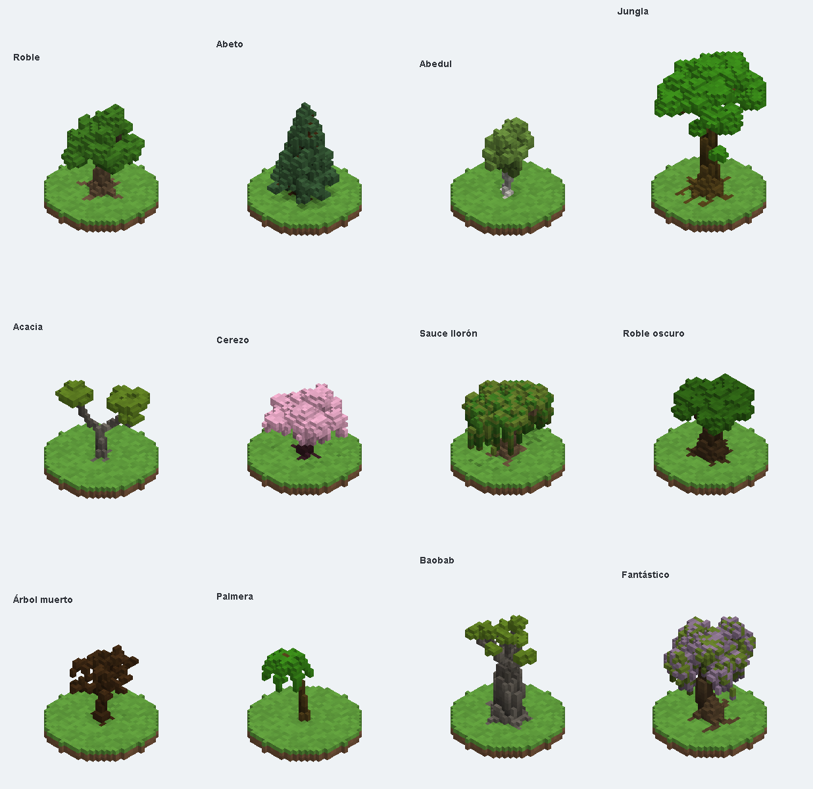

### Especies

| Especie | Alias | Cómo crece | Materiales de serie |
| --- | --- | --- | --- |
| `oak` | `roble`, `encina` | Copa en cúpula con 7 bultos, ramas maestras gruesas y raíces anchas | `oak_log`, `oak_leaves` |
| `spruce` | `abeto`, `pino` | Guía central y pisos de ramas en verticilo que se acortan hacia arriba, cada piso un cono de hojas | `spruce_log`, `spruce_leaves` |
| `birch` | `abedul` | Tronco fino y alto, copa estrecha y ovalada | `birch_log`, `birch_leaves` |
| `jungle` | `jungla`, `selva`, `tropical` | Tronco alto con contrafuertes, copa en sombrilla arriba y matas sueltas en el tronco | `jungle_log`, `jungle_leaves` |
| `acacia` | `sabana` | El tronco se abre en 2–4 guías inclinadas que acaban en copas planas con ramitas en abanico | `acacia_log`, `acacia_leaves` |
| `cherry` | `cerezo`, `sakura` | Copa ancha y baja, con hojas que cuelgan por debajo | `cherry_log`, `cherry_leaves` |
| `willow` | `sauce`, `lloron` | Cúpula ancha de la que caen cortinas de hojas casi hasta el suelo | `oak_log`, `oak_leaves,azalea_leaves` |
| `dark_oak` | `robleoscuro`, `oscuro` | Tronco muy grueso y corto, cúpula densa y plana por debajo | `dark_oak_log`, `dark_oak_leaves` |
| `dead` | `muerto`, `seco` | Sin hojas, ramas retorcidas y algunas partidas | `spruce_log`, sin hojas |
| `palm` | `palmera` | Tronco curvo que se inclina más cuanto más sube y una corona de frondas en arco que caen | `jungle_log`, `jungle_leaves` |
| `baobab` | `adansonia` | Tronco en botella y una corona corta de ramas gruesas con matas pequeñas | `acacia_log`, `acacia_leaves` |
| `fantasy` | `fantastico`, `retorcido`, `curvo` | Tronco en S y ramas que giran en espiral alrededor del tronco, con hojas colgantes | `mangrove_log`, `flowering_azalea_leaves,azalea_leaves` |

Sin especie se planta un roble; con solo un número, un roble de esa altura.

### Comportamiento de los árboles

- **Tronco y ramas con el motor de tubo.** Cada tronco, rama y raíz es un tubo del mismo espacio de tubo que `sweep` (curva de Kochanek–Bartels, marcos de mínima rotación y voxelizado inverso con supermuestreo) con un radio en cada punto, así que se estrecha sin escalones. El tronco se inclina (`-i`), serpentea con ruido (`-c`) y se ensancha en la base; en una ladera se entierra lo que haga falta para que el lado de abajo no quede al aire.
- **Ramificación por colonización del espacio** (Runions et al.) en las frondosas: se reparten puntos de atracción por la copa, agrupados en bultos hacia fuera, y las ramas crecen paso a paso hacia ellos hasta consumirlos. El grosor sale del modelo de tuberías (cada rama es tan gruesa como las que sostiene), así que las ramas maestras son gruesas y las puntas de un bloque. El abeto, la acacia, la palmera y el baobab tienen su propio esqueleto.
- **Copa:** grupos de hojas alrededor de cada punta, elipsoides deformados por ruido y aplanados por debajo para que se vean las ramas. La superficie va casi llena y el interior más ralo (como en los árboles de verdad, que no tienen hojas dentro), con las hojas pegadas a las ramas casi siempre puestas.
- **Raíces:** salen de la base, siguen la altura del terreno columna a columna y acaban hundiéndose en él; pueden ocupar tierra, hierba, arena, grava, barro y nieve.
- **Troncos orientados:** cada bloque de tronco o raíz lleva el `axis` del eje del mundo más alineado con su rama (`y` en el tronco, `x` o `z` en las ramas tumbadas). Cualquier bloque con `axis` sirve (troncos, maderas, tallos, hifas…).
- **Hojas persistentes:** todas las hojas llevan `persistent=true` (no se caen solas nunca) y su `distance` real a la madera; las de la copa están a 6 pasos o menos de la madera, como pide Minecraft, y las colgantes (cortinas y frondas) a 12 o menos.
- **Nada flotando:** toda la madera queda unida cara con cara a algo apoyado en el suelo (una rama de un bloque en diagonal también) y cada hoja llega a la madera por otras hojas. Si una piedra corta una rama, el trozo suelto se une con un puente corto o se quita.
- **Qué ocupa:** madera y hojas solo en aire, plantas que se reemplazan (hierba, flores, nieve fina…) y, la madera, también en hojas y agua; las construcciones y la piedra se respetan.
- Con la misma semilla, el mismo sitio y los mismos ajustes sale el mismo árbol. Sin `-s` se elige una y el chat la dice para repetirla.

### Banderas de los árboles

| Bandera | Efecto |
| --- | --- |
| `[especie]` | Una de la tabla, o `#preset`. |
| `[altura]` | Altura en bloques (4–96; por defecto la de la especie). |
| `-g <0.25–4>` | Grosor del tronco y, con él, de todas las ramas. |
| `-b <0–3>` | Cantidad de ramas (y de guías en la acacia, verticilos en el abeto, frondas en la palmera). |
| `-d <0–2>` | Densidad de la copa; `0` la deja sin hojas. |
| `-w <0.3–3>` | Ancho de la copa. |
| `-i <grados>[,rumbo]` | Inclinación del tronco (0–75°); el rumbo va en grados (0 = este, 90 = sur) y sin él es al azar. |
| `-c <0–4>` | Cuánto serpentean tronco y ramas. |
| `-s <semilla>` | Semilla. |
| `-t <bloques>` | Tronco y ramas: un bloque, una lista (`oak_log,stripped_oak_log`), `##paleta` o `#paleta guardada`; con varios, sale a vetas. |
| `-h <bloques>` | Hojas; `-h no` sin hojas. Con varias, mezcladas. |
| `-r <bloques>` | Raíces (por defecto, el tronco); `-r no` sin raíces. |
| `-m <máscara>` | Máscara de WorldEdit: dónde puede poner bloques. |
| `-x <0–1>` | Variación entre árboles (puntos marcados y pincel). |
| `-v`, `--preview` | Vista previa universal (solo en la orden). |

Ejemplos:

```text
/komaedit tree
/komaedit tree oak 24 -g 1.3 -i 10
/komaedit tree spruce 30 -d 1.4
/komaedit tree cherry 14 -w 1.4 -c 1.5
/komaedit tree willow 18 -h oak_leaves,azalea_leaves,flowering_azalea_leaves
/komaedit tree palm 18 -i 25,90
/komaedit tree dead 16 -t spruce_log,stripped_spruce_log -r no
/komaedit tree baobab 22 -g 1.2 -m grass_block,air
/komaedit arbol fantastico 26 -c 2
/komaedit tree jungle 40 -x 0.3
```

### Rocas

| Tipo | Alias | Forma |
| --- | --- | --- |
| `boulder` | `roca`, `piedra`, `canto` | Roca redondeada y facetada (radio 4 por defecto). |
| `crag` | `penasco`, `peñasco`, `risco` | Peñasco ancho con la cima casi plana, estratos y grietas (radio 7). |
| `spire` | `aguja`, `pinaculo`, `menhir` | Aguja alta que se estrecha hacia arriba, con grietas a lo largo (radio 3, alto ×3,2). |

- **Forma:** un elipsoide (o un huso que se estrecha, en las agujas) cortado por caras planas al azar, deformado con ruido sobre coordenadas distorsionadas (domain warping, nada de bultos en rejilla) y surcado por grietas que siguen los bordes de unas celdas de Voronoi; los peñascos además tienen estratos horizontales.
- **Hundida:** una parte de su alto queda bajo tierra (`-h`) y la parte baja sigue al terreno columna a columna: en una ladera baja por el lado de abajo y sube por el de arriba, así que no queda hueco debajo.
- **Sombreado:** los bloques de `-b` van de oscuro a claro. Cada bloque visible toma el suyo según la altura (más oscuro abajo), hacia dónde mira (luz desde arriba y el sur), lo encajonado que está (más oscuro en grietas y rincones) y un poco de grano. Por defecto `deepslate,tuff,cobblestone,stone,andesite`.
- **Musgo** (opcional, `-u`): por arriba y en los rincones, a manchas, solo donde le da el aire por encima.
- Ocupa aire, plantas, agua, tierra y piedra natural; nunca construcciones ni hojas. Queda de una pieza (los trozos sueltos que pueda dejar el ruido se quitan).

| Bandera | Efecto |
| --- | --- |
| `[tipo]` o `-t <tipo>` | `boulder`, `crag` o `spire`, o `#preset`. |
| `[tamaño]` | Radio en bloques (1–32). |
| `-b <bloques>` | Bloques de oscuro a claro: lista, `##paleta` o `#guardada`. |
| `-u <0–1 \| bloques>` | Musgo: una cantidad (con `moss_block`) o los bloques del musgo (a la mitad). |
| `-a <0.2–6>` | Alto respecto al ancho. |
| `-e <1–4>` | Planta alargada. |
| `-r <0–1>` | Rugosidad del ruido. |
| `-g <0–1>` | Grietas y estratos. |
| `-c <0–32>` | Caras planas talladas (`0` sin caras). |
| `-h <0–0.9>` | Parte enterrada. |
| `-i <0–60>` | Inclinación. |
| `-s`, `-m`, `-x`, `-v` | Semilla, máscara, variación y vista previa, como en los árboles. |

```text
/komaedit rock
/komaedit rock 6 -u 0.6
/komaedit rock crag 10 -e 2 -u 0.5
/komaedit rock spire 4 -a 4 -i 12
/komaedit rock boulder 5 -b ##Grayscale -g 0.8
/komaedit roca peñasco 8 -b granite,diorite,calcite -h 0.4
```

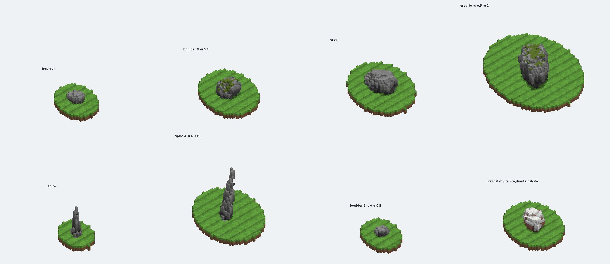

### Presets

Unos ajustes se guardan con nombre, por jugador y mundo (`komaedit/players/<uuid>/nature`), como los ruidos guardados, y se usan con `#nombre`. Lo que se escriba detrás manda sobre lo guardado: `#mio 25 -s 3` usa el preset con otra altura y otra semilla.

```text
/komaedit tree save bosque oak 22 -g 1.2 -h oak_leaves,azalea_leaves
/komaedit tree #bosque 28
/komaedit rock save menhir spire 3 -a 5 -u 0.4
/komaedit pincel rock #menhir
```

- `list` (`lista`) enseña los de serie y los tuyos; `delete` (`borrar`) borra uno; `-f` sustituye uno que ya existe. Un preset no puede apuntar a otro ni llamarse como una especie o un tipo.

### Pinceles de árboles y rocas

`/komaedit pincel tree <ajustes>` y `/komaedit pincel rock <ajustes>` aceptan lo mismo que las órdenes (también `#preset`). Cada **clic derecho** planta un árbol o una roca en el suelo que miras con una **variante nueva**: otra semilla y, con `-x` (0,2 por defecto), otra altura, grosor, ancho e inclinación. Con `-s` todos salen iguales. Con `-p` cada clic deja su vista previa de pincel (`/komaedit pincel aplicar`).

```text
/komaedit pincel tree oak 16 -x 0.35
/komaedit pincel rock boulder 3 -u 0.4
```

### Rendimiento y limitaciones

- El cálculo es rápido: un roble de 18 bloques (unos 1 500 bloques) tarda de 70 a 150 ms; uno de 60 (unos 43 000 bloques), menos de un segundo; las rocas de serie, de 10 a 50 ms. Lo que más tarda es leer el entorno, repartido entre ticks.
- Un árbol lee una caja de su copa más 14 bloques por debajo; con varios puntos marcados la caja los cubre a todos y tiene un tope de 4 millones de bloques. Tope de bloques por operación del servidor (`maxBlocksPerOperation`), como todo el mod.
- El árbol no ve otros árboles que pongas en la misma orden: si se cruzan, la madera tapa las hojas del otro y las hojas se respetan entre sí.
- Las rocas no tienen biomas ni entidades en cuenta, y una máscara de bioma da error.
- Renders de comprobación (fuera del juego): `docs/renders/arboles/` y la prueba `NatureRenderTest` con `KOMAEDIT_NATURE_RENDER=<carpeta>`.

## Tejados

### Objetivo y acceso

Un tejado completo sobre la planta de una casa en una sola orden, con las piezas bien puestas: escaleras mirando al caballete, escaleras colgadas bajo el alero para que no se vean muescas, esquinas exteriores e interiores donde tocan y losas arriba o abajo según la altura. Ahorra la parte más lenta de cada casa y funciona también con plantas en L, T y U.

```text
/komaedit roof <tipo> [material] [banderas]
/komaedit tejado <tipo> [material] [banderas]
```

- **Planta:** la selección de WorldEdit (cuboide, `//sel poly` o cualquier otra; cuenta su huella en planta). Selecciona a la altura de lo alto de los muros: el tejado empieza justo encima de la selección. Con `-d` la planta sale de los muros que hay dentro de la selección (ver más abajo).
- **Material:** un bloque entero (`spruce_planks`, `deepslate_tiles`…); las escaleras y losas salen de su familia, como en smoothblocks (por nombre o, si no tiene, por color). También vale una escalera o una losa (`dark_oak_stairs`: se usa para las piezas y su bloque entero para el relleno), cualquier patrón de WorldEdit o una paleta `##Nombre`/`#guardada`, que se reparte **en degradado por altura** (la primera entrada abajo, la última en el caballete). Por defecto, `spruce_planks`.
- Permiso: `komaedit.build` o `komaedit.build.roof` (paquete intermedio).
- Todo va a una sola edición por lotes: un **//undo** lo quita entero, con la estimación, la confirmación de los Build grandes y la vista previa (`-v`) del motor común.

Ejemplos:

```text
/komaedit roof gable spruce_planks
/komaedit roof gable deepslate_tiles -p 1:2 -a 2 -c polished_deepslate
/komaedit roof hip dark_oak_planks -d -b 2
/komaedit roof mansard spruce_planks -b 2 -m white_terracotta
/komaedit roof shed oak_planks -p 1:3 -lado s
/komaedit roof gablet ##DustyBrown -q 3
/komaedit roof cone dark_prismarine -p 2:1
/komaedit roof spire deepslate_tiles -lados 8 -h 12
/komaedit roof dome copper_block
/komaedit roof pagoda dark_oak_planks -a 2
/komaedit roof flat smooth_stone -pretil 1 -m stone_bricks
/komaedit roof hip spruce_planks -e
```

### Tipos

| Tipo | Alias | Qué hace | Pendiente por defecto |
| --- | --- | --- | --- |
| `gable` | `dosaguas` | A dos aguas: caballete a lo largo del ala, hastiales en los remates. En L, T y U, un hastial al final de cada ala, limatesa en las esquinas de fuera y limahoya en las de dentro. | 1:1 |
| `hip` | `cuatroaguas`, `pabellon` | A cuatro aguas: todos los bordes son alero; limatesas a 45° y limahoyas en las esquinas de dentro. | 1:1 |
| `mansard` | `mansarda` | Faldón bajo empinado (2:1 o la pendiente + 1) y faldón alto suave; el alero hace un pequeño quiebro hacia fuera. | 1:2 (el alto) |
| `shed` | `unagua`, `cobertizo` | A un agua: un solo plano que baja hacia `-lado`; los otros lados se cierran con muro. | 1:2 |
| `gablet` | `holandes`, `dutch` | Holandés: cuatro aguas abajo y un hastial pequeño arriba en cada remate. | 1:1 |
| `dome` | `cupula` | Cúpula por anillos, inscrita en la planta; la altura es el radio por la pendiente o `-h`. | 1:1 |
| `cone` | `cono`, `torreon` | Cono redondo por anillos de escaleras. | 2:1 |
| `spire` | `aguja`, `chapitel` | Aguja poligonal de `-lados` lados (8 por defecto); con 4 es una pirámide exacta. | 3:1 |
| `pagoda` | `oriental` | Cuatro aguas con faldones cóncavos (suaves en el alero, empinados arriba) y las puntas del alero levantadas. | 1:1 |
| `flat` | `plano`, `azotea`, `terraza` | Plano, con pretil de `-pretil` bloques en el borde. | — |

Cúpula, cono y aguja se centran en la caja de la planta; lo que de la planta queda fuera de la figura se cubre con losas, así no queda lo alto de los muros al aire.

### Banderas

| Bandera | Alias | Qué hace |
| --- | --- | --- |
| `-p <pendiente>` | `-pendiente`, `-pitch` | Subida:avance (`1:1`, `1:2`, `2:1`, `1:3`) o grados (`30`, `30°`); de 1:10 a 8:1. Las pendientes limpias son 1:1 (escaleras), 1:2 (losa y bloque), 1:3 y 2:1 (escalera sobre bloque); las demás alternan piezas. |
| `-a <bloques>` | `-alero` | Lo que sale el tejado por fuera de los muros (0 a 8). Por defecto 1, y 0 en `flat` y `dome`. Con 1:1 y alero 1, la escalera del alero queda a la altura de lo alto del muro. |
| `-g <capas>` | `-grosor` | Grosor del faldón medido en perpendicular (1 a 6). |
| `-c <material>` | `-caballete` | Material del caballete: la pieza más alta de cada columna que no tiene ninguna vecina más alta (caballete, cúspide y caballetes de las buhardillas). |
| `-b <n>` | `-buhardillas` | Buhardillas por cada alero recto de 9 bloques o más (0 a 8), en `gable`, `hip`, `mansard`, `shed` y `gablet`. |
| `-m <material>` | `-muro`, `-hastial` | Material de hastiales, paredes de buhardillas, escalón del holandés y pretil. Sin él se usa el más repetido en lo alto de los muros de debajo y, si no hay muros, el del tejado. |
| `-abierto` | `-sinhastial` | No cierra los hastiales. |
| `-ventana <bloque>` | `-window` | Ventana de las buhardillas (`glass_pane` por defecto; los paneles y barrotes se unen a lo largo del muro). |
| `-lado <n\|s\|e\|o>` | `-bajo` | Lado bajo del tejado a un agua; por defecto, el de la selección más cercano a ti. |
| `-lados <n>` | `-sides` | Lados de la aguja (3 a 32). |
| `-h <bloques>` | `-altura` | Altura de cúpula, cono, aguja o pagoda. |
| `-pretil <bloques>` | `-parapet` | Altura del pretil del tejado plano (0 a 6, 1 por defecto). |
| `-q <bloques>` | `-quiebro` | Mansarda: hasta dónde llega el faldón empinado (por defecto 1 o 2 bloques, según el fondo). Holandés: hasta dónde llegan las aguas de los remates antes del hastial pequeño (por defecto, la mitad). |
| `-d` | `-detectar`, `-muros` | La planta sale de los muros, no de la selección. |
| `-eje <x\|z>` | `-axis` | Dirección del caballete en `gable` y `gablet`; sin ella, en cada ala, a lo largo. |
| `-escaleras <material>` | `-stairs` | Escaleras de otro material (`dark_oak`, `dark_oak_stairs` o `dark_oak_planks`). |
| `-losas <material>` | `-slabs` | Losas de otro material. |
| `-r` | `-reemplazar` | Sustituye también lo que no es aire. Sin ella el tejado no pisa ningún bloque: lo alto de los muros, faroles o lo que haya se respeta. |
| `-e` | `-estimar` | Solo estima: bloques, piezas, chunks, caja, memoria y tiempo. |
| `-v` | `--preview` | Vista previa, como en el resto de órdenes. |

### Planta desde los muros (`-d`)

Selecciona la casa entera (o al menos lo alto de los muros, con algo de aire alrededor) y añade `-d`:

- Lo más alto que hay construido en la selección marca la altura: el tejado empieza justo encima.
- Son muro las columnas con bloque en alguna de las dos capas de arriba (una puerta o una ventana más abajo no cuentan) y la planta es el muro y todo lo que encierra. Así salen plantas en L, T, U o con patio, aunque la selección sea un cuadrado.
- Si los muros no cierran (falta un trozo arriba), lo dice y no hace nada.
- El material de los hastiales sale de lo alto de esos muros.

### Comportamiento

- **Faldones.** La altura del tejado se calcula cada medio bloque (las columnas de octantes de las piezas) con la distancia de ajedrez desde el borde de la planta, que en plantas rectilíneas da justo un tejado a cuatro aguas: limatesas a 45° en las esquinas salientes y limahoyas en las entrantes. En los de dos aguas los bordes de hastial no cuentan, y los faldones resbalan a lo largo de ellos. Un borde es hastial si sus dos extremos son esquinas salientes, mide al menos 3 bloques y es más corto que el fondo de planta que tiene detrás (el remate de un ala); en un cuadrado, el caballete va a lo largo del eje x (o el de `-eje`).
- **Piezas.** Las alturas se redondean a medio bloque y se ajustan dentro de cada bloque para que salga una pieza que existe: arriba losa, bloque o escalera con el escalón alto hacia el caballete; abajo lo mismo boca abajo. Con 1:1 cada fila es una escalera con otra colgada debajo (`half=top`, mirando hacia fuera), así el alero se ve liso desde abajo.
- **Esquinas.** La forma de cada escalera (recta, interior o exterior) la decide Minecraft según sus vecinas; el tejado elige la orientación de cada escalera para que la forma que pondrá Minecraft sea la que pide la superficie (el mismo repaso del perfil `SlabsAndStairs` de smoothblocks) y la deja ya puesta en el plan. En las limatesas quedan escaleras exteriores y en las limahoyas, interiores.
- **Hastiales y paredes.** El triángulo bajo cada hastial se rellena desde lo alto del muro hasta el tejado. Lo mismo bajo el escalón del holandés, en las mejillas y el frente de las buhardillas y en los tres lados altos del tejado a un agua.
- **Buhardillas.** Cinco de ancho: muro delantero de 2 bloques sobre el muro de la casa con ventana de 2 de alto, mejillas a los lados y tejadillo a dos aguas 1:1 que entra en el faldón hasta que este lo tapa. Por dentro quedan abiertas al desván. Se omiten (y se avisa) las que caerían en una limatesa o en un tejado demasiado bajo para que quepan.
- **Figuras redondas.** Cúpula, cono y agujas de más de 4 lados se hacen por anillos de altura constante, como los construye un constructor: arriba de cada columna una escalera mirando a la cúspide, abajo una colgada hacia fuera y bloques en medio; Minecraft pone las esquinas. Cada columna baja hasta lo alto de sus vecinas, así entre anillos no quedan rendijas.
- **Nada se pisa.** Sin `-r` el tejado solo va donde hay aire, y la construcción es condicional: si alguien cambia un bloque mientras se coloca, se respeta.
- Determinista: la misma selección y la misma orden dan siempre el mismo tejado.

### Rendimiento y limitaciones

- La lectura del mundo va repartida entre ticks (la zona del tejado, de unos pocos bloques por debajo del alero a lo más alto que puede llegar) y el cálculo, en un worker; en el hilo del servidor solo se resuelven los materiales.
- Planta de 512 × 512 bloques como mucho y tejado de 320 bloques de alto como mucho.
- Las plantas con bordes en diagonal (`//sel poly` inclinado) salen escalonadas: un tejado de Minecraft no tiene faldones en diagonal.
- Las pendientes que no son 1:1, 1:2, 1:3 o 2:1 alternan escalones de distinto tamaño; es lo más fiel que se puede con bloques.
- En la pagoda, las puntas levantadas no caben exactas en piezas y llevan algún bloque entero.
- La cúpula sobre una planta alargada es elíptica; sobre una en L o en U se centra en su caja.
- En el Procedural Studio está en la etapa [Herramientas](#herramientas) (tarjeta Tejado): manda esta misma orden sobre la selección.

Renders de comprobación (fuera del juego, con `KOMAEDIT_ROOF_RENDER=<carpeta>`), en `docs/renders/tejados/`: cada tipo sobre una casa visto desde dos esquinas y desde abajo, plantas en L, T y U, figuras redondas y detalles de buhardillas, holandés, mansarda, a un agua y pagoda.

## Loft entre curvas

### Objetivo y acceso

Una superficie tendida entre 2 y 6 curvas: toldos, velas, lonas, puentes colgantes, cubiertas curvas o paredes que serpentean. Como el «loft» de Arceon o el modelado de Axiom.

```text
/komaedit loft [curva] [curva] [más curvas…] [material] [banderas]
/komaedit lona …
```

- **Curvas:** nombres de recorridos guardados con `/komaedit path save <nombre>`; `actual` es el recorrido de ahora (los puntos marcados con **P**, o la selección de la supervarita o de WorldEdit). Sin nombres, los puntos de ahora se reparten en `-n` curvas seguidas del mismo número de puntos: con 4 puntos marcados alrededor de un hueco salen dos tramos rectos y una lona entre ellos.
- Cada curva pasa por sus puntos con un Catmull–Rom, como las trayectorias (en el modo `lineal`, en tramos rectos). Si una curva se marcó al revés que la anterior se le da la vuelta, para que la superficie no salga retorcida.
- **Material:** cualquier patrón de WorldEdit o una paleta `##Nombre`/`#guardada`, que se reparte en degradado de la primera curva a la última. Por defecto, `white_wool`.
- Permiso: `komaedit.build` o `komaedit.build.loft` (paquete intermedio).
- Una sola edición por lotes y un **//undo**, con estimación, confirmación de Build grandes y vista previa (`-v`).
- En el Studio, tarjeta Loft de la etapa [Herramientas](#herramientas): con los puntos de ahora o con recorridos guardados escritos en **Recorridos guardados**.

Ejemplos:

```text
/komaedit loft white_wool -i catenaria -comba 2
/komaedit loft borde1 borde2 red_wool -i catenaria -comba 20%
/komaedit loft a b c -i catmull -g 2 -w SlabsAndStairs
/komaedit loft cable1 cable2 spruce_planks -i lineal -w SlabsAndStairs
/komaedit loft suelo arriba stone_bricks -i catmull
/komaedit loft aro1 aro2 aro3 aro4 ##FadeOrange -cerrar
```

### Banderas

| Bandera | Qué hace |
| --- | --- |
| `-i lineal\|catmull\|catenaria` | Cómo se pasa de una curva a la siguiente: en recta (superficie reglada), con un Catmull–Rom centrípeto que pasa por todas las curvas (por defecto) o colgando entre cada dos curvas como una catenaria. Alias `linear`, `cr`, `suave`, `catenary`, `cuelga`. |
| `-comba <bloques\|%>` | Lo que cuelga el centro de cada tramo en la catenaria: en bloques o en tanto por ciento del vano (`20%`). Por defecto, el 15 % del vano. Da por hecha `-i catenaria`. |
| `-g <bloques>` | Grosor (1 a 8). |
| `-w <perfil>` | Losas y escaleras en la superficie, con los perfiles de smoothblocks (`SlabsAndStairs`, `Slabs`, `SSW`, `Panes`…). |
| `-cerrar` | Une la última curva con la primera (con tres o más): tubos y cúpulas abiertas. |
| `-n <curvas>` | En cuántas curvas se reparten los puntos de ahora (2 a 6, 2 por defecto). |
| `-e` | Solo estima. |
| `-v` / `--preview` | Vista previa. |

### Comportamiento

- Las curvas se muestrean cada medio bloque y cada muestra se une con la de la curva siguiente; la malla de triángulos resultante se voxeliza al revés: entra cada bloque cuyo centro queda a menos de medio grosor (y como mínimo medio bloque) de la superficie.
- **Sin agujeros.** Con medio bloque basta para que la superficie sea estanca: dos bloques que comparten una cara a uno y otro lado de la superficie están a un bloque, así que uno de los dos queda a medio bloque o menos y entra. Ningún camino de caras atraviesa la lona (ni el agua ni las criaturas).
- La catenaria cuelga en vertical: su forma sale de la comba y la longitud del vano (con combas pequeñas, una parábola).
- Con `-w`, las mismas distancias miden la ocupación de cada octante y se eligen las piezas como en los tubos; las piezas solo sustituyen o se añaden, nunca quitan bloques de la superficie.

### Rendimiento y limitaciones

- El cálculo va en un worker; no lee el mundo y, como las figuras, sustituye lo que haya donde cae.
- Como mucho 1 500 000 bloques; curvas de hasta 4 096 bloques de largo.
- La superficie va siempre de una curva a la siguiente en orden: para una vela con un punto suelto, marca ese punto como una curva corta.
- Con curvas muy dispares (una larga y otra de dos puntos muy cerca), la malla se aprieta en un lado y la superficie se pliega.

## Variaciones de la figura

En el Studio son las **Variaciones** de la etapa Figuras (ver [Tamaño, material y variaciones](#tamaño-material-y-variaciones)). Por debajo son los mismos números de la receta (`RecipeExtensions`), así que las recetas, los paquetes `.krecipe` y las instancias de antes se leen igual:

| Variación | Números de la receta |
| --- | --- |
| Afinar | escala inicial y final, espaciado inicial y final |
| Retorcer | torsión total |
| Otra figura encima | fusión: figura secundaria e intervalo |
| Pegar al terreno | conformado: modo, alcance y separación |
| Repetir lo copiado | sockets Kitbash: colocación e intervalo |
| (Más ajustes) Cómo cambia | curva de transición |
| (Más ajustes) Cerrar huecos y Quitar bloques sueltos | reparación de microhuecos y componentes aislados |

Lo que hacen, como antes:

- Escala inicial y final.
- Espaciado inicial y final.
- Curvas de transición.
- Torsión progresiva.
- Fusión con una figura secundaria.
- Conformado a suelo, techo o superficie.
- Sockets Kitbash, también doblados a lo largo del recorrido (modos **Doblar** y **Estirar**).
- Reparación de microhuecos y componentes aislados.

En las figuras de espacio de tubo y en las clásicas con motor exacto, la escala, el espaciado y la torsión se aplican al evaluar cada bloque, sin deformación posterior ni puentes entre bloques separados. La figura de **Fusión** hereda el motor exacto de la receta cuando también lo tiene.

## Estructuras

La familia Estructuras de la etapa Figuras (antes, una etapa aparte del Studio) contiene generadores arquitectónicos orientados por puntos:

- Pilares monumentales configurables.
- Pares de pilares monumentales conectados mediante arcos.
- Puentes arqueados entre apoyos.
- Torii japoneses gigantes que respetan diferencias verticales del terreno sin ondular sus vigas.

## Materiales y degradados

KomaEdit admite bloques individuales, patrones de WorldEdit y paletas de degradado. La distribución puede seguir el eje, exposición, cavidades, bordes, curvatura o propiedades específicas de la figura.

### Paletas con nombre

Donde KomaEdit espera una paleta (por ejemplo, `/komaedit gradient` o el material de una receta) se puede usar la notación de paletas de ezEdits, además de la lista `a;b;c` de siempre:

| Escritura | Resultado |
| --- | --- |
| `##Grayscale`, `##Magma`, `##GlowBlue`… | Paleta de serie de KomaEdit; no distingue mayúsculas. |
| `#mipaleta` | Paleta guardada del jugador (ver «Paletas guardadas»). |
| `stone,andesite` o `stone;andesite` | Concatena bloques o paletas. |
| `-##Grayscale` | Invierte el orden. |
| `##Grayscale(1:8)` | Tramo de la posición 1 a la 8, ambas incluidas. |
| `gold_block*3,diamond_block` | Repite el tramo anterior. |
| `-[##Grayscale,gold_block]` | Agrupa para aplicar un modificador a todo el grupo. |
| `oak_stairs[facing=east]` | Bloques con estado: los corchetes pegados al nombre son parte del bloque. |

Una paleta admite hasta 256 entradas.

### Ruido configurable

Las herramientas que usan ruido aceptan la notación de ezEdits `Tipo(clave:valor,…)`, con nombres largos o abreviados y sin distinguir mayúsculas. Por defecto el valor va de 0 a 1.

- **Tipos:** `Perlin` (`Pe`), `OpenSimplex2` (`Si`), `OpenSimplex2S` (`Sm`), `Value` (`Va`), `ValueCubic` (`VC`), `White` (`Wh`), `Cellular` (`Ce`), `Shard` (`Sh`) y `Gabor` (`Gb`).
- **Básicos:** `Seed` (`s`, `-1` = semilla del contexto), `Frequency` (`f`), `Inverted` (`i`), escalas `x`, `y` y `z`, y `ValueMapping` (`m`): `Default`, `None` (valor crudo de −1 a 1) u `Override` (`OR`) con `l`, `u`, `Mn` y `Mx`.
- **Celular:** `cJ` (jitter), `cD` (`e`, `sq`, `man`, `h`, las de Minkowski `m1`, `m4` y `m99`, y `r`, redondeada) y `cR`: `cell`, `distance`, `distance2`, `add`, `sub`, `mul`, `div`, `sq`, `inv`, `log`, `exp`, `2sq`, `2inv`, `2log`, `2exp`, `edge`, `rounded` (`r`, mínimo suave de las distancias: celdas con las esquinas redondeadas) y `noiseLookup` (`n`): cada celda toma el valor de otro ruido, `cN` (`Pe`, `Si`, `Sm`, `Va`, `VC`, `Wh` o `Ce`, Perlin por defecto), muestreado en su punto con la frecuencia `cF` en celdas (0,1 por defecto: las celdas vecinas se parecen).
- **Shard:** celdas planas, cada una con su propia inclinación, como las caras de un cristal roto. `h` (nitidez, de 0 a 1, 0,5 por defecto) decide si se cortan en seco o se funden con las vecinas. Admite los mismos fractales que el resto.
- **Fractal:** `fT` (`N`, `F`, `R`, `P`), `fO` (octavas), `fL` (lacunaridad), `fG` (ganancia), `fW` (fuerza ponderada) y `fP` (ping-pong).
- **Distorsión de dominio:** `wT` (`G`, `S`, `R`, `F` flujo y `T` turbulencia), `wF`, `wO`, `wG`, `wA`, `wC` (`N`, `I`, `P`) y `wl`. `Flow` desplaza con el rotacional de tres ruidos (remolinos que no se amontonan) y `Turbulence` con un fBm en valor absoluto (pliegues marcados); en las dos `wO` son las capas y `wA` la fuerza en bloques.
- **Gabor:** `gR` (radio), `gF` (frecuencia de vetas), `gFs` (dispersión), `gO` (orientación `1;0;0`), `gJ` (variación), `gN` (impulsos por celda, máx. 8) y `gM` (contraste).

Ejemplos: `Perlin(f:0.04)`, `Ce(cD:e,cR:sub,F:.1)`, `Si(fT:R,fO:4,wT:S,wA:30)`, `Ce(cD:e,cR:n,cN:Pe,cF:.2,F:.1)`, `Shard(F:0.15,h:0.8)`, `Pe(F:0.03,wT:F,wA:25)`.

En lugar de escribir el ruido entero se puede usar el nombre de un ruido de serie (`ridged`, `smoothcells`, `voronoiedge`, `clouds`, `marble`, `veins`, `pebbles`, `dunes`, `static`) o el de un ruido guardado (ver «Ruidos guardados»).

Limitaciones: el ruido se calcula con FastNoiseLite (licencia MIT), con posiciones en doble precisión. `Shard`, las distancias de Minkowski y redondeada, los retornos `rounded` y `noiseLookup` y las distorsiones `Flow` y `Turbulence` son implementaciones propias de KomaEdit (`ExtendedNoise`): tienen el carácter que describe ezEdits, pero no dan los mismos valores bloque a bloque. El celular propio (con esas distancias o retornos) cuesta unas dos veces más que el de FastNoiseLite.

## Retoques sobre la selección

### Objetivo y acceso

Ajustes rápidos de supervivencia sobre la selección de WorldEdit, como `//eztweak` de ezEdits:

```text
/komaedit tweak deinfest
/komaedit tweak persist [on|off]
/komaedit tweak waterlog [on|off]
/komaedit tweak wax [on|off]
```

Alias: `/komaedit retocar` y `/komaedit survival` (el nombre antiguo en ezEdits), y los modos `desinfestar`, `persistir`, `anegar`, `encerar`. `on`/`off` también se escriben `true`/`false`.

### Comportamiento

- `deinfest` cambia cada bloque infestado por su versión normal, conservando las propiedades (por ejemplo, el eje de la pizarra profunda).
- `persist` activa o desactiva la persistencia de las hojas para que no se caigan.
- `waterlog` anega o seca todo lo que admita agua (escaleras, losas, vallas…).
- `wax` encera o desencera el cobre, incluidas escaleras, losas, puertas, trampillas, rejillas y bombillas. El mineral, el bloque de cobre en bruto y el pararrayos no tienen versión encerada y se dejan igual.
- `wax` también encera o desencera los carteles, normales y colgantes, como ezEdits: un cartel encerado ya no se puede editar. Los carteles guardan la cera en sus datos (`is_waxed`), no en el estado del bloque, así que se cambian aparte con una edición de WorldEdit: el chat dice cuántos, y se deshacen con su propio `//undo` (el cobre va en otro).
- La selección se lee repartiendo el trabajo entre ticks, se calcula en un worker y se escribe por lotes. Cada bloque solo se cambia si sigue igual que al leerlo, así no se pisa lo que alguien construya mientras tanto. Se deshace con `//undo`.

### Limitaciones

- Los carteles solo se buscan en los chunks cargados de la selección.
- La selección más su margen admite hasta 16 millones de bloques y 1 500 000 cambios.

## Deformar la selección

### Objetivo y acceso

Transforma lo que hay en la selección de WorldEdit en columnas, celdas, cuboides o figuras nuevas, como `//ezdeform` de ezEdits:

```text
/komaedit deform hexagonalize [tamaño 12] [hueco 0] [giroX 0] [giroZ 0] [ángulo 60] [-w perfil]
/komaedit deform noise <ruido> [fuerza 2] [-z zoom] [-s semilla] [-h] [-v] [-w perfil]
/komaedit deform rotate <ángulo> [-o] [-w perfil]
/komaedit deform voronoialize [tamaño 12] [hueco 0] [-s semilla] [-w perfil]
/komaedit deform voronoialize2 <cantidad> [hueco 0] [-s semilla] [-r uniformidad] [-n profundidad] [-w perfil]
/komaedit deform voxelize [escalas 3] [hueco 0] [distorsión 0] [-i eje] [-j eje] [-s semilla] [-h] [-v] [-w perfil]
/komaedit deform cylindrify [-afost] [-r radios] [-d profundidad] [-x mapa] [-i eje] [-j eje] [-w perfil]
/komaedit deform spherify [-aflost] [-r radios] [-d profundidad] [-x mapa] [-i eje] [-j eje] [-w perfil]
```

Alias: `/komaedit deformar` y los modos `hex`, `ruido`, `girar`, `voronoi`, `voronoi2`, `voxeles`, `cilindro` y `esfera`. Necesita el permiso de construir.

### Comportamiento

Cada modo es una función de punto: para cada punto del resultado dice de qué punto de la selección original sale su material, o que queda hueco. Así no aparecen agujeros al estirar o girar, y las losas y escaleras de `-w` miden la forma deformada dentro de cada bloque. Cuenta como «forma» todo lo que no es aire ni líquido. Donde el resultado deja aire sobre agua o lava, el líquido se conserva.

- **hexagonalize**: reparte el plano perpendicular a las columnas en celdas de una red y cada columna copia la línea que pasa por el centro de su celda. Quedan columnas de tapa plana, como el basalto. `ángulo` es el que forman los dos vectores de la red: 60° da hexágonos regulares y 90° cuadrados. `giroX` y `giroZ` tumban las columnas (en grados). Las celdas del borde leen el punto más cercano dentro de la selección para no desaparecer.
- **noise**: desplaza cada punto según tres campos del ruido indicado, uno por eje. `fuerza` es el desplazamiento máximo en bloques y `-z` agranda los rasgos (2 = el doble de grandes). `-h` solo mueve en horizontal y `-v` solo en vertical. El ruido usa la notación de ezEdits (ver [Ruido configurable](#ruido-configurable)) o el nombre de un ruido de serie o guardado (ver [Ruidos guardados](#ruidos-guardados)).
- **rotate**: gira la selección en el sentido de las agujas del reloj mirando a lo largo de tu mirada, alrededor del centro de la selección (o de tus ojos con `-o`). Si miras a menos de 10° de un eje del mundo, se usa ese eje exacto. Lo que sale de la selección se escribe fuera de ella. Donde la selección queda vacía se pone aire.
- **voronoialize**: celdas de Voronoi al azar, una por cada cubo de `tamaño` bloques. Cada celda queda entera si su sitio cae dentro de la forma y desaparece si no, así salen trozos convexos de roca. El `hueco` los separa.
- **voronoialize2**: reparte `cantidad` puntos por la superficie y los separa entre sí con `-r` pasadas de repulsión (0 = al azar, 15 = uniforme). Cada punto da el plano tangente de su zona y su sitio se hunde `-n` bloques hacia dentro. Dentro de cada celda la forma queda cortada por su plano, de modo que la superficie se vuelve facetas planas que siguen la forma original. Las facetas solo actúan cerca de la superficie: el interior y lo lejano no cambian.
- **voxelize**: reparte la selección en celdas de `escalas` bloques (`3` o `2,4,2` en x, y, z de la rejilla). Cada celda queda llena si más de la mitad estaba ocupada y vacía si no. Lo que se rellena toma el material mayoritario de la celda. `-i` y `-j` eligen qué eje del mundo es la «y» y la «x» de la rejilla (por defecto `y` y `-x`). `distorsión` (0–1) desplaza al azar los planos de corte sin dejar de formar cuboides. `-h` agrupa solo en horizontal y `-v` solo en vertical.
- **cylindrify** y **spherify**: proyectan la selección, como si fuera un mapa, sobre un cilindro o una esfera nuevos que se construyen aparte. La selección original no se toca. Por defecto el eje X del mapa da la vuelta, el Z recorre el cilindro a lo largo (o la latitud de la esfera) y el Y es la profundidad: lo más alto del mapa queda en la cara exterior. La esfera usa Mercator, o LAEA de un solo parche con `-l` (área igual; el centro del mapa queda arriba y los bordes se juntan abajo).

### Parámetros de cylindrify y spherify

- `-r`: radios. Cilindro: `r`, `r,mitad` o `r1,r2,mitad` (mitad = media longitud). Esfera: `r` o `r1,r2,r3` en los ejes `-j`, `-i` y el tercero. Sin `-r`, la vuelta mide lo mismo que el mapa (radio = ancho / 2π; con LAEA, la esfera tiene la misma área que el mapa).
- `-d`: profundidad de la proyección hacia el centro. Por defecto, el alto de la selección.
- `-x`: qué eje del mapa va a cada eje de la figura, en orden `EW,UD,NS`: `xyz` (por defecto), `zyx`, `-xyz` (el signo menos da la vuelta a ese eje).
- `-i`: eje de la figura en el mundo (`y` por defecto). `-j`: dirección donde empieza la vuelta (`x` por defecto). Valen `x`, `-x`, `y`, `-y`, `z` y `-z`.
- `-a`: no pone la caja de aire alrededor de la figura. Lo que la figura no ocupa se respeta, aunque el aire del mapa sí se coloca.
- `-f`: rellena el interior repitiendo la capa más honda del mapa hasta el centro.
- `-o`: construye alrededor de tu posición en vez de encima de la selección. Si encima no cabe en la altura del mundo, se construye al lado (al este).
- `-s`: descarta medio bloque del mapa en la dirección de la vuelta, para que un patrón repetido case en la costura.
- `-t`: centro de dos bloques (diámetro par). Necesita `-r`.

Antes de empezar se avisa del radio, la profundidad, la caja donde se construye y cuántos bloques fuera de la selección se van a sustituir. Esa caja se lee y se escribe con la misma escritura condicional que el resto: si alguien cambia un bloque mientras se calcula, ese bloque se respeta.

### Ejemplos

```text
/komaedit deform hexagonalize 8 1
/komaedit deform hexagonalize 16 0 45 0 60 -w SlabsAndStairs
/komaedit deform noise Perlin(F:0.06) 4 -z 2 -h
/komaedit deform rotate 30 -w Slabs
/komaedit deform voronoialize 16 2 -s 69420
/komaedit deform voronoialize2 50 -r 15 -n 5
/komaedit deform voxelize 4,2,4 0 0.5
/komaedit deform cylindrify -f
/komaedit deform spherify -l -r 24 -d 4 -o
```

### Rendimiento y limitaciones

- La lectura se reparte entre ticks y el cálculo va en un worker. La selección más su margen (y, en rotate, cylindrify y spherify, la caja de salida) admite hasta 16 millones de bloques y 1 500 000 cambios. Con `-o` lejos de la selección, la caja que hay que leer crece; acércate si el aviso dice que es demasiado grande.
- `voronoialize2` admite hasta 4096 celdas. En formas finas con pocas celdas, los planos de celdas vecinas pueden cruzarse y rellenar huecos pequeños. Baja `-n` o sube la cantidad.
- hexagonalize, noise, voronoialize, voronoialize2 y voxelize escriben solo dentro de la selección: lo que el ruido o las celdas empujen fuera se corta en su borde.
- Los modos se calculan con el bloque más cercano, sin mezclar materiales: los estados (orientación de troncos, escaleras…) se copian tal cual y no se giran con rotate.
- Respeta la máscara global de WorldEdit (`//gmask`) al escribir, como el resto de ediciones por lotes.

## Superficie

### Objetivo y acceso

Retoca la superficie de lo que hay en la selección, tallándola hacia dentro o haciéndola crecer hacia fuera hasta un radio, como `//ezsurface` de ezEdits:

```text
/komaedit surface fuzzify <radio> [radioSuave 0] [iteraciones 0] [-c] [-e] [-m máscara] [-t] [-w perfil]
/komaedit surface rockify <radio> [tamaño 10] [octavas 1] [radioSuave 1] [iteraciones 4] [-c] [-e] [-m máscara] [-t] [-w perfil]
/komaedit surface voronoify <radio> [celda 12] [radioSuave 0] [iteraciones 0] [-c] [-e] [-m máscara] [-t] [-w perfil]
/komaedit surface noisify <radio> <ruido> [escala 1] [radioSuave 1] [iteraciones 4] [-c] [-e] [-m máscara] [-t] [-w perfil]
```

Alias: `/komaedit superficie` y los modos `pelusa`, `roca`, `celdas` y `ruido`. Todos admiten además `-seed <n>` para repetir el resultado.

### Comportamiento

Se calcula la distancia exacta de cada bloque a la superficie (positiva fuera, negativa dentro) y la superficie nueva pasa por donde esa distancia iguala `radio × ruido`. El ruido va de −1 (tallar el radio entero) a +1 (crecer el radio entero). Nada a más del radio cambia. Después, si se pide, el campo se suaviza `iteraciones` veces con una caja de `radioSuave` bloques. Lo que crece toma el material del bloque ocupado más cercano: sobre la hierba crece hierba y en la roca, roca.

- **fuzzify**: ruido blanco, un valor al azar por bloque. Deja la superficie áspera.
- **rockify**: Perlin fractal con rasgos de unos `tamaño` bloques y `octavas` capas. Da roca ondulada.
- **voronoify**: celdas de unos `celda` bloques: una cúpula por celda con un pliegue en cada borde, como roca agrietada.
- **noisify**: cualquier ruido con la notación de ezEdits (ver [Ruido configurable](#ruido-configurable)) o por su nombre, de serie o guardado, muestreado a `escala` (2 = rasgos el doble de grandes).

Banderas:

- `-c`: solo talla (el ruido va de 0 a −1).
- `-e`: solo crece (de 0 a +1). No se puede usar a la vez que `-c`.
- `-m <máscara>`: solo se tallan los bloques que la cumplen y solo se crece desde ellos. Admite cualquier [máscara de WorldEdit](#máscaras-de-las-operaciones-de-región), con las de ezEdits (`#near`, `#fullblock`, `#eznoisemask`…); si lleva espacios va entre comillas: `-m "#existing !#near[water][2]"`. La lista de antes sigue valiendo con su significado: ids y etiquetas separados por comas, con `!` delante para invertir la lista (`stone,andesite`, `#minecraft:base_stone_overworld`, `!grass_block`).
- `-t`: intenta conservar la topología. Los cambios se aplican de uno en uno, del más claro al más dudoso, y solo si el bloque es *simple* en ese momento: no se abren túneles, no se cierran huecos y nada se parte en dos ni se une. Lo que no se puede cambiar se queda como estaba.

### Ejemplos

```text
/komaedit surface fuzzify 1.5
/komaedit surface rockify 4 12 2 1 4
/komaedit surface voronoify 3 10 -c
/komaedit surface noisify 3 Ce(F:0.1,cR:sub) 1 1 4 -m stone,andesite -t
/komaedit surface rockify 2 -m ">stone"
/komaedit surface rockify 3 -w SlabsAndStairs
```

## Texturizado

### Objetivo y acceso

Pinta una paleta sobre lo que ya hay construido en la selección de WorldEdit según una medida del sitio de cada bloque: lo ocluido, la curvatura, la luz, un eje, ruido, celdas o líneas de flujo. Es la familia `//eztexture` de ezEdits, con los mismos modos, argumentos y banderas:

```text
/komaedit texture <modo> …
```

Alias: `/komaedit textura`. `/komaedit texture` sin modo muestra la ayuda. Requiere el permiso de construir (`komaedit.build`).

Para sombrear según la luz sin montar la paleta ni combinar modos (luz, sombras y oclusión juntas, paleta sacada de la selección y escaleras que cambian de material dentro de su familia), está `/komaedit shade`: ver [Color y sombreado](#color-y-sombreado).

Los argumentos van por posición y las banderas en cualquier sitio. Un argumento con espacios va entre comillas; los paréntesis y corchetes agrupan solos, así que `Ambient(Radius:2, Contrast:0.3)` es un solo argumento.

### Comportamiento

- **Paleta**: cualquier paleta de [Paletas con nombre](#paletas-con-nombre) (`##Grayscale`, `-##Magma(1:8)`, `stone,andesite,cobblestone`…) o una [guardada](#paletas-guardadas) (`#nombre`), con al menos dos bloques; cada entrada es un bloque o un patrón de WorldEdit sin comas (`oak_stairs[facing=east]`, `#clipboard`). Cada modo da a cada bloque un valor de 0 a 1 y se coloca el bloque de esa posición de la paleta: 0 es el principio y 1 el final.
- **Convención**: lo ocluido, cóncavo, poco iluminado o de cara a la luz va hacia el **principio** de la paleta. `##Grayscale` empieza en negro, así que las grietas salen oscuras con `ambient`; para que las caras iluminadas salgan claras con `pointlight` o `sunlight` usa `-##Grayscale`.
- **Superficie**: `ambient`, `curvature`, `pointlight`, `sunlight`, `blocklight` y `flow` solo cambian los bloques con alguna cara al aire (el interior no se ve). `axisgradient`, `noise` y `cells` cambian todos los bloques de la máscara. Si la selección no tiene superficie (por ejemplo, solo el interior de un muro) avisa de que hay que ampliarla para que incluya aire; la lectura ya coge un margen alrededor.
- **Máscara**: qué bloques se texturizan. Ver [Máscaras de las operaciones de región](#máscaras-de-las-operaciones-de-región).
- **`-w`**: respeta las piezas con forma (escaleras, losas, muros, vallas, puertas de valla, botones, placas y trampillas). Cada una se cambia por la pieza del mismo tipo del material elegido, con su orientación y propiedades; si ese material no tiene la pieza, se usa el material más cercano de la paleta que sí la tenga, y si ninguno la tiene el bloque se queda como está. Sin `-w` la máscara manda: una escalera que pase la máscara se cambia por el bloque entero.
- **`-d <0–1>`** (propio de KomaEdit): tramado entre dos bloques vecinos de la paleta. Con 0 (por defecto) cada bloque toma el más cercano; con más tramado los cambios se reparten con un umbral fijo por posición y no salen franjas. `blend` usa 0,5 por defecto.
- **Semilla**: `cells`, `noise`, `flow` y `advanced` usan la de `-s` (cuando el modo la tiene) o una al azar que se muestra en el mensaje; con la misma semilla sale lo mismo.
- La lectura va repartida entre ticks, el cálculo en un worker y la escritura por lotes y condicional (no pisa lo que cambie mientras tanto). Todo es una edición: `//undo` la deshace.

### Modos y parámetros

| Modo | Uso | Qué mide |
| --- | --- | --- |
| `ambient` | `<máscara> <paleta> [radio=3] [brillo=0] [contraste=0] [-w]` | Oclusión ambiental: rayos por el hemisferio de cada cara, de largo `2·radio+1`. El campo se suaviza con el radio; el contraste devuelve el detalle local (0 = solo el campo suave, 1 = solo el local). Se estira para usar la paleta entera. |
| `axisgradient` | `<máscara> <paleta> [x\|y\|z=y] [-r] [-w]` | Degradado por un eje de lo más bajo a lo más alto de la máscara. `-r`: relativo, cada columna estira la paleta entera. |
| `blend` | `<paleta> [radio=0,5] [-v] [-w]` | Mezcla los bloques de la paleta que ya hay: cada uno toma la media ponderada de sus vecinos (gaussiana de desviación `radio`). `-v` mezcla también el interior; sin `-w` las piezas con forma no se tocan. |
| `blocklight` | `<máscara> <paleta> [-v] [-s] [-l] [-w]` | Luz de bloque que llega a las caras al aire (0–15). `-v`: solo la de encima. `-s`: cuenta también la luz del cielo. `-l`: no cambia los bloques que emiten luz. |
| `cells` | `<máscara> <paleta> <cantidad> [brillo=0] [contraste=0] [-s semilla] [-r repulsión=5] [-w]` | Celdas de Voronoi con un valor al azar cada una. Cada centro se elige entre `repulsión` candidatos, el más alejado de los demás: más repulsión, celdas más regulares. |
| `curvature` | `<máscara> <paleta> [radio=3] [brillo=0] [contraste=0] [-w]` | Proporción de material en la caja de `radio`: una pared lisa queda en el centro de la paleta, las aristas hacia el final y los rincones hacia el principio. |
| `flow` | `<máscara> <paleta> [exposición=0,6] [iteraciones=32] [velocidad=0,5] [escalar=1] [ruido=Perlin(Freq:0.03)] [-m [peso=0,5]] [-g [dirección=down]] [-f] [-w]` | Líneas que nacen en caras al azar y avanzan pegadas a la superficie en la dirección que marca el ruido. Cada bloque recorrido toma el avance de la línea (0 al nacer, 1 al final) por el escalar. La exposición es la densidad de líneas. `-m`: inercia de la dirección. `-g`: tira de los puntos hacia una dirección. `-f`: lo que ninguna línea pisa toma el primer bloque; sin `-f` se queda como está. |
| `noise` | `<máscara> <paleta> [ruido=Perlin(Freq:0.05)] [-z escala=1] [-s semilla] [-w]` | Un [ruido configurable](#ruido-configurable) en cada bloque. `-z` agranda el dibujo. |
| `pointlight` | `<máscara> <paleta> [alcance=0] [radio=1] [intervalo=0,90] [-l x,y,z] [-o oclusión=0] [-r radio=1] [-f] [-w]` | Ángulo entre la normal de cada cara (aproximada en `radio`) y la dirección a la luz: 0° es el principio del intervalo; por debajo o por encima, el primer o el último bloque. La luz está en los ojos del jugador o en `-l`. El alcance atenúa con la distancia (0 = la distancia al centro de la selección); `-f` la quita. `-o` proyecta sombras (0–1) y `-r` las suaviza. |
| `shift` | `<paleta> [desplazamiento=1]` | Mueve cada bloque de la paleta tantas posiciones como se pida (negativo hacia atrás), sin pasar de los extremos. Conserva escaleras, losas y demás piezas si el material nuevo las tiene. |
| `sunlight` | `<máscara> <paleta> [radio=1] [intervalo=0,180] [-l dirección=down] [-o oclusión=0] [-r radio=1] [-w]` | Como `pointlight` con una luz lejana que alumbra en la dirección `-l` (`down`, `east`, `-1;-1;0.3`…). Las sombras recorren la foto hasta salir de ella. |
| `advanced` | `<máscara> <paleta> <textura> [-w]` | Combina modos (abajo). |

Ejemplos:

```text
/komaedit texture ambient #existing ##Grayscale 3 0 0.4
/komaedit texture axisgradient stone,andesite -##GrayRough y -r -d 0.6
/komaedit texture cells #solid ##Magma 40 0 0.3 -s 7 -r 12
/komaedit texture flow #existing ##GlowCyan 0.8 40 0.5 1 Si(f:0.02) -m 0.6 -g down -f
/komaedit texture noise #existing stone,andesite,cobblestone Ce(cR:cell,f:0.08) -z 2
/komaedit texture pointlight #existing -##Grayscale 40 2 0,100 -o 0.7 -r 2
/komaedit texture sunlight #existing -##GrayWarm 2 0,150 -l -1;-2;0.5 -o 0.8 -w
/komaedit texture blocklight #existing ##Magma -s -l
/komaedit texture blend stone,andesite,cobblestone,gravel 1.5
/komaedit texture shift ##GrayRough 2
```

**Texturas combinadas (`advanced`)**. Una textura se escribe `Tipo(Parámetro:valor,…)` como en ezEdits, sin distinguir mayúsculas; los parámetros que faltan toman su valor por defecto. `/komaedit texture ambient #existing ##Grayscale 2 0.2 0.3` es lo mismo que `/komaedit texture advanced #existing ##Grayscale Ambient(Radius:2,Brightness:0.2,Contrast:0.3)`.

- **Modos**: `Ambient(Radius, Brightness, Contrast)`, `AxisGradient(Axis, Relative)`, `Blocklight(Vertical, Skylight, KeepLights)`, `Cells(Amount, Brightness, Contrast, Seed, Repulsion)`, `Curvature(Radius, Brightness, Contrast)`, `Flow(Exposure, Iterations, Velocity, PaletteScalar, Noise, Momentum, Gravity, Fill, Seed)`, `Noise(Noise, Scale, Seed)`, `Pointlight(FalloffRange, Radius, Interval, Light, Occlusion, OcclusionRadius, NoFalloff)` y `Sunlight` o `Sun(Radius, Interval, Light, Occlusion, OcclusionRadius)`. Las abreviaturas de una letra también valen (`R`, `B`, `C`, `O`…). Las direcciones y posiciones se escriben `x;y;z` y el intervalo `0;90`.
- **Combinar dos** (`T1`/`Texture1` y `T2`/`Texture2`, obligatorias): `Add`, `Subtract`, `Multiply`, `Divide`, `WeightedAverage` (con `Weight`, 0,5 por defecto), `Darken` (mínimo), `Lighten` (máximo), `Difference` y `Screen`. Donde a una de las dos le falta valor (por ejemplo el interior en `ambient`), el bloque no cambia; dentro de una combinación `Flow` rellena sus huecos con 0.
- **Retocar una** (`T`/`Texture`, obligatoria): `Adjust(T, Brightness, Contrast)`, `Invert(T)` y `Blend(T, Radius)`, que suaviza el campo.
- **Ruidos con nombre**: donde va un ruido vale el nombre de uno de serie (`ridged`, `marble`…) o de uno guardado (`#nombre`), ver [Ruidos guardados](#ruidos-guardados). Como en ezEdits, `@@nombre(…)` (o `@nombre(…)`) toma ese ruido y le cambia los parámetros que se escriban: `@@ridged(Freq:0.12)`, `@@smoothcells(freq:0.5)`.

```text
/komaedit texture advanced #existing -##Grayscale WeightedAverage(T1:Sun(L:-1;-1;0.3,O:0.8),T2:Ambient(R:3))
/komaedit texture advanced #existing ##GrayRough Blend(T:Flow(Noise:@@ridged(Freq:0.12)),Radius:0.7)
/komaedit texture advanced #existing ##Magma Darken(T1:Noise(Noise:@@smoothcells(freq:0.5)),T2:Flow)
/komaedit texture advanced #existing ##Grayscale Adjust(T:Pointlight,Contrast:0.5)
```

Límites: 1 024 caracteres, 8 niveles de anidado y 32 texturas por expresión.

### Rendimiento y limitaciones

- Medido en un terreno de 192×192×48 (800 000 bloques, 68 000 caras al aire): preparar la foto 0,16 s; `ambient` radio 3 0,35 s y radio 6 0,9 s; `curvature` 0,04 s; `noise` 0,05 s; `cells` con 200 celdas 0,17 s; `flow` 0,1 s; `pointlight` y `sunlight` con sombras 0,13–0,16 s. La lectura del mundo, repartida entre ticks, suele tardar más que el cálculo.
- La selección más su margen admite hasta 8 millones de bloques (las tablas auxiliares ocupan unos 8 bytes por bloque). El margen depende del modo: `2·radio+2` en `ambient`, `radio+1` en `curvature`, unos pocos bloques en los demás, hasta 32.
- `blocklight` lee los niveles de luz del mundo, lo que hace la lectura algo más lenta. Las sombras de `pointlight` y `sunlight` solo ven lo que hay en la foto: lo que quede fuera de la selección y su margen no hace sombra.
- `shift` y `blend` reconocen los bloques por su identificador (sin propiedades); con un material repetido en la paleta, `shift` parte de su última aparición al subir y de la primera al bajar, y `blend` de la central.
- Los patrones aleatorios de la paleta se resuelven bloque a bloque; para reconocer el material de una entrada (`shift`, `blend`, `-w`) se usa lo que el patrón da en el origen.

## Máscaras de las operaciones de región

`texture`, `vines`, `slabmerge` y `statecycle`, y la bandera `-m` de `noisegen`, `flowfield`, `surface` y el pincel `petalpainter`, aceptan cualquier máscara de WorldEdit que se evalúe sobre bloques. La máscara se parsea con el `MaskFactory` de WorldEdit en el hilo del servidor y se evalúa en el worker sobre la foto capturada (un `Extent` de solo lectura): no toca el mundo ni bloquea el servidor.

- En `-m`, la lista de bloques que admitía cada orden antes sigue valiendo con el mismo significado (por ejemplo `#solid,!stone` en los generadores es «sólido y no piedra»); cualquier otra cosa se lee como máscara de WorldEdit. Varias máscaras separadas por espacios se cumplen a la vez y van entre comillas: `-m "#existing !#near[water][3]"`.
- Lo que la máscara lee al escribir la orden (el bloque de `#aim`, tu posición en los degradados, el portapapeles) sale del mundo en ese momento; lo demás, de la foto. Con máscaras que miran a los vecinos (`>stone`, `#surface`, `#near`) se captura un margen alrededor de la selección (1 bloque, o 17 con `#near`).
- `#current` no se admite aquí: la máscara global de WorldEdit está atada al mundo y el worker no puede leerla. Escribe la máscara directamente.
`texture`, `vines`, `slabmerge`, `statecycle` y las [utilidades de obra](#utilidades-de-obra) (`text`, `analyze`, `gravity`, `snow`, `drain`, `waterlog`, `biome` y el pincel `biome`, con `-m`) aceptan cualquier máscara de WorldEdit que se evalúe sobre bloques. La máscara se parsea en el hilo del servidor y se evalúa en el worker sobre la foto capturada (un `Extent` de solo lectura): no toca el mundo ni bloquea el servidor.

- Funcionan: listas de bloques (`stone,andesite`), estados (`oak_stairs[half=top]`, `^[facing=north]`), etiquetas (`##minecraft:logs`), `#existing`, `#solid`, `#air`, `#surface` o `#exposed`, desplazamientos (`>stone` encima de piedra, `<air`), negación (`!`), `#region` y `#dregion`, ruido (`%30`) y expresiones (`=y>64`). También las de ezEdits que registra KomaEdit ([Máscaras y patrones en WorldEdit](#máscaras-y-patrones-en-worldedit)): `#palette[##Ice]`, `#near[stone][3]`, `#fullblock`, `#attached`… Las que miran la luz (`#blocklight`, `#truelight`, `#lightsource`) la leen del mundo, no de la foto.
- `*`, `#all` o `todo` aceptan cualquier bloque que no sea aire.
- Fuera de la foto (la selección más su margen) todo cuenta como aire. Las máscaras de bioma (`$plains`) no funcionan aquí y dan un error claro, porque la foto no guarda biomas.

## Enredaderas, musgo, losas y estados

### Objetivo y acceso

Los comandos de región de ezEdits (`//ezvines`, `//ezmoss`, `//ezslabmerge` y `//ezstatecycle`) sobre la selección de WorldEdit:

```text
/komaedit vines <máscara> <patrón> [porcentaje=10] [mínimo=2] [máximo=5] [-s semilla]
/komaedit moss <patrón> [cantidad=2] [radios=1] [iteraciones=5] [-s semilla]
/komaedit slabmerge [máscara=*] [-b] [-t]
/komaedit statecycle <máscara> <propiedad> [pasos=1]
```

Alias: `enredaderas`, `musgo`, `unirlosas` y `ciclarestado`. Requieren `komaedit.build`. La hiedra que crece y trepa es otra herramienta: [Hiedra viva](#hiedra-viva).

### Comportamiento y parámetros

- **`vines`**: de un `porcentaje` de los bloques de la máscara con aire debajo cuelga una tira del patrón de entre `mínimo` y `máximo` bloques (hasta 32), que se corta al tocar algo y puede salir por debajo de la selección. Con `vine` cada tramo se pega a las paredes vecinas (y hereda las caras del de encima); donde no tendría apoyo la tira se corta, como en vanilla. `weeping_vines` y `cave_vines` llevan tallo (`_plant`) y punta. Cualquier otro patrón (`chain`, `glow_lichen`, `oak_fence`…) se cuelga tal cual. `/komaedit vines #existing vine 15 2 6`, `/komaedit vines stone_bricks weeping_vines 8 3 9 -s 4`.
- **`moss`**: manchas sobre las caras de arriba. Parte de ruido blanco, lo suaviza `iteraciones` veces con la media de sus vecinos en una caja de `radios` (uno o tres, en el orden este/oeste, arriba/abajo, norte/sur) y cubre la parte que pide la `cantidad` (2 cubre la mitad, 4 tres cuartos; 0 nada). Más iteraciones o radios, manchas más grandes y redondas. Un patrón de bloque entero (`moss_block`) cambia la superficie; uno que no ocupa el bloque entero (`moss_carpet`, flores, nieve) se pone encima, en el aire. `/komaedit moss moss_block 3 2,1,2 8`, `/komaedit moss moss_carpet 1.5`.
- **`slabmerge`**: cambia las losas dobles por el bloque entero de su material (`stone_brick_slab` → `stone_bricks`, `oak_slab` → `oak_planks`, `quartz_slab` → `quartz_block`). `-b` también las losas de abajo y `-t` las de arriba.
- **`statecycle`**: avanza una propiedad (`facing`, `half`, `axis`, `age`…) al valor siguiente en cada bloque de la máscara que la tenga, en el orden de valores del bloque y dando la vuelta; con pasos negativos va hacia atrás. `/komaedit statecycle #existing facing`, `/komaedit statecycle oak_stairs half`, `/komaedit statecycle #existing age -1`.
- Igual que las texturas: lectura repartida entre ticks, cálculo en un worker, escritura condicional y `//undo`. `vines` y `moss` con la misma semilla dan lo mismo.

### Rendimiento y limitaciones

- La selección más su margen admite hasta 16 millones de bloques y 1 500 000 cambios. `vines` lee `máximo` bloques de margen para ver dónde acaba cada tira; `moss` uno.
- `moss` solo mira las caras de arriba; para musgo en paredes usa `texture` con una máscara (`texture noise #surface moss_block,stone …`).
- `slabmerge` busca el bloque entero por el nombre (con una tabla para los casos sin convención); si no lo encuentra deja la losa.
- Las enredaderas se colocan con las actualizaciones normales de WorldEdit: si después se rompe el bloque del que cuelgan, se caen como en vanilla.

## Vidriera degradada

### Objetivo y acceso

Busca las capas de cristal tintado que, vistas de frente, más se acercan a cada color de un degradado y las coloca delante del jugador (como `//ezstainedglassgradient` de ezEdits):

```text
/komaedit glassgradient <inicio> [fin] <capas> [longitud=1] [calidad=6] [dirección=up] [-c fondo] [-b] [-s]
```

Alias: `/komaedit vidriera`. Requiere `komaedit.build`.

### Comportamiento

- Los colores van en hexadecimal (`#3A7FD2`, `3A7FD2` o `#38D`). Sin color final, todo el degradado es el inicial. Los pasos intermedios se reparten en OKLab, así el degradado avanza de forma pareja a la vista.
- Las capas se apilan en la dirección en la que miras (la primera es la más cercana) y la vidriera empieza dos bloques delante de tus ojos; si miras muy arriba o muy abajo, las capas van en vertical. El degradado avanza `longitud` bloques hacia `up`, `down`, `left`, `right` o un punto cardinal (no hacia donde miras).
- El color se compone como en Minecraft: cada capa de cristal mezcla su tinte (alfa medio 0,46, medido en las texturas de 1.21.1) sobre lo que hay detrás. El cristal sin tinte cuenta como transparente, así una combinación puede usar menos capas reales.
- **Fondo**: lo que se ve detrás, `-c` (negro por defecto). Con `-b` se elige y se coloca detrás el bloque opaco que mejor completa cada color, entre 183 bloques de una sola textura (hormigón, lana, terracota, piedras, minerales…).
- **Calidad**: la búsqueda va capa a capa desde delante y conserva las `4·2^calidad` pilas más prometedoras (con calidad 6, 256); con dos capas equivale a probarlas todas. Más calidad, colores más exactos y más tiempo. `-s` prueba cada mezcla una sola vez sin importar el orden de las capas: más rápido y casi igual de exacto.
- El mensaje final da el error medio y máximo (distancia OKLab; por debajo de 0,02 apenas se nota). Todo es una edición: `//undo` la deshace.

Ejemplos:

```text
/komaedit glassgradient #E8D44D #5A2FB2 4 24
/komaedit glassgradient #2E7D6A 3 1 8 -b
/komaedit glassgradient FF8800 112266 5 16 6 right -c #FFFFFF -s
```

### Rendimiento y limitaciones

- Se lee la selección más un margen de `radio + radioSuave × iteraciones + 2` bloques (como mucho 32), así el borde de la selección ve lo que hay al otro lado. Solo se escribe dentro de la selección; amplíala si quieres que la superficie crezca hacia fuera.
- `-t` es más lento: comprueba cada cambio con sus 26 vecinos, en dos pasadas.
- `-m` usa una lista de bloques y etiquetas, no la sintaxis completa de máscaras de WorldEdit. La máscara global (`//gmask`) se respeta al escribir.
- Radio de 0 a 32; suavizado de radio 0–8 y 0–16 iteraciones.

## Color y sombreado

### Objetivo y acceso

Ayuda a elegir bloques por su color y a sombrear lo construido, como el Colour Picker, el Gradient Helper y el Autoshade de Axiom:

```text
/komaedit color similar [bloque|#hex] [n=8] [-c] [-s] [-o] [-u] [-x]
/komaedit color gradient <A> <B> [pasos=7] [-c] [-s] [-o] [-u] [-x] [-v variante] [-p nombre] [-f]
/komaedit color palette <selection|hotbar|paleta> [nombre] [-f]
/komaedit color hotbar <bloques|undo>
/komaedit shade [selection|rampa|paleta] [-l luz] [-a 0–1] [-r radio] [-o 0–1] [-d 0–1] [-m máscara] [-n tamaño] [-k]
```

Alias: `colour`; `similar` → `parecidos`, `gradient` → `degradado`, `palette` → `paleta`, `hotbar` → `barra`; `shade` → `sombrear`. Permisos: `komaedit.color.similar`, `.gradient`, `.palette` y `.hotbar` (los da `komaedit.use`; paquete básico) y `komaedit.build.shade` (los da `komaedit.build`; paquete intermedio). En el Studio están en la etapa **Color** (tecla `9`).

### Colores de los bloques

- Cada bloque tiene un color: la media de su textura en los bloques vanilla (la misma tabla que usa smoothblocks, `assets/komaedit/smooth/colors.txt`, generada desde el jar de 1.21.1 con `tools/smooth_colors.py`) y, en los de mods, su color de mapa, que es más aproximado. Se comparan e interpolan en **OKLab**: una misma distancia se ve como el mismo salto de color en toda la gama y un degradado en línea recta no se ensucia de gris a mitad. En el chat la distancia sale como `Δ` (OKLab × 100): por debajo de 2 casi no se nota; a partir de 10 ya es otro color.
- De los bloques con exactamente el mismo color (los tablones, su losa, su escalera y su valla) solo se propone uno, el entero.
- **Materiales lisos.** Por defecto no se proponen menas ni bloques de mineral en bruto, terracota esmaltada, bloques cincelados, coral vivo (se muere fuera del agua), máquinas con cara delantera (horno, dispensador, observador, colmena…), bloques de función (mesa de trabajo, librería, TNT, bloque musical…), texturas con mucho dibujo (más de 0,15 de desviación media en OKLab en alguna cara), bloques que dan luz ni bloques con entidad de bloque (cofres, barriles, arena sospechosa…; también los de mods). Su color medio engaña: una mena de oro tiene el color medio de una piedra amarillenta, pero se ve a motas. `-x` los deja entrar.
- Nunca se proponen bloques técnicos (barrera, luz, bloques de comandos, de estructura…), piedra infestada ni la losa de roble petrificada, ni bloques sin objeto (no se pueden llevar en la mano).

Filtros comunes (se pueden juntar):

| Bandera | Deja solo |
| --- | --- |
| `-c` | Cubos enteros (sin losas, escaleras, vallas, plantas…). |
| `-s` | Bloques sólidos, con colisión. |
| `-o` | Bloques opacos (sin cristal, hojas, hielo…). |
| `-u` | Cubos con la misma textura en las seis caras (piedra, lana, hormigón; no troncos, arenisca ni césped). En bloques de mods no se sabe y no pasan. |
| `-x` | No es un filtro: deja entrar también los materiales que no son lisos. |

### Bloques parecidos

- `color similar` lista los `n` bloques (hasta 32) de color más parecido a un bloque o a un color `#RRGGBB`. Sin argumento usa el bloque de la mano y, si no llevas ninguno, el que miras.
- Cada línea lleva la **muestra de color** (`██` del color del bloque; al pasar el ratón dice su nombre, su color en hexadecimal, su luminosidad y qué es) y botones: **[barra]** lo pone en la mano, **[parecidos]** busca a partir de él y **[degradado]** hace el degradado del bloque de referencia hasta él. Pulsar el nombre lo copia. **[todo a la barra]** llena la barra rápida con los resultados.

```text
/komaedit color similar stone 12 -c -o
/komaedit color similar #8B5A2B
/komaedit color parecidos
```

### Degradado entre bloques

- `color gradient` reparte los pasos en línea recta en OKLab entre los dos extremos y elige un bloque para cada paso, **sin repetir**. Los extremos pueden ser bloques (van tal cual en las puntas) o colores `#hex` (se elige el bloque más cercano). De 2 a 32 pasos, contando los extremos.
- No elige el más cercano a cada paso por separado: eso repite bloques y a veces da un paso atrás. Resuelve la fila entera (programación dinámica) con dos reglas: cada bloque avanza a lo largo del degradado más que el anterior y, si los extremos tienen distinta luminosidad, la luminosidad no da marcha atrás. Si no hay ninguna fila que las cumpla (dos extremos casi iguales, un filtro muy estricto), se queda con los más cercanos y los ordena por luminosidad.
- El resultado sale como una tira de muestras (cada una se puede pulsar para llevarla a la mano), la lista copiable y los botones **[a la barra]**, **[guardar]** (escribe `/komaedit palette save nombre …` para que pongas el nombre), **[copiar]**, **[otra]** y **[más pasos]**.
- **Alternativas:** `-v 1`, `-v 2`… (o **[otra]**) penalizan los bloques que ya salieron en las variantes anteriores; cada una prueba otros bloques sin alejarse del color y con las mismas reglas. Es determinista: la misma variante da siempre lo mismo.
- `-p nombre` lo guarda directamente como paleta `#nombre` (con `-f` sustituye una que ya exista).

```text
/komaedit color gradient deepslate calcite 9 -c -o
/komaedit color gradient dark_oak_planks birch_planks 7 -c -o -v 1
/komaedit color gradient #2B1B3A #F2C14E 9 -c -o -u -p atardecer
```

### Paleta ordenada por luminosidad

- `color palette selection [nombre]` lee la selección de WorldEdit (cualquier forma y tamaño, repartido entre ticks) y saca sus materiales, los más abundantes primero (hasta 256); las escaleras, losas y muros cuentan como su bloque entero. `color palette hotbar` usa la barra rápida y `color palette <paleta>` cualquier paleta (`##Grayscale`, `#mía`, `stone,andesite…`).
- La enseña **de oscuro a claro** con sus muestras y los mismos botones que el degradado; con `nombre` la guarda como `#nombre`. Lo que no tiene color conocido se avisa y queda fuera.
- `palette fetch` sigue leyendo filas de 1×1×N o la barra rápida en su orden.

### Barra rápida

- `color hotbar <bloques>` pone los bloques (lista separada por comas o cualquier paleta) en la barra rápida: uno solo va a la casilla que tienes elegida; varios, desde la primera casilla. Si son más de 9 se reparten 9 por igual, con el primero y el último. Las entradas sin objeto se avisan y se saltan.
- Solo en **creativo** (en supervivencia sería sacar bloques de la nada). `color hotbar undo` devuelve la barra que había antes del último cambio.

### Sombrear la selección

`/komaedit shade` recolorea la **superficie** de la selección según la luz que recibe, como el Autoshade de Axiom:

- **Luz directa:** cuánto mira cada cara a la luz (ley de Lambert, con la orientación media de los bloques de alrededor, así una ladera escalonada se ve como una pendiente), apagada en las **sombras que proyecta** el propio volumen.
- **Oclusión ambiental:** rincones, grietas, huecos y el pie de los muros ven menos cielo y quedan más oscuros.
- La luz de cada bloque elige su sitio en una **paleta de oscuro a claro**. El 2 % más oscuro va al primer bloque y el 2 % más claro al último; si la luz apenas cambia (una pared lisa), no se estira a toda la paleta.
- **Formas:** solo cambian los bloques enteros sólidos y las piezas con forma. Escaleras, losas, muros, vallas, trampillas, botones y placas conservan su forma, orientación y mitad y pasan a la pieza del material nuevo; si ese material no la tiene, toman la del más cercano de la paleta que sí la tenga, y si ninguno la tiene se quedan como están. El cristal, las hojas, las flores, las antorchas y lo demás no se tocan.
- Todo es una edición: `//undo` la deshace. El chat dice qué paleta se usó.

Paleta (primer argumento):

| Valor | Paleta |
| --- | --- |
| `selection` (por defecto) | Los materiales de la superficie de la selección, de oscuro a claro. Solo entran los que cubren al menos el 2 % de la superficie (como mucho 16): los detalles sueltos (ojos de piedra luminosa, un ribete de oro) no se reparten por la luz y se quedan. Si queda uno solo, se usa su rampa. |
| `rampa` | Una rampa de 7 bloques (`-n` de 3 a 16) con el tono del material principal: baja más hacia las sombras de lo que sube hacia los brillos, prefiere el mismo tono antes que la luminosidad exacta (en la arenisca: tablones, madera descortezada, arenisca, arenisca cortada y lisa) y solo usa cubos opacos y lisos. Solo se recolorea ese material, y la luz más corriente le cae a él: sigue siendo el que más se ve. |
| una paleta | `##Grayscale`, `#mía`, `deepslate,tuff,stone,andesite,calcite`…: se ordena de oscuro a claro (con `-k` se respeta su orden: el primero es la sombra). Recolorea todos los bloques enteros sólidos y piezas de la superficie. Un solo bloque (`/komaedit shade sandstone`) da su rampa. |

Opciones:

| Bandera | Qué hace |
| --- | --- |
| `-l <luz>` | De dónde viene la luz. `sol` (por defecto): el sol según la hora del mundo, que en Minecraft sale por el este y se pone por el oeste; su altura se limita entre 20° y 65° (ni rasante ni a plomo, que aplanan el relieve) y de noche alumbra la luna. `jugador`: desde donde estás hacia el centro de la selección. `mirada`: la luz va hacia donde miras. `foco`: luz puntual en tus ojos. `arriba`. Un rumbo (`n`, `ne`, `e`, `se`, `s`, `so`/`sw`, `o`/`w`, `no`/`nw`): viene de ahí a 45°. O `x;y;z`: hacia dónde va la luz, como en `texture sunlight -l`. |
| `-a <0–1>` | Fuerza de la oclusión ambiental (por defecto `0.6`). |
| `-r <radio>` | Alcance de la oclusión en bloques (1–8, por defecto 3). |
| `-o <0–1>` | Fuerza de las sombras proyectadas (por defecto `0.8`; `0` sin sombras). |
| `-d <0–1>` | Tramado: en el paso entre dos bloques de la paleta los mezcla con un umbral por posición para que no salgan franjas (por defecto `0`). |
| `-m <máscara>` | Solo los bloques que pasan la máscara de WorldEdit (`-m stone,andesite`, `-m #existing`…). |
| `-n <tamaño>` | Bloques de la rampa (3–16, por defecto 7). |
| `-k` | Con una paleta escrita, respeta su orden en lugar de ordenarla por luminosidad. |

```text
/komaedit shade
/komaedit shade -l ne -d 0.5
/komaedit shade rampa -l jugador -o 0.6
/komaedit shade deepslate,tuff,stone,andesite,calcite -l so -a 0.8
/komaedit shade ##Grayscale -l arriba -m #existing
```

Los renders de `docs/renders/color/` (de `ColorRenderTest`, con las texturas de 1.21.1) enseñan degradados con su alternativa, las rampas, una colina y un busto con escaleras y losas antes y después de sombrear.

### Etapa Color del Studio

- **Degradado:** dos tarjetas (Desde y Hasta) que abren el catálogo de bloques, los pasos (2–16), «Solo cubos opacos» y «También menas, máquinas y luces». Debajo, la tira de muestras: al pasar el ratón dice el bloque y su color; un clic lo lleva a la mano. **A la barra** pone todo el degradado en la barra rápida, **Otra** prueba la variante siguiente y **Al chat** lo escribe en el chat con los botones para guardarlo.
- **Parecidos** al bloque de Desde: ocho muestras; un clic lleva el bloque a la mano.
- **Sombrear la selección:** luz (sol, desde donde estás, hacia donde miras, desde arriba o un rumbo), paleta (la de la selección, la rampa del material o el degradado de arriba) y tramado; **Sombrear selección** lanza `/komaedit shade` con eso.
- Calcula en el cliente con el mismo catálogo que el servidor y guarda sus ajustes al cerrar y abrir el Studio; las órdenes las comprueba el servidor como siempre (permisos y creativo).

### Rendimiento y limitaciones

- El catálogo se monta una vez (unos 1 060 bloques vanilla más los de mods) y las búsquedas recorren la lista entera: son instantáneas. Un degradado de 32 pasos prueba como mucho 400 candidatos por paso.
- `shade` lee la selección más un margen de `2·radio + 2` bloques (8 con el radio 3) repartido entre ticks, calcula en un worker y escribe con `//undo`, como `texture`; el volumen con margen no puede pasar de 8 000 000 de bloques. Las sombras solo las proyecta lo que está dentro de lo leído: amplía la selección si una torre de fuera debería dar sombra. En los renders, una colina de 52×52 con 4 700 bloques de superficie tarda menos de 150 ms.
- El color medio no dice todo: dos bloques con el mismo color pueden tener texturas muy distintas. Los filtros y la bandera de materiales lisos quitan lo peor; el resto lo decide quien construye. Los colores de mapa de los bloques de mods son mucho más toscos que los medidos.
- Los bloques que cambian solos (cobre que se oxida, coral fuera del agua) se proponen por su color de ahora; para que no cambien, usa su versión encerada.
- La luz del sol de Minecraft no tiene inclinación norte-sur: con `-l sol` las caras norte y sur reciben la misma luz. Para dar relieve en esa dirección usa un rumbo o `-l jugador`.

## Imagen en bloques

### Objetivo y acceso

Convierte una imagen en una obra plana de bloques, en vertical o en horizontal, como `//stainedglassimage` de ezEdits. Por defecto sale una vidriera de vidrio tintado; también hay lana, hormigón, terracota, todos los bloques enteros o cualquier paleta de KomaEdit.

```text
/komaedit image <archivo|https://…> [ancho|anchoxalto] [paleta] [-w ancho] [-h alto] [-p paleta]
                [-d none|fs|bayer] [-b brillo] [-c contraste] [-a air|keep|bloque] [-u umbral] [-o anclaje] [-s] [-e] [-r]
```

Alias: `/komaedit imagen` y `/komaedit stainedglassimage`. Permiso `komaedit.build.image` (paquete avanzado; es el `ezedits.stainedglass.image` de ezEdits). Las imágenes por URL dependen además de la [configuración de imágenes](#configuración-de-imágenes). Sin argumentos, la orden muestra su ayuda.

### Origen de la imagen

- **Archivo del servidor:** el nombre es relativo a `config/komaedit/images/`, que se crea al arrancar; se admiten subcarpetas (`vidrieras/rosa.png`) y los nombres con espacios van entre comillas (`"mi foto.png"`). El autocompletado ofrece las imágenes de la carpeta (hasta 100, con un nivel de subcarpetas). El nombre nunca sale de la carpeta: se rechazan `..`, las rutas absolutas, `\` y los enlaces que apunten fuera.
- **URL `https://`:** solo si el admin las activa. Se aceptan los dominios de su lista, sin usuario ni contraseña y en el puerto 443; el dominio no puede resolver a una dirección interna (bucle local, red privada, enlace local…). Las redirecciones se siguen hasta tres veces y solo dentro del mismo host. La descarga tiene un tamaño y un tiempo máximos y va en un worker, nunca en el hilo del servidor.
- **Formatos:** PNG (con transparencia), JPG y GIF (de un GIF animado, el primer fotograma). Se reconocen por su contenido, no por la extensión. Antes de decodificar se leen las medidas de la cabecera: una imagen que declare más píxeles de los permitidos (`maxPixels`) o más de 16 384 de lado se rechaza sin cargarla.

### Colocación

- **Mirando una pared** (hasta 128 bloques): la obra queda en vertical delante de la cara que miras, con el centro de su fila de abajo en el bloque de delante; se lee de frente desde donde estás.
- **Mirando el suelo o el techo:** en horizontal, sobre el suelo o bajo el techo, centrada en el bloque que miras; la parte de arriba de la imagen apunta hacia donde miras.
- **Sin mirar ningún bloque:** de pie a dos bloques delante de ti, con la base a la altura de tus pies (o en horizontal, dos bloques por encima o por debajo de los ojos, si miras muy arriba o muy abajo).
- `-r`: sobre la superficie que miras, sustituyendo sus bloques, en lugar de delante.
- `-s`: ajustada a la selección, que tiene que ser un rectángulo de un bloque de grosor (vertical u horizontal). La imagen cabe entera sin deformarse; `-e` la estira hasta llenarla. Una selección vertical se ve desde tu lado; en una horizontal, la parte de arriba apunta hacia donde miras.
- **Medida:** `64` o `-w 64` es el ancho en bloques y `-h 40` el alto; la otra medida sale de la proporción de la imagen. `64x40` (o `-w 64 -h 40`) fija las dos y estira. Sin medida, la obra tiene un bloque por píxel hasta 128 bloques en el lado largo. El lado máximo es `maxBlocksPerSide` (512 por defecto).
- **Anclaje `-o`:** qué punto de la obra cae en el bloque elegido: `center`, `bottom`, `top`, `left`, `right`, `bottomleft`, `bottomright`, `topleft` o `topright` (también `centro`, `abajo`, `arriba`, `izquierda`, `derecha`, `abajoizquierda`…). Por defecto, `bottom` en vertical y `center` en horizontal. Con `-s` dice hacia dónde se arrima la obra si no llena la selección (por defecto, al centro).
- Lo que cae por encima o por debajo de la altura del mundo no se coloca, y el mensaje final lo dice.

### Paletas

| Paleta | Bloques |
| --- | --- |
| `glass` (`vidrio`, `cristal`) | Los 16 vidrios tintados. Por defecto |
| `panes` (`paneles`) | Los 16 paneles de vidrio tintado; cada panel se une a los bloques de su fila. Solo en vertical |
| `wool` (`lana`) | Las 16 lanas |
| `concrete` (`hormigon`) | Los 16 hormigones |
| `terracotta` (`terracota`) | Las 16 terracotas teñidas y la terracota sin teñir |
| `solid` (`solidos`, `todos`) | Unos 180 bloques enteros y opacos con la misma textura en todas las caras (piedras, maderas, minerales, hormigón, lana, terracota, cobre…), sin el coral vivo, que muere fuera del agua |
| `##Nombre`, `#mía`, `a,b,c` | Cualquier paleta de KomaEdit (de serie, del servidor o guardada) o una lista de bloques, con estados (`oak_log[axis=x]`) |

- El color de cada bloque es la media de su textura en Minecraft 1.21.1, la misma tabla que usan los smoothblocks (`assets/komaedit/smooth/colors.txt`). El bloque más parecido se busca en CIELAB (ΔE de 1976), que se acerca más a lo que ve el ojo que la distancia en RGB.
- En una paleta propia, los bloques que no están en la tabla (los de mods) se ignoran con un aviso; si no queda ninguno, la orden falla.
- El vidrio tintado se compara por su tinte. A contraluz, con el cielo detrás, se ve más claro (deja pasar algo más de la mitad de la luz); con un interior oscuro detrás, más parecido al tinte.

### Tramado, ajustes y transparencia

- `-d fs` (por defecto): Floyd–Steinberg en serpentina. El error de cada bloque pasa a sus vecinos; es lo mejor para fotos y degradados.
- `-d bayer` (`ordenado`): tramado ordenado con la matriz de Bayer de 8×8 sobre una mezcla de 16 bloques por color (método de Knoll). La trama es regular y estable, sin los «gusanos» de la difusión.
- `-d none` (`ninguno`): cada píxel, el bloque más parecido. Zonas planas y bordes limpios, para pixel art y logos.
- `-b` y `-c`: brillo y contraste de −100 a 100, aplicados antes de elegir los bloques.
- **Reescalado:** al reducir, cada bloque es la media de los píxeles que cubre, con alfa premultiplicado (un borde transparente no oscurece el color); al ampliar, cada bloque toma el píxel que tiene debajo, así el pixel art sigue nítido.
- **Transparencia:** un píxel con alfa por debajo de `-u` (50 % por defecto) es un hueco. Con `-a air` (por defecto) el hueco queda en aire y borra lo que hubiera; con `-a keep`, no se toca; con `-a <bloque>`, se rellena con ese bloque. El tramado no reparte error hacia los huecos ni desde ellos, y los paneles no se unen a un hueco.
- El mensaje final da la imagen original, la medida en bloques, cuántos bloques distintos usa y el ΔE medio «visto de lejos» (entre las medias de 3×3 de la imagen y de los bloques; por debajo de 5 apenas se nota).

### Ejemplos

```text
/komaedit image roseton.png 48
/komaedit image foto.jpg 96 concrete -d bayer
/komaedit image icono.png 32 wool -d none -a keep
/komaedit image mural.png -s solid -o bottom
/komaedit image "vidrieras/san jorge.png" -e panes
/komaedit image mapa.png -p ##Grayscale -c 20 -r
/komaedit image https://imagenes.ejemplo.com/logo.png 64
```

Los renders de comprobación (un atardecer generado por código en vidrio tintado, hormigón y bloques enteros, con y sin tramado, y un icono en lana) están en `docs/renders/imagen/`; se regeneran con `KOMAEDIT_IMAGE_RENDER=<carpeta>` y `./gradlew test --tests '*ImageRenderTest'`.

### Configuración de imágenes

`config/komaedit/images.json` se crea al arrancar y se recarga con `/komaedit reload`:

| Clave | Por defecto | Qué hace |
| --- | --- | --- |
| `allowUrls` | `false` | Si se aceptan URL `https://`. Desactivado, solo valen los archivos de la carpeta |
| `urlsRequireAdmin` | `true` | Las URL, solo para quien tenga `komaedit.admin.image.url` (o sea operador) |
| `allowedHosts` | `[]` | Dominios permitidos: `ejemplo.com` exacto, `*.ejemplo.com` sus subdominios (no el dominio pelado). Vacía, ninguno |
| `maxImageBytes` | `8388608` (8 MiB) | Tamaño máximo del archivo o de la descarga (de 1 KiB a 64 MiB). La descarga se corta en cuanto lo pasa, lo diga o no la cabecera |
| `maxPixels` | `4194304` (2048×2048) | Píxeles que puede declarar la imagen (hasta 8192×8192) |
| `timeoutSeconds` | `10` | Tiempo máximo de la descarga entera, con sus redirecciones (de 1 a 60) |
| `maxBlocksPerSide` | `512` | Lado máximo de la obra en bloques (de 1 a 4096) |

Un `images.json` inválido se rechaza entero y se usan los valores por defecto (URL desactivadas). Ejemplo para que los admins descarguen de un dominio propio:

```json
{
  "format": 1,
  "allowUrls": true,
  "urlsRequireAdmin": true,
  "allowedHosts": ["imagenes.miservidor.net", "*.cdn.miservidor.net"],
  "maxImageBytes": 8388608,
  "maxPixels": 4194304,
  "timeoutSeconds": 10,
  "maxBlocksPerSide": 512
}
```

### Rendimiento y limitaciones

- La lectura o descarga, la decodificación, el reescalado y la elección de bloques van en un worker; el plan se coloca por ticks con la cola común y es una sola edición: `//undo` la deshace entera. Por encima de `confirmBuildAboveBlocks` pide confirmación, y el total cuenta para `maxBlocksPerOperation`.
- Una foto de 2048×1536 se convierte en unos 40 ms a 128×96 bloques y en 150–250 ms a 512×384, con cualquier paleta y tramado. Si la imagen tiene mucha más resolución de la necesaria, se decodifica saltando píxeles (deja al menos cuatro por bloque), así gasta menos memoria.
- Una capa de vidrio por píxel: no apila varias capas tintadas para mezclar colores, como hace `glassgradient`.
- Los colores son los de los bloques vanilla; un bloque de mod en una paleta propia se ignora.
- Los paneles solo se unen a los vecinos de su fila dentro de la obra; en el mundo, Minecraft puede unirlos además a los bloques que tengan al lado.
- No hay holograma previo: la obra se coloca directamente (o tras confirmar, si es grande).
- No se leen JPG en CMYK ni las animaciones de GIF.
- Las direcciones internas se comprueban al resolver el dominio antes de conectar; la lista de dominios del admin es la barrera principal.

## Suavizado

### Objetivo y acceso

Suaviza, engorda o adelgaza lo que hay en la selección, como `//ezsmooth`, `//ezinflate`, `//ezdeflate` y `//ezsmoothblocks` de ezEdits:

```text
/komaedit smooth <radios> [iteraciones 1] [sesgo 0] [-w perfil]
/komaedit inflate <radios> [-w perfil]
/komaedit deflate <radios> [-w perfil]
/komaedit smoothblocks <perfil> [radio 2] [sesgo 0]
```

Alias: `suavizar`, `inflar`, `desinflar` y `suavizarpiezas`.

### Comportamiento

- **smooth**: la ocupación se convierte en densidad (1 lleno, 0 vacío), se desenfoca con una caja de los radios dados (dos pasadas, que se parecen a un desenfoque gaussiano) y se vuelve a cortar. Cada iteración repite las dos cosas. El `sesgo` (−1 a 1) mueve el corte: positivo engorda y negativo adelgaza.
- **inflate**: añade todo lo que queda a menos de los radios de un bloque ocupado, con distancia euclídea exacta: un bloque suelto con radio 2 se convierte en una esfera de 33 bloques.
- **deflate**: quita todo lo que queda a menos de los radios del aire. Un cubo de 5 con radio 1 se queda en uno de 3.
- **smoothblocks**: suaviza una vez con el radio y el sesgo dados y pone losas y escaleras en la superficie según el perfil.
- Los radios son un número o tres separados por comas para este-oeste, arriba-abajo y norte-sur: `inflate 3,0,3` solo crece en horizontal.
- Lo que aparece toma el material del bloque ocupado más cercano y solo se escribe dentro de la selección.

### Ejemplos

```text
/komaedit smooth 2 3 0
/komaedit smooth 3,1,3 2 0.3 -w SlabsAndStairs
/komaedit inflate 2
/komaedit deflate 1,2,1
/komaedit smoothblocks Slabs 2 0
/komaedit smoothblocks SlabsAndStairs(C:0.7) 3 -0.2
```

### Rendimiento y limitaciones

- smooth lee un margen de dos veces el radio por iteración (como mucho 32 bloques); inflate y deflate, el radio. Radios de hasta 16 en smooth y smoothblocks y de hasta 30 en inflate y deflate, con 1–32 iteraciones.
- Al suavizar un terreno, lo que se talla deja a la vista la capa de debajo (tierra o piedra). La hierba no se vuelve a poner encima.

## Smoothblocks: perfiles de `-w`

Smoothblocks termina las superficies con piezas que no ocupan el bloque entero (losas, escaleras, capas de nieve, muros y paneles) para que las curvas y pendientes queden suaves, como el smoothblocks de ezEdits. Se activa con `-w <perfil>` y funciona igual en todos los comandos que lo admiten en ezEdits:

| Comando | Equivale en ezEdits |
| --- | --- |
| Figuras de tubo: `sweep`, `braid`, `noisetube`, `expr` (y la fila **Piezas** del Studio) | `//ezspline … -w` |
| `deform <modo> … -w` | `//ezdeform` |
| `surface <modo> … -w` | `//ezsurface` |
| `smooth`, `inflate`, `deflate … -w` y `smoothblocks <perfil> [radio] [sesgo]` | `//ezsmooth`, `//ezinflate`, `//ezdeflate`, `//ezsmoothblocks` |
| `place`, `array`, `scatter … -w` y sus pinceles | `//ezplace`, `//ezarray`, `//ezscatter` |

### Perfiles

| Perfil | Alias | Piezas | Notas |
| --- | --- | --- | --- |
| `Slabs` | `SlabsOnly`, `slabs`, `losas` | losa abajo y arriba | El más rápido. |
| `SlabsAndStairs` | `SAS`, `stairs`, `escaleras` | losas y escaleras en las 4 orientaciones, apoyadas o colgadas, con esquinas interiores y exteriores | Esquinas en 3D: ver abajo. |
| `SlabsAndStairs2D` | `SAS2D`, `stairs2d`, `escaleras2d` | las mismas | Cada escalera se elige recta y sola; las esquinas solo salen donde Minecraft las fuerza. Más rápido que el 3D. |
| `Layers` | `capas`, `nieve`, `snow` | capas de nieve de 1 a 7 | Alturas de 1/8 de bloque, siempre apoyadas en el suelo. |
| `SSW` | `SlabsStairsWalls`, `muros` | losas, escaleras y muros | Los muros toman las columnas finas que no llenan ni media pieza. |
| `Panes` | `paneles`, `bars`, `barrotes` | paneles de vidrio y barrotes de hierro | Las partes finas de la superficie (láminas, cintas, bordes) pasan a paneles unidos entre sí y a los bloques enteros de al lado, como los ve Minecraft. Pensado para vidrio: `//ezspline noise -w Panes light_gray_stained_glass 20,15,25`. |

Las mayúsculas, `_` y `-` no importan. `none` (o no poner `-w`) deja solo bloques enteros.

### Parámetros

Van entre paréntesis tras el nombre, separados por comas, en cualquier orden:

- **Cobertura `C:<0–1>`** (también `coverage:` o `cobertura:`): cuánta superficie se cubre con piezas. `0` coloca solo bloques enteros; `0.5` (por defecto) pone una pieza solo donde encaja mejor que el bloque entero y da los contornos más fieles; `1` pone pieza en cada bloque de superficie que no esté entero, aceptando piezas hasta dos octantes peores (escaleras en cada esquina posible: menos fiel, pero se ve nítido con el sombreado de Minecraft). Los muros nunca se ponen por cobertura: solo donde encajan mejor.
- **Material por variante** `Slab:`, `Stair:`, `Wall:`, `Layer:` y `Pane:` (también `losa:`, `escalera:`, `muro:`, `capa:`, `panel:`): fija el material de esa pieza para todo el comando, sea cual sea el bloque del patrón. Vale la pieza (`acacia_slab`, `minecraft:spruce_stairs`), el nombre corto de su familia (`acacia`, `cobblestone`) o cualquier bloque, que se cambia por su pieza como si lo pusiera el patrón (`oak_planks`, `white_wool`). Solo se admiten las variantes que usa el perfil (`Slabs(Stair:oak)` da error), y un material inexistente se avisa al escribir la orden.

La forma antigua `stairs:0.7` (cobertura tras dos puntos) sigue funcionando. Un perfil con espacios tras las comas también se lee bien en tubos y en deform, surface y suavizado; en `place`, `array` y `scatter` los paréntesis ya agrupan.

```text
/komaedit sweep circle 6 smooth_sandstone -w SlabsAndStairs
/komaedit smooth 3 2 0 -w SSW(C:0.5)
/komaedit deform noise Perlin(F:0.08) 3 -w Layers
/komaedit surface rockify 3 -w SlabsAndStairs(C:1)
/komaedit smoothblocks SlabsAndStairs(Slab:acacia,Stair:spruce) 2 0
/komaedit place Clipboard Aim -w Slabs
/komaedit scatter Sh(S:Ellipsoid,P:stone) -w SSW(C:0.3,Wall:cobblestone)
/komaedit ezspline noise light_gray_stained_glass 20,15,25 -w Panes
/komaedit sweep rectangle 6 glass -a 0.12 -r 90 -w Panes(C:1,Pane:iron_bars)
```

### Cómo se elige cada pieza

1. **Medición.** Cada bloque de la superficie, y cada hueco vacío pegado a ella, se divide en 8 octantes y se mide qué fracción de cada uno queda dentro de la forma (con más muestras en los bloques mixtos; con `Layers`, cuatro alturas por octante para acertar el número de capas).
2. **Encaje.** Cada pieza del perfil sabe cuánto llena de cada octante (losas y escaleras, octantes enteros; una capa, octavos de altura; un muro, la cuarta parte central de cada octante). El error es la suma de diferencias con lo medido. Gana la pieza de menor error, y sustituye al bloque (o rellena el hueco) si mejora al original en más que el umbral de la cobertura. Un bloque que ya encaja casi perfecto (lleno, o una esquina apenas rozada) se queda como está aunque la cobertura sea 1.
3. **Esquinas en 3D** (`SlabsAndStairs` y `SSW`). Minecraft decide la forma de cada escalera (recta, esquina interior o exterior) por la orientación de las escaleras de alrededor, así que elegirlas una a una no basta. Tras la primera elección se repasan las escaleras con sus vecinas: para cada una se prueban las demás piezas del perfil y se queda la que deja menos error entre ella y sus cuatro vecinas horizontales, ya con las esquinas que pondrá Minecraft. Los bloques que cambian vuelven a la cola de sus vecinos, hasta 4 pasadas. Así salen las esquinas exteriores de una pirámide o las interiores de un valle.
4. **Esquinas como en vanilla.** El plan trae ya la forma que calcularía Minecraft para cada escalera, así el mundo queda igual que el holograma.
5. **Apoyo de las capas.** Una capa de nieve necesita debajo un bloque entero o una pieza con la cara de arriba entera (como en vanilla, que si no la rompe al primer aviso de un vecino). Las capas sin apoyo vuelven a ser el bloque entero, o se quitan si iban en un hueco.
6. **Paneles.** Al elegir, un panel cuenta como la lámina central de 2/16 de bloque de lado a lado (1/8 de cada octante): gana en los bloques poco llenos, no en los medio llenos de una pared gruesa (salvo con cobertura alta). Al terminar, cada panel se une a sus vecinos horizontales que son paneles o bloques enteros de la figura, y el plan lleva ya esas conexiones: no depende de que Minecraft actualice los vecinos. Los paneles no se unen en vertical.

### Materiales por defecto

Sin material fijo, cada pieza sale del bloque que hay (o que pone el patrón, la paleta o la estructura) en esa posición:

1. **Por nombre**, si el bloque tiene esa pieza: `stone` → `stone_slab`/`stone_stairs`, `stone_bricks` → `stone_brick_*`, `oak_planks` u `oak_log` → `oak_*`, `quartz_pillar` → `quartz_*`, cobre → cobre cortado del mismo grado (también encerado y cincelado), `snow_block` → capas `snow`. Una tabla resuelve los casos sin convención: `deepslate` → `cobbled_deepslate`, `reinforced_deepslate` y `chiseled_deepslate` → `deepslate_tile`, `end_stone` → `end_stone_brick`, `netherrack` y `magma_block` → `nether_brick`, `nether_wart_block` → `red_nether_brick`, `mud` y `packed_mud` → `mud_brick`, `sand` → `sandstone`, `red_sand` → `red_sandstone`, `quartz_bricks` → `quartz`, `smooth_basalt` → `polished_deepslate`, `dripstone_block` → `tuff`, `powder_snow` → `snow`… La madera, que no tiene muros, usa su valla como muro. Funciona igual con bloques de mods que sigan la convención.
2. **Por color**, si no tiene esa pieza (hormigón, lana, terracota, basalto…): la pieza registrada del color más parecido. El color de cada bloque es la media de sus texturas vanilla (tabla `assets/komaedit/smooth/colors.txt`, generada desde el jar de cliente con `tools/smooth_colors.py`), y se compara con la ΔE de CIELAB, que se parece a como lo ve el ojo. Los bloques de mods que no están en la tabla usan su color de mapa. Ejemplos: `gray_concrete` → losa de `deepslate_tile`, `white_wool` → `smooth_quartz`, `clay` → `smooth_stone`, `dirt` → `mud_brick`, `obsidian` → `blackstone`, `terracotta` → `brick`, `red_concrete` → `mangrove`. Las capas solo existen en nieve, así que `Layers` es siempre de nieve salvo que un mod añada otras. El cobre encerado y la losa de roble petrificado no se eligen por color.
3. **No se convierten** el cristal, las hojas y demás bloques no opacos ni los bloques con entidad (cofres, hornos…): se quedan enteros, y la pieza de un hueco no se pone. La excepción son los paneles: el cristal (cubo entero translúcido) sí se convierte en su panel. Si el patrón ya pide una pieza (`oak_slab`, `glass_pane`), se respeta y solo se orienta cuando coincide el tipo.
4. **Paneles:** `glass` → `glass_pane`, cada vidrio tintado → su panel, `iron_block` → `iron_bars`; el resto, el panel del color más parecido (los paneles tintados y los barrotes). Con `Pane:` se fija uno para todo (`Panes(Pane:iron_bars)`).

### Holograma

El holograma de las figuras dibuja cada pieza con su forma: losas y escaleras por medios bloques, las capas con su altura, los muros como la columna central y los paneles como su poste con un brazo hacia cada vecino unido. Las colocaciones y operaciones sobre la selección no tienen holograma propio y se ven al aplicarse.

### Rendimiento y limitaciones

- Solo se mide la superficie. El repaso 3D de las esquinas cuesta poco (unas decenas de comprobaciones por escalera); `SlabsAndStairs2D` se lo ahorra.
- Los muros se colocan como poste; Minecraft los une a los muros y bloques vecinos al ponerlos, así que en el mundo pueden quedar más llenos que en el holograma.
- No hay niveles de agua como pieza.
- En tubos huecos no se añaden piezas fuera ni se abre la pared; en tubos, los materiales fijos no se guardan en la receta del Studio.
- Si junto a la obra ya había escaleras en el mundo, Minecraft puede doblar las del borde hacia ellas.
- Capas de 1 a 16, longitud de 1 a 512 y calidad de 1 a 10. El cálculo va en un worker; los colores repetidos se calculan una vez.
- Error medio del degradado #E8D44D → #5A2FB2 en 24 pasos sobre negro: 0,163 con una capa, 0,016 con tres y 0,005 con cinco; con tres capas y `-b`, 0,003.
- El color real depende del brillo, la niebla y el paquete de texturas; se calcula con las texturas de vanilla y la mezcla alfa estándar. Lo que haya en el sitio de la vidriera se sustituye.

## Formas sueltas

### Objetivo y acceso

Formas geométricas de una sola pieza colocadas donde estás, como `//ezshapes` de ezEdits. No dependen de trayectorias ni de la selección: se calculan con sus parámetros y aparecen con la base en el bloque de tus pies (el toro, centrado en él).

```text
/komaedit shape <forma> <parámetros> [banderas]
/komaedit forma <forma> <parámetros> [banderas]
```

| Forma | Uso |
| --- | --- |
| `cone` (`cono`) | `<patrón> <radios> <altura> [giro] [-dhos]` |
| `polydome` (`polidomo`) | `<patrón> <lados> <radio> [altura] [-v <patrón>] [-s]` |
| `polygon` (`poligono`) | `<patrón> <lados> <radio> [altura] [dirección] [-s]` |
| `square` (`cuadrado`) | `<patrón> <radio> [altura] [-fws]` |
| `tetrahedron` (`tetraedro`) | `<patrón> <radio> [giro] [-hos]` |
| `torus` (`toro`) | `<patrón> <radio_mayor> <radio_menor> [sección] [-hos]` |

- Permiso: `komaedit.build`, `komaedit.build.shape` o el de cada forma, `komaedit.build.shape.<forma>`.
- El patrón es cualquier patrón de WorldEdit (`stone`, `50%stone,50%andesite`, `#clipboard`…).
- Cada forma es una sola edición por lotes: **//undo** la quita entera y `/komaedit job status|cancel` funciona como en el resto de figuras.
- No duplican las brochas de esculpir (`/komaedit sculpt`): aquellas modelan terreno con cono, esfera, cubo o domo a golpe de clic; estas colocan una forma exacta con medidas.

### Comportamiento

- Cada forma se evalúa en el centro de cada bloque. Los radios cuentan medio bloque más, como en `//sphere`: un radio de 3 da 7 bloques de lado a lado.
- **Cono:** base elíptica; el primer radio va de norte a sur y el segundo de este a oeste (con uno solo, base redonda). La base sale con el radio entero y la cúspide es un solo bloque. `[giro]` lo gira en grados alrededor de la vertical.
- **Polidomo:** un domo facetado. En planta es un polígono regular de `<lados>` lados y en alzado una poligonal que sigue un cuarto de círculo, con un tramo por cada cuatro lados (como mínimo dos). Siempre es hueco, con un bloque de grosor y el suelo abierto. `[altura]` es una proporción del radio (1 = media esfera, 0,5 = domo rebajado; de 0,1 a 4).
- **Polígono:** prisma relleno de base regular y `[altura]` capas (1 por defecto). Con lados pares tiene una arista mirando a cada eje (un cuadrado sale alineado); con impares, un vértice hacia el sur. Crece en la `[dirección]` dada o, sin ella, hacia donde miras redondeado a una de las 26 direcciones (ejes y diagonales). Las placas inclinadas engordan lo justo para no dejar agujeros.
- **Cuadrado:** caja de 2·radio+1 de lado y `[altura]` capas, bloque a bloque, sin redondeos.
- **Tetraedro:** regular, apoyado en una cara. El radio es el de la circunferencia de la base; la altura sale sola (radio × √2).
- **Toro:** aro horizontal alrededor del bloque de tus pies, con sección `circle` (círculo, por defecto), `diamond` (rombo), `rounded_square` (cuadrado redondeado) o `square` (cuadrado).
- Las formas huecas dejan una cáscara de un bloque de grosor, sin huecos por las diagonales. El cono hueco queda abierto por la base, como un tejado.

### Parámetros

| Bandera | Formas | Efecto |
| --- | --- | --- |
| `-h` | cone, tetrahedron, torus | Hueca. |
| `-d` | cone | Con la punta hacia abajo. |
| `-o` | cone, tetrahedron | Suma al giro el de tu mirada (en horizontal). |
| `-o` | torus | El aro se pone perpendicular a tu mirada: mirando al frente sale de pie, como un portal; mirando abajo, tumbado. |
| `-s` | todas | Mueve tu selección de WorldEdit para que envuelva la forma. |
| `-v <patrón>` | polydome | Pinta las aristas con otro patrón (los nervios del domo). |
| `-f` | square | Solo las caras: paredes, suelo y techo. |
| `-w` | square | Solo las paredes. |

Las direcciones del polígono son `north`, `south`, `east`, `west`, `up` y `down` y sus combinaciones (`northeast`, `upwest`, `down-south`…), también con iniciales (`une`) o en español (`norte`, `arriba`…); `me` es tu mirada. Las banderas sin valor se pueden juntar (`-hos`).

Ejemplos:

```text
/komaedit shape cone stone 6,10 12 30
/komaedit shape cone spruce_planks 8 6 -ho
/komaedit shape polydome white_concrete 8 12 -v gold_block -s
/komaedit forma poligono quartz_block 6 10 3 up
/komaedit shape square stone_bricks 7 5 -w
/komaedit shape tetrahedron sandstone 12 45
/komaedit shape torus prismarine 14 3 rounded_square -o
```

### Rendimiento y limitaciones

- La forma se calcula en un worker: los ejemplos de arriba tardan entre 1 y 20 ms.
- Radios hasta 160 y alturas hasta 384. La caja que envuelve la forma puede tener hasta 48 millones de bloques y la forma hasta 1 500 000 (o el límite de operación del servidor, si es menor).
- Lo que quede fuera de la altura del mundo se recorta.
- No hay holograma previo: se coloca directamente y se deshace con //undo.

## Terreno con ruido

### Objetivo y acceso

Genera terreno dentro de la selección de WorldEdit a partir de un ruido y una paleta, como `//eznoisegen` de ezEdits.

```text
/komaedit noisegen heightmap <paleta> [ruido] [altura] [-z zoom] [-s semilla] [-o x,y,z] [-m máscara] [-cty]
/komaedit noisegen terrain <paleta> [ruido] [altura] [fuerza] [-z zoom] [-s semilla] [-l estirado] [-o x,y,z] [-m máscara] [-c]
/komaedit noisegen advanced <paleta> [ruido] [inferior] [superior] [-z zoom] [-s semilla] [-l estirado] [-o x,y,z] [-m máscara] [-chnty]
```

- Alias: `/komaedit ruidogen` y los modos `alturas`, `terreno` y `avanzado`.
- Permiso: `komaedit.build` o `komaedit.build.noisegen`.
- La paleta usa la notación de [paletas con nombre](#paletas-con-nombre) (`##Nombre`, `-`, `(a:b)`, `*n`, `[…]`) y el ruido la de [ruido configurable](#ruido-configurable), también los guardados con `/komaedit noise save`; sin ruido se usa `Perlin()`.

### Comportamiento

- Solo añade bloques: lo que haya por encima de la superficie generada se queda como estaba. Para regenerar una zona, vacíala antes con `//set air`.
- La paleta se reparte **por alturas**: la primera entrada abajo y la última arriba, en franjas iguales de la altura del terreno.
- **heightmap:** cada columna de la selección toma un valor de ruido 2D (de 0 a 1) y se llena desde el suelo de la selección hasta ese valor por la altura. La altura por defecto (0) es la de la selección; si se pone mayor, el terreno puede salir por encima de ella.
- **terrain:** ruido 3D sobre un degradado vertical que va de macizo abajo a vacío arriba. La **fuerza** dice cuánto pesa el ruido a cada altura: con poca fuerza sale un llano a media altura y con mucha aparecen voladizos, cuevas e islas sueltas.
- **advanced:** coloca donde el ruido 3D cae entre el umbral inferior y el superior (0 y 0,5 por defecto, de 0 a 1), y la paleta se reparte de un umbral a otro. Con `-h` es un mapa de alturas 2D en el que los umbrales hacen de rango: por debajo del inferior la columna queda vacía y por encima del superior, llena.
- Los umbrales admiten fórmulas de KomaEdit (las de la [figura Expresión](#figura-expresión)) con `x`, `y` y `z` normalizadas de −1 a 1 dentro de la selección y `t`, la altura relativa (0 abajo, 1 arriba). Por ejemplo `"0.3+0.2*t"` o `"r < 0.5 ? 0.1 : 0.4"`. Se eligió el compilador de KomaEdit y no el de WorldEdit porque es cerrado (sin bucles ni búferes globales) y unas diez veces más rápido, y aquí se evalúa una vez por bloque.
- Las coordenadas del ruido son las del mundo, así que dos selecciones vecinas empalman sin costura. Con `-c` se cuentan desde el centro de la selección y con `-n` (advanced) van de −1 a 1 dentro de ella (pide frecuencias altas, del orden de 1).
- Con `-m` la base de cada columna es el bloque más alto que cumple la máscara: el terreno crece encima de lo que ya hay y las columnas sin ese bloque se saltan. Admite cualquier [máscara de WorldEdit](#máscaras-de-las-operaciones-de-región), también las de ezEdits (`#near`, `#eznoisemask`, `#fullblock`…), entre comillas si lleva espacios. La lista de antes sigue valiendo igual: bloques con o sin propiedades (`grass_block`, `oak_log[axis=y]`), `#solid`, `#existing`, `#air`, `#liquid` y `!` para negar, separados por comas.
- Se respeta la forma de la selección (cilindros, polígonos, esferas…).
- Con la misma semilla, la misma selección y los mismos parámetros sale el mismo terreno. Si no se fija `-s` (o vale −1) se elige una al azar y el chat la dice para poder repetirla.

### Parámetros

| Parámetro | Modos | Efecto |
| --- | --- | --- |
| `<paleta>` | todos | Bloques de abajo arriba. Cada entrada tiene que ser un bloque (con estado si se quiere). |
| `[ruido]` | todos | Ruido; por defecto `Perlin()`. |
| `[altura]` | heightmap, terrain | Altura del terreno en bloques; 0 = la de la selección. |
| `[fuerza]` | terrain | Hasta tres valores separados por comas, de abajo arriba e interpolados: `0.5` = 50 % en toda la altura, `0.7,0` = del 70 % abajo al 0 % arriba, `0,1,0` = solo en medio. Por defecto `1,0.5,0`. |
| `[inferior] [superior]` | advanced | Umbrales del ruido (números de 0 a 1 o fórmulas entre comillas). |
| `-z <zoom>` | todos | Divide las coordenadas: con 2 el dibujo del ruido sale el doble de grande. |
| `-s <semilla>` | todos | Semilla del ruido (si el ruido no fija la suya con `s:`). |
| `-o x,y,z` | todos | Desplaza las coordenadas del ruido. |
| `-l <estirado>` | terrain, advanced | Estira el ruido 3D en vertical: con 1 sale el doble de alto. |
| `-m <máscara>` | todos | Genera encima de los bloques que la cumplen. |
| `-c` | todos | Coordenadas desde el centro de la selección. |
| `-h` | advanced | Modo mapa de alturas (ruido 2D). |
| `-n` | advanced | Coordenadas normalizadas de −1 a 1 centradas en la selección. |
| `-t` | heightmap, advanced con `-h` | Modo suave: la nieve (`snow`) de la paleta se pone en capas según la altura exacta de la columna y solo en la cima; el agua y la lava forman lagos planos hasta el techo de su franja, y bajo tierra se cambian por la entrada sólida más cercana. |
| `-y` | heightmap, advanced con `-h` | Usa ruido 3D cortado a la altura del suelo de la selección; así cuenta también la `y` de `-o`. |

Ejemplos:

```text
/komaedit noisegen heightmap water,sand,grass_block,stone,snow Perlin(F:0.03,fT:F,fO:4) -t
/komaedit noisegen heightmap ##Grayscale Si(F:0.02,fT:R,fO:5) 24 -z 2 -s 7
/komaedit noisegen terrain stone,dirt,grass_block Perlin(F:0.05,fT:F,fO:3) 0 1,0.5,0
/komaedit ruidogen terreno andesite,stone,moss_block Si(F:0.04) 0 0,1,0 -l 2
/komaedit noisegen advanced -##Magma Perlin(F:0.06) 0.55 1
/komaedit noisegen advanced sand,grass_block,stone,snow Ce(F:0.05) 0 "0.3+0.2*t" -h -t
/komaedit noisegen heightmap dirt,grass_block Perlin(F:0.05) 6 -m grass_block
/komaedit noisegen heightmap sand,grass_block,stone Perlin(F:0.03) 8 -m "#existing !#near[water][3]"
```

### Rendimiento y limitaciones

- Sin máscara no hace falta leer el mundo: se calcula directamente en un worker. Una selección de 80×32×80 tarda unos 10 ms en heightmap y unos 30 ms en terrain y advanced; el tiempo crece con columnas × altura.
- Con `-m` primero se lee la selección repartida entre ticks (unos 4 ms por tick), y cada bloque solo se cambia si sigue igual que al leerlo. En ese modo el terreno no pasa del techo de la selección.
- Límites: hasta 64 millones de bloques recorridos (columnas × altura), 16 millones leídos con `-m` y 1 500 000 bloques colocados (o el límite de operación del servidor).
- La paleta de los generadores solo admite bloques, no patrones (`#clipboard`, porcentajes…), porque el worker escribe estados fijos. Sí admite las paletas guardadas con `/komaedit palette save` (`#nombre`).
- La máscara se evalúa sobre la foto de la selección; las de bioma y `#current` no se admiten (ver [Máscaras de las operaciones de región](#máscaras-de-las-operaciones-de-región)). Las expresiones (`=y>64`) son las más lentas.
- No hay holograma previo; se deshace con //undo.

## Campos y líneas de flujo

### Objetivo y acceso

El arte generativo de los «flow fields», como `//ezflowfield` y `//ezflowline` de ezEdits: un ruido da una dirección en cada punto y muchas partículas lo recorren dejando rastro. Sirve para vetas, ríos de bloques, texturas de suelo, raíces o lianas.

```text
/komaedit flowfield <paleta> <líneas|n%> [iteraciones] [velocidad] [escala_paleta] [ruido] [banderas]
/komaedit flujo …
/komaedit flowline <patrón> <longitud> [gravedad] [ruido] [-i inercia] [-c puntos] [-l líneas] [-r azar] [-s]
/komaedit lineaflujo …
```

- Permiso: `komaedit.build` o `komaedit.build.flowfield` / `komaedit.build.flowline`.
- `flowfield` trabaja dentro de la selección de WorldEdit; `flowline` sale de tus ojos hacia donde miras.

### Comportamiento

- **Campo de flujo:** las líneas salen de puntos al azar de la selección (o de los bloques que cumplen `-m`). En cada paso avanzan `velocidad` bloques en la dirección del campo, mezclada con la anterior según la inercia y con la gravedad sumada. Una línea se corta al salir de la selección (más el borde `-b`) o al agotar sus iteraciones.
- Cada paso suma su fuerza a los bloques que pisa (una vez por línea) y al final la suma de cada bloque, multiplicada por la escala de paleta, elige la entrada: con escala 1, por donde pasa una línea va la primera entrada, por donde se cruzan dos la segunda, y así. Con escala 0,5 hacen falta dos pasadas por entrada. Las fuerzas negativas de `-p` restan, y donde la suma no es positiva no se coloca nada.
- Por defecto el flujo es **plano**: las partículas se mueven en horizontal (la gravedad puede moverlas en vertical) y el ruido se muestrea en 3D, así que cada altura tiene su propio dibujo. La dirección da dos vueltas completas en el rango del ruido.
- `-t` hace el flujo **3D**: la dirección sale de tres muestras del ruido desfasadas.
- `-h` es el modo **mapa de alturas**: las partículas siguen la superficie del terreno de la selección (el bloque sólido o líquido más alto de cada columna) y pintan ese bloque (`surface`, por defecto) o el de encima (`above`).
- `-c` usa el **rotacional** del campo: en plano, (∂ψ/∂z, −∂ψ/∂x) con ψ el ruido; en 3D, el rotacional de tres ruidos. No tiene fuentes ni sumideros, así que salen remolinos en vez de líneas que se juntan.
- `-x`, `-y` y `-z` transforman las coordenadas antes de muestrear el ruido con una fórmula de KomaEdit en `x`, `y` y `z`; si empieza por un operador se aplica al propio eje (`-x *10` es `x*10`, `-z "+x/2"` es `z+x/2`).
- **Línea de flujo:** la dirección en cada paso es tu mirada torcida por un ruido 3D, mezclada con la anterior según la inercia y con la gravedad empujando en vertical (−1 por defecto: tiende a caer). Cada línea mide `longitud` pasos de un bloque. Con `-l` salen varias, cada una con el ruido desplazado y el arranque torcido según `-r`.

### Parámetros

| Parámetro | Comando | Efecto |
| --- | --- | --- |
| `<paleta>` | flowfield | Bloques por número de pasadas, de menos a más. |
| `<líneas>` | flowfield | Número de líneas, o `n%`: n líneas por cada 100 bloques de la selección (columnas con `-h`); `100%` es una por bloque. |
| `[iteraciones]` | flowfield | Pasos por línea (32). |
| `[velocidad]` | flowfield | Bloques por paso (1). |
| `[escala_paleta]` | flowfield | Multiplica la suma de cada bloque (1). |
| `[ruido]` | ambos | Ruido; por defecto `Perlin()`. Frecuencias de 0,01 a 0,05 dan curvas amplias. |
| `-m <máscara>` | flowfield | Solo salen líneas de los bloques que la cumplen: cualquier máscara de WorldEdit o la lista de antes, como en noisegen. Va bien con `-j`. |
| `-h [surface\|above]` | flowfield | Mapa de alturas. |
| `-i <0–1>` | ambos | Inercia: cuánto pesa la dirección anterior (0). |
| `-g x,y,z` | flowfield | Gravedad sumada a cada paso, en bloques. |
| `-j x,y,z` | flowfield | Temblor: desplaza al azar los puntos de salida hasta esos bloques. |
| `-b <bloques>` | flowfield | Las líneas pueden salir de la selección hasta esa distancia y volver; fuera no se coloca nada. |
| `-x`, `-y`, `-z <fórmula>` | flowfield | Transforman las coordenadas del ruido. |
| `-p inicio:fin` | flowfield | Fuerza de la línea al principio y al final (1:1); con negativos resta. |
| `-s <semilla>` | flowfield | Semilla de las salidas y del ruido. |
| `-c` | flowfield | Rotacional del campo. |
| `-f` | flowfield | Rellena el resto de la selección (o de la superficie con `-h`) con la primera entrada. |
| `-t` | flowfield | Flujo 3D; no se combina con `-h`. |
| `<patrón>` | flowline | Cualquier patrón de WorldEdit. |
| `<longitud>` | flowline | Pasos de la línea (hasta 2 048). |
| `[gravedad]` | flowline | Empuje vertical por paso: negativo cae, positivo sube (−1). |
| `-c <puntos>` | flowline | Crea una selección convexa de WorldEdit con esos puntos repartidos a lo largo de las líneas. |
| `-l <líneas>` | flowline | Número de líneas (1, hasta 32). |
| `-r <azar>` | flowline | Cuánto difieren las líneas: desplaza el ruido de cada una hasta r bloques y tuerce su arranque hasta r/2 grados (50). |
| `-s` | flowline | Pega las líneas a las superficies: cada paso sube o baja hasta 8 bloques hasta el suelo y pinta su bloque de arriba. |

Ejemplos:

```text
/komaedit flowfield ##GlowBlue 600 64 1 0.5 Perlin(F:0.02)
/komaedit flowfield stone,andesite,diorite,calcite 400 80 1 0.34 Perlin(F:0.015) -c
/komaedit flujo coarse_dirt,rooted_dirt 50% 24 1 1 Si(F:0.03) -h -f
/komaedit flowfield moss_block,moss_carpet 300 48 1 1 Perlin(F:0.03) -m grass_block -j 2,0,2 -h above
/komaedit flowfield ##Magma 120 96 1 1 Perlin(F:0.03) -t -c -s 5
/komaedit flowline oak_log 80 -1 Perlin(F:0.05) -i 0.6
/komaedit flowline moss_block 120 -2 Si(F:0.04) -l 5 -r 30 -s
/komaedit flowline stone 60 0 -c 16
```

### Rendimiento y limitaciones

- El campo de flujo se calcula en un worker: 600 líneas de 64 pasos tardan unos 45 ms. Topes: 200 000 líneas, 4 096 iteraciones y 60 millones de pasos en total.
- Sin `-h` ni `-m` no se lee el mundo. Con ellos primero se lee la selección repartida entre ticks y cada bloque solo se cambia si sigue igual que al leerlo.
- La línea de flujo son pocos miles de bloques como mucho (longitud × líneas ≤ 16 384), así que se calcula en el hilo del servidor y puede leer el mundo para `-s` sin foto previa.
- Como en noisegen, la paleta del campo solo admite bloques (también las guardadas, `#nombre`).
- La selección convexa de `-c` necesita al menos cuatro puntos que no estén en un mismo plano para tener volumen.
- No hay holograma previo; los dos se deshacen con //undo.

## Construir a mano: capacidades

### Objetivo y acceso

Las capacidades aceleran la construcción bloque a bloque en creativo, como el modo Builder de Axiom: reemplazar con un clic, retocar estados, extruir capas, estirar filas, colocar en el aire, llegar lejos, colocar sin espera y colocar sin actualizar a los vecinos. Cada una se activa por separado y se recuerda por jugador y mundo (`<mundo>/komaedit/players/<uuid>/capabilities/settings.json`).

- **Studio:** la tarjeta Capacidades de la etapa [Herramientas](#herramientas) tiene los mismos interruptores y números, y manda las órdenes de `/komaedit capability`.
- **Menú rápido:** mantén `Z` (Controles → KomaEdit → «Menú de capacidades»). Es un círculo con las ocho capacidades; debajo, la velocidad de vuelo y el modo de juego si tienes permiso para ellos.
  - Clic izquierdo activa o desactiva; clic derecho cambia su opción (familia de Reemplazar, tipo o estado de Extruir, soltar el origen de Arrastrar) y la rueda ajusta su número (distancia de Colocar en el aire, alcance, bloques por capa; con `Mayús` va más deprisa).
  - Al soltar la tecla se cierra. Si no has pulsado nada y el ratón apunta a una capacidad, la alterna: mantener, apuntar y soltar es el gesto rápido.
  - Pulsada y soltada en seguida, el menú se queda abierto hasta `Esc` o volver a pulsarla.
  - Arriba se ve el nombre, qué hace, si falta permiso o hace falta creativo, la opción actual y su atajo.
- **Atajos sueltos:** cada capacidad tiene su tecla en Controles → KomaEdit («Capacidad: …»), sin asignar de serie.
- **Orden:** `/komaedit capability` (alias `capacidad`) lista las capacidades con casillas que se pulsan en el chat.

```text
/komaedit capability
/komaedit capability <capacidad> [on|off|toggle]
/komaedit capability angel 8
/komaedit capability reach 32
/komaedit capability extrude 512
/komaedit capability option family on
/komaedit capability option match state
/komaedit capability option flyspeed 2.5
```

Las capacidades activas salen en pequeño a la derecha de la barra rápida. Si el servidor no tiene KomaEdit, el cliente no ofrece nada: el menú no se abre y los clics son los de siempre. Sin KomaEdit en el cliente funcionan el alcance largo y la velocidad de vuelo (con la orden), porque solo dependen del servidor.

### Capacidades

| Capacidad | Id (alias) | Qué hace |
| --- | --- | --- |
| Reemplazar | `replace` (`reemplazar`) | Clic derecho con un bloque cambia el bloque apuntado por el de la mano. Conserva cada propiedad que compartan: escalera por escalera mantiene `facing`, `half` y `shape`; losa por losa, `type`; tronco por tronco, `axis`; cualquier anegable, `waterlogged`. Lo que no comparten sale de la colocación normal (hacia dónde miras, mitad pulsada). |
| Retocar | `tweak` (`retocar`) | Clic derecho con la mano vacía pasa la propiedad elegida al valor siguiente; con `Mayús`, al anterior. `F` con las dos manos vacías elige la propiedad siguiente (`Mayús+F`, la anterior). |
| Extruir | `extrude` (`extruir`) | Con el mismo bloque que el apuntado en la mano: clic derecho en una cara copia hacia fuera la capa conectada; clic izquierdo la encoge. |
| Arrastrar | `smear` (`arrastrar`) | El primer clic derecho fija el origen (con `Mayús`, la fila entera) y el eje; el segundo lo estira hasta donde miras. Clic izquierdo cancela. |
| Colocar en el aire | `angel` (`aire`) | Clic derecho mirando al aire coloca el bloque (o el agua o la lava del cubo) a la distancia elegida, sin apoyo. |
| Alcance largo | `reach` (`alcance`) | Llegas a los bloques desde más lejos: todo lo que haces con la mano, también romper y colocar normal. |
| Colocación rápida | `fastplace` (`rapida`) | Sin la espera de 4 ticks entre bloques al mantener el clic derecho (uno por tick). |
| Sin actualizaciones | `noupdates` (`sinactualizar`) | Coloca y rompe sin avisar a los vecinos: la arena no cae, el agua y la lava se quedan quietas, las escaleras no recalculan su forma. |

### Qué hace cada clic

Si varias capacidades podrían usar el mismo clic, gana la primera de la lista. Lo que no recoge ninguna sigue haciendo lo de Minecraft. Los pinceles y la supervarita conservan siempre sus clics.

| Clic | Condición | Acción |
| --- | --- | --- |
| Derecho | Arrastrar activo | Fija el origen o, si ya hay uno, lo estira |
| Derecho sobre un bloque | Mano vacía y Retocar | Retoca la propiedad elegida |
| Derecho sobre una cara | El mismo bloque en la mano y Extruir | Extruye la capa |
| Derecho sobre un bloque | Otro bloque en la mano y Reemplazar | Reemplaza |
| Derecho sobre una cara | Bloque o cubo en la mano y Sin actualizaciones | Coloca sin actualizar |
| Derecho mirando al aire | Bloque o cubo en la mano y Colocar en el aire | Coloca a la distancia elegida |
| Izquierdo | Arrastre a medias | Lo cancela |
| Izquierdo sobre una cara | El mismo bloque en la mano y Extruir | Encoge la capa |
| Izquierdo sobre un bloque | Sin actualizaciones | Rompe sin actualizar (cada 5 ticks si se mantiene, como en creativo) |
| `F` | Retocar, las dos manos vacías y un bloque delante | Cambia la propiedad que se retoca |

Retocar, Extruir y Arrastrar actúan una vez por pulsación; Reemplazar, colocar y romper se repiten al mantener el botón (cada tick con Colocación rápida).

### Retocar

- Las propiedades se recorren en este orden: `facing`, `half`, `type`, `shape`, `axis`, `rotation`, `open`, `hinge`, `face`, `attachment`, `hanging`, `north`, `east`, `south`, `west`, `up`, `down`, `layers`, `waterlogged`, `lit`, `persistent`… y después las demás del bloque.
- La propiedad elegida se recuerda; si el bloque apuntado no la tiene, se usa la primera suya. El mensaje de la barra dice cuál es y cuántas tiene el bloque (`propiedad 2/4: half = top`).
- No se retocan las mitades de los bloques de dos partes (`half` de puertas y plantas altas, `part` de camas): cambiar una sola dejaría la otra huérfana.
- Con actualizaciones, un vecino puede volver a corregir el bloque (por ejemplo la forma de una escalera); con Sin actualizaciones se queda como lo dejes.

### Reemplazar

- Opción **Reemplazar familia** (clic derecho en el menú, o `option family on`): cambia el material y conserva la forma según las familias de Minecraft. Con planchas de abeto en la mano, una escalera de roble pasa a escalera de abeto, una losa a losa y las planchas a planchas; con andesita pulida apuntada y granito en la mano sale granito pulido. Si la familia de la mano no tiene esa pieza (abeto no tiene la valla de otra madera, o el bloque no es de ninguna familia), se reemplaza por el bloque de la mano tal cual.
- Con el mismo bloque que el apuntado no se reemplaza (sale la colocación normal o, con Extruir, la extrusión).
- Los bloques de dos partes (puertas, camas, plantas altas) ni se reemplazan ni se colocan con capacidades; con ellos en la mano los clics son los de siempre.

### Extruir

- La capa son los bloques iguales al pulsado que se tocan por un lado en el plano de la cara y tienen esa cara al descubierto (aire, agua, hierba u otro bloque reemplazable delante).
- «Iguales» es el mismo tipo de bloque (de serie) o el mismo estado exacto (`option match state`): con tipo, una pared de escaleras en varias orientaciones se extruye entera y cada copia conserva la suya.
- Como mucho los bloques por capa elegidos (`/komaedit capability extrude <n>` o la rueda; 256 de serie) y nunca más que `maxLayerBlocks` del servidor. Si la capa era mayor, el mensaje lo dice.
- Encoger quita la capa al descubierto; un bloque anegado deja su agua.
- Una copia anegada solo queda anegada si va a parar a agua.
- Cada extrusión o encogido es un solo `//undo`. Se copia el estado del bloque, no su contenido: un cofre o un cartel salen vacíos.

### Arrastrar

- El eje es el de la cara pulsada en el primer clic. Con `Mayús` el origen es la tira recta más larga de bloques iguales (con el mismo criterio que Extruir) que cruza el bloque en el plano de esa cara.
- El final es el punto del eje más cercano a la línea de tu mirada, así que se puede estirar hacia el aire o hacia atrás, a través del propio origen. Si miras casi a lo largo del eje se usa la distancia al bloque mirado (o tu alcance).
- Mientras el origen está fijado se ve en amarillo y lo que ocupará el estirado, en azul. La barra recuerda «Arrastre: elige el final».
- Las copias solo van a posiciones libres; lo que haya en medio se respeta. Como mucho `maxSmearLength` bloques de largo y `maxLayerBlocks` en total; el final tiene que estar a menos de `maxReach` de tus ojos.
- Cada arrastre es un solo `//undo`. Cambiar de dimensión, desactivar Arrastrar o el clic izquierdo sueltan el origen.

### Colocar en el aire y alcance largo

- Colocar en el aire usa la distancia elegida (4 de serie), con un bloque o un cubo de agua o lava. Se ve una caja blanca donde caerá. El bloque se coloca como si se pulsara la cara de arriba; lo que necesita apoyo (antorchas, flores) se queda en el aire con Sin actualizaciones y se cae sin ellas.
- Alcance largo suma al alcance de Minecraft lo necesario para llegar a la distancia elegida (24 de serie, `/komaedit capability reach <n>`) con un modificador del atributo `block_interaction_range`. Minecraft lo sincroniza con el cliente y el servidor lo comprueba como siempre, así que también sirve para romper, usar y colocar con normalidad, y para clientes sin KomaEdit.
- Las dos se limitan a `maxReach` del servidor (64 de serie, el tope de Minecraft).

### Sin actualizaciones

Coloca y rompe con una `EditSession` de WorldEdit sin los efectos «vecinos» ni «al colocarse» (los de `//perf`): la arena y la grava flotan, el agua y la lava del cubo se quedan quietas, las vallas no se conectan y las plantas no se rompen sin suelo. La luz sí se actualiza. Afecta también a lo que hacen Reemplazar, Retocar, Extruir, Arrastrar y Colocar en el aire mientras está activa. Romper deja el agua de un bloque anegado.

### Velocidad de vuelo y modo de juego

- La velocidad de vuelo va de ×0,5 a ×20 en el menú (botones o rueda sobre la fila) o con `option flyspeed <x>`; el servidor la limita con `maxFlySpeed`. Se guarda y se vuelve a aplicar al entrar; si ya no tienes el permiso, vuelve a la normal.
- Los botones de modo de juego cambian entre supervivencia, creativo, aventura y espectador.

### Permisos y comprobaciones del servidor

Todo lo decide el servidor: el cliente solo manda qué ha pulsado y dónde. Para cada acción el servidor comprueba:

- El permiso de la capacidad (`komaedit.capability.<id>`) y que estés en creativo o tengas `komaedit.admin.anymode`. Fuera de creativo, sin ese permiso, las capacidades no hacen nada (el menú lo avisa) y el alcance largo se retira.
- Que la capacidad siga activa (un cliente con un estado viejo recibe el bueno).
- La distancia: el bloque pulsado tiene que estar al alcance del jugador (con el alcance largo incluido); la celda de Colocar en el aire, a la distancia elegida; el final de un arrastre, a menos de `maxReach`.
- Que puedas construir en cada posición: dentro de los límites del mundo y cargada, fuera de la protección del spawn y dentro del borde del mundo, sin modo aventura, sin entidades estorbando el bloque nuevo, solo operadores para bloques de comandos y estructuras, y la aprobación del evento de Fabric `PlayerBlockBreakEvents.BEFORE`, que escuchan la mayoría de mods de protección. Las posiciones que no pasan se saltan y el mensaje dice cuántas y por qué.
- Un freno por jugador: `actionsPerTick` acciones de un bloque por tick y una acción de varios bloques cada 4 ticks.

Nodos y paquetes:

| Nodo | Paquete |
| --- | --- |
| `komaedit.capability.replace`, `.tweak`, `.angel`, `.fastplace`, `.flyspeed` | básico |
| `komaedit.capability.extrude`, `.smear`, `.noupdates`, `.reach` | intermedio |
| `komaedit.admin.gamemode` (modo de juego desde el menú), `komaedit.admin.anymode` (capacidades fuera de creativo) | admin |

`komaedit.build` sigue dando todas las `komaedit.capability.*`, como el resto de funciones de construcción, y `komaedit.capability` da la familia entera.

### Historial

Las acciones de más de un bloque (extruir, encoger, arrastrar y cualquiera que otro mod amplíe, como la simetría) son una sola operación de `//undo`. Las de un bloque (reemplazar, retocar, colocar, romper) no entran en el historial, igual que la colocación normal, para no echar del historial de WorldEdit las operaciones grandes.

### Configuración de las capacidades

`config/komaedit/capabilities.json` se crea al arrancar con:

- `maxReach`: `64`; rango `5–64`. Alcance largo y Colocar en el aire.
- `maxLayerBlocks`: `4096`; rango `1–65536`. Bloques por extrusión, encogido o arrastre.
- `maxSmearLength`: `64`; rango `1–256`. Largo del arrastre y de la fila de origen.
- `maxFlySpeed`: `100` (×10); rango `10–200`, en décimas de la velocidad normal.
- `actionsPerTick`: `4`; rango `1–20`.

Un valor fuera de rango invalida el archivo y se usan los de serie. Se recarga con `/komaedit reload`, que vuelve a mandar el estado a los jugadores.

### Para otros mods

Las capacidades no pasan por `BlockItem.place` ni por el paquete de uso de bloque: un gancho sobre la colocación vanilla no las ve. Antes de aplicar cada acción se lanza el evento `com.komainu.moxia.capability.HandEditEvents.COLLECT` con los bloques previstos (`HandEdit`: posición y estado de Minecraft). Lo que un oyente añada entra en la misma operación: misma `EditSession` y `//undo`, mismo modo sin actualizaciones y las mismas comprobaciones de que el jugador puede construir ahí (todas salvo la de distancia). Así se replica, por ejemplo, en simetría.

### Rendimiento y limitaciones

- Cada clic es una edición pequeña en el hilo del servidor; las capas grandes de Extruir se buscan en el momento (4 096 bloques son unos pocos milisegundos). La vista previa de la capa en el cliente se recalcula solo cuando cambia el bloque, la cara o la opción, y con más de 256 celdas se dibuja como una caja.
- Las ediciones pasan por WorldEdit: respetan su máscara global (`//gmask`) y su límite de bloques, y los registros que no ven WorldEdit (Ledger, CoreProtect) tampoco las ven.
- Con Arrastrar activo, todos los clics derechos son suyos: desactívalo para colocar normal.
- Mientras capturas una trayectoria con `P`, Reemplazar o Retocar se quedan los clics derechos sobre bloques.
- La celda de Colocar en el aire y el final del arrastre los calcula el cliente con su mirada (para que coincidan con la vista previa); el servidor comprueba la distancia, no que se vea.
- La colocación rápida la decide el cliente cuando el servidor dice que está activa; Minecraft no limita el ritmo de colocación en el servidor.

## Terraformado

### Objetivo y acceso

Herramientas de paisaje como las de goBrush, Axiom (Elevation, Slope) o Arceon (`//river`): un pincel de relieve con sellos en escala de grises, rampas, ríos y cañones a lo largo de la trayectoria y erosión física de la selección. Todas trabajan sobre el **mapa de alturas** de la zona (el bloque de suelo más alto de cada columna) y lo vuelven a pasar a bloques con una **paleta de superficie** por pendiente y altura.

```text
/komaedit pincel heightmap <sello> [radio] [altura] [sumar|restar|maximo|aplanar|suavizar] [paleta|auto] [-i intensidad] [-r mirada|azar|grados] [-x variación] [-s semilla] [-k] [-m máscara] [-c neutro] [-p]
/komaedit terreno rampa [plano|cono] [ancho] [transición] [paleta] [-t talud] [-u] [-m máscara] [-e]
/komaedit terreno rio|arroyo|canon|barranco [ancho] [profundidad] [paleta] [-o orilla] [-w laderas] [-t transición] [-f agua|lava|seco] [-n nivel] [-z suavizado] [-y] [-k] [-m máscara] [-e]
/komaedit terreno erosion hidraulica|termica|completa [iteraciones] [fuerza] [paleta] [-a ángulo] [-s semilla] [-m máscara] [-e]
/komaedit terreno pintar [paleta] [-m máscara] [-e]
/komaedit terreno sellos [categoría] | sellos exportar <sello> | paletas
```

- Alias: `/komaedit terrain` con `ramp`, `river`, `stream`, `canyon`, `gully`, `erode` (`hydraulic`, `thermal`, `full`), `paint`, `stamps` y `palettes`; el pincel también es `relieve` o `sello` (`hm`), y el de pintura, `pincel paint` o `pintar`. `cañon`, `río` y `erosión` con tilde también valen.
- Permisos: `komaedit.build` o los finos `komaedit.build.brush.heightmap`, `komaedit.build.brush.paint`, `komaedit.build.terrain.ramp`, `.terrain.river` (río y arroyo), `.terrain.canyon` (cañón y barranco), `.terrain.paint` (paquete intermedio) y `.terrain.erode.hydraulic` y `.terrain.erode.thermal` (avanzado; la completa pide los dos).
- **En el Studio:** familia Terreno de la etapa [Herramientas](#herramientas): sello de relieve con la galería de miniaturas, pintar terreno, rampa, río o cañón, erosión y pintar superficie, con **Estimar** (`-e`).
- **Todo en un worker y un solo //undo:** el pincel va por el camino de los pinceles (captura repartida entre ticks, cálculo fuera del hilo del servidor, `-p` para vista previa) y las órdenes por el motor de las operaciones de región: lectura repartida entre ticks, cálculo en un worker, la estimación de `/komaedit estimate` (bloques, chunks, caja, memoria y tiempo, con la [confirmación de Build grandes](#confirmación-de-build-grandes) por encima del umbral) y escritura por lotes solo donde el bloque no haya cambiado mientras tanto. `-e` solo estima, sin construir.
- **Máscara `-m`:** decide qué columnas se tocan mirando su **bloque de superficie**. En las órdenes es una máscara de WorldEdit (`grass_block,dirt`, `!stone`, `#existing`…, ver [Máscaras de las operaciones de región](#máscaras-de-las-operaciones-de-región)); en el pincel, la de los pinceles: una lista (`#fullblock`, `grass_block,sand`, `!sand`) o cualquier máscara de WorldEdit, como en el resto de pinceles. Así se erosiona solo la hierba o se talla un río sin tocar un camino de piedra.

### Paleta de superficie

Las columnas que cambian se repintan según su pendiente nueva, su altura y el agua: hierba en lo llano, piedra en las pendientes, nieve en las cumbres, arena en la orilla y grava en el lecho. Las fronteras llevan ruido para que no salgan en línea recta, y varios bloques separados por `|` se mezclan a manchas. Las paredes que quedan al aire (tres bloques o más de caída, como las de un cañón) se pintan como pendiente.

| Preajuste | Superficie |
| --- | --- |
| `natural` (por defecto) | Hierba, piedra y andesita desde 50°, nieve por encima de Y 150, tierra debajo, grava, arena y arcilla en el lecho, arena en la orilla. |
| `pradera` | Hierba hasta en las cuestas; tierra gruesa y piedra solo desde 58°. |
| `bosque` | Hierba con podzol y tierra gruesa, piedra musgosa en las pendientes, barro en la orilla. |
| `desierto` | Arena y arenisca. |
| `mesa` | Arena roja arriba y estratos de terracota por altura en las pendientes, como unas badlands. |
| `nevado` | Nieve en todo lo llano y piedra en las pendientes. |
| `volcanico` | Toba, piedra negra y basalto; magma en el lecho (para ríos de lava). |
| `playa` | Arena, con arenisca en lo empinado. |
| `piedra` | Todo piedra, para texturizar después. |
| `conservar` | Los mismos bloques que tenía cada columna. |
| `alpino` | Hierba, roca (piedra, andesita, toba) desde 38° y nieve en el 30 % más alto de lo que se cambia (`cumbre@70%`). |
| `costa` | Hierba arriba, paredes de piedra, andesita y diorita desde 45° y arena al pie, junto al agua. |
| `rocoso` | Hierba con tierra gruesa en lo llano y piedra, andesita, roca y toba desde 32°. |
| `isla` | Hierba, roca en lo empinado y playa de arena de 3 bloques sobre el agua. |
| `bancal` | Hierba en los bancales y muros de piedra, piedra musgosa y roca en los escalones. |
| `ceniza` | Para volcanes: toba y andesita en las laderas, basalto desde 36° y piedra negra en el 25 % más alto (`cumbre@75%`); magma en el lecho. |
| `glaciar` | Nieve y hielo compacto; roca, grava y hielo en las pendientes; hielo azul en el lecho. |

A un preajuste se le pueden cambiar partes con `clave:bloques@valor` separados por comas (sin espacios): `natural,cumbre:powder_snow@170,pendiente:stone|tuff@35`. Claves: `llano`, `pendiente@grados`, `cumbre@Y` (o `cumbre@70%`: relativa, por encima del 70 % de lo que se cambia; con el pincel de relieve, del 70 % del sello estampado sobre la altura del clic, así una montaña se nieva en su tercio de arriba y un hoyo no; con menos de 6 bloques de desnivel no hay cumbre), `relleno@capas` (bajo la superficie, 3 por defecto), `fondo`, `lecho` (bajo el agua), `orilla@altura` (sobre el agua) y `estratos` (bandas por altura en las pendientes). También en inglés (`flat`, `steep`, `peak`, `fill`, `deep`, `bed`, `shore`, `strata`). `/komaedit terreno paletas` las lista.

### Pincel de relieve (sellos)

Cada clic estampa un **sello**: una forma de relieve (una imagen en escala de grises donde el blanco es lo más alto) escalada a un cuadrado de lado `2·radio` alrededor del bloque que miras. Es la manera fácil de hacer terreno sin saber de herramientas: se elige una forma en la [biblioteca](#biblioteca-de-sellos), se pulsa y sale una montaña, un cañón o una isla con su erosión, sus cauces y su paleta.

- **Modos de mezcla:** `sumar` (de serie) añade la forma del sello; `restar` la quita; `maximo` sube el terreno hasta la forma del sello puesta a la altura del clic **sin hundir lo que ya esté más alto** (dos montañas que se pisan no se apilan; repasar no sube más); `aplanar` deja el terreno **a la altura del sello** (puesto a la altura del clic), suba o baje, con la huella fundida en el borde; `suavizar` suaviza lo que hay bajo el sello con su forma como fuerza, para fundir bordes y costuras. El clic izquierdo hace lo contrario (sumar ↔ restar; máximo resta) y la F cambia de modo. Alias: `elevar`/`subir`, `bajar`/`hundir`, `máximo`/`tope`, `llano`/`ajustar`, `alisar`/`fundir`.
- **Altura:** `[altura]` son los bloques que sube lo más alto del sello (hasta 96). Sin escribirla, la **altura natural** del sello para ese radio: una colina sale con un tercio del radio, un pico casi con el radio entero (la proporción de cada sello está en la [hoja de contacto](#biblioteca-de-sellos)). En un PNG propio, la mitad del radio.
- **Paleta:** sin paleta o con `auto`, la de la **categoría** del sello (`alpino` en montañas y cordilleras, `pradera` en colinas, `mesa` en mesetas y cañones, `costa` en acantilados, `rocoso` en cráteres y rocas, `ceniza` en volcanes, `desierto` en dunas, `isla`, `bancal`, `glaciar` y `conservar` en los de detalle). Cualquier otra se escribe como siempre.
- **Variación en cada clic:** como la semilla de Axiom. De la **semilla** del pincel y el número de clic salen a la vez un **giro** de hasta ±25°, una **escala** de ±20 %, un **espejo** (uno de cada dos) y un **ruido fino** de ±30 % que mueve las crestas, todo multiplicado por `-x` (60 % de serie; `-x 0` estampa siempre lo mismo). Así diez clics del mismo sello no dejan diez copias. El ruido fino multiplica el relieve, así que el borde sigue en cero.
  - `-s semilla` fija la semilla con la que empieza (sin ella, una al azar al coger el pincel); **Mayús+F** con el pincel en la mano da una semilla nueva y vuelve a contar los clics.
  - `-k` **bloquea la semilla**: todos los clics salen exactamente iguales (los de la semilla y el clic 0), para repetir un sello idéntico.
  - Con `-r azar`, el giro entero sale de la semilla (cualquier ángulo) y con la semilla bloqueada se repite.
- **Giro (`-r`):** `mirada` (por defecto: la parte de arriba de la imagen apunta hacia donde miras), `azar` o unos grados fijos (0 = la parte de arriba al norte). Los sellos con orientación (acantilado, cañón ciego, circo, duna, valle…) la toman del giro: «hacia ti» es hacia donde estás al pulsar.
- **Intensidad (`-i`):** el porcentaje de la forma en cada clic (100 por defecto); con sumar, repasar acumula.
- **Gris neutro (`-c`):** el gris que no cambia nada. Por debajo, el sello hunde aunque el modo sea sumar: así funcionan los cañones, la dolina o el valle (neutro 1), los cráteres (0,35) y los de detalle (0,5, suben y bajan). Va en el propio PNG y `-c` lo cambia.
- **Sellos propios:** cualquier imagen en `config/komaedit/heightmaps/` con los formatos de `/komaedit image` (PNG, JPG o GIF; mejor PNG en grises de 16 bits, que no deja escalones; en color se toma el brillo y la transparencia deja el terreno como está), de hasta 1024×1024 y 8 MB. Se usa por su nombre sin `.png`; uno con el nombre de uno de serie lo sustituye. La carpeta se crea con un `LEEME.txt` que lo explica; los de serie ya no se copian allí (van dentro del mod). `/komaedit terreno sellos exportar <sello>` deja allí una copia en 16 bits de uno de serie para retocarlo (permiso de administración `komaedit.admin.stamps.export`; no pisa nada). Las plantillas que escribía la 1.8 con los 20 sellos de entonces, si siguen sin tocar, se ignoran y vale el sello nuevo del mismo nombre; si las retocaste, mandan las tuyas.
- `/komaedit terreno sellos` lista los de serie por categoría y los PNG propios; `sellos <categoría>` (`montanas`, `cordilleras`, `colinas`, `mesetas`, `acantilados`, `canones`, `crateres`, `volcanes`, `dunas`, `islas`, `terrazas`, `glaciar`, `rocas`, `detalle`) los explica uno por uno. Pulsar uno lo deja escrito en el chat.

```text
/komaedit pincel heightmap montana 24 -r azar
/komaedit pincel heightmap cordillera 30 maximo
/komaedit pincel heightmap lomas 22 maximo pradera -x 80
/komaedit pincel heightmap canon 26
/komaedit pincel heightmap mesa 28 24 aplanar mesa -r 30
/komaedit pincel heightmap colina 16 suavizar -i 50
/komaedit pincel heightmap pico 20 -s 4217 -k
/komaedit pincel heightmap mi_isla 32 40 -i 50 -m grass_block,sand
```

#### Biblioteca de sellos

80 sellos de serie en 14 categorías, **generados por código**: ruido por capas (un Perlin de 64 direcciones, crestas multifractales y deformación del dominio), formas de base (conos, crestas a lo largo de un trazo, cuencos, escalones, campos de piezas sueltas) y, en casi todos, la **erosión del terraformado horneada** (la hidráulica por gotas y la térmica por talud, con la forma puesta a escala de bloques) para que tengan cauces, crestas afiladas y faldas de derrubios en lugar de conos lisos. Las dunas pasan por la térmica a 33°, el ángulo de reposo de la arena, que pone la cara de sotavento. Nada sale de imágenes de nadie. Cada sello baja suave a su gris neutro antes del borde, para fundirse con lo que haya.

| Categoría | Sellos | Paleta |
| --- | --- | --- |
| Montañas y picos | `montana`, `pico`, `macizo`, `cumbre_doble`, `montana_vieja` (sierra vieja de lomos redondeados), `espolon` | `alpino` |
| Cordilleras | `cordillera`, `sierra` (dentada), `cordillera_curva`, `cordillera_ramificada` (en Y), `cordones` (sierras paralelas) | `alpino` |
| Colinas suaves | `colina`, `loma`, `lomas`, `cerro` (cima casi llana), `ondulaciones` (sube y baja) | `pradera` |
| Mesetas y mesas | `mesa`, `meseta`, `cerro_testigo`, `mesa_escalonada`, `mesa_partida` | `mesa` |
| Acantilados y escarpes | `acantilado`, `ensenada`, `promontorio`, `farallones`, `canchal` | `costa` |
| Cañones y gargantas (hunden) | `canon`, `garganta`, `valle_fluvial`, `hoz`, `canon_ciego` | `mesa` |
| Cráteres y calderas | `crater`, `crater_central`, `caldera`, `dolina`, `crateres`, `cuenca` | `rocoso` |
| Volcanes | `volcan`, `volcan_escudo`, `cono_ceniza`, `volcan_roto`, `volcan_doble`, `colada` | `ceniza` |
| Dunas | `duna` (barján), `dunas`, `duna_estrella`, `duna_lineal`, `duna_parabolica`, `barjanes` | `desierto` |
| Islas y atolones | `isla`, `archipielago`, `atolon`, `cayo`, `isla_media_luna`, `tombolo` | `isla` |
| Terrazas y bancales | `terrazas`, `bancales`, `anfiteatro`, `terrazas_fluviales` | `bancal` |
| Glaciares y morrenas | `circo`, `valle` (en U), `cuerno`, `morrena`, `drumlins`, `glaciar` | `glaciar` |
| Rocas y peñascos | `aguja`, `agujas`, `domo`, `penasco`, `tor`, `bloques`, `laja` | `rocoso` |
| Detalle | `arrugas`, `grietas`, `carcavas`, `arroyo`, `barrancos`, `rizos`, `bultos`, `escalones` | `conservar` |

Los 20 nombres de la 1.8 siguen valiendo (algunos con una forma mejor), así que las órdenes y los presets guardados no se rompen.

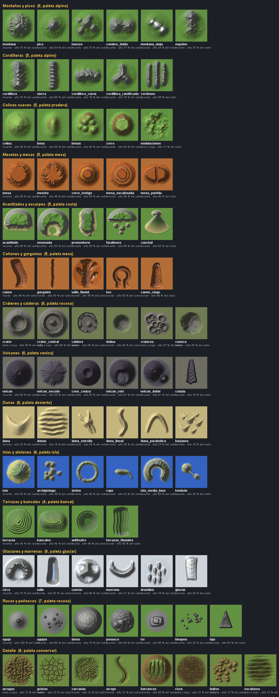

Cada sello estampado en bloques con radio 30, su altura natural y la paleta de su categoría:

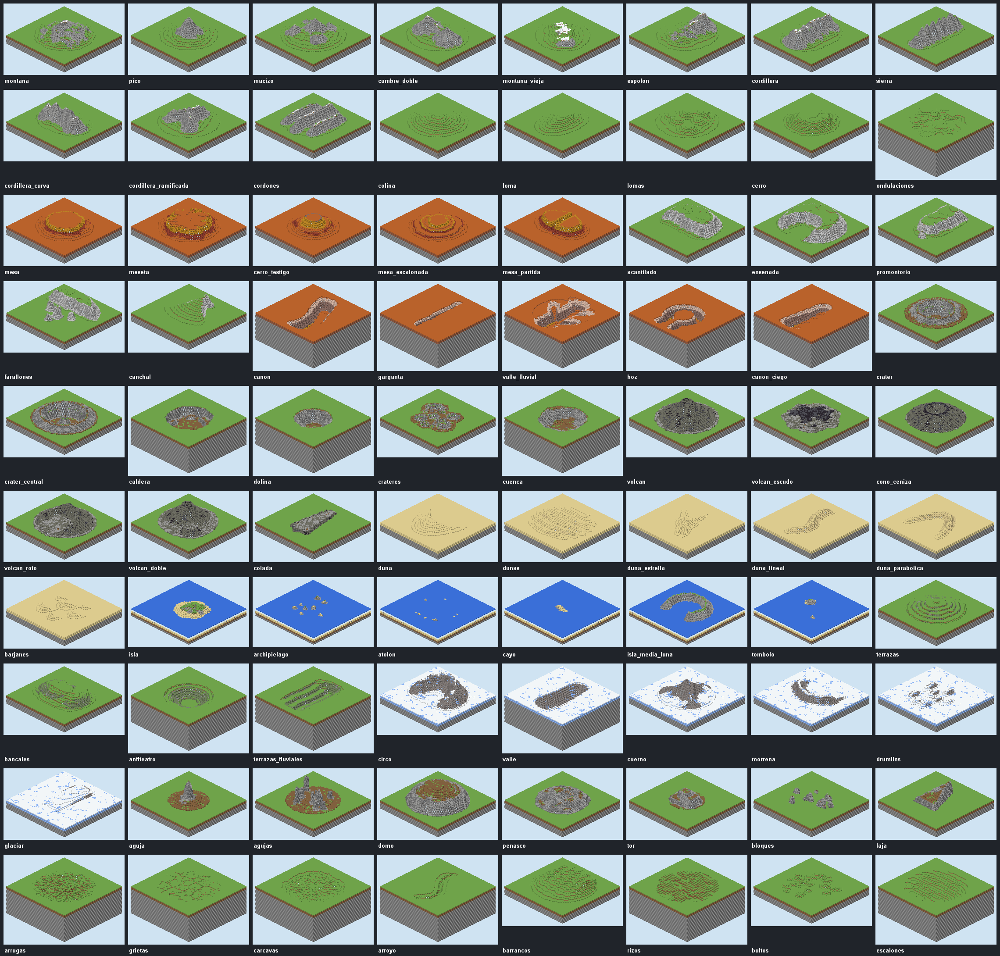

Tres paisajes hechos **solo estampando** sobre un llano (con la variación de cada clic):

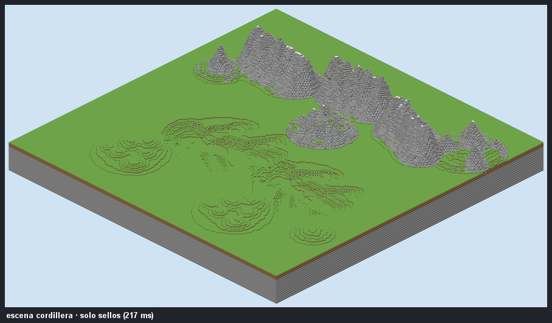

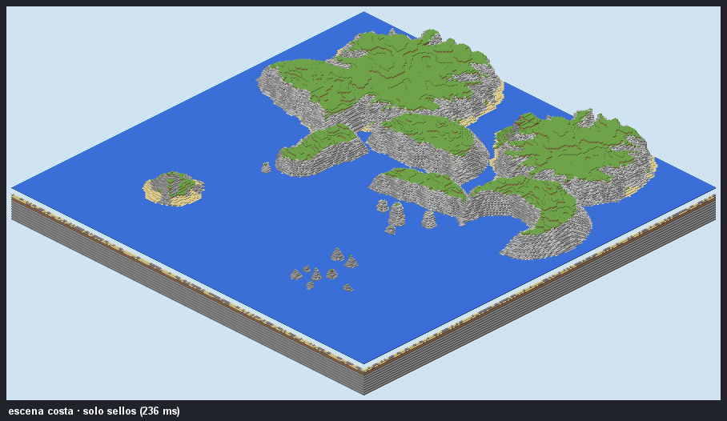

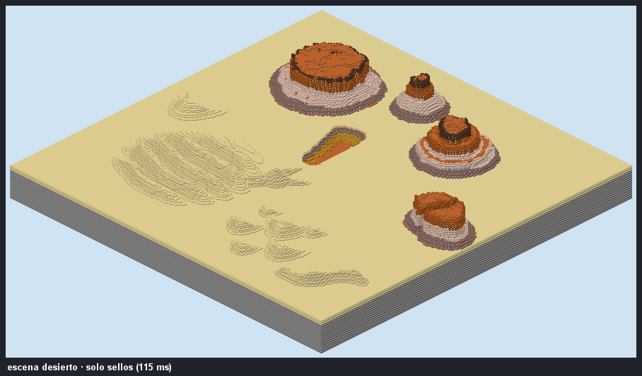

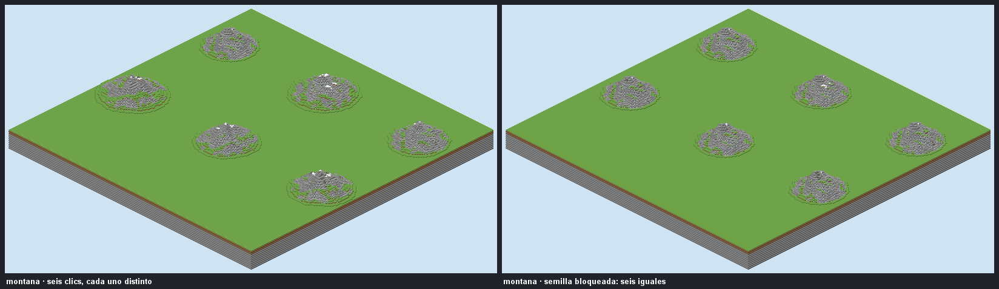

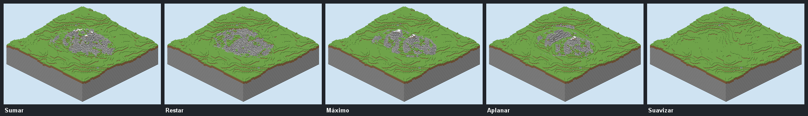

- **Dónde están:** dentro del jar, como PNG de 16 bits de 160×160 (`assets/komaedit/stamps/`, unos 1,6 MB en total, con la altura guardada a 1/4096). Se leen al primer uso de cada uno en unos milisegundos. Generarlos al arrancar costaría unos 12 s de CPU en cada cliente y servidor la primera vez y, como la erosión es caótica, dos Java distintas podrían dar cauces algo distintos: la miniatura del cliente no sería exactamente lo que estampa el servidor. Una prueba comprueba que los PNG del jar son los de las recetas.
- **Rendimiento:** un clic de radio 32 con erosión horneada cuesta lo mismo que antes (el sello ya viene hecho); muestrear con giro, escala, espejo y ruido fino es una interpolación y una octava de ruido por columna.
- **Limitaciones:** el sello cubre como mucho un cuadrado de 64×64 bloques con el radio máximo (32), así que una cordillera larga se hace con varios clics (mejor en `maximo`). Las formas son de una sola capa de altura por columna: no hay arcos ni salientes. La nieve de `alpino` sale en lo alto del sello; una paleta con `cumbre` fija (`natural`) sigue usando su Y.

### Pincel de pintura

Recolorea la **superficie** con un degradado de la paleta **sin cambiar ninguna altura**, arrastrando como un pincel de dibujo: lo que hasta ahora solo se podía hacer sobre una selección (texturizado, `shade`, `terreno pintar`) ahora se pinta a mano. Pensado para empezar sin saber nada: `/komaedit pincel pintar` y mantener el clic derecho sobre una ladera pinta hierba en lo llano y piedra en lo empinado.

```text
/komaedit pincel paint [paleta] [radio] [pendiente|altura|ruido|huella] [fuerza] [-h huella] [-s semilla] [-k] [-e espaciado] [-u dureza] [-j variación] [-d capas] [-t] [-c] [-x] [-b bloques] [-m máscara] [-y desde..hasta] [-a grados..grados] [-n ruido] [-z tamaño] [-p]
```

- Alias: `pintar` (y `pt`). Los posicionales van en cualquier orden: el primer número es el radio (8 de serie, hasta 32), el segundo la fuerza en % (60), una palabra de degradado el modo (`pendiente` de serie) y lo demás, la paleta.
- Permiso: `komaedit.build.brush.paint` (paquete intermedio) o `komaedit.build`.
- **Controles:** clic derecho pinta un toque; **mantenerlo y arrastrar** pinta a lo largo del trazo. Clic izquierdo: un toque con la paleta al revés. **F**: semilla nueva (🎲). **Mayús + F**: bloquea o libera la semilla. La barra de acción dice la semilla.
- **Paleta:** cualquiera de KomaEdit (`##Nombre`, una guardada con `#nombre` o una lista `stone,andesite,tuff`) ordenada del primer tono al último, o una de serie del pincel:

| Paleta | Tonos | Para |
| --- | --- | --- |
| `hierba_piedra` (de serie) | hierba, musgo, tierra gruesa, grava, andesita, piedra | por pendiente: hierba en lo llano, piedra en las paredes |
| `bosque` | hierba, podzol, tierra gruesa, tierra enraizada, piedra musgosa, toba | por pendiente |
| `musgo` | hierba, musgo, piedra musgosa, adoquín, piedra | por pendiente o por ruido |
| `nevado` | nieve, calcita, diorita, andesita, piedra, toba | por pendiente: nieve en lo llano |
| `cumbres` | hierba, tierra gruesa, piedra, andesita, calcita, nieve | por altura: hierba al pie y nieve arriba |
| `costa` | arena, grava, tierra gruesa, hierba | por altura: de la orilla a la hierba |
| `desierto` | arena, arenisca, arena roja, arenisca roja, terracota | por pendiente |
| `mesa` | arena roja y seis terracotas | por altura: estratos |
| `volcanico` | toba, pizarra abismal, basalto liso, piedra negra, basalto | por pendiente o por ruido |

- **Huella (`-h`):** la forma del pincel vista desde arriba, como máscara de intensidad: `circulo` (de serie), `cuadrado` o cualquier sello del [pincel de relieve](#pincel-de-relieve-sellos), de serie o propio, donde lo que se aparta del gris neutro pinta más (también lo hundido de una dolina). La **dureza** (`-u`, 30 % de serie) decide el borde: 0 lo difumina desde el centro y 100 lo corta.
- **Degradado (cómo se reparte la paleta dentro de la pincelada):**
  - `pendiente` (de serie): lo llano, el primer tono; lo empinado, el último. De serie de 30° (hasta ahí aguanta la hierba; una cuesta de un bloque por bloque son 45°) a 65°; `-a 20..55` lo cambia. La pendiente se mide en la columna con la altura del suelo a dos bloques.
  - `altura`: lo bajo, el primer tono; lo alto, el último. Sin `-y`, al empezar cada trazo se mide el terreno de alrededor (el mapa de alturas en 64 bloques a la redonda, sin hojas) y la franja va del 5 % al 95 % de esas alturas, con 8 bloques como mínimo: pintar una colina reparte la paleta entre su pie y su cima aunque se empiece por el llano. `-y 60..120` la fija.
  - `ruido`: manchas con la semilla del pincel, de `-z` bloques (12 de serie); `-n` usa otro ruido (el [ruido configurable](#ruido-configurable) o uno guardado) tal cual.
  - `huella`: el centro del toque, el primer tono; el borde, el último. Al arrastrar sale un camino con el borde de otro color.
- **Mezcla tramada:** cada bloque cae entre dos tonos vecinos al azar en la proporción que le toca (un 2,3 da un 70 % del tono 2 y un 30 % del 3), así no hay bandas; la **variación** (`-j`, 15 %) mueve además las fronteras con ruido para que no salgan rectas.
- **Fuerza y pasadas:** la fuerza es la de un trazo, como la opacidad de un pincel de dibujo. Un bloque que estaba en el tono `p` al empezar el trazo se acerca al que le toca `P` hasta `p + (P - p) · fuerza · intensidad de la huella`: los toques que se solapan al arrastrar no se suman (da igual ir despacio o deprisa) y es **otra pasada** la que empuja un poco más, sin saltar del primero al último. Lo que no es de la paleta (la hierba de alrededor de otro color, la tierra de un corte) se cubre con esa misma probabilidad, así el borde se funde con el terreno.
- **Semilla, como en Axiom:** el ruido, la trama y el giro de la huella salen de una semilla que se ve (en la barra de acción y en el Studio) y se elige con `-s`. Con la semilla **libre**, cada toque gira la huella al azar y cambia un poco su tamaño (±15 %), distinto en cada clic. **Bloqueada** (`-k`), la huella no gira ni cambia y el mismo trazo sobre el mismo terreno pinta siempre lo mismo. Al cambiar los ajustes desde el Studio sin semilla escrita, el pincel conserva la suya.
- **Espaciado (`-e`):** distancia entre toques al arrastrar, en % del radio (30 de serie, de 5 a 200).
- **Qué se pinta:** de serie solo la superficie (los bloques que tocan el aire o algo abierto, como plantas, hojas o nieve en capa) hasta `-d` capas hacia dentro (1); `-t` pinta todo el volumen del pincel. Las **escaleras y losas** se pintan con la escalera o losa del material del tono y conservan su forma y orientación (`-c` las deja como están; si el material no tiene esa pieza, se quedan). Sin máscara solo se toca el terreno natural (tierras, piedras, arenas, terracotas, nieve, hielo, menas, Nether y End) y los bloques de la propia paleta, para no repintar una casa al pasar al lado; `-x` deja pintar cualquier bloque. `-b grass_block,dirt` pinta solo esos bloques y `-m` acepta una máscara de WorldEdit completa (las dos juntas se suman). Hojas, troncos y plantas nunca se pintan.
- **Alcance:** cada toque mira desde el suelo de la columna del centro hasta `radio + 4` bloques por encima y por debajo (entre 8 y 28).
- **Vista previa:** con `-p` cada clic es un toque con su holograma y `/komaedit pincel aplicar`, sin arrastrar.

```text
/komaedit pincel pintar
/komaedit pincel pintar cumbres 14 altura -h montana
/komaedit pincel pintar musgo ruido 80 -z 8
/komaedit pincel pintar ##Grayscale 6 huella -u 70
/komaedit pincel pintar desierto 12 -h dunas -s 4242 -k
/komaedit pincel pintar bosque -b grass_block,dirt,coarse_dirt -d 2
```

- **En el Studio:** tarjeta **Pintar terreno** de la familia Terreno, junto al sello de relieve. A la vista: la paleta con la **muestra de su degradado** (sus bloques en celdas, con la misma trama que pone el pincel; «Propia» deja escribir cualquier paleta), la **huella** con su miniatura (el círculo, el cuadrado y los sellos como mancha de luz), el degradado, el radio, la fuerza, la semilla con **Azar** (`R`). En **Más ajustes**: **Bloquear semilla**, espaciado, dureza, variación, las pendientes o alturas de cada extremo (según el modo), el tamaño de las manchas, capas, solo la superficie, escaleras y losas, cualquier bloque, solo estos bloques, máscara y vista previa en cada clic. Presets: **Ladera** (lo de serie), **Cumbres**, **Manchas** y **Desierto**. **Al pincel** deja el pincel en la mano y [lo sigue](#el-pincel-sigue-al-studio); con el Studio abierto, se pinta ahí mismo manteniendo el clic en el mundo (ver [El ratón en el mundo](#el-ratón-en-el-mundo)).
- **Un trazo, un //undo:** todo lo que se pinta mientras se mantiene el clic es una sola edición del historial de WorldEdit (se cierra al soltar el botón). Lo que cambies a mano mientras tanto no se pisa: cada bloque se escribe solo si sigue como estaba en la foto.
- **Rendimiento:** la paleta (con sus losas y escaleras y lo que pone sobre cada estado), la huella medida, las máscaras sencillas y los ruidos se preparan una vez al configurar el pincel (o al cambiarlo desde el Studio): ningún clic lee del disco. Minecraft repite el clic derecho cada 4 ticks; entre medias el servidor mira cada tick hacia dónde apuntas y lo confirma con la siguiente repetición, así el trazo es suave y acaba donde sueltas. Los toques se calculan en tandas (hasta 24, o lo que quepa en 1,5 millones de bloques leídos): foto repartida entre ticks (4 ms por tick), cálculo en un worker propio que no cancela ni espera a otros pinceles y escritura con 4 ms por tick; cada tanda empieza cuando la anterior está escrita, para que los toques nuevos vean lo pintado. En el worker, un toque cuesta unos 0,4 ms con radio 8 y unos 2 ms con radio 16 (`PaintStrokeBenchmarkTest`).
- **Limitaciones:** un trazo pinta como mucho el límite de operación del servidor (al llegar, el chat lo dice y lo pintado se queda); el límite de WorldEdit (`//limit`) también lo para. Con la semilla bloqueada y poca fuerza, repasar puede quedarse a medio camino del tono (la trama es la misma en cada pasada): sube la fuerza o libera la semilla. Los clientes sin KomaEdit también arrastran (el clic derecho se repite igual), pero sin la F.

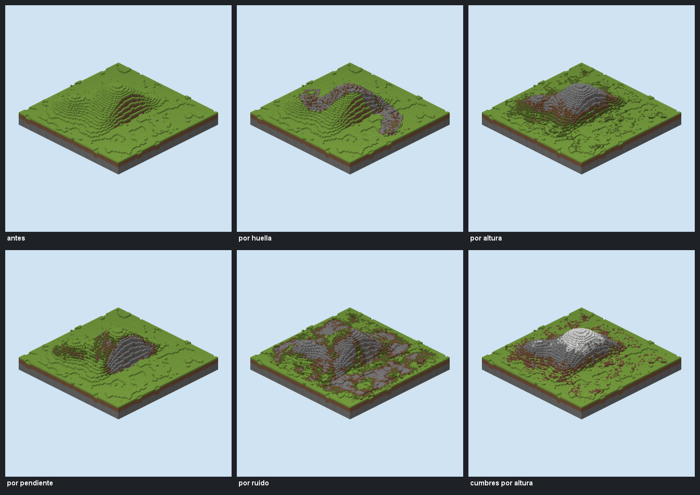

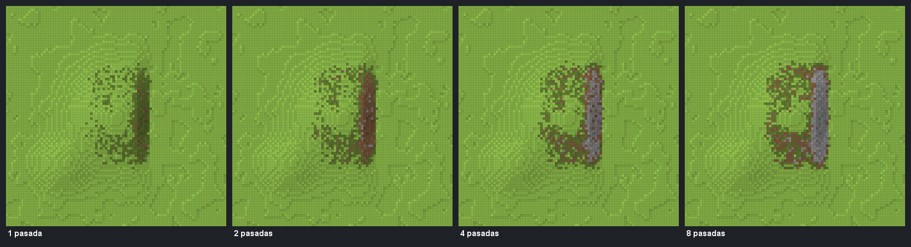

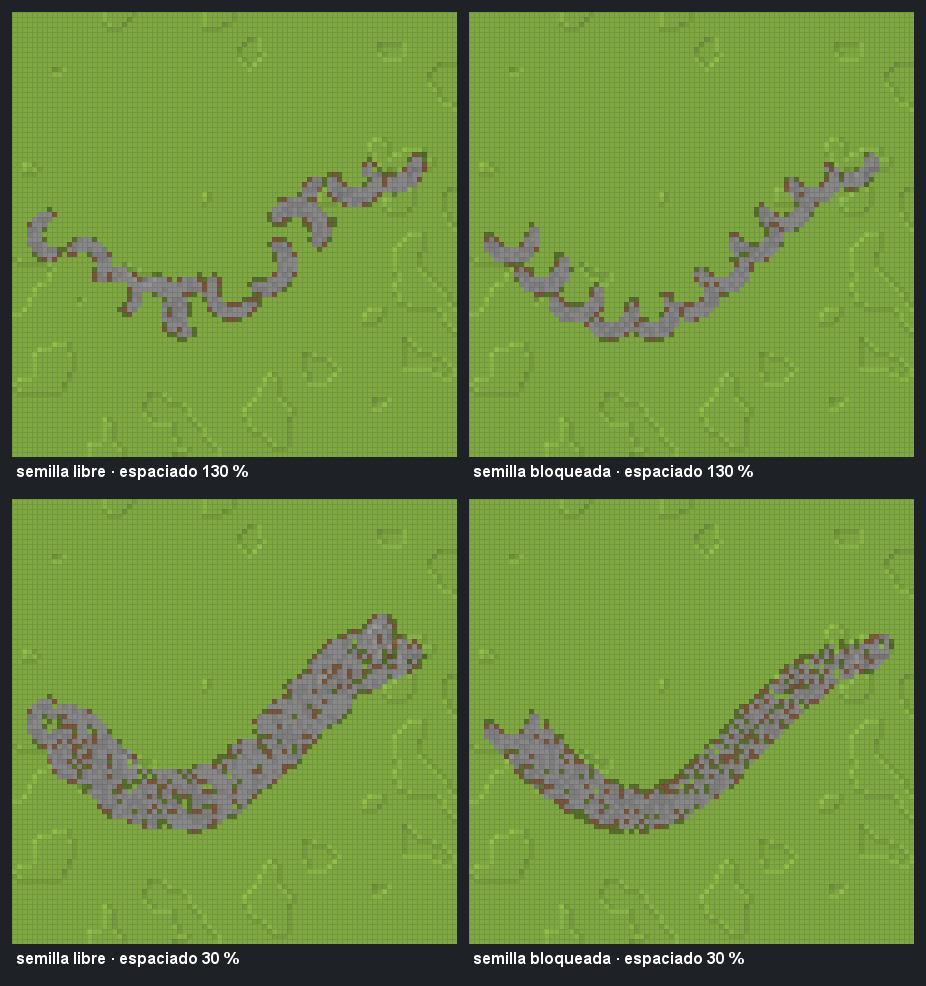

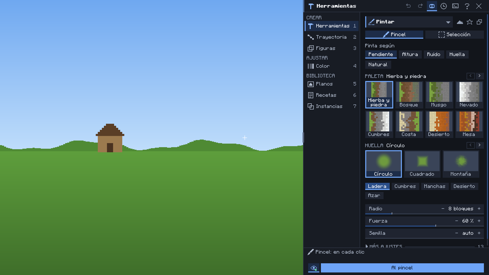

### Rampa

Una rampa del **primer al último punto** de la trayectoria (`/komaedit path`), o de `//pos1` a `//pos2` si no hay trayectoria. Los dos extremos son el bloque de la calzada: la rampa empieza y acaba a su altura. Rellena por debajo y recorta por encima (hasta 32 bloques de desnivel con el terreno).

- **`plano`** (por defecto): sección plana de `[ancho]` bloques (5 por defecto) y una franja de `[transición]` bloques a cada lado (6) que la funde con el terreno con una curva suave.
- **`cono`**: sección de terraplén. Fuera de la calzada el terreno queda entre dos taludes que bajan (relleno) o suben (desmonte) `-t` bloques por bloque (1, unos 45°), así nunca hay paredes y el terraplén acaba donde toca el terreno.
- Los extremos se redondean. `-u` pone un perfil suave a lo largo: empieza y acaba más tendida.
- **Sin escalones:** una rampa que sube más de un bloque por bloque (1,5 veces menos con `-u`) daría escalones y se rechaza con un aviso para alejar los puntos. En la calzada y, con un talud de hasta 1, también en los taludes, dos columnas vecinas nunca se separan más de un bloque. En `plano`, la transición solo queda sin escalones si es más ancha que 1,5 veces el desnivel con el terreno.

```text
/komaedit terreno rampa
/komaedit terreno rampa cono 7 -t 0.8
/komaedit terreno rampa plano 4 10 desierto -u
```

### Ríos y cañones

Tallan un cauce a lo largo de la trayectoria (curva suave por sus puntos; también cerrada, para un foso) o de los puntos de la selección.

- **Sección:** un fondo plano de `[ancho]` bloques, orillas en curva suave de `-o` bloques que suben `[profundidad]` y, por fuera, una ladera con `-w` bloques de subida por bloque a lo largo de `-t` bloques. Donde el terreno es más bajo que esa sección no se toca, y donde es más alto la ladera lo corta hasta encontrarse con él; en el borde se funde con un mínimo suave y una franja de fundido, así no quedan aristas ni muros.
- **El agua no sube:** el fondo es el terreno del eje menos la profundidad, con el mínimo acumulado en el sentido del agua y una media móvil de `-z` bloques que conserva ese orden; después se recorre el eje y ninguna columna puede quedar más alta que las anteriores. El agua corre hacia el extremo más bajo (el chat avisa si va al revés que los puntos); `-k` respeta el orden de los puntos y `-y` hace que el fondo siga la altura de los puntos menos la profundidad (sin pasar del terreno) en lugar del terreno.
- **Agua o lava:** `-f agua` (por defecto en río, arroyo y cañón), `-f lava` o `-f seco` (por defecto en el barranco). `-n` es el nivel sobre el fondo (el del preajuste, sin pasar de la profundidad menos uno). El nivel también baja a escalones en el sentido del agua; donde el terreno de al lado queda más bajo que el agua se levanta un ribazo, ataludado hacia fuera, para que no se escape.
- **Materiales:** el lecho (lo que queda bajo el agua) sale de la clave `lecho` de la paleta, la orilla de `orilla` y las laderas de la regla de pendiente; con `volcanico`, un río de lava lleva magma y piedra negra.
- Quita la vegetación (troncos, hojas, plantas) que quedaría flotando sobre lo tallado.

| Preajuste | Ancho | Profundidad | Orilla | Laderas | Transición | Líquido |
| --- | --- | --- | --- | --- | --- | --- |
| `rio` | 5 | 3 | 4 | 1 | 6 | agua a 2 |
| `arroyo` | 2 | 2 | 1,5 | 1 | 4 | agua a 1 |
| `canon` | 5 | 12 | 3 | 3 | 12 | agua a 2 |
| `barranco` | 1 | 5 | 2 | 1,5 | 8 | seco |

```text
/komaedit terreno rio
/komaedit terreno rio 7 4 bosque
/komaedit terreno canon 6 24 mesa -o 7 -w 2.5
/komaedit terreno rio 4 3 volcanico -f lava
/komaedit terreno barranco 2 6 -t 12
```

### Erosión física

Erosiona la selección de WorldEdit (con su forma: cilindros, polígonos…) sobre su mapa de alturas. Es mucho más realista que el pincel `erosion` de `/komaedit sculpt`, que solo media alturas vecinas y sigue disponible.

- **`hidraulica`:** simulación de gotas. Cada gota cae en un punto al azar, baja por la pendiente con algo de inercia, arranca suelo mientras va deprisa y con poca carga y lo suelta donde frena o sube. Salen cauces que se juntan, crestas afiladas y abanicos de sedimento al pie de las laderas. `[iteraciones]` son las gotas por columna (3 por defecto, de 0,1 a 64) y `[fuerza]` (1 por defecto, de 0,1 a 8) escala lo que arranca y lo que lleva cada gota.
- **`termica`:** por talud. Donde una columna queda por encima de sus vecinas más de lo que permite el ángulo de reposo `-a` (40° por defecto), el material resbala hacia ellas y al pie de los cortados se forman canchales. La dureza de la roca varía un poco con un ruido fijo, para que queden resaltes en lugar de un cono perfecto. `[iteraciones]` son las pasadas (40 por defecto, hasta 2000) y `[fuerza]` la parte del exceso que se mueve en cada una (1, de 0,1 a 2).
- **`completa`:** primero las gotas y luego cinco pasadas térmicas con 8° más de ángulo, que solo desmoronan las paredes que dejan las cárcavas.
- **Masa:** lo que se arranca se deposita en otra parte (al morir, cada gota deja su carga donde está), así que el volumen se conserva salvo el redondeo de cada columna a bloques. Las columnas fijas (fuera de la máscara o con la superficie fuera de la selección) guían a las gotas pero no se tocan.
- **Determinista:** con la misma semilla `-s` y la misma selección sale lo mismo; sin `-s`, una al azar.
- Después se pinta con la paleta: lo arrastrado deja piedra al aire y los depósitos se cubren de hierba (o de lo que diga la paleta; `conservar` mantiene los bloques de cada columna).
- La selección tiene que abarcar todo el relieve, de debajo del suelo a encima de las cumbres: lo que asoma por arriba de la selección no se erosiona.

```text
/komaedit terreno erosion hidraulica
/komaedit terreno erosion hidraulica 6 1.5 -s 42
/komaedit terreno erosion termica 80 1 -a 35
/komaedit terreno erosion completa 4 1 nevado -m grass_block,snow_block,stone
```

### Pintar

`/komaedit terreno pintar [paleta]` repinta la superficie de la selección (la de arriba y las capas de relleno) con la paleta de superficie sin cambiar ninguna altura: sirve para dar materiales a un terreno hecho a mano o generado con otra herramienta.

### Rendimiento y limitaciones

- El cálculo va en un worker y no para el servidor: en una zona de 160×160 columnas, cinco sellos tardan unos 150 ms, un río de 200 bloques unos 150 ms, 40 pasadas térmicas unos 150 ms y la erosión hidráulica con 3 gotas por columna (77 000 gotas) medio segundo. Lo que más tarda es leer la zona, repartida entre ticks (unos 4 ms por tick).
- La rampa y el río leen la caja que los rodea: de largo, su recorrido más el alcance de la sección; de alto, de algo por debajo del fondo a 24–96 bloques por encima del punto más alto. Pasa por el límite de volumen de las operaciones de región (16 millones de bloques leídos y el límite de operación del servidor sobre la caja); para ríos muy largos, por tramos.
- El pincel lee como mucho 4 millones de bloques por clic (radio 32 y altura 96 caben) y cambia como mucho 1 000 000.
- El mapa de alturas es de una sola capa: no hay voladizos ni cuevas en el resultado, y las cuevas bajo la superficie ni se rellenan ni se vacían. Lo que no es suelo (hojas, troncos, plantas, cristal, losas) no cuenta como superficie: al bajar una columna se quita lo que quedaría flotando y al subirla se entierra.
- El agua y la lava se colocan como bloques fuente; en cada escalón del nivel hay un pequeño salto de agua.
- Las órdenes `terreno` admiten la [vista previa](#vista-previa-progreso-y-cancelación) del motor común con `-v` (o «previsualizar siempre»), con su barra de progreso y `/komaedit cancel`; el pincel tiene la suya con `-p`. `-e` da solo la estimación y todo se deshace con //undo.
- Renders de antes y después en `docs/renders/terreno/`; se regeneran con `KOMAEDIT_RENDER_DIR=<carpeta> ./gradlew test --tests "*TerrainRenderDump"`.

## Pinceles

### Objetivo y acceso

Los pinceles de ezEdits (`//ezbrush`) dentro del sistema de brochas de KomaEdit: cada clic se captura, se calcula en un worker y se aplica como **una sola operación de //undo**, igual que las brochas de esculpido.

```text
/komaedit pincel <tipo> [parámetros] [banderas]
/komaedit ezbrush <tipo> [parámetros] [banderas]
/komaedit pincel aplicar | cancelar | quitar | estado
/komaedit pincel actualizar <tipo> [parámetros] [banderas]
```

| Tipo | Alias | Pincel |
| --- | --- | --- |
| `paletteshift` | `desplazar`, `ps` | [Desplazar paleta](#pincel-desplazar-paleta) |
| `gradient` | `degradado`, `gr` | [Degradado](#pinceles-de-degradado) |
| `gradientstroke` | `trazo`, `gs` | [Trazo de degradado](#pinceles-de-degradado) |
| `petalpainter` | `petalos`, `pp` | [Pintor de pétalos](#pintor-de-pétalos) |
| `place` | `colocar`, `pl` | [Colocación](#pincel-de-colocación) |
| `scatter` | `dispersar`, `sc` | [Dispersión](#pincel-de-colocación) |
| `array` | `hilera`, `ar` | [Hilera a lo largo de un trazo](#pincel-de-colocación) |
| `tree` | `arbol`, `tr` | [Un árbol en cada clic](#pinceles-de-árboles-y-rocas) |
| `rock` | `roca`, `rk` | [Una roca en cada clic](#pinceles-de-árboles-y-rocas) |
| `heightmap` | `relieve`, `sello`, `hm` | [Pincel de relieve](#pincel-de-relieve-sellos) (propio de KomaEdit) |
| `sculpt` | `modelar`, `modelado`, `sk` | [Modelado](#pinceles-de-modelado): esculpir, roca, soldar, fundir, rugosidad y grietas (propio de KomaEdit) |
| `stamp` | `estampar`, `planos`, `st` | [Estampar planos de la biblioteca](#pincel-estampar) (propio de KomaEdit) |
| `paint` | `pintar`, `pt` | [Pintar el terreno con un degradado, arrastrando](#pincel-de-pintura) (propio de KomaEdit) |

- El pincel se liga al **objeto de la mano principal**, como los de WorldEdit: cada objeto guarda el suyo y se pueden llevar varios a la vez. Con la mano vacía se entrega una pluma llamada «Pincel de KomaEdit». Volver a configurar un objeto que ya tiene pincel lo sustituye.
- `quitar` (`off`, `none`) suelta el pincel del objeto de la mano; `estado` (`status`) dice qué pincel lleva y sus controles.
- `actualizar` (`update`) cambia los ajustes del pincel que ya tienes en la mano, solo si es de ese tipo, y lo dice en la barra de acción: nunca marca ni entrega otro objeto. Es lo que manda el Studio al cambiar la tarjeta del pincel (ver [El pincel sigue al Studio](#el-pincel-sigue-al-studio)).
- Los pinceles apuntan al bloque que miras hasta a **192 bloques**.
- Permiso: `komaedit.build` o el de cada pincel, `komaedit.build.brush.<tipo>` (ver [Permisos](#permisos)).

### Comportamiento común

- **Controles:** con un pincel en la mano, el clic izquierdo no rompe bloques, el derecho no usa el objeto y la tecla de cambiar de mano (F) no cambia de mano: todo se lo queda el pincel. Mantener el clic derecho repite la pasada, como un pincel de verdad.
- **Vista previa:** con `-p` cada clic calcula la pasada y la deja en el holograma (una caja con el color del pincel) en vez de aplicarla; `/komaedit pincel aplicar` la coloca y `/komaedit pincel cancelar` la descarta. Sin `-p` se aplica en el acto.
- **Historial:** cada pasada es una edición por lotes de `BatchEditService` y queda en el historial de WorldEdit; `//undo` la quita entera y `/komaedit job status|cancel` funcionan como en el resto del mod.
- **Rendimiento:** la paleta se lee y se convierte en estados una vez por pincel, y lo que pone cada entrada sobre cada estado del mundo (con sus propiedades copiadas) se recuerda en el pincel; todo se rehace solo al configurarlo de nuevo (también con los cambios del Studio). Las máscaras sencillas (`#fullblock`, listas de bloques) se leen una vez por pincel; las de WorldEdit (`#hotbar`, `#aim`, `#fuzzypalette[…]`…) en cada clic, porque fijan lo del momento. Las paletas guardadas (`#nombre`) no se vuelven a leer del disco mientras el archivo no cambie. La foto del terreno se reparte entre ticks con hasta 5 ms por tick: un pincel de radio 8 a 12 empieza a calcular en el siguiente tick. Lo que sigue costando lo mismo con cualquier paleta es el ruido (`-n`, sobre todo los fractales de varias octavas, como `ridged`) y colocar bloques que dan luz (como los de `##Magma`), que obliga a Minecraft a recalcular la iluminación.
- **Paletas:** donde un pincel pide una paleta vale la notación de ezEdits (`##Magma`, `-##Grayscale(1:8)`, `stone*3,andesite`…, ver [Paletas con nombre](#paletas-con-nombre)) y tus [paletas guardadas](#paletas-guardadas) con `#nombre`. Las entradas tienen que ser bloques sueltos, con estado si hace falta (`oak_log[axis=x]`); los patrones aleatorios de WorldEdit no valen dentro de un pincel.
- **Ruido:** `-n` acepta el [ruido configurable](#ruido-configurable) y los [ruidos guardados](#ruidos-guardados), y `-z` multiplica las coordenadas antes de muestrearlo. Sin `-n` el ruido es blanco por bloque: cada bloque tira su propio dado.
- **Piezas (`-w`):** con `-w` los pinceles de paleta también pintan losas y escaleras, cambiándolas por la losa o escalera del material de la paleta (la misma que usa el modo [losas y escaleras](#losas-y-escaleras-en-la-superficie): por nombre o del color más parecido) y conservando su forma, orientación y anegado. Sin `-w` las piezas no se tocan.
- Lo que no es un cubo entero (flores, vallas, antorchas, carteles…) nunca se pinta.
- Con KomaEdit solo en el servidor (cliente vanilla) el pincel responde al clic derecho y al izquierdo sobre bloques al alcance; la F y el clic izquierdo a distancia necesitan el mod en el cliente.

### Rendimiento y limitaciones

- El cálculo es lo de menos: con radio 32 (unos 140 000 bloques) tarda menos de 20 ms en un worker. Lo que cuesta es leer la zona, que se reparte entre ticks (unos 16 000 bloques por tramo): con el radio por defecto (8) es instantáneo y con radio 32, alrededor de un segundo.
- Radio de 1 a 32. Una pasada lee como mucho 4 millones de bloques y cambia como mucho 1 000 000 (o el límite de operación del servidor, si es menor).
- Una pasada nueva cancela la anterior si aún se estaba calculando; si la anterior ya se está escribiendo, la nueva se descarta y el chat lo avisa.
- La vista previa es la caja que ocupa la pasada, no los bloques uno a uno.
- Los pinceles viven en la sesión: se pierden al salir del servidor o reiniciarlo (la marca del objeto se queda y basta con volver a configurarlo).

## Pincel Desplazar paleta

### Objetivo y acceso

Recorre una paleta bloque a bloque: cada bloque del pincel que esté en la paleta pasa al que tiene unas posiciones más allá. Sirve para oscurecer, aclarar, envejecer o «subir de nivel» una zona sin perder su textura (el Palette Shift de ezEdits).

```text
/komaedit pincel paletteshift <paleta> [radio] [desplazamiento] [-r] [-p]
```

### Comportamiento

- **Clic derecho** desplaza hacia delante; **clic izquierdo**, hacia atrás. Con desplazamiento 2, el primer bloque de la paleta pasa a ser el tercero.
- Se mira el id del bloque, no su estado: una escalera de la paleta sigue siendo escalera y conserva su orientación.
- Las **losas y escaleras** del material de cada entrada cuentan como esa entrada y pasan a la losa o escalera del material de destino. Si ese material no tiene, se quedan como estaban.
- Si un bloque se repite en la paleta (`stone*3,andesite`), hacia delante se cuenta desde su última aparición y hacia atrás desde la primera: un desplazamiento de 1 siempre cambia algo.
- En los extremos el bloque se queda en el primero o el último de la paleta; con `-r` da la vuelta (el último pasa al primero).
- Los bloques que no están en la paleta no se tocan.

### Parámetros

| Parámetro | Efecto |
| --- | --- |
| `<paleta>` | Al menos dos bloques, en orden. |
| `[radio]` | Radio de la esfera (1–32, por defecto 8). |
| `[desplazamiento]` | Posiciones que avanza cada clic (−255 a 255, por defecto 1). |
| `-r` | Da la vuelta en los extremos. |
| `-p` | Vista previa antes de aplicar. |

Ejemplos:

```text
/komaedit pincel paletteshift ##Grayscale
/komaedit pincel paletteshift stone,andesite,cobblestone,mossy_cobblestone 6 1
/komaedit pincel desplazar -##Magma 12 2 -r
```

### Rendimiento y limitaciones

- Ver [Pinceles](#pinceles). Las paletas de serie mezclan materiales de familias distintas: para envejecer una pared conviene una paleta propia del mismo material.

## Pinceles de degradado

### Objetivo y acceso

Pintan un degradado de paleta sobre lo que ya hay construido (los Gradient y Gradient Stroke de ezEdits): el color de cada bloque sale de su posición entre dos puntos, o a lo largo de un trazo, mezclado con ruido.

```text
/komaedit pincel gradient <paleta> [radio] [interpolación] [sangrado] [-a] [-v] [-w] [-n <ruido>] [-z <escala>] [-d <distancia>] [-p]
/komaedit pincel gradientstroke <paleta> [radio] [interpolación] [sangrado] [-a] [-d] [-v] [-w] [-x] [-n <ruido>] [-z <escala>] [-p]
```

### Comportamiento

**Degradado (`gradient`):**

- **Clic izquierdo** marca el inicio en el bloque que miras (**Mayús**: en tus pies). **Clic derecho** marca el final (**Mayús**: en tus pies); con los dos puestos, cada **clic derecho** pinta la esfera del pincel donde miras.
- El degradado va del primer punto (primera entrada de la paleta) al segundo (última), por planos perpendiculares a la recta que los une: lo que queda antes del inicio es la primera entrada y lo que queda después del final, la última.
- Con `-d <distancia>` el degradado se mide desde el primer punto hacia fuera, con la distancia `euclidean`, `manhattan` o `chebyshev`; el segundo punto marca dónde termina.
- **F** cambia entre puntos **PER_ITEM** (de esta herramienta, por defecto) y **GLOBAL** (compartidos por todas tus herramientas de degradado).

**Trazo (`gradientstroke`):**

- **Clic izquierdo** añade un punto al trazo; **Mayús + izquierdo** quita el último. **Clic derecho** pinta el trazo entero; **Mayús + derecho** lo borra.
- Pinta un tubo de radio `[radio]` alrededor de la línea que une los puntos, con el degradado a lo largo del recorrido. Con `-d` el degradado va del eje del tubo (primera entrada) a su borde (última).
- `-x` borra el trazo después de cada pasada; sin él se puede repintar con otra paleta.
- **F** cambia entre trazo PER_ITEM y GLOBAL, como en `gradient`.

**En los dos:**

- Solo se pintan bloques enteros que ya existen; con `-a` también el aire (el trazo con `-a` construye el tubo) y con `-w` las losas y escaleras.
- Los puntos se marcan con partículas que solo ves tú; `-v` las quita.
- El **sangrado** y la **interpolación** deciden cómo se mezclan los colores vecinos. El ruido (de 0 a 1) se convierte en un empujón de −sangrado a +sangrado a lo largo del degradado:

| Interpolación | Efecto |
| --- | --- |
| `NONE` | Bandas limpias; el ruido no se usa. Por defecto en `gradient`. |
| `LINEAR` | El mismo empujón en todo el degradado: cerca de los extremos se sale de los dos puntos. Por defecto en `gradientstroke`. |
| `TAPERED` | Fuerte en el centro y nulo en los extremos (4·t·(1−t)): no ensucia el principio ni el final. |
| `BEZIER` | Curva de Bézier con el punto de control movido por el ruido: mezcla más suave. Con sangrado mayor que 1 deja de ser monótona y salpica. |
| `SIN` | Como `TAPERED`, con un seno: reparte el sangrado más ancho por el centro. |

### Parámetros

| Parámetro | Efecto |
| --- | --- |
| `<paleta>` | Al menos dos bloques; la primera entrada es el inicio. |
| `[radio]` | Radio de la esfera o del tubo (1–32, por defecto 8). |
| `[interpolación]` | `NONE`, `LINEAR`, `TAPERED`, `BEZIER` o `SIN` (también `ninguna`, `lineal`, `seno`). |
| `[sangrado]` | Cuánto se mezclan los colores (0–4, por defecto 0,5; lo normal, de 0 a 1). |
| `-n <ruido>` | Ruido de la mezcla, por ejemplo `Perlin(F:0.25)`. Sin él, blanco por bloque. |
| `-z <escala>` | Multiplica las coordenadas del ruido (por defecto 1). |
| `-d <distancia>` | (`gradient`) Degradado por distancia al inicio: `euclidean`, `manhattan`, `chebyshev`. |
| `-d` | (`gradientstroke`) Degradado del eje al borde del tubo. |
| `-a` | Pinta también el aire. |
| `-w` | Pinta también losas y escaleras con su pieza del material. |
| `-v` | Sin partículas en los puntos. |
| `-x` | (`gradientstroke`) Borra el trazo tras cada pasada. |
| `-p` | Vista previa antes de aplicar. |

Ejemplos:

```text
/komaedit pincel gradient ##Grayscale
/komaedit pincel gradient ##Magma 10 tapered 0.6 -n Perlin(F:0.25)
/komaedit pincel gradient stone,andesite,tuff,deepslate 8 linear 0.4 -w -n Ce(F:0.15)
/komaedit pincel gradient -##GlowBlue 12 sin 0.5 -d euclidean
/komaedit pincel gradientstroke ##Grayscale 3 linear 0.5 -a -x
/komaedit pincel trazo moss_block,mossy_cobblestone,cobblestone 4 tapered 0.8 -d
```

### Rendimiento y limitaciones

- Ver [Pinceles](#pinceles). El trazo lee la caja que lo contiene más el radio: un trazo de 100 bloques en diagonal con radio 4 son unos 170 000 bloques (alrededor de medio segundo).
- El trazo admite hasta 256 puntos y es una polilínea: no se suaviza en curva.
- La integración con WorldEditCUI de ezEdits se sustituye por las partículas de los puntos.

## Pintor de pétalos

### Objetivo y acceso

Esparce follaje en capas sobre el terreno (el Petal Painter de ezEdits): pétalos rosas, flores silvestres u hojarasca, con más o menos piezas por bloque y orientación al azar.

```text
/komaedit pincel petalpainter <tipo> [radio] [densidad] [-n <ruido>] [-z <escala>] [-m <máscara>] [-p]
```

### Comportamiento

- **Clic derecho** esparce el follaje en la esfera del pincel, justo encima del bloque que miras; **clic izquierdo** quita el follaje de ese tipo en la esfera.
- Cada hueco de aire con un bloque de la máscara debajo toma un valor del ruido. Si queda por debajo de la densidad recibe follaje, y cuanto más bajo, más piezas (de 1 a 4). Con el ruido blanco de serie, la densidad es la fracción de suelo cubierta.
- Donde ya hay follaje del mismo tipo, se conserva su orientación y solo se suben las piezas; como el ruido blanco cambia en cada clic, repasar una zona la va espesando. Con un ruido propio (`-n`) el dibujo se mantiene de un clic a otro.
- Las piezas nuevas se orientan al azar hacia los cuatro puntos cardinales.

### Parámetros

| Parámetro | Efecto |
| --- | --- |
| `<tipo>` | `petals` (`pink_petals`), `wildflowers` (`minecraft:wildflowers`) o `leaves` (`minecraft:leaf_litter`); también cualquier bloque con `flower_amount` o `segment_amount`. |
| `[radio]` | Radio de la esfera (1–32, por defecto 8). |
| `[densidad]` | Cuánto follaje (0–1, por defecto 0,3). |
| `-n <ruido>` | Ruido que reparte el follaje, por ejemplo `Perlin(F:0.05)` para manchas. |
| `-z <escala>` | Multiplica las coordenadas del ruido (por defecto 0,03, como en ezEdits; con `Perlin(F:1)` da manchas de unos 30 bloques). |
| `-m <máscara>` | Bloques sobre los que se pone (por defecto `#fullblock`). Cualquier máscara de WorldEdit, con las de ezEdits, entre comillas si lleva espacios; la lista de antes sigue valiendo: ids y `#fullblock`, `#solid` (cubo, losa o escalera) y `#existing` separados por comas, con `!` para excluir. |
| `-p` | Vista previa antes de aplicar. |

Ejemplos:

```text
/komaedit pincel petalpainter petals
/komaedit pincel petalpainter petals 10 0.6 -m grass_block,moss_block
/komaedit pincel petalos petals 16 0.5 -n Perlin(F:1) -z 0.05
/komaedit pincel petalpainter petals 6 1 -m #fullblock,!sand,!gravel
/komaedit pincel petalpainter petals 8 0.5 -m "##minecraft:dirt !#near[water][2]"
```

### Rendimiento y limitaciones

- Ver [Pinceles](#pinceles).
- Minecraft 1.21.1 solo tiene `pink_petals`: `wildflowers` y `leaf_litter` llegaron en 1.21.5 y dan un error claro hasta que KomaEdit se actualice. Los bloques de mods con `flower_amount` o `segment_amount` funcionan.
- La máscara se lee en cada clic, en el hilo del servidor (así `#aim` o el origen de `#radialgradientmask` son los del clic), y se evalúa sobre la foto de la pasada: fuera de ella todo es aire, y `#current` y las de bioma no se admiten.

## Pincel de colocación

### Objetivo y acceso

Los tres pinceles de colocación de ezEdits (`//ezbrush place`, `scatter` y `array`) con el mismo motor que [Colocar estructuras](#colocar-estructuras): todas las estructuras (`Clipboard`, `Schematic`, `Shape`, `Expression`, `TexturedShape`, `Icosphere`), todas las alineaciones y todas las banderas de `place`, `scatter` y `array`.

```text
/komaedit pincel place <estructura> [<primaria>] [<secundaria>] [banderas de place]
/komaedit pincel scatter <estructura> [<primaria>] [<secundaria>] [banderas de scatter]
/komaedit pincel array <estructura> [<primaria>] [<secundaria>] [banderas de array]
```

### Comportamiento

- **place:** cada **clic derecho** coloca una estructura en el bloque de aire delante de la cara que miras. `SurfaceNormal` es la normal del terreno alrededor del bloque mirado (se lee una caja de 7×7×7).
- **ViewDiff** (solo en `place`): el **clic derecho** marca dónde va la estructura y el **izquierdo**, en otro bloque, la dirección (del primero al segundo); con el segundo clic se coloca. Por ejemplo `/komaedit pincel place Cl SurfaceNormal ViewDiff`.
- **scatter:** cada **clic derecho** reparte estructuras por las superficies de una región centrada en el bloque mirado. Sin `-h` la región es una caja de 40×40×40 (`Box`); `-h Ellipsoid(D:"30,20,30")`, `Cylinder`, y también `Active(P:false)` o `Saved(Name:…,P:false)`, que llevan tu selección (o una guardada) al clic. `-l` con `-m` cubre lo ya sembrado para que los clics que se solapan no repitan.
- **array:** el **clic izquierdo** añade un punto al trazo (el bloque mirado), **Mayús + izquierdo** quita el último, el **clic derecho** coloca las estructuras a lo largo de la curva que pasa por los puntos (justo encima de cada uno) y **Mayús + derecho** borra el trazo. **F** cambia entre trazo de esta herramienta y global, como en el trazo de degradado.
- Cada pasada es una edición de `//undo`, con la misma escritura condicional del motor común. Sin `-i` cada clic usa una semilla nueva y el chat la dice.
- **Vista previa:** con `-p` el pincel `place` usa la colocación anterior, de giros de 90° y con holograma (`/komaedit pincel aplicar`): solo admite `Clipboard`, las alineaciones `Constant`, `Aim`, `Upward`, `SurfaceNormal`, `PlayerRelative` y `Random`, y las banderas `-a` y `-x`. En `array`, `-p` son los parámetros de la curva, como en el comando.

### Parámetros

Los de [Colocar estructuras](#colocar-estructuras), [Alineación primaria y secundaria](#alineación-primaria-y-secundaria), [Dispersión de estructuras](#dispersión-de-estructuras) y [Arrays a lo largo de la trayectoria](#arrays-a-lo-largo-de-la-trayectoria).

Ejemplos:

```text
/komaedit pincel place Clipboard
/komaedit pincel place Sh(S:Cone,P:diamond_block) PlayerRelative Constant -s 12,36,12
/komaedit pincel place Cl SurfaceNormal ViewDiff -j MULTIPLES_45
/komaedit pincel place Shape(S:Torus(Thickness:0.4),P:gold_block) PlayerRelative ViewDiff -s 20,20,30 -k x -c 90
/komaedit pincel scatter Sc(N:arbol_.*) C R -m grass_block -n 1 -o 0.8,1.3
/komaedit pincel scatter Sh(S:Crystal,P:amethyst_block,O:BOTTOM) S R -s 3,9,3 -h Ellipsoid(D:"20,14,20") -n 3
/komaedit pincel scatter Cl C R -m clay -l pink_wool
/komaedit pincel array Cl Tangential Constant -g 2
/komaedit pincel place Cl(R:90) C(D:south) C(D:east) -p
```

### Rendimiento y limitaciones

- Los límites son los del motor común (5000 estructuras y 1 500 000 bloques por pasada). Un clic nuevo cancela el cálculo anterior si aún no ha terminado.
- En estos pinceles `Constant(D:aim)` y `aim` en las direcciones son la mirada de **cada clic** (en ezEdits, la de cuando se configuró el pincel); para la de cada clic también está `Aim`.
- No hay visualizador de la alineación mientras apuntas (en ezEdits, entidades BlockDisplay).
- El trazo de `array` admite hasta 256 puntos; con `-b` cada colocación baja a la superficie más cercana.

## Pinceles de modelado

### Objetivo y acceso

Las herramientas de modelado de Axiom que faltaban, como pinceles de clic: **esculpir** (empujar o hundir la superficie), **roca**, **soldar**, **fundir**, **rugosidad** y **grietas**. Sirven para dar forma a terreno, acantilados y rocas a mano, y para retocar lo construido (unir piezas sueltas, redondear aristas, romper un muro).

```text
/komaedit pincel sculpt <modo> [radio] [cantidad] [banderas]
/komaedit pincel modelar <modo> …
/komaedit pincel <modo> …                    atajo: /komaedit pincel soldar 8
/komaedit sculpt set <modo> <patrón|auto> <radio> [altura] [intensidad] [caída] [hueco]
```

| Modo | Alias | Clic derecho | Clic izquierdo | `cantidad` (de serie) |
| --- | --- | --- | --- | --- |
| `draw` | `esculpir`, `dibujar` | Empuja la superficie hacia fuera | La hunde | Altura en bloques en el centro, 0,5–16 (2) |
| `rock` | `roca`, `rocoso` | Añade una masa rocosa | Talla esa forma | Rugosidad del ruido, 0–1 (0,4) |
| `weld` | `soldar`, `unir` | Suelda: solo añade | Funde | Umbral, 0,01–0,99 (0,4) |
| `melt` | `fundir`, `derretir` | Funde: solo quita | Suelda | Umbral, 0,01–0,99 (0,6) |
| `roughen` | `rugosidad`, `rugoso` | Hace rugosa la superficie | Lo mismo | Amplitud en bloques, 0,5–8 (1,5) |
| `shatter` | `grietas`, `agrietar` | Agrieta | Lo mismo | Tamaño de las celdas, 2–32 (60 % del radio, mínimo 3) |

- El radio va de 1 a 32 (6 de serie; 10 en las grietas).
- En `/komaedit pincel`, `rock` y `roca` son el pincel de rocas sueltas de [Árboles y rocas](#árboles-y-rocas); la roca de modelado es `/komaedit pincel sculpt rock` (o `modelar roca`). Los demás modos valen directamente como pincel: `/komaedit pincel grietas 12 -e y`.
- Permiso: `komaedit.build.brush.sculpt` (paquete intermedio) o `komaedit.build`. `/komaedit sculpt` no tiene nodo propio.

### Cómo trabaja cada modo

- **Esculpir:** calcula la normal media de la superficie bajo el pincel con los vecinos de cada bloque (los bloques llenos empujan, el aire tira) y desplaza la forma a lo largo de esa normal: el centro se mueve `cantidad` bloques y el resto lo que diga la caída, medida de lado a la normal. Funciona igual en un suelo, en una pared o en el techo de una cueva. Con `-s n` suaviza después `n` pasadas (0–4) dentro del pincel.
- **Roca:** un poliedro de caras al azar redondeado contra una esfera y deformado con ruido fractal, que asoma un poco de la superficie y se une a lo que hay con una unión suave (`-k`, de serie el 35 % del radio): rellena el hueco entre la roca y el suelo en vez de dejarla pegada. Cada clic es una roca distinta salvo con `-i`.
- **Soldar y fundir:** desenfoque gaussiano del volumen (`-g`, la desviación en bloques, 1,5 de serie) mezclado con la caída y cortado por el umbral. Con umbral bajo se rellenan rincones y huecos entre piezas (soldar une un pilar suelto a la pared); con umbral alto se comen aristas y esquinas (fundir redondea un bloque cuadrado). Soldar nunca quita y fundir nunca añade.
- **Rugosidad:** mueve la superficie hacia dentro y hacia fuera con un ruido de media cero (bultos de `-z` bloques, 1,5 de serie, más un salto por bloque): salen muchas más caras a la vista y el volumen apenas cambia.
- **Grietas:** las aristas de un Voronoi, en 3D o en columnas a lo largo de un eje (`-e x|y|z|3d`; `y` da columnas verticales como el basalto), solo sobre los bloques que ya hay y hasta `-d` bloques de profundidad desde la superficie (3 de serie; 0 sin límite). `-w` es el ancho (1 de serie) y `-b` el relleno: aire de serie, o un bloque o paleta (`-b gravel`). La caída de serie es constante; con otra, las grietas se afinan hacia el borde. Al arrastrar, el dibujo de las grietas sigue siendo el mismo.

### Material, máscara y banderas

- **Material de lo añadido:** el de alrededor (el más repetido entre los vecinos, o el del bloque más cercano), así que una pared de piedra crece de piedra y un prado, de hierba. Lo que queda tapado se entierra: la hierba, el micelio, el podsol y los caminos pasan a tierra, y el nilio a netherrack. Con `-b` se usa una paleta (`-b stone,andesite,tuff`, `##Grayscale`, `#mipaleta`), repartida al azar fijo por posición.
- **Piel:** si un pincel quita la capa de arriba de una columna (hundir un prado, fundir, la rugosidad), el bloque que queda debajo toma su material: el terreno baja con su hierba en vez de dejar tierra al aire.
- **Qué cuenta como masa:** todo lo que no es aire, líquido ni reemplazable. La hierba alta, las flores y la nieve en capa se tapan al añadir y no cuentan como forma; el agua se puede rellenar.
- **Máscara (`-m`):** qué bloques se pueden quitar o cambiar, con la [lista sencilla o una máscara de WorldEdit](#máscaras-y-patrones-en-worldedit) (`-m #solid`, `-m stone,dirt`, `-m !grass_block`). Lo libre siempre se puede llenar.

| Bandera | Modos | Efecto |
| --- | --- | --- |
| `-f <caída>` | todos | `constant`, `linear`, `smooth` (de serie) o `spherical`. |
| `-m <máscara>` | todos | Qué se puede quitar o cambiar. |
| `-b <paleta>` | todos | Material de lo añadido; en las grietas, el relleno (`air` de serie). `auto` es el de alrededor. |
| `-s <0–4>` | draw | Pasadas de suavizado. |
| `-g <0,3–8>` | weld, melt | Desviación del desenfoque. |
| `-k <0–16>` | rock | Radio de la unión suave con el terreno. |
| `-z <escala>` | rock, roughen, shatter | Tamaño de los rasgos del ruido o de las celdas. |
| `-w <0,1–8>` | shatter | Ancho de las grietas. |
| `-e <eje>` | shatter | `x`, `y`, `z` o `3d` (de serie). |
| `-d <0–64>` | shatter | Profundidad máxima (0: sin límite). |
| `-i <semilla>` | rock, roughen, shatter | Fija el azar. |
| `-n` | todos | Cambia los clics: el izquierdo hace el modo y el derecho el contrario. |
| `-p` | todos | Vista previa en cada clic; se aplica con `/komaedit pincel aplicar`. |

Ejemplos:

```text
/komaedit pincel sculpt draw 8 4
/komaedit pincel esculpir 6 2 -s 1 -m #solid
/komaedit pincel modelar roca 7 0.5 -b stone,andesite,tuff
/komaedit pincel soldar 6 0.3 -g 2
/komaedit pincel fundir 5
/komaedit pincel rugosidad 10 2 -z 2
/komaedit pincel grietas 12 6 -e y -d 0
/komaedit pincel grietas 10 5 -w 1.2 -b gravel,tuff -p
```

### Con la brocha de `/komaedit sculpt`

Los seis modos también son tipos de la brocha de siempre (`draw`, `rock`, `weld`, `melt`, `roughen`, `shatter`, con sus alias en español), con su vista previa (`/komaedit sculpt preview` y `apply`) y su máscara (`/komaedit sculpt mask`). Al elegir la brocha, si no llevas ya un pincel de Minecraft, se te da: a la mano si está vacía o a un hueco del inventario. Con el inventario lleno no se tira al suelo: un aviso dice que hagas sitio y lo vuelvas a pedir (el modo queda elegido igualmente). Lo mismo con `/komaedit brush <figura>`. Lo que trae la orden se reparte así:

- El **patrón** es el material de lo añadido; `auto` (o `alrededor`) pone el de alrededor. En las grietas es el relleno: `air` o `auto` las deja vacías.
- La **intensidad** es la altura de esculpir, el doble de la amplitud de la rugosidad, el desenfoque de soldar y fundir (`0,5 + intensidad/4`) y el tamaño de celda de las grietas (`intensidad + 2`).
- **Hueco** (`true`) invierte esculpir y roca. El ruido de `/komaedit sculpt tune` es la rugosidad de la roca (en %).

```text
/komaedit sculpt set draw auto 8 16 4 smooth
/komaedit sculpt set shatter air 12 24 6 constant
/komaedit sculpt set rock "stone,andesite" 6
```

### Rendimiento y limitaciones

- Cada pasada lee el radio más un margen (lo que se desplaza, el desenfoque o la unión de la roca, hasta 32 bloques más) y se calcula en un worker. Medido sobre colinas: con radio 16, de 5 a 55 ms según el modo; con radio 32, de 25 a 70 ms, salvo la roca (unos 0,4 s). Lo que más tarda es leer la zona, que se reparte entre ticks: la roca lee hasta dos veces el radio (con radio 32, unos 2 millones de bloques, varios segundos). Una pasada cambia como mucho 1 000 000 de bloques.
- Todo es determinista: la misma zona y los mismos ajustes dan lo mismo (la roca solo cambia de un clic a otro porque cada clic elige semilla, salvo con `-i`).
- Los cambios van en una sola edición de //undo por clic, con la vista previa y la cancelación del motor común.
- No se tocan losas ni escaleras para suavizar el resultado: el modelado trabaja con bloques enteros. Para piezas, pasa después [smoothblocks](#smoothblocks-perfiles-de--w).
- Los bloques con datos (cofres, carteles) cuentan como masa: se pueden fundir o agrietar si la máscara lo deja. Para protegerlos, usa `-m`.

## Supervarita

### Objetivo y acceso

Herramienta de selección avanzada (la Superwand de ezEdits) que escribe directamente en la **selección de WorldEdit**: lo que marques lo ven al momento `//set`, `//copy`, WorldEditCUI y las operaciones de KomaEdit.

```text
/komaedit superwand [modo] [-d <distancia>]
/komaedit supervarita [modo] [-d <distancia>]
/komaedit superwand off
```

- Se liga al objeto de la mano principal; con la mano vacía se entrega una vara de blaze llamada «Supervarita». `off` la desactiva y quita la marca del objeto.
- Al activarla lee los puntos de tu selección actual.
- Permiso: `komaedit.select`.

### Comportamiento

| Modo | Clic derecho |
| --- | --- |
| `trace` (`apuntar`, por defecto) | Marca el bloque que miras (hasta 192 bloques). |
| `position` (`posicion`) | Marca el bloque en el que estás. |
| `relative` (`relativo`) | Marca un punto a partir del último, en la dirección en la que miras: a la distancia de `-d` o, sin ella, a la que estás del último punto. |
| `grab` (`agarrar`) | Agarra el punto que miras (a menos de 1,5 bloques del rayo) o, si no miras ninguno, la selección entera, y la lleva a la misma distancia delante de ti mientras te mueves y giras. Otro clic, o el izquierdo, la suelta. |

| Control | Efecto |
| --- | --- |
| Clic derecho | Punto nuevo; si la selección ya está llena (dos puntos en un cuboide, una esfera o un cilindro) sustituye el último. En `grab`, agarra o suelta. |
| Clic izquierdo | Quita el último punto. En `grab`, suelta. |
| Mayús + clic izquierdo | Pasa al modo siguiente (`trace` → `position` → `relative` → `grab`). |
| F (cambiar de mano) | Invierte el orden de los puntos. |
| Mayús + F | Desplaza todos los puntos una posición en la lista (el primero pasa al final). |

- La selección se reconstruye con el **selector que tengas en WorldEdit** (`//sel cuboid`, `sphere`, `cyl`, `poly`, `convex`…): el primer punto es el primario y los demás, secundarios. Con `//sel convex` o `//sel poly` no hay límite práctico de puntos (256).
- Si cambias la selección por otro camino (`//pos1`, la varita de WorldEdit), la supervarita vuelve a leerla antes del siguiente clic.
- Cada cambio marca los puntos con partículas y avisa a WorldEditCUI.

### Parámetros y ejemplos

| Parámetro | Efecto |
| --- | --- |
| `[modo]` | `trace`, `position`, `relative` o `grab`. |
| `-d <distancia>` | Distancia fija del modo relativo (0–512; 0 = la del último punto). |

```text
/komaedit superwand
/komaedit superwand relative -d 8
//sel convex
/komaedit superwand trace
/komaedit supervarita grab
```

### Rendimiento y limitaciones

- No escribe bloques, solo la selección: no pasa por el historial ni tiene vista previa (la selección ya se ve con WorldEditCUI o con las partículas).
- Al leer una esfera, un elipsoide o un cilindro se toman el centro y un punto en el borde a lo largo del eje x: el radio en las otras direcciones se pierde si era distinto.
- La F y el clic izquierdo a distancia necesitan KomaEdit en el cliente; sin él, la supervarita responde al clic derecho y al izquierdo sobre bloques al alcance.
- La selección agarrada se mueve por bloques enteros y se actualiza en cada tick en que cambia.

## Simetría

### Objetivo y acceso

Modo de construcción con simetría, como `//ezsymmetry` de ezEdits (su wiki solo lo nombra en la página de permisos, así que el diseño es propio). Mientras está activo, cada bloque que pones o rompes a mano se repite al momento en sus copias simétricas, con el estado girado o reflejado. Si lo pides, también se reflejan tus ediciones de WorldEdit y KomaEdit.

```text
/komaedit symmetry                                  estado, centro y botones (igual que info)
/komaedit symmetry on [modo]                        activa; sin centro, lo fija en tu bloque
/komaedit symmetry off                              desactiva
/komaedit symmetry toggle                           cambia entre activada y desactivada
/komaedit symmetry mode <modo>                      x, z, xz, y, xy, zy, xzy o radial [brazos] [y]
/komaedit symmetry center [here]                    centro en el bloque donde estás
/komaedit symmetry center here half [ejes]          centro en el borde entre bloques más cercano
/komaedit symmetry center selection                 centro de la selección de WorldEdit
/komaedit symmetry center <x> <y> <z> [half [ejes]] centro en ese bloque o entre él y el siguiente
/komaedit symmetry arms <2-16>                      brazos del radial (pasa a radial)
/komaedit symmetry worldedit [on|off]               refleja también tus ediciones de WorldEdit y KomaEdit
/komaedit symmetry info                             estado con botones clicables
```

Alias: `simetria` y `sym` para la orden; `activar`, `desactivar`, `modo`, `centro`, `aqui`, `seleccion`/`sel`, `medio`, `brazos` y `we` para las subórdenes. `/komaedit help symmetry` lista todo con clic.

Permisos: `komaedit.build.symmetry.reflectional` (espejos) y `komaedit.build.symmetry.rotational` (radial), en el paquete intermedio; `komaedit.build.symmetry.worldedit` (reflejar ediciones de WorldEdit y KomaEdit), en el avanzado. `komaedit.build.symmetry` o `komaedit.build` lo dan todo. Se comprueban en cada acción: si te quitan el permiso, las copias se paran.

### Tipos

| Modo | Copias por bloque | Qué hace |
| --- | --- | --- |
| `x` | 2 | Espejo en un plano perpendicular al eje X (este ↔ oeste). |
| `z` | 2 | Espejo en un plano perpendicular al eje Z (norte ↔ sur). |
| `xz` | 4 | Los dos espejos: cuatro cuadrantes iguales. |
| `y` | 2 | Espejo arriba ↔ abajo en un plano horizontal. |
| `xy`, `zy`, `xzy` | 4, 4 y 8 | Combinaciones; el orden de las letras da igual y `x+z` también vale. |
| `radial <n>` | n | Giro de 360°/n alrededor de un eje vertical, de 2 a 16 brazos. Sin número conserva los brazos que tenías (4 de serie). |
| `radial <n> y` | 2·n | El radial más el espejo en Y. |

El radial no se combina con los espejos en X o Z. `on <modo>` cambia el modo y activa a la vez: `/komaedit sym on radial 8 y`.

### Centro

- Cada eje del centro cae en el **centro de un bloque** o **entre dos bloques**. Con el centro en un bloque, ese bloque es su propio reflejo y la obra sale con un número impar de bloques de ancho; entre bloques, con un número par.
- `center <x> <y> <z>` pone el plano en el centro de ese bloque; con `half` lo pone entre ese bloque y el siguiente (el de coordenada mayor), y con `half xz` solo en esos ejes. Admite `~`.
- `center here` usa el bloque donde estás; `center here half [ejes]`, el borde entre bloques más cercano a tu posición exacta.
- `center selection` usa el centro de la caja de la selección de WorldEdit: en un eje de lado impar, el bloque del medio; de lado par, entre los dos del medio.
- El centro se escribe como `x 10, y 64, z -3|-2`: un número es el bloque del centro y `a|b`, el borde entre esos dos bloques.
- El centro va ligado a su dimensión: en otra dimensión no se copia nada y `info` lo avisa. `on` sin centro, o desde otra dimensión, lo fija en tu bloque.
- En radial, el centro tiene que caer en bloque en X y Z a la vez, o entre bloques en los dos; si no, se avisa, porque los giros de 90° saltarían bloques.

### Qué se copia a mano

- **Colocar**: todo bloque puesto con su objeto (también antorchas, carteles y estandartes de pared, losas dobles, velas, capas de nieve…) y la otra mitad que pone el propio bloque: puertas, camas y plantas altas.
- **Romper**: la copia solo se rompe si en su sitio está el mismo bloque, así nunca se rompe algo que no era el reflejo; la otra mitad de puertas y camas va con ella. Las copias no sueltan objetos (un cofre sí suelta lo que guarda, como al romperlo).
- **Estado**: dirección (`facing`), ejes de troncos y pilares, la `rotation` de 16 pasos de carteles, estandartes y cabezas (exacta en los radiales de 8 y 16 brazos), escaleras (la esquina izquierda pasa a derecha con un espejo), bisagras de puertas, cofres dobles, raíles con sus curvas y rampas, conexiones de vallas, muros, cristal y redstone, y la orientación del crafter. Con el espejo en Y también: mitad de escaleras, trampillas y losas, mitades de puerta, botones y palancas de suelo ↔ techo, campanas, faroles colgados y estalactitas. En radiales que no son múltiplos de 90° la dirección se redondea al cuarto de vuelta más cercano.
- Cada copia se ajusta a sus vecinos como al colocarla a mano (las vallas se unen, las escaleras hacen esquina) y solo queda anegada si en su sitio hay agua quieta. Si no se sostiene (una antorcha sin pared, una puerta sin suelo), no se pone: tampoco se puede colocar así a mano.
- Lo puesto y roto a mano no entra en `//undo`, como cualquier bloque puesto a mano.
- No se copian los cubos (agua, lava), lo que no es un bloque ni los cambios al usar un bloque (abrir una puerta, girar un repetidor).

### Ediciones de WorldEdit y KomaEdit

Con `/komaedit symmetry worldedit on`, cada bloque que escribe una edición tuya (`//set`, `//paste`, `//replace`, las brochas de WorldEdit, los Build, pinceles, deformaciones y demás órdenes de KomaEdit) escribe también sus copias simétricas, en la misma edición:

- Todo queda en **un solo `//undo`**, y `//undo` y `//redo` no se vuelven a reflejar.
- Las copias pasan por la máscara global (`//gmask`) y cuentan para el límite de bloques de WorldEdit.
- Como mucho `maxBlocksPerOperation` copias por edición (1.500.000 de serie; sin límite con `komaedit.limit.unrestricted`). Al pasarlo, la edición termina sin más copias y se avisa una vez.
- Los bloques con datos (cofres, carteles) copian sus datos, como `//paste`. Una copia que cae fuera de la altura del mundo o del borde se salta.
- Una orden que lee lo que va escribiendo (`//smooth`, `//move`) lee el mundo tal cual: las copias no cambian lo que ve.

### Marcas en el mundo

Mientras la simetría está activa, solo tú ves sus guías. Con KomaEdit en el cliente se dibujan con líneas: cada plano de espejo como un marco de 24×24 bloques alrededor de ti con líneas tenues cada 4 (rojo el de X, azul el de Z, verde el de Y), el eje vertical en amarillo (en el radial y en `xz`) y, en el radial, un rayo por brazo a la altura de tus pies, el primero en verde; se apagan en los [ajustes del cliente](#ajustes-del-cliente). Sin el mod, cada medio segundo, partículas con la misma forma: un marco y una cruz de puntos cada 2 bloques por plano (45 puntos, en lugar de la rejilla de 81 de antes), el eje y los rayos. Un plano a más de 48 bloques no se dibuja con partículas.

### Seguridad

- Una copia hecha a mano nunca pisa un bloque: solo se coloca sobre aire, agua o plantas que se pueden reemplazar. La excepción es completar el mismo bloque cuando el original también se completó (losa doble, otra vela, otra capa de nieve).
- Antes de tocar cada sitio se comprueba que está dentro de la altura del mundo y del borde, que su chunk está cargado (las copias nunca cargan chunks), la protección del spawn y los mods de protección: se les pregunta con el evento de rotura de Fabric (`PlayerBlockBreakEvents.BEFORE`), como si fueras a romper ese bloque. Si alguno lo impide, esa copia no se hace.
- Solo se copia en la dimensión del centro y en modos de juego que permiten construir (en aventura o espectador no se copia nada).
- Si una parte de una copia falla (la otra mitad de una puerta cae en una zona protegida), la copia entera se descarta. La barra de acción dice cuántas copias no se hicieron.
- Una copia que cae sobre el propio bloque (un bloque en el plano o en el eje) no se hace: no se pisa a sí mismo con su estado reflejado.

### Rendimiento y limitaciones

- A mano, como mucho 31 copias por bloque (`radial 16 y`) de una o dos piezas: no se nota.
- Con WorldEdit, cada bloque de la edición escribe hasta 31 más: una edición de 100.000 bloques con `radial 16 y` escribe 3,2 millones, que cuentan para los dos límites de arriba.
- En radiales que no son múltiplos de 90° las posiciones se redondean al bloque más cercano: la simetría no es exacta bloque a bloque y, al romper desde una copia de otro brazo, el redondeo puede no dar con todas las demás. Rompe desde el brazo donde construyes.
- Los mods de protección que no usan el evento de rotura de Fabric no se consultan. Las copias de WorldEdit siguen las reglas de WorldEdit, que en Fabric tampoco consulta protecciones.
- La simetría de cada jugador vive en memoria: se pierde al salir del servidor o reiniciarlo.
- No están los modos `translational` y `update` de ezEdits. En el Studio, la tarjeta Simetría de la etapa [Herramientas](#herramientas) manda estas órdenes y enseña el estado.

## Máscaras y patrones en WorldEdit

### Objetivo y acceso

KomaEdit registra en WorldEdit las máscaras y patrones de ezEdits, así que valen en **cualquier** orden de WorldEdit que acepte una máscara o un patrón: `//set`, `//replace`, `//gmask`, `//mask`, pinceles, `//overlay`… No hay que activar nada: se registran al arrancar el servidor. Se escriben `#nombre[argumento][argumento]…`; los argumentos entre `<…>` son opcionales y se pueden dejar vacíos (`[]`) para usar el valor por defecto.

```text
//replace #palette[##Grayscale] #palette[##Ice]
//set #eznoisepattern[##Magma][ridged][2]
//gmask #near[water][3]
//replace #lightsource[10][15] #aim
//set #vectorgradientpattern[##FadeBlue][up][20][marble]
```

### Máscaras

| Máscara | Pasa en… |
| --- | --- |
| `#aim[<hitboxes>]` | Bloques iguales (mismo estado) al que miras. Con `true` respeta la forma de los bloques y puedes apuntar detrás de una losa; con `false` (por defecto) todo bloque cuenta como cubo. Si no miras a nada a menos de 256 bloques, no pasa ninguno. |
| `#attached[<direcciones>]` | Bloques pegados a un vecino que no es aire. Por defecto mira los seis lados; `#attached[up,down,left,north]` solo esos. «Pegado» es que el bloque llegue a esa cara: una losa inferior no pasa `#attached[up]`; un farol colgado, una antorcha de pared, un botón o una enredadera sí, por su estado. |
| `#blocklight[nivel]` / `#blocklight[mín][máx]` | Luz de bloques (sin el cielo) en ese nivel o rango. |
| `#truelight[nivel]` / `#truelight[mín][máx]` | Luz total, incluida la del cielo sin el ciclo de día. |
| `#lightsource` / `#lightsource[nivel]` / `#lightsource[mín][máx]` | Bloques que emiten luz (o la emiten en ese rango). |
| `#clipblocks[<aire>][<estricto>]` (`#cb`) | Bloques que hay en tu portapapeles. `aire` (false) incluye el aire; `estricto` (false) exige el mismo estado. |
| `#schemblocks[schematic][<aire>][<estricto>]` (`#sb`) | Lo mismo con un schematic de la carpeta `schematics` de WorldEdit (`.schem` o `.schematic`). |
| `#current` (`#c`) | Tu máscara global actual (`//gmask`). `//gmask !#current` la invierte. Sin máscara global, pasa todo. |
| `#eznoisemask[ruido][<escala>][<umbral>][<semilla>]` (`#eznm`) | Donde el ruido (de 0 a 1) supera el umbral (0,5). La escala estira el ruido (2 = el doble de grande). |
| `#fullblock` | Bloques que ocupan el cubo entero (piedra, cristal, nieve de 8 capas; no losas ni nieve de 1 a 7). |
| `#hotbar` | Bloques del mismo tipo que alguno de tu barra rápida (sin mirar sus propiedades). Sin bloques en la barra, no pasa ninguno. |
| `#infested` | Bloques infestados de lepismas. |
| `#near[máscara][distancia]` / `#near[máscara][mín][máx]` | Bloques a esa distancia esférica de alguno de la máscara, sin contar los de la propia máscara. Con mínimo, excluye los que están más cerca. Distancia hasta 16. |
| `#palette[paleta][<estricto>]` | Bloques de la paleta. Estricto (por defecto) mira además las propiedades escritas: `oak_stairs[facing=east]` no encaja con una escalera al oeste; `oak_stairs` sin corchetes encaja con todas. |
| `#fuzzypalette[paleta]` (`#fpalette`) | Igual que `#palette[paleta][false]`: solo el tipo de bloque. |
| `#radialgradientmask[distancia][<modo>][<inicio>][<ruido>][<escala>][<semilla>]` (`#rgradientm`) | Degradado desde tu posición: cerca pasa casi todo, a `distancia` bloques ya nada. `modo`: `sphere`, `cube`, `diamond` o `cylinder`. `inicio`: bloques que pasan siempre antes de empezar el degradado. Con ruido, el borde sigue el ruido en vez de salir moteado. |
| `#vectorgradientmask[vector][distancia][<ruido>][<escala>][<semilla>]` (`#vgradientm`) | Degradado a lo largo de un vector desde tu posición: `up`, `north`, `me`, `left`… o `x,y,z`. Lo que queda detrás pasa siempre. |

### Patrones

| Patrón | Pone… |
| --- | --- |
| `#aim[<hitboxes>]` | El bloque al que miras, con sus datos. |
| `#palette[paleta]` | Un bloque al azar de la paleta: `//set #palette[##Ice]`. |
| `#hotbar` | Un bloque al azar de los de tu barra rápida (cada casilla con un bloque cuenta una vez). |
| `#eznoisepattern[paleta][ruido][<escala>][<semilla>]` (`#eznp`) | El bloque de la paleta que toca según el valor del ruido (0 = primero, 1 = último). |
| `#ridged[paleta][<escala>][<semilla>]`, `#smoothcells[…]`, `#voronoiedge[…]` | Atajos de `#eznoisepattern` con esos ruidos de serie. |
| `#radialgradientpattern[paleta][distancia][<modo>][<inicio>][<ruido>][<escala>][<semilla>]` (`#rgradientp`) | La paleta según la distancia a ti, con medio bloque de mezcla a cada lado entre tramos (o el ruido si se da). |
| `#vectorgradientpattern[paleta][vector][distancia][<ruido>][<escala>][<semilla>]` (`#vgradientp`, `#vectorgradient`) | La paleta a lo largo de un vector. |
| `#selection[selección][<desplazamiento>]` (`#sel`) | Los bloques que hay ahora en una selección guardada, repetidos como un mosaico. `desplazamiento` = `x,y,z`. |

Las paletas aceptan toda la notación de «Paletas con nombre», incluidas tus paletas guardadas (`#mipaleta`). Los ruidos aceptan la notación completa, los nombres de serie y tus ruidos guardados. La semilla `-1` o vacía es aleatoria en cada orden; con una semilla fija sale siempre lo mismo.

En la wiki de ezEdits el apartado del patrón `#vectorgradient` describe en realidad el degradado radial; aquí `#vectorgradient` es el vectorial y el radial es `#radialgradientpattern`.

### Rendimiento y limitaciones

- Todo lo que depende de ti (la mirada de `#aim`, tu posición en los degradados, el portapapeles, la máscara global, la selección de `#selection`) se fija al escribir la orden.
- Las máscaras leen los bloques a través de WorldEdit (ven los cambios de la propia edición) y guardan la respuesta por estado de bloque. La luz se lee del motor de luz de Minecraft, que no carga chunks: en zonas sin cargar vale 0. Se evalúan donde WorldEdit las evalúa, en el hilo del servidor.
- `#near` revisa una esfera alrededor de cada bloque y se para en el primero que encuentra; guarda lo que ya sabe de la máscara interior. Con distancias grandes en zonas sin coincidencias es la más lenta.
- `#clipblocks` y `#schemblocks` revisan hasta 4 millones de bloques; `#selection` copia hasta 262 144.
- Solo las puede usar un jugador cuando dependen de él (`#aim`, `#hotbar`, degradados, `#selection`).
- No piden permiso propio: las gobiernan los permisos de la orden de WorldEdit en la que se escriben.

## Paletas guardadas

### Objetivo y acceso

Como `//ezpalette` de ezEdits. Las paletas guardadas son de cada jugador y de cada mundo, y se usan con `#nombre` en cualquier sitio que acepte una paleta (degradados, recetas, máscaras y patrones de WorldEdit…).

```text
/komaedit palette list [all|default|mine]
/komaedit palette save <nombre> <paleta> [-f]
/komaedit palette delete <nombre>
/komaedit palette fetch <world|selection|hotbar> <nombre> [largo] [-d dirección] [-f]
/komaedit palette place <paleta> [dirección]
/komaedit palette swap <origen> <destino> [-a] [-s] [-f] [-b]
/komaedit palette print <paleta> [-v]
/komaedit palette encode <paleta>
/komaedit palette decode <código>
```

Alias: `/komaedit paleta`.

### Comportamiento

- `save` guarda la paleta ya desplegada: si guardas `#hielo,stone` y luego borras `#hielo`, la nueva sigue igual. `-f` sustituye una que ya exista.
- `fetch world` lee bloques en fila desde el bloque al que miras (o el que pisas) hacia donde miras o hacia `-d`; `fetch selection` lee una selección de 1×1×N de pos1 a pos2; `fetch hotbar` toma los bloques de la barra rápida. Con largo 0 (por defecto) lee hasta encontrar aire. Solo guarda las propiedades que no son las de por defecto.
- `place` pone la paleta en fila delante de ti; se deshace con `//undo`.
- `swap` cambia, dentro de la selección, el bloque n del origen por el n del destino. `-a` no toca el aire del origen, `-s` estira el destino para cubrir todo el origen (sin él, lo que sobra del origen se queda igual), `-f` encaja el origen solo por tipo y `-b` copia las propiedades del bloque original sobre el nuevo cuando las admite. Va por el motor de operaciones sobre la selección: lectura repartida, cálculo en un worker y un solo `//undo`.
- `print` muestra la paleta (`-v` con id completo y estados); al pulsarla se copia.
- `encode` da un código `kp1:…` que se copia al pulsarlo; `decode` lo convierte otra vez en bloques. El formato es propio de KomaEdit (no es el de ezEdits) y admite bloques de mods.
- Para sacar los materiales de una selección de cualquier forma, de la barra rápida o de otra paleta **ordenados de oscuro a claro**, usa `/komaedit color palette <selection|hotbar|paleta> [nombre]`; para crear una paleta de degradado entre dos bloques, `/komaedit color gradient … -p nombre` (ver [Color y sombreado](#color-y-sombreado)).

### Paletas de serie

Además de las de degradados (`##Grayscale`, `##GlowBlue`, `##FadeRed`…), KomaEdit trae con sus propias listas `##Beige`, `##Brown`, `##DustyBrown`, `##EnchantedDark`, `##EnchantedWarm`, `##EnchantedBright`, `##LegacyWool` (las 16 lanas en el orden de los tintes), `##Light`, `##Moss`, `##Ice`, `##Rocks`, `##Leaf`, `##LeavesAll` (hojas persistentes), `##Sand` y `##ShiningGold`.

**Paletas del servidor.** El administrador puede añadir paletas de serie para todos los jugadores en `config/komaedit/palettes.json` (se crea vacío al arrancar), como el `DefaultPalettes.json` de ezEdits:

```json
{
  "format": 1,
  "palettes": {
    "murallas": "stone_bricks,cracked_stone_bricks,mossy_stone_bricks",
    "atardecer": "##FadeOrange,-##FadePurple"
  }
}
```

Se usan con `##murallas` en cualquier sitio que acepte una paleta y salen en `/komaedit palette list default`. Cada definición admite la notación completa y puede usar las paletas de serie y las del servidor que estén antes en el archivo. Los nombres van en minúsculas, con letras, números y `_` (hasta 32). Si un nombre coincide con una paleta de KomaEdit, gana la de KomaEdit; las definiciones que no se pueden leer se saltan con un aviso en el registro del servidor. `/komaedit reload` las vuelve a leer sin reiniciar.

### Rendimiento y limitaciones

- Hasta 512 paletas por jugador y mundo, de hasta 256 entradas; se guardan en `<mundo>/komaedit/players/<uuid>/palettes/palettes.json` con escritura atómica.
- `swap` y `fetch` solo admiten bloques (no porcentajes ni patrones) en las paletas; `save`, `place` y `print` admiten cualquier patrón de WorldEdit.
- `place` y `swap` necesitan `komaedit.build` (o `komaedit.build.palette.place` / `.swap`); el resto, `komaedit.use` (o `komaedit.palette.<orden>`). Ver [Permisos](#permisos).

## Ruidos guardados

### Objetivo y acceso

Como `//eznoise` de ezEdits. Un ruido guardado se usa por su nombre (o `#nombre`) en cualquier sitio que acepte un ruido.

```text
/komaedit noise list [all|default|mine]
/komaedit noise save <nombre> <ruido> [-f]
/komaedit noise delete <nombre>
/komaedit noise print <ruido>
```

Alias: `/komaedit ruido`.

### Comportamiento

- `save` comprueba el ruido y lo guarda con su definición completa. No admite nombres de tipos ni de ruidos de serie.
- `print` muestra el tipo y cada parámetro, y la definición para copiarla al pulsarla. Vale también con un ruido de serie: `/komaedit noise print marble`.
- Ruidos de serie: `ridged`, `smoothcells`, `voronoiedge`, `clouds`, `marble`, `veins`, `pebbles`, `dunes` y `static`.

### Rendimiento y limitaciones

Hasta 512 ruidos por jugador y mundo, en `<mundo>/komaedit/players/<uuid>/noises/noises.json`.

## Selecciones

### Objetivo y acceso

Las órdenes de selección de ezEdits, sobre la selección de WorldEdit, con el permiso `komaedit.select` (o el de cada orden, `komaedit.select.<orden>`):

| KomaEdit | ezEdits | Qué hace |
| --- | --- | --- |
| `/komaedit sel list [-g]` | `//ezsel list` | Lista tus selecciones (pulsa una para cargarla); `-g` las agrupa por tipo. |
| `/komaedit sel save <nombre> [-f]` | `//ezsel save` | Guarda la selección actual. |
| `/komaedit sel load <nombre> [-h]` | `//selload`, `//ezsel load` | La recupera; con `-h` la trae a tu posición. |
| `/komaedit sel delete <nombre>` | `//ezsel delete` | La borra. |
| `/komaedit sel next [dirección] [hueco]` | `//next` | Desplaza la selección su propio tamaño hacia donde miras o en la dirección dada, más el hueco. |
| `/komaedit sel here [pos1\|pos2\|center]` | `//selhere`, `//seltome` | Lleva ese punto de la selección a tus pies; el resto la acompaña. Alias `tome`. |
| `/komaedit sel invert` | `//ezselinvert` | Invierte el orden de los puntos (en un cubo cambia pos1 por pos2). |
| `/komaedit sel delpos2` | `//delpos2` | Quita el último punto de una selección convex o poly. |
| `/komaedit sel encapsulate <máscara>` | `//encapsulate` | Ajusta la selección al cubo más pequeño que contiene los bloques de la máscara. Alias `enc`. |
| `/komaedit sel encapsulatenear <radio> <máscara>` | `//encapsulatenear` | Lo mismo, buscando en un cubo de ese radio alrededor de ti. Alias `encnear`. |
| `/komaedit sel catenary <puntos> [comba] [dirección]` | `//selcatenary` | Cambia la selección por una convexa de esos puntos (3 a 256) a lo largo de una catenaria entre su principio y su final. La comba es relativa al vano (0,1 por defecto; 0 es una recta; hasta 5, y nunca más de 512 bloques). Dirección `down` (por defecto), `up`, `left` o `right`. Alias `catenaria`. |

Alias: `/komaedit seleccion`. Para una catenaria como trayectoria (puntos P) está también `/komaedit path catenary <comba> [dirección] [puntos]`, con la comba en bloques. También están en `/komaedit help palette`, `help noise` y `help sel`.

### Comportamiento

- Se guardan cuboid, extend, poly, convex, ellipsoid, sphere y cylinder, con el mundo donde se marcaron. Al cargar una de otro mundo se avisa y se carga igual; `#selection` en cambio exige el mismo mundo.
- Las direcciones aceptan `up`, `down`, `north`, `south`, `east`, `west`, `me`, `back`, `left` y `right` (también `arriba`, `norte`, `izquierda`…).
- `here` con una selección redonda usa siempre el centro.
- `catenary` usa pos1 y pos2 de un cubo, o el primer y el último vértice de una selección `poly` o `convex`; las esferas, elipsoides y cilindros no tienen principio ni final y dan un error.
- `encapsulate` admite cualquier máscara de WorldEdit, también las de KomaEdit: `/komaedit sel enc #palette[##Ice]`.

### Rendimiento y limitaciones

- `encapsulate` revisa hasta 1 000 000 de bloques en el hilo del servidor; `encapsulatenear` admite un radio de hasta 48.
- Las selecciones se guardan en `<mundo>/komaedit/players/<uuid>/selections/selections.json`.

## Colocar estructuras

### Objetivo y acceso

Coloca «estructuras» (el portapapeles, schematics o formas procedurales) con una orientación precisa, como la colocación de ezEdits. Hay tres comandos que comparten la misma sintaxis, la misma cadena de transformaciones y las mismas banderas comunes:

```text
/komaedit place <estructura> [<primaria>] [<secundaria>] [banderas]
/komaedit colocar …
/komaedit array <estructura> [<primaria>] [<secundaria>] [banderas]
/komaedit hilera …
/komaedit scatter <estructura> [<primaria>] [<secundaria>] [banderas]
/komaedit dispersar …
```

- `place` coloca una sola estructura en el bloque de tus pies.
- `array` coloca una tras otra a lo largo de la trayectoria (puntos P o la selección de WorldEdit). Ver **Arrays a lo largo de la trayectoria**.
- `scatter` reparte muchas sobre las superficies de una región. Ver **Dispersión de estructuras**.
- Permisos: `komaedit.build` (o `komaedit.build.place`, `.array`, `.scatter`); el portapapeles y los schematics piden además `komaedit.clipboard`.
- Sin argumentos, cada comando muestra su uso con un ejemplo. El autocompletado propone estructuras, alineaciones y banderas.
- Los **pinceles de colocación** (`/komaedit pincel place`, `scatter` y `array`) usan este mismo motor en el punto del clic; ver [Pincel de colocación](#pincel-de-colocación).

### Comportamiento

Cada colocación pasa por esta cadena, en este orden:

1. **Dimensiones** (`-s`): el tamaño de la caja. Las formas procedurales miden 20×20×20 por defecto; el portapapeles y los schematics, lo que miden de verdad. Si las proporciones cambian, la estructura se estira o se aplasta.
2. **Escala aleatoria** (`-o`).
3. **Orientación** (`-k` y `-c`): qué eje es «arriba» y «delante» para la estructura.
4. **Simetrías aleatorias** (`-f`) y **giros de 90° aleatorios** (`-r`).
5. **Alineación**: la primaria y la secundaria (ver **Alineación primaria y secundaria**).
6. **Desplazamientos** de la estructura (`RO`, `WO`, `OJ`).

- Se trabaja al revés: cada bloque del mundo de la caja orientada pregunta qué bloque de la estructura le toca. Ni con giros libres ni al ampliar quedan agujeros. Con giros de 90° y escala 1, el portapapeles se copia exacto.
- Las escaleras, troncos, vallas y demás bloques con dirección se giran con la orientación de cada colocación (con giros libres, a la dirección más cercana); las simetrías invierten escaleras, losas y cofres.
- El aire de la estructura no se coloca salvo con `-a` (al revés que `//paste -a`). Donde se solapan colocaciones gana la última, pero su aire nunca borra un bloque que otra acaba de poner.
- Se coloca de abajo arriba, en una sola edición deshacible con `//undo`. El cálculo va en un worker; si hace falta leer el mundo (superficies, normales, `-b`), la lectura se reparte entre ticks y, dentro de lo leído, cada bloque solo se cambia si sigue igual que al leerlo.
- La semilla (`-i`) fija todo lo aleatorio: con la misma semilla y el mismo mundo sale lo mismo. Sin `-i` se elige una al azar y `scatter` la dice al empezar.

### Parámetros

| Bandera | Efecto |
| --- | --- |
| `-s <ancho,alto,fondo>` | Dimensiones de la caja en bloques (un número solo vale para los tres). |
| `-o <mín,máx>` | Escala aleatoria por colocación. Por defecto `1,1`. |
| `-k <dirección>` y `-c <grados>` | Orientación: gira la estructura `-c` grados alrededor de `-k` (por defecto `y` y `0`). |
| `-f <ejes>` | Simetrías aleatorias en `X`, `Y`, `Z`, `XY`, `XZ`, `YZ` o `XYZ`. |
| `-r <eje>` | Giros aleatorios de 90° alrededor de `X`, `Y` o `Z`. |
| `-a` | Coloca también el aire de la estructura. |
| `-j <ajuste>` y `-x` | Ajuste de direcciones y perturbación de la secundaria (ver **Alineación primaria y secundaria**). |
| `-w <perfil>` | Piezas en la superficie con un perfil de smoothblocks (`Slabs`, `SlabsAndStairs`, `SlabsAndStairs2D`, `Layers`, `SSW`), su cobertura `C:` y materiales fijos (`SlabsAndStairs(C:0.7,Slab:oak)`); ver [Smoothblocks: perfiles de `-w`](#smoothblocks-perfiles-de--w). Con estructuras, la pieza sale de cada bloque de la estructura; los materiales fijos también valen al pegar el portapapeles. |
| `-i <semilla>` | Semilla de todo lo aleatorio; `-1` (por defecto) elige una nueva. |

Ejemplos:

```text
/komaedit place Clipboard
/komaedit place Sh(S:Cone,P:stone) Aim Constant -s 12,36,12
/komaedit place Cl(O:C) C(D:(-1,2,-1)) C(D:west) -j MULTIPLES_45
/komaedit place Sh(S:Torus(Thickness:0.4),P:gold_block) C C -k x -c 90 -s 20,20,30
/komaedit colocar Ic(P:"stone,andesite",R:0.7,S:1) C R -s 9,6,9 -w stairs
```

### Copias (`-copias`)

Solo en `place` (y en su pincel): repite la colocación como «Modify copies» de Axiom. Cada copia sale de la anterior desplazada, girada alrededor de un pivote y girada sobre sí misma; combinadas dan escaleras de caracol, coronas de columnas, hélices o pilas.

| Bandera | Efecto |
| --- | --- |
| `-copias <n>` (`-copies`) | Copias además de la original, de 1 a 256. Hace falta para las demás. |
| `-desplazar <x,y,z>` (`-translate`, `-offset`) | Lo que se mueve cada copia respecto a la anterior, en bloques del mundo. |
| `-revolver <grados>` (`-revolve`) | Lo que gira cada copia alrededor de la vertical que pasa por el pivote, en el sentido de `//rotate` (positivo: de este a sur). |
| `-pivote <x,y,z>` (`-pivot`) | Centro de `-revolver`, relativo al ancla de la colocación (de serie, el ancla: la copia gira sobre sí misma). |
| `-torcer <grados>` (`-twist`) | Lo que gira cada copia sobre sí misma, alrededor de la dirección de `-desplazar` (o de la vertical si no hay desplazamiento). |

- La copia `i` es la original desplazada `i` veces, girada `i·torcer` sobre sí misma y después `i·revolver` alrededor del pivote. Todas son la misma estructura con la misma semilla.
- Las copias pasan por el mismo voxelizado que la original: con giros libres no quedan huecos y los bloques con dirección van a la dirección más cercana. Donde se solapan gana la última.
- Si faltan `-copias` o las copias caerían todas en el mismo sitio, la orden lo dice y no coloca nada.
- No están en `array` ni en `scatter`, que ya reparten sus colocaciones a lo largo de una trayectoria o de una región.

```text
/komaedit place Clipboard -copias 11 -desplazar 0,1,0 -revolver 30 -pivote 4,0,0
/komaedit place Sh(S:Cylinder,P:stone_bricks) C C -s 3,12,3 -copias 7 -revolver 45 -pivote 10,0,0
/komaedit place Cl -copias 5 -desplazar 0,4,0 -torcer 15
```

### Rendimiento y limitaciones

- Se colocan como mucho 5000 estructuras y 1 500 000 bloques por comando; el cálculo se corta si pasaría de 400 millones de muestras.
- Medido en un worker: 1311 conos de 5×12×5 dispersos sobre 256×256 bloques de colinas, 110 000 bloques, en unos 20–100 ms, más 200–400 ms si llevan `-w SlabsAndStairs`; una icosfera de 40³ con 4 subdivisiones, 20–55 ms.
- El portapapeles y los schematics se copian sin NBT: los cofres, carteles o macetas pierden su contenido. Las entidades no se copian.
- Un portapapeles o schematic admite hasta 2 000 000 de bloques de caja.
- Con giros libres, los bloques con dirección quedan en la dirección de Minecraft más cercana; una escalera no puede quedar a 30°.

## Alineación primaria y secundaria

### Objetivo y acceso

Las dos alineaciones son el segundo y el tercer argumento de `place`, `array` y `scatter`. Definen hacia dónde mira cada colocación:

- La **primaria** es el +y (el «arriba») de la estructura.
- La **secundaria** sugiere su +x (el «delante»): de todas las direcciones perpendiculares a la primaria se usa la más parecida a la secundaria. Así la estructura nunca se deforma aunque las dos no sean perpendiculares.

Por defecto, la primaria es `Constant` (+y) y la secundaria `Constant` (+x, el este): la estructura queda como se copió.

### Comportamiento

| Modo | Abreviatura | Dirección |
| --- | --- | --- |
| `Constant(Direction:<dirección>)` | `C(D:…)` | La misma para todas. Sin `D`, +y en la primaria y +x en la secundaria. |
| `Random` | `R` | Al azar en cada colocación. |
| `Noise(Noise:<ruido>)` | `N(N:…)` | Del ruido en la posición de cada colocación (por defecto `Perlin(Freq:0.01)`); con celdas (`Ce(cR:cell)`) cada celda tiene la suya. |
| `Aim` | `A` | Hacia donde miras. |
| `Upward` | `U` | La perpendicular a la mirada más hacia arriba. |
| `PlayerRelative` | `P` | Desde la colocación hacia ti. |
| `SurfaceNormal` | `S` | Perpendicular al terreno en la colocación. |
| `Expression(Expression:=…,Space:…)` | `E(E:…,S:…)` | Una fórmula que da `rx`, `ry` y `rz` a partir de `x`, `y`, `z`. |
| `Tangential` | `T` | A lo largo de la trayectoria (solo `array`). |
| `Orthogonal(Angle:<grados>)` | `O(A:…)` | Perpendicular a la trayectoria: 0° arriba, 90° izquierda, 180° abajo, 270° derecha (solo `array`). |
| `<peso>%<modo>,…` | | Mezcla: suma de las direcciones con sus pesos, por ejemplo `10%C,2%R`. |

- **Direcciones** (en `Constant`, `-k` y `-d`): ejes (`x`, `-z`), puntos cardinales (`north`, `east`, `up`, `down`, también `norte`, `este`, `arriba`…), vectores `(1,2,0)`, direcciones relativas a ti (`aim`, `forward`, `back`, `left`, `right`) y sumas con factores: `east-z+(0,0.5,0)`, `2*up+aim`. Un `=` final se ignora.
- **Expression:** las sentencias van separadas por `;` y asignan `rx`, `ry` o `rz` (las que falten valen 0; el resto de asignaciones son variables auxiliares). Usa el compilador de fórmulas de KomaEdit (sin bucles, con `noise`). `Space` es `WORLD` (la posición en el mundo, por defecto), `LOCAL` o `NORMALIZED`: en `place`, 0; en `scatter`, relativa al centro de la región (normalizada a [-1, 1]); en `array`, `z` es la distancia recorrida (normalizada, de 0 a 1).
- **SurfaceNormal** necesita leer el mundo: en `scatter` es la normal de cada superficie; en `place`, la del suelo bajo tus pies; en `array`, la de la superficie que encuentra `-b` (sin `-b`, arriba).
- `ViewDiff` (dos clics) es solo para pinceles y aquí da un error.

### Parámetros

| Bandera | Efecto |
| --- | --- |
| `-j <ajuste>` | Solo deja usar ciertas direcciones: `MULTIPLES_90` (ejes), `MULTIPLES_45`, `MULTIPLES_22_5`, `MULTIPLES_15`, o `DIAGONALS_1_1` a `DIAGONALS_5_1` (vectores enteros con proporciones hasta 5:1). |
| `-x` | Si la primaria y la secundaria caen en la misma recta, empuja un poco la secundaria en vez de fallar. |

Ejemplos:

```text
/komaedit scatter Clipboard Constant Random
/komaedit scatter Clipboard SurfaceNormal Constant -d up -e 0.4
/komaedit scatter Cl C Noise(N:Ce(F:0.02,cR:cell))
/komaedit scatter TS(P:##Grayscale,S:Fur,T:=y) C Ex(E:"=rx=z;rz=-x",S:N)
/komaedit place Cl C(D:(-1,2,-1)) C(D:-aim) -x
/komaedit scatter Sh(P:clay,S:Cone) 10%C,4%R -s 11,30,11 -n 1
```

### Rendimiento y limitaciones

- Cada alineación se evalúa una vez por colocación: no tiene coste apreciable.
- `-j` con ángulos (`MULTIPLES_22_5`, `MULTIPLES_15`) ajusta por separado el rumbo y la inclinación.
- En las fórmulas de `Expression` los nombres distinguen mayúsculas: hay que escribir `rx`, no `RX`.

## Estructuras colocables

### Objetivo y acceso

Lo que se coloca es el primer argumento de `place`, `array` y `scatter`, con la notación de ezEdits (nombre largo, abreviado o en español, sin distinguir mayúsculas):

| Estructura | Abreviatura | Qué es |
| --- | --- | --- |
| `Clipboard(Origin:…,PasteMethod:…,FillBias:…,Rotation:…)` | `Cl` | Tu portapapeles de WorldEdit (`//copy`). |
| `Schematic(Filename:<regex>,Format:…,Origin:…,PasteMethod:…,Rotation:…)` | `Sc(N:…)` | Schematics de la carpeta de WorldEdit cuyo nombre casa con la expresión regular. |
| `Shape(Shape:<forma>,Pattern:<patrón>)` | `Sh(S:…,P:…)` | Una forma pintada con un patrón de WorldEdit. |
| `Expression(Expression:=<fórmula>,Palette:<paleta>)` | `Ex(E:…,P:…)` | Una fórmula que decide forma y material. |
| `TexturedShape(Shape:<forma>,TexturingShape:<forma>,Palette:<paleta>)` | `TS(S:…,T:…,P:…)` | Una forma pintada por otra forma o fórmula. |
| `Icosphere(Pattern:…,Randomness:…,Subdivisions:…,Platform:…)` | `Ic(P:…,R:…,S:…,PL:…)` | Una roca: icosfera deformada. |
| `Blueprint(Name:…,Tag:…,Origin:…,Rotation:…)` | `Bp(N:…,T:…)` | Planos de la [biblioteca](#biblioteca-de-planos) (propio de KomaEdit). |

### Comportamiento

- **Clipboard y Schematic:** `Origin` es `INHERENT` (el punto desde el que se copió, por defecto) o `CENTER` (el centro de la caja). `PasteMethod` es `FAST` (vecino más cercano: con giros de 90° es como `//paste`) o `SMOOTHED`, que mira 27 puntos por bloque y coloca el bloque mayoritario cuando la parte llena, multiplicada por `FillBias` (1 por defecto), llega a la mitad: bordes más limpios con giros libres y, con `FillBias` alto, láminas finas que no se rompen. `Rotation` gira la estructura alrededor de su vertical antes que nada.
- **Schematic:** `Filename` es una expresión regular (`arbol_.*` casa con `arbol_1`, `arbol_2`…) sobre el nombre con o sin extensión; admite subcarpetas (`bosque/roble_.*`) y `%p` es tu UUID, para las carpetas por jugador. Cada colocación elige uno al azar de los que casan (hasta 32). `Format` fuerza un formato (`sponge.3`, `mcedit`…); sin él se detecta.
- **Shape:** formas `Cone`, `Crystal(Sides:6,Extrusion:0.5)`, `Cuboid`, `Curl`, `Cylinder`, `Ellipsoid`, `Fur(Strands:18)`, `Heart`, `Jellybean`, `Leaf`, `Lemon`, `Onion`, `Polygon(Sides:6)`, `Pyramid(Sides:4)`, `Supersphere(Exponent:4)`, `Tetrahedron`, `Torus(Thickness:0.5)` o una fórmula propia `=…` (dentro donde vale más que 0). Las geométricas llenan su caja; las orgánicas (corazón, limón, hoja, rizo…) conservan sus proporciones centradas. El pelo cambia en cada colocación.
- **Expression:** `x`, `y`, `z` van de -1 a 1 y `seed` es un entero distinto en cada colocación. Hasta 0 es aire, entre 0 y 1 elige el bloque de la paleta y de 1 en adelante el último.
- **TexturedShape:** `S` decide qué se coloca y `T` reparte la paleta con la misma regla que `Expression` (una forma con nombre usa el primer bloque fuera y el último dentro).
- **Icosphere:** `Randomness` (0–1, por defecto 0,5) deforma los vértices; `Subdivisions` (0–4, por defecto 0) añade polígonos y suaviza la deformación; `Platform` (0–1) aplasta la mitad de arriba. Cada colocación sale distinta.
- **Paletas** con la notación de ezEdits (`##Magma`, `-##Grayscale(1:8)`, `a,b,c`) o tus paletas guardadas (`#nombre`, ver `/komaedit palette`); cada entrada debe ser un bloque concreto. Los **patrones** de `Shape` e `Icosphere` son de WorldEdit (`50%stone,50%andesite`, `##Gradiente`…). Si llevan comas, van entre comillas: `P:"dirt,stone"`.
- **Opciones comunes:** `RelativeOffset` (`RO`) desplaza siguiendo la orientación de la colocación, `WorldOffset` (`WO`) en ejes del mundo y `OffsetJitter` (`OJ`, 0–1) multiplica los dos por un valor al azar entre `1-OJ` y 1. Ejemplo: `Sh(S:Cone,P:stone,RO:(0,1,0),WO:(0,0,2))`.
- **Blueprint:** `Name` (`N`) es una lista de planos separados por `|` (`roca_1|servidor/ruina`), cada uno con peso opcional (`roca_1:3`), y `Tag` (`T`) una o varias etiquetas (`rocas|musgo`); se pueden juntar. Cada colocación elige uno al azar según su peso (hasta 32 planos distintos). `Origin` es `BOTTOM` (de serie: el centro de la base cae en la posición de colocación), `CENTER` o `INHERENT` (donde estabas al copiarlo); `Rotation` como en el portapapeles. Pide `komaedit.blueprint.load`.
- **Origin:BOTTOM** (propio de KomaEdit) apoya las formas procedurales en el suelo: el origen pasa al centro de su cara de abajo. Por defecto, como en ezEdits, el origen es el centro.

### Parámetros

| Opción | Valores |
| --- | --- |
| `Origin` (`O`) | `INHERENT` o `CENTER` en portapapeles y schematics; `CENTER` o `BOTTOM` en las formas; `BOTTOM`, `CENTER` o `INHERENT` en los planos. |
| `PasteMethod` (`PM`) | `FAST` o `SMOOTHED` (`smooth`). |
| `FillBias` (`FB`) | 0,05–8; más alto coloca más bloques en `SMOOTHED`. |
| `Rotation` (`R`) | Grados alrededor de la vertical (portapapeles, schematics y planos). |
| `RO`, `WO`, `OJ` | Desplazamientos comunes. |

Ejemplos:

```text
/komaedit place Cl(O:C,PM:smooth,R:45) C C -s 14,10,14
/komaedit scatter Sc(N:arbol_.*) C R -o 0.8,1.3 -n 0.5
/komaedit scatter Sc(N:%p/rocas/.*) S R
/komaedit place Sh(S:Crystal(Sides:5,Extrusion:0.3),P:amethyst_block,O:BOTTOM) C C -s 6,18,6
/komaedit place Ex(E:"=x*x+y*y+z*z<0.6+noise(x*3,y*3,z*3)*0.3",P:clay)
/komaedit place TS(S:Ellipsoid,T:=y*.5+.5,P:##Magma) C C -s 16
/komaedit scatter Ic(P:"stone,andesite,tuff",R:0.7,S:1,PL:0.3,O:BOTTOM) C R -s 7,5,7 -n 0.3
/komaedit scatter Bp(N:roca_musgo:3|roca_gris,T:arbustos) S R -n 0.4
```

### Rendimiento y limitaciones

- `SMOOTHED` cuesta 27 veces más que `FAST` (un portapapeles de 32³ girado libremente y ampliado ×1,5: unos 60–150 ms).
- Las icosferas de 4 subdivisiones tienen 5120 caras; se buscan por el árbol de subdivisión, así que cuestan poco más que las de 0.
- Las fórmulas propias de `Shape` y `Expression` usan el compilador de KomaEdit (ver **Figura Expresión**): no admiten bucles ni reasignaciones del estilo `x+=…` de WorldEdit; usa definiciones (`a=x+sin(y);…`).

## Dispersión de estructuras

### Objetivo y acceso

`/komaedit scatter` (alias `dispersar`) reparte estructuras sobre las superficies de una región: árboles por un bosque, rocas por una ladera, cristales en una cueva.

```text
/komaedit scatter <estructura> [<primaria>] [<secundaria>] [banderas]
```

### Comportamiento

1. Se lee la región con un margen de 3 bloques, repartido entre ticks.
2. **Superficies:** bloques que no son aire, dentro de la región y con alguna cara al aire. Si no hay, avisa para que amplíes la región hasta incluir aire.
3. **Normal** de cada superficie: la media de las direcciones hacia el aire en un radio de 2 bloques. El origen de la estructura cae en el bloque de aire vecino que más mira hacia ella (encima del suelo, delante de un muro).
4. **Filtros:** por dirección (`-d`/`-e`) y por máscara (`-m`). La máscara de WorldEdit se comprueba contra lo leído, fuera del hilo del servidor.
5. **Cantidad:** la densidad (`-n`) es el porcentaje de las superficies que quedan tras los filtros.
6. **Uniformidad** (`-u`): se empieza al azar y en cada vuelta los puntos se repelen y vuelven a la superficie libre más cercana. `0` es puro azar.
7. Las estructuras pueden asomar fuera de la región salvo con `-t`.

### Parámetros

| Bandera | Efecto |
| --- | --- |
| `-h <región>` | Dónde repartir. Por defecto `Active(UseOriginalPosition:true)`, tu selección. `Box`, `Ellipsoid` y `Cylinder` (`B`, `E`, `C`) crean una alrededor de ti con `Dimensions:"40,40,40"` (`D`). `Active(P:false)` mueve tu selección hasta ti y `Saved(Name:…)` usa una selección guardada con `/komaedit sel save` (también se puede mover con `P:false`). Todas admiten `Offset:(x,y,z)` (`O`). |
| `-d <direcciones>` y `-e <umbral>` | Solo superficies que miran hacia alguna de las direcciones (`up`, `west,up`…) con un parecido de al menos `-e` (de -1 a 1, por defecto 0,5). |
| `-m <máscara>` | Solo superficies que cumplen la máscara de WorldEdit: `red_wool`, `!red_wool`, `=y>95`… |
| `-n <densidad>` | Porcentaje de superficies que reciben estructura; el `%` es opcional. Por defecto 2. |
| `-i <semilla>` | Semilla del reparto. |
| `-u <vueltas>` | Uniformidad, de 0 a 200. Por defecto 15. |
| `-l <patrón>` | Al terminar, cubre con ese patrón las superficies que cumplen `-m` y no han recibido estructura (necesita `-m`). Sirve para no volver a sembrar lo ya sembrado al repetir en una zona vecina. |
| `-t` | No coloca bloques fuera de la región. |

Ejemplos:

```text
/komaedit scatter Clipboard
/komaedit scatter Clipboard -n 0.5% -u 20
/komaedit scatter Sc(N:arbol_.*) C R -m grass_block -d up -e 0.7 -o 0.7,1.4
/komaedit scatter Sh(S:Crystal,P:amethyst_block,O:BOTTOM) S R -s 3,9,3 -h Ellipsoid(D:"30,20,30") -n 3
/komaedit scatter Clipboard -m sea_lantern -n 100%
/komaedit scatter Cl C R -m clay -l pink_wool
/komaedit scatter Cl C C -s 15,21,15 -n 0.5 -t
```

### Rendimiento y limitaciones

- La región más su margen admite hasta 16 millones de bloques; salen como mucho 5000 estructuras.
- Medido en un worker: 65 536 superficies (256×256) con densidad 2 % y 15 vueltas de uniformidad, unos 200–400 ms de reparto.
- La densidad se cuenta sobre bloques de superficie, no sobre área: en una ladera escalonada hay más superficies por bloque de suelo que en un llano.

## Arrays a lo largo de la trayectoria

### Objetivo y acceso

`/komaedit array` (alias `hilera`) coloca estructuras una tras otra a lo largo de la trayectoria: postes de una valla, arcos de un acueducto, piedras de un camino, faroles de una calle o los saltos de un parkour.

```text
/komaedit array <estructura> [<primaria>] [<secundaria>] [banderas]
```

La trayectoria son los puntos P o, si no hay, la selección de WorldEdit (dos puntos de un cuboide o los vértices de `//sel convex`).

### Comportamiento

- La curva pasa por los puntos (Kochanek–Bartels, como las figuras de tubo). La primera colocación cae al principio y cada una avanza lo que mide su caja a lo largo de la curva más el hueco `-g`.
- Con `Tangential` la estructura sigue la curva y con `Orthogonal` queda perpendicular a ella, con su ángulo. El marco de la curva lo decide `-n`.
- En un lazo cerrado no se coloca una última copia encima de la primera.

### Parámetros

| Bandera | Efecto |
| --- | --- |
| `-g <bloques>` | Hueco entre colocaciones. `0` (por defecto) las pone seguidas; en negativo se solapan. |
| `-y <bloques>` | Una colocación nunca queda más de esto por encima de la anterior (hacia abajo no limita): pensado para parkour. |
| `-q <factores>` | Escala progresiva: `1`, `0.3,3` o tantos como quieras (`1.5,0.5,5,2,0.2`), repartidos y suavizados a lo largo del recorrido; con `posición:factor` se fija dónde va cada uno. Se combina con `-o`. |
| `-p t:b:c` | Tensión, sesgo y continuidad de la curva (de -1 a 1). |
| `-n <modo>` | Marco de `Orthogonal`: `consistent` (por defecto, sin girar sobre sí mismo), `horizontal` (la perpendicular más hacia arriba) o `upright` (el +y del mundo, sin inclinarse). |
| `-b` | Lleva cada colocación a la superficie más cercana (hasta `arraySnapRadius` bloques, 96 por defecto como en ezEdits, configurable en `config.json`; si no la encuentra, se queda en la curva). |

Ejemplos:

```text
/komaedit array Clipboard
/komaedit array Cl -g 10
/komaedit array Cl Tangential Constant -g 11 -o 2
/komaedit array Cl C Tangential -g 2 -q 0.6,1.8
/komaedit array Cl Orthogonal Constant -n upright
/komaedit array Sh(S:Fur,P:clay) C E(E:"=rx=sin(2*pi*z);rz=cos(2*pi*z)",S:N) -g -12
/komaedit array Cl -g 1 -y 1 -b
```

### Rendimiento y limitaciones

- La trayectoria admite hasta 4096 bloques y salen como mucho 5000 colocaciones.
- Con `-b` se lee la caja de la trayectoria con `arraySnapRadius` bloques de margen (96 por defecto; menos si no cabe en el límite de lectura de 16 millones): la superficie se busca dentro de lo leído, así que el alcance real es ese margen.
- El paso se mide con la caja de cada colocación sobre la tangente: en curvas cerradas, estructuras muy anchas pueden tocarse por el lado de dentro.

## Utilidades de obra

Herramientas pequeñas de uso diario (las que traen Axiom o FAWE): texto en bloques, lista de materiales, gravedad, nieve, drenar e inundar y pintar biomas. Todas leen el mundo en el hilo del servidor repartiendo el trabajo entre ticks, calculan en un worker, escriben por lotes solo donde el bloque sigue como al leerlo y dejan **una sola entrada de `//undo`**. Todas admiten una máscara de WorldEdit con `-m` (ver [Máscaras de las operaciones de región](#máscaras-de-las-operaciones-de-región)). Las que cambian bloques tienen la [vista previa](#vista-previa-progreso-y-cancelación) (`-v` o `--preview`; en `text`, solo `--preview`, porque `-v` lo pone de pie), la barra de progreso y `/komaedit cancel`; los biomas, la barra y `cancel` (no hay bloques que enseñar, y en `biome` `-v` es el relleno vertical). Ayuda en el juego: `/komaedit help utilidades`. Renders de comprobación fuera del juego en `docs/renders/utilidades/` (se regeneran con `KOMAEDIT_BUILDER_RENDER=<carpeta>`).
Herramientas pequeñas de uso diario (las que traen Axiom o FAWE): texto en bloques, lista de materiales, gravedad, nieve, drenar e inundar y pintar biomas. Todas están también en el Studio, etapa [Herramientas](#herramientas). Todas leen el mundo en el hilo del servidor repartiendo el trabajo entre ticks, calculan en un worker, escriben por lotes solo donde el bloque sigue como al leerlo y dejan **una sola entrada de `//undo`**. Todas admiten una máscara de WorldEdit con `-m` (ver [Máscaras de las operaciones de región](#máscaras-de-las-operaciones-de-región)). Ayuda en el juego: `/komaedit help utilidades`. Renders de comprobación fuera del juego en `docs/renders/utilidades/` (se regeneran con `KOMAEDIT_BUILDER_RENDER=<carpeta>`).

### Texto en bloques

```text
/komaedit text "<texto>" [material] [banderas]
/komaedit text fonts
```

Alias: `texto`; `fuentes` para `fonts`. Permiso `komaedit.build.text` (paquete intermedio).

- **Dónde:** en el bloque que miras (hasta 128 bloques), en la cara que miras; si no miras ningún bloque, en tus pies. **De pie** (mirada horizontal) el texto mira hacia ti y su grosor crece hacia ti, así apoyado en una pared no se mete en ella; mirando una pared se pone de frente a ella aunque la mires de lado. De pie sobre el suelo apoya su base en él; bajo un techo cuelga de él. **Tumbado** (mirando al suelo, más de 50° hacia abajo) se lee desde donde estás; mirando al techo cuelga de él y se lee mirando hacia arriba. Tumbado y en una pared queda centrado en el punto mirado. `-v` lo fuerza de pie y `-h` tumbado. Desde el Studio, tras un clic en el mundo, manda la cara pulsada y no la inclinación de la cámara: en una pared, pegado a ella; en el suelo, tumbado; en un techo, colgado (ver [El ratón en el mundo](#el-ratón-en-el-mundo)).
- **Texto:** entre comillas si lleva espacios (`"Año Nuevo"`; una comilla dentro se escribe `\"`). `\n` parte líneas (hasta 16, con 256 caracteres en total). Los acentos, la ñ, `¿` y `¡` salen con las fuentes de serie; si una fuente no tiene un carácter, se avisa antes de construir.
- **Material:** un patrón de WorldEdit (`stone`, `50%stone,50%andesite`); sin nada, `stone`. Con `-g v|h` (o si empieza por `#` o lleva `;`) es una **paleta en degradado** con la notación de [Paletas guardadas](#paletas-guardadas) (`##Magma`, `#mipaleta`, `white_concrete;light_gray_concrete;gray_concrete`): `v` va de abajo arriba y `h` de izquierda a derecha; la primera entrada queda abajo o a la izquierda (`-##Magma` la invierte).

| Bandera | Qué hace | Por defecto |
| --- | --- | --- |
| `-f <fuente>` | Fuente: `sans` (Lato Bold), `fina` (Lato Regular), `mono` (JetBrains Mono Bold) o el nombre de un archivo de `config/komaedit/fonts/` | `sans` |
| `-s <tamaño>` | Altura de una mayúscula en bloques (1–256): con `-s 8` una «H» mide 8 bloques | `8` |
| `-d <grosor>` | Extrusión en bloques (1–64) | `1` |
| `-b <ancho>` | Borde alrededor de las letras, en bloques (1–16), con las esquinas redondeadas | sin borde |
| `-o <material>` | Material del borde (un patrón); sin `-b`, borde de 1 | el de las letras |
| `-g v` o `-g h` | El material es una paleta en degradado vertical u horizontal | — |
| `-w <perfil>` | Losas y escaleras en los bordes de las letras, como en el resto de comandos (`SlabsAndStairs`, `Slabs(C:0.7)`, `SSW`…) | sin piezas |
| `-m <máscara>` | Solo donde la máscara acepta (por ejemplo `air` para no tocar nada construido) | todo |
| `-k <bloques>` | Espacio extra entre letras (-8 a 32, admite decimales) | `0` |
| `-l <factor>` | Interlineado (0.5 a 4) | `1` |
| `-a izquierda`, `centro` o `derecha` | Alineación de las líneas entre sí | `centro` |

Ejemplos:

```text
/komaedit text Kyobble
/komaedit text "Año Nuevo" ##Magma -s 12 -d 2 -b 1 -o black_concrete -w SlabsAndStairs
/komaedit text "Plaza Mayor\nAlcázara" quartz_block -f fina -s 6 -m air
/komaedit text "¿Qué tal?" oak_planks -f mono -s 7 -h
/komaedit text "BIENVENIDOS" white_concrete;light_blue_concrete;blue_concrete -g h -s 10 -k 1
```

**Comportamiento.** El texto se dibuja con la fuente sobre una rejilla de 8×8 muestras por bloque: un bloque es letra si la letra lo cubre al menos a la mitad. Con `-w` se mide qué parte de cada octante cubre y se elige la losa o la escalera del material, igual que en el resto de comandos; las piezas solo aparecen en huecos (aire o líquido). El texto **nunca quita bloques**: donde no hay letra se deja lo que hubiera. El borde se calcula con la distancia exacta a la letra, así rodea las curvas y redondea las esquinas.

**Fuentes.** Las de serie van dentro del jar con su licencia, la SIL Open Font License 1.1 (`komaedit/fonts/OFL-Lato.txt` y `OFL-JetBrainsMono.txt`): Lato © tyPoland Łukasz Dziedzic, JetBrains Mono © The JetBrains Mono Project Authors. El administrador puede añadir cualquier `.ttf` u `.otf` a `config/komaedit/fonts/`; se usa por el nombre del archivo sin extensión, en minúsculas (`MiFuente.ttf` → `-f mifuente`), sin reiniciar. `/komaedit text fonts` lista las disponibles. Comprueba que la licencia de una fuente propia permite usarla así.

**Rendimiento y limitaciones.**

- El contorno se calcula al escribir la orden (milisegundos); el relleno, el borde y las piezas, en un worker. La caja del texto entra en el límite de bloques por operación y en los 16 millones de bloques de lectura.
- Por debajo de unos 6 bloques de tamaño los trazos finos se rompen: usa `sans` o `mono`, que son gruesas.
- Las piezas de `-w` en un texto tumbado son losas y escaleras horizontales: suavizan los bordes vistos de lado, no desde arriba.
- Vista previa con `--preview` (`-v` es «de pie»); con `-m air` no se pisa nada y con `//undo` se quita entero.

### Lista de materiales

```text
/komaedit analyze [-m máscara] [-n líneas]
```

Alias: `analizar`, `materiales`. Permiso `komaedit.analyze` (paquete básico). No cambia ningún bloque.

- Cuenta los bloques de la selección (sin aire ni líquidos) agrupados por bloque y calcula **lo que cuesta en survival**: las losas pasan a su bloque base a 0,5 (una doble, 1); los muros a 1; las escaleras a 1 con el cortapiedras o a 1,5 si son de madera o de mosaico de bambú, que solo se hacen en la mesa de trabajo (6 → 4). Las puertas, plantas altas y camas cuentan una vez (no la mitad de arriba ni la cabecera); las capas de nieve, velas, pepinos de mar, huevos de tortuga y pétalos cuentan cada unidad; las antorchas y carteles de pared, el cable de redstone, los cultivos y las macetas con planta cuentan el objeto con el que se colocan (maceta y planta por separado). Fuego, portales y piezas técnicas no cuestan nada.
- El chat muestra el total de bloques y tipos, los objetos que hay que reunir, los **huecos** de inventario (cada objeto con su tamaño de pila: 64, 16 o 1) y los **cofres** que llenaría todo (27 huecos), y las `-n` líneas más grandes (10 por defecto) en unidades, pilas y sueltos (`oak_planks: 1197 (18 pilas + 45)`).
- **[COPIAR]** copia la lista al portapapeles al pulsarlo (el servidor no puede escribir en tu portapapeles sin ese clic).
- Se guarda un CSV en `config/komaedit/exports/materiales-<jugador>-<fecha>.csv`, separado por punto y coma (lo abre bien una hoja de cálculo en español), con una fila por objeto (`coste`: cantidad, pila, pilas, sueltos y huecos), una por bloque colocado (`colocado`) y los totales. Pulsar la ruta en el chat la copia.
- Las cantidades se redondean hacia arriba (media losa también hay que fabricarla). Los bloques de mods cuentan como su propio objeto si existe.

### Gravedad

```text
/komaedit gravity [-a] [-m máscara]
```

Alias: `gravedad`. Permiso `komaedit.build.gravity` (paquete básico).

- Deja caer los bloques de la selección **por columnas**, como si fueran arena: cada columna se compacta hacia abajo **conservando el orden** y el número de bloques. Caen dentro de la selección: el fondo de cada columna es lo más bajo de la selección (o el primer bloque fijo).
- **`-a`**: solo caen los bloques **sin apoyo**, los que no están unidos por alguna cara, a través de otros bloques, a algo de fuera de la selección (el suelo, una pared). Un voladizo pegado a una torre se queda; un trozo suelto cae.
- **`-m`**: solo caen los bloques que acepta la máscara; los demás se quedan donde están y hacen de suelo para lo que cae encima (`-m sand,gravel`, `-m !glass`).
- **Agua:** los bloques atraviesan el agua y la lava; el hueco que dejan por debajo del nivel del líquido de la columna se llena de él, así la superficie no baja. Un bloque que acaba bajo el agua queda anegado si lo admite (escaleras, losas, vallas…) y uno que acaba por encima se seca.
- Lee un bloque de margen. Hasta 16 millones de bloques de lectura y 1 500 000 cambios.
- Los bloques que guardan datos (cofres, barriles, hornos, carteles, cabezas, generadores…) no se mueven, para no perder lo que guardan: hacen de suelo como los que no pasan la máscara.
- Limitaciones: es por columnas, no física de sólidos: una isla flotante con `-a` puede deformarse si sus columnas caen distancias distintas. Las antorchas, escaleras de mano y demás bloques que se apoyan en una cara caen como cualquier otro: exclúyelos con la máscara si no quieres moverlos.

### Nieve

```text
/komaedit snow [capas] [-r radio] [-f relleno] [-s sombra] [-h altura] [-p] [-m máscara]
```

Alias: `nieve`. Permiso `komaedit.build.snow` (paquete básico).

- Pone **capas de nieve** (de 1 a 8; 2 por defecto) sobre la superficie que ve el cielo en cada columna de la selección. La selección tiene que incluir el aire de encima del terreno.
- **Solo donde la nieve puede estar**, con la regla de Minecraft: sobre bloques con la cara de arriba entera (también hojas, losas de arriba y escaleras del revés), sobre miel, arena de almas y barro, y nunca sobre hielo, hielo compacto, barreras, losas de abajo, vallas, cristales finos, caminos, agua ni lava.
- **Sigue la pendiente:** la altura del terreno se suaviza con el radio `-r` (2 por defecto) y cada columna recibe las capas que le faltan para llegar a esa superficie suave: los escalones de un bloque se vuelven rampas y la nieve **se acumula en los huecos**, mientras en las aristas y cimas queda más fina. `-f` (de 0 a 1, 1 por defecto) es cuánto se rellenan los huecos; `-r 0` o `-f 0` dan un manto uniforme. Un vecino cuenta como mucho dos bloques más alto o más bajo, así un árbol o un acantilado no entierran lo que tienen al lado.
- **`-s`**: capas extra a la sombra total (2 por defecto, de 0 a 8). La sombra es la parte del cielo que tapan los bloques de alrededor (17 rayos de hasta 12 bloques): al pie de un muro o bajo un saliente cuaja más.
- **`-h`**: capas extra en lo más alto de la selección (0 por defecto, de 0 a 8), repartidas con la altura.
- **`-p`**: tapa también la hierba corta, los helechos y los arbustos secos (los reemplaza la nieve); sin `-p` se respetan y esas columnas se quedan sin nieve. Las flores nunca se tapan.
- **`-m`**: solo sobre los bloques que acepta la máscara (se mira el bloque de debajo de la nieve): `-m grass_block,stone`.
- Nunca quita nieve: una capa existente solo crece. La hierba, el micelio y el podsol de debajo pasan a `snowy=true`.
- Ejemplos: `/komaedit snow 3`, `/komaedit snow 2 -r 4 -s 4 -p`, `/komaedit snow 1 -h 6 -m stone,andesite`.
- Rendimiento: lee un margen de `radio + 1` bloques (6 con sombra) para ver a los vecinos. Lo que hay fuera de la selección no recibe nieve, pero cuenta para la pendiente y la sombra.

### Drenar e inundar

```text
/komaedit drain [water|lava|all] [-k] [-m máscara]
/komaedit waterlog [nivel|~|~n] [-b] [-m máscara]
```

Alias: `drenar` e `inundar`; `agua`, `todo` para los modos de `drain`. Permisos `komaedit.build.drain` y `komaedit.build.waterlog` (paquete básico).

- **`drain`** quita el agua (fuente, corriente y columnas de burbujas), la lava (`lava`) o las dos (`all`) de la selección, y **desanega** todos los bloques anegados. Las algas y las praderas marinas se quitan con el agua (fuera de ella se romperían en la siguiente actualización); `-k` las conserva. Agua por defecto.
- **`waterlog`** inunda por debajo de un nivel, incluido: anega todo lo que admite agua (escaleras, losas, vallas, cadenas…), llena el aire de agua quieta y convierte el agua corriente en quieta. `-b` solo anega bloques, sin llenar el aire. El nivel es una altura (`62`), `~` (tus pies) o `~-2`; sin nada, lo más alto de la selección.
- `tweak waterlog` sigue existiendo: anega o seca bloques sin mirar el nivel ni llenar el aire.
- Limitaciones: el agua se escribe con las actualizaciones normales de WorldEdit; si la inundación queda abierta por un lado, el agua correrá hacia fuera como en vanilla. Drenar no seca esponjas mojadas ni cambia el coral (que muere fuera del agua cuando le llega una actualización).

### Pintar biomas

```text
/komaedit biome <bioma> [-v] [-m máscara]
/komaedit pincel biome <bioma> [radio] [-v] [-m máscara]
```

Alias: `bioma`. Permisos `komaedit.build.biome` y `komaedit.build.brush.biome` (paquete intermedio).

- El bioma es cualquier id del servidor, también de datapacks y mods (`cherry_grove`, `minecraft:snowy_plains`, `terralith:moonlight_grove`); el autocompletado los lista.
- Minecraft guarda el bioma en **celdas de 4×4×4 bloques**: cambia entera cada celda que tenga al menos un bloque dentro de la selección (y de la máscara). **`-v`** (relleno vertical) pinta cada columna de celdas tocada desde el fondo hasta el techo del mundo, para que la lluvia, la nieve que cae y la niebla cambien también por encima y por debajo.
- **`-m`**: solo las celdas con algún bloque que acepte la máscara (`-m grass_block` cambia el bioma donde hay hierba). Sin máscara no se lee el mundo.
- **Pincel:** el **clic derecho** pinta una esfera del radio (8 por defecto, hasta 32) alrededor del bloque mirado; el **clic izquierdo** toma el bioma del bloque mirado (cuentagotas) y lo deja en el pincel.
- **Deshacer y clientes:** el cambio se escribe con WorldEdit (`setBiome`) repartido entre ticks y queda en **una sola entrada de `//undo`**; al terminar, WorldEdit reenvía los biomas de los chunks tocados a los jugadores, así que se ve el color nuevo de la hierba, las hojas y el agua **sin volver a entrar**. Al deshacer pasa lo mismo.
- Rendimiento: el límite de bloques por operación cuenta celdas (cada celda es una escritura). Con `-v` una zona de 100×100 son unas 60 000 celdas en un mundo de 384 de alto. Los chunks deben estar cargados (WorldEdit los carga si hace falta). La bossbar enseña el avance y `/komaedit cancel` lo para (lo ya pintado se deshace con `//undo`).
- Limitaciones: la hierba, las hojas y el agua cambian de color en cuanto el cliente recibe el bioma; la nieve, el hielo y la vegetación de cada bioma no aparecen solos (usa `snow`). Las máscaras de bioma de WorldEdit (`$plains`) no sirven en `-m`.

## Imagen de referencia

### Objetivo y acceso

Abrir una foto, un plano o un pixel art para **calcarlo**, como «Open Reference Image» de Axiom: una fachada, una estatua, un mapa. La imagen se ve **en pantalla**, en una ventana flotante, o **en el mundo**, como un plano fijo que se mueve, se gira y se escala con el gizmo. Lleva una rejilla opcional en la que cada celda es un bloque, para contar al calcar.

Es **solo del cliente**: no cambia el mundo, no pasa por el servidor, no pide permisos y solo la ves tú. Funciona igual en un servidor sin KomaEdit.

```text
/keref             abre la lista de imágenes de referencia
/keref alternar    enseña u oculta todas (también Ctrl+I en el juego)
/keref listo       deja de mover con el gizmo la que se esté editando
```

- **Ctrl+Mayús+I** abre la lista y **Ctrl+I** enseña u oculta todas (ver «Teclas», más abajo).
- En el Studio, etapa [Herramientas](#herramientas): la tarjeta **Referencias** de Utilidades. **Abrir** abre la lista; al cerrarla se vuelve al Studio. **Mostrar u ocultar**, en Más ajustes.

### Abrir imágenes

- **La carpeta:** las imágenes van en `config/komaedit/references/` de tu equipo, en PNG o JPG (se reconocen por sus primeros bytes, no por la extensión), con una subcarpeta como mucho. **Abrir carpeta** la abre en el explorador del sistema y **Recargar** vuelve a mirarla y relee las imágenes que hayas cambiado.
- **La lista:** a la izquierda, las imágenes de la carpeta con su miniatura y su nombre; **un clic abre una** como referencia nueva, en pantalla y encima de las demás. A la derecha, las abiertas en este mundo, con su miniatura: un cuadradito de color dice si está en pantalla o en el mundo, y las ocultas salen veladas. Debajo de la elegida, su archivo, sus medidas en píxeles, sus medidas en bloques y su postura (en el mundo) y sus celdas (con rejilla).
- **Arrastrar archivos:** con la lista abierta, se pueden arrastrar PNG o JPG desde el explorador a la ventana del juego. Se copian a la carpeta (con su nombre sin espacios ni símbolos; si ya hay otro igual, con `_2`, `_3`…) y se abren. Lo que no es una imagen PNG o JPG no se copia y se dice por qué.

### En pantalla

La imagen es una **ventana flotante** que no se mueve con la cámara.

- **Jugando** (sin ninguna pantalla abierta) se ve tal cual, sin barra: no estorba al ratón.
- **Con una pantalla abierta** (la de **Colocar ventanas**, el chat, el Studio, el inventario) lleva su barra con el nombre y dos botones:
  - **»** la deja **«a través»**: sin barra y el ratón la ignora; los clics van a lo de debajo.
  - **×** la oculta.
- **Moverla:** arrastrándola por la barra o por la imagen.
- **Tamaño:** arrastrando la esquina de abajo a la derecha (sin deformarla), o con la **rueda** sobre ella, que agranda o encoge alrededor del ratón.
- **Opacidad:** **Mayús+rueda** sobre ella la cambia de 5 en 5 %.
- **Contar:** con la rejilla encendida, el ratón sobre la imagen dice la columna y la fila de la celda («Columna 15 · fila 9»).
- **Colocar ventanas** (en la lista) abre una pantalla transparente, sin velo, para colocarlas sobre el juego tal como se verán. En ella todas llevan barra, también las «a través»: es donde se recuperan. Esc vuelve a la lista.
- La posición y el tamaño se guardan en fracciones de la pantalla: siguen en su sitio al cambiar el tamaño de la ventana del juego o la escala de la interfaz. Siempre queda un trozo dentro de la pantalla para poder agarrarla.

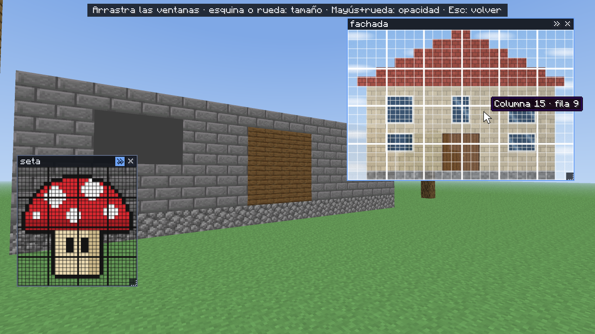

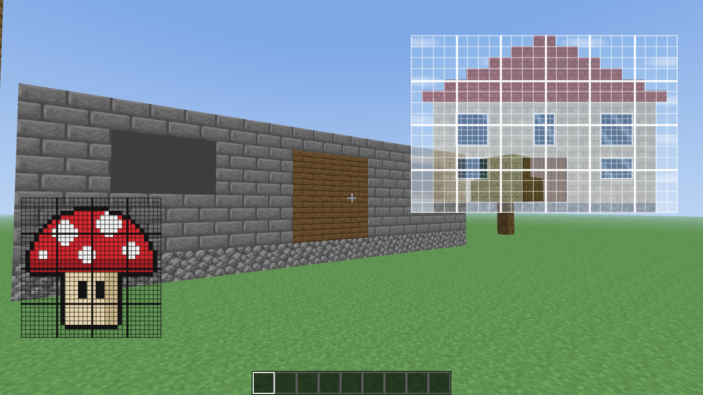

### En el mundo

La imagen es un **plano fijo** en una posición y con un giro, que se ve por las dos caras.

- **Al pasarla al mundo** queda donde se abrió: de pie, delante de quien la abrió, de cara a él y a la altura de sus ojos.
  - **Traer delante** la vuelve a poner de pie delante de ti, de cara a ti.
  - **Tumbar en el suelo** la pone boca arriba a tus pies, delante de ti, con su parte de arriba hacia donde miras: para calcar una planta o un pixel art en el suelo.
- **Tamaño de serie:** un píxel por bloque si parece pixel art (ningún lado pasa de 128 píxeles); si no, unos 32 bloques por su lado largo.
- **Profundidad:**
  - **No** (de serie): se ve siempre, encima de todo, aunque haya bloques delante.
  - **Sí:** lo que tenga delante la tapa. Va un pelo adelantada, así que no parpadea contra la cara de un bloque.
- **Filtro:**
  - **Nítido** deja ver cada píxel al agrandarla (pixel art);
  - **Suave** la difumina (fotos).
  - Se abre nítida si es pequeña (hasta 256 píxeles de lado) y suave si no.

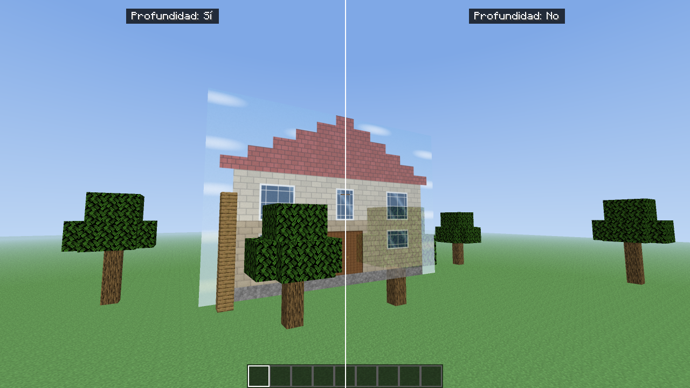

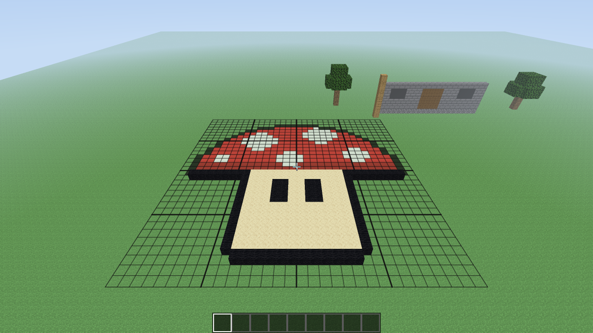

### Mover, girar y escalar con el gizmo

**Mover con el gizmo** (en la lista) cierra la pantalla y pone el gizmo del [fantasma](#colocar-con-gizmo) en el centro de la imagen, con un cuadradito blanco en cada esquina y su contorno. Como con el fantasma, el punto de mira es el puntero: apuntas a una pieza (se pone amarilla), mantienes el **clic izquierdo** y giras la cámara.

| Pieza | Qué hace | Pasos (con **Ctrl**, más finos) |
| --- | --- | --- |
| Flechas (roja X, verde Y, azul Z) | Mueve por ese eje | De bloque en bloque (1/16 de bloque) |
| Cubo del centro | La arrastra por su propio plano (de canto, por el suelo) | De bloque en bloque por su ancho y su alto (1/16) |
| Anillos (los tres) | Giran alrededor de ese eje del mundo | De 15° en 15° (de grado en grado) |
| Esquinas | Agrandan o encogen alrededor del centro, sin deformarla | La anchura en bloques enteros (en 1/16) |
| Rueda | Agranda o encoge | Un bloque de anchura (1/16) |

- **La barra de acción** dice su nombre y sus medidas en bloques; mientras arrastras, lo que cambia: «Girando +20°», «Moviendo +3, 0, -1», «Escalando a bloques enteros».
- **Terminar:** Intro, Esc o el clic derecho (o `/keref listo`). Se guarda al momento.
- Mientras se edita no se rompen bloques al arrastrar. Fuera de las piezas, el clic izquierdo hace lo de siempre.
- Si sale un fantasma de colocar, manda él: el gizmo de la imagen espera a que lo coloques o lo canceles.
- **1 celda = 1 bloque** ajusta el tamaño para que cada celda de la rejilla mida justo un bloque, y enciende la rejilla. Con una foto de una fachada a 20 píxeles por bloque y celdas de 20 píxeles, los bloques de la foto caen justo sobre los del mundo.

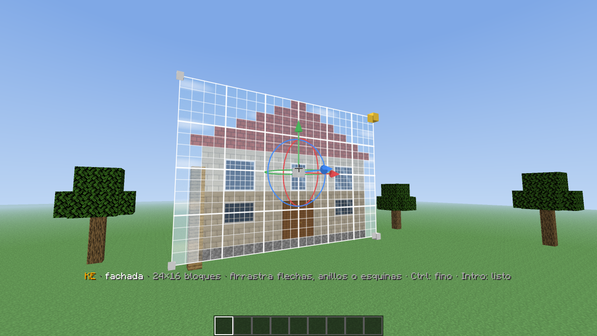

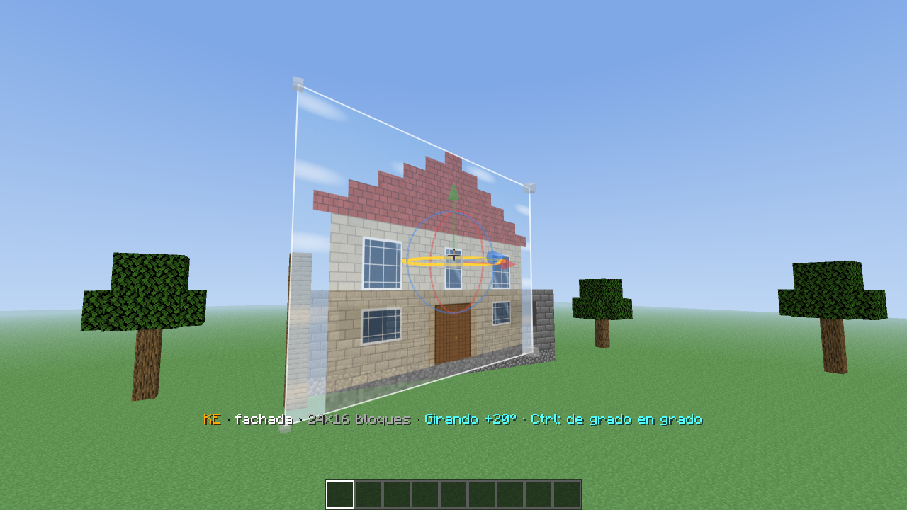

### Rejilla

Líneas encima de la imagen, en los dos modos, para contar bloques al calcar.

| Ajuste | De serie | Qué hace |
| --- | --- | --- |
| Rejilla | No | La enciende o la apaga. |
| Celda | 1 px (imágenes pequeñas) o 16 px | Cuántos píxeles de la imagen son una celda, es decir, un bloque. De 1 a 512. |
| Color | Blanco | Blanco, negro, rojo o cian, para que se vea sobre cualquier foto. |
| Marcada | Ninguna | Una línea más gruesa cada 4, 5, 8, 10 o 16 celdas, para contar de 5 en 5 o de 10 en 10. |
| Desfase X, Desfase Y | 0 | Dónde empieza la primera columna y la primera fila, en píxeles. Sirve para que cuadre con un pixel art que trae borde; la tira de antes cuenta como celda 1. |

- La rejilla se dibuja con su contorno.
- Si las celdas salen demasiado pequeñas para distinguirse (menos de 3 unidades en pantalla, menos de 1/32 de bloque en el mundo), solo se dibujan las marcadas.
- Con más de 1 024 líneas por lado, solo las marcadas, y si aun así sobran, ninguna.

### Varias a la vez, por mundo y ocultar

- Hasta **16 referencias** abiertas a la vez, en pantalla y en el mundo mezcladas. La última tocada se dibuja encima.
- Se recuerdan **por mundo o servidor**, cada uno en `config/komaedit/references/.worlds/<clave>.json`:
  - un mundo de un jugador, por el nombre de su carpeta;
  - un servidor, por su dirección (un Realm, por su nombre).
  - Al volver a ese mundo o servidor salen como las dejaste. Se guarda un segundo después de cada cambio y al salir.
- **Visible** (en la lista) oculta solo esa, sin quitarla.
- **Ctrl+I**, `/keref alternar` o **A la vista** (arriba en la lista) enseñan u ocultan todas sin tocar cada una; la barra de acción dice cuántas hay.
- **Quitar** la cierra en este mundo; el archivo sigue en la carpeta.

### Teclas

Están en **Controles → KomaEdit** y vienen **sin asignar**, como las del fantasma, para no quitarle la tecla a nadie. Mientras no las asignes valen los atajos de serie; si asignas una tecla, esa tecla sola hace la acción.

| Acción | De serie |
| --- | --- |
| Mostrar u ocultar las imágenes de referencia | Ctrl+I |
| Abrir las imágenes de referencia | Ctrl+Mayús+I |
| Terminar de mover con el gizmo | Intro, Esc o clic derecho |

### Rendimiento y limitaciones

- **Lectura de las imágenes:**
  - Se leen en otro hilo y se suben a la tarjeta gráfica con 2 048 píxeles por su lado más largo como mucho: una foto más grande se lee saltando píxeles. Las medidas, la rejilla y el tamaño en bloques usan siempre las del archivo original.
  - Las miniaturas de la lista son de 96 píxeles.
  - Un archivo de más de 40 MB no se abre.
  - Mientras llega, la ventana dice «Cargando…» y en el mundo se ve un velo gris donde va. Si el archivo falta o no se puede leer, lo dice en la lista y en la ventana.
- **Dibujo:** cada referencia en el mundo son dos triángulos y sus líneas: no cuestan nada aunque haya 16.
- **F1** oculta las ventanas en pantalla junto con el resto del HUD. Las del mundo se siguen viendo.
- Arrastrar archivos solo funciona con la lista abierta: Minecraft solo pasa los archivos a la pantalla que esté abierta.
- **Nada de esto se ha probado aún dentro de Minecraft.**
  - Las pruebas son JUnit: giros, plano y píxeles, rejilla, ventana, gizmo y arrastre, guardado y carga, archivos y que los textos caben.
  - Las maquetas, fuera del juego, en `docs/renders/referencias/`. Se regeneran con `KOMAEDIT_REFERENCE_MOCKUPS=<carpeta>` y, para las texturas, `KOMAEDIT_MC_JAR`; la tarjeta del Studio, con `KOMAEDIT_STUDIO_MOCKUPS`.

## Biblioteca de planos

### Objetivo y acceso

Una biblioteca de planos como los Blueprints de Axiom: guarda lo que copias con su miniatura, autor y etiquetas, lo encuentras por nombre o etiqueta y lo reutilizas: al portapapeles, colocado con la colocación de KomaEdit o repartido al azar con el pincel **estampar** (rocas, arbustos, ruinas…). Cada jugador tiene los suyos y el servidor una colección compartida para todos.

```text
/komaedit blueprint save <nombre> [etiquetas]
/komaedit blueprint list [texto|#etiqueta] [página]
/komaedit blueprint search <texto|#etiqueta>
/komaedit blueprint info <plano>
/komaedit blueprint load <plano>
/komaedit blueprint place <plano> [primaria] [secundaria] [banderas]
/komaedit blueprint tags <plano> [etiquetas]
/komaedit blueprint share <plano>
/komaedit blueprint delete <plano>
/komaedit pincel stamp <planos|#etiqueta> [radio] [banderas]
```

Alias: `planos`, `plano` y `blueprints` para la orden; `guardar`, `lista`, `buscar`, `ver`, `cargar`, `colocar`, `etiquetas`, `compartir` y `borrar` para las subórdenes; `estampar` para el pincel. En el Studio, la etapa **Planos** (tecla `0`). Ayuda: `/komaedit help blueprint`.

### Guardar

- `save` guarda el **portapapeles de WorldEdit** (`//copy`) con su giro (`//rotate`, `//flip`) ya aplicado, como `//schem save`.
- **Nombre:** de 1 a 32 letras, números, `_` o `-`, sin mayúsculas. Guardar otra vez con el mismo nombre reemplaza el plano y conserva su fecha de creación.
- **Etiquetas:** hasta 8, separadas por espacios o comas, con o sin `#` (`rocas musgo`, `#ruinas,#piedra`). Se guardan sin mayúsculas ni tildes: `Árboles` queda `arboles`. `tags <plano> [etiquetas]` las cambia (sin etiquetas, las quita).
- Junto al esquema se guardan el **autor**, las fechas, el **tamaño** (ancho × alto × fondo), el **número de bloques** que no son aire, las etiquetas y la huella de la miniatura.
- **Miniatura:** un PNG isométrico de 128×128 pintado en el servidor por código, sin Minecraft cliente: se mira desde el sureste y desde arriba, la cara de arriba sale más clara que la sur y la este, lo lejano un poco más oscuro, las aristas de los bloques se marcan cuando cada bloque ocupa 3 píxeles o más y el fondo es transparente. Se encuadra en la silueta de lo que no es aire, así que el aire de alrededor del portapapeles no la empequeñece. Los colores son los **colores medios de textura** de la tabla del mod (la misma de smoothblocks, `/komaedit image` y `/komaedit color`), con el color de mapa para los bloques de mods; el agua, el césped, la hierba alta y el nenúfar, que Minecraft tiñe según el bioma, llevan un color fijo, y la barrera, la luz y el vacío de estructura no se pintan.
- Escribir el esquema y pintar la miniatura va en un hilo aparte («KomaEdit planos»), como `//schem save`: el chat avisa cuando el plano está guardado.

### Dónde se guardan

```text
config/komaedit/blueprints/players/<uuid>/<nombre>.schem   esquema (formato sponge.3 de WorldEdit)
config/komaedit/blueprints/players/<uuid>/<nombre>.json    metadatos
config/komaedit/blueprints/players/<uuid>/<nombre>.png     miniatura
config/komaedit/blueprints/shared/<nombre>.schem|.json|.png  los compartidos
```

- El `.schem` es un esquema normal de WorldEdit (Sponge v3, con el NBT de cofres, carteles…): se puede llevar a la carpeta de schematics y abrir con `//schem load`.
- El JSON lleva `name`, `scope` (`jugador` o `servidor`), `owner`, `author`, `created`, `updated`, `size`, `blocks`, `tags`, `thumbnail` (SHA-256 del PNG), `schematic` y, en los compartidos, `sharedBy` y `sharedAt`.
- Se escribe con `.tmp` y `.bak`, y el JSON va el último: un cierre a medias deja el plano anterior o el nuevo, nunca uno sin esquema. Un plano dañado se omite de la biblioteca, se avisa en `latest.log` y se queda en disco.
- Los planos son **del servidor**, no de un mundo: valen en todos los mundos y dimensiones.

### Nombrar y buscar

- `roca` busca primero entre los tuyos y después entre los compartidos; `servidor/roca` (o `server/roca`) va directo al compartido. En las listas, los compartidos salen como `servidor/…` con una ★.
- `list` y `search` (son la misma orden) piden que **cada palabra** case: con un trozo del nombre o con el principio de una etiqueta (`roca` encuentra `roca_musgo` y lo etiquetado `#rocas`), y `#etiqueta` pide esa etiqueta exacta. Sin tildes ni mayúsculas. Primero el nombre exacto, luego los que empiezan por la búsqueda y luego el resto; dentro de cada grupo, por nombre y los tuyos antes.
- Ocho por página, con botones: **[cargar]**, **[colocar]** (escribe la orden con `-v` para revisarla), **[estampar]** y **[borrar]** en los tuyos. Al pasar el ratón por el nombre se ven tamaño, bloques, autor, fecha y etiquetas; un clic abre `info`.

### Cargar y colocar

- `load` lo pone en tu **portapapeles de WorldEdit**, con su NBT: luego `//paste`, `//rotate` o `/komaedit place Clipboard`.
- `place` es lo mismo que `/komaedit place Bp(N:<plano>) …`: alineación primaria y secundaria, `-s`, `-o`, `-r`, `-f`, `-a`, `-w`… (ver [Colocar estructuras](#colocar-estructuras)) y la [vista previa](#vista-previa-progreso-y-cancelación) con `-v`, que se confirma con `/komaedit confirm`. De serie el plano se apoya por el **centro de su base** en tu posición.
- En `place`, `scatter`, `array` y sus pinceles los planos son una estructura más, **`Blueprint`** (`Bp`), ver [Estructuras colocables](#estructuras-colocables): `Bp(N:roca_1|roca_2:3,T:rocas)` mezcla nombres y etiquetas, con peso opcional; cada colocación elige uno al azar según su peso.

Ejemplos:

```text
/komaedit blueprint save roca_musgo rocas musgo
/komaedit blueprint list #rocas
/komaedit blueprint place casita SurfaceNormal -v
/komaedit place Bp(N:servidor/pozo) Constant Aim -v
/komaedit scatter Bp(T:rocas) SurfaceNormal Random -n 0.8 -r Y -f XZ
/komaedit array Bp(N:farola) Tangential Constant -g 6
/komaedit pincel stamp #rocas 8 -n 60 -y -1
/komaedit pincel stamp roca_musgo:3,arbusto 12 -d 5 -m grass_block
```

### Pincel estampar

`/komaedit pincel stamp <planos|#etiqueta> [radio] [banderas]` pone en tu mano un pincel que, en cada **clic derecho**, coloca al azar planos de la lista sobre el suelo que miras. El **clic izquierdo** olvida lo ya estampado para que la separación empiece de cero.

| Parámetro | Valores |
| --- | --- |
| `<planos>` | Nombres y etiquetas separados por comas: `roca_1,roca_2:3,#arbustos,servidor/ruina`. `:n` es el peso (1 de serie); una etiqueta reparte el suyo entre sus planos. Hasta 32 planos distintos. |
| `[radio]` | `0` (de serie): un plano en el bloque que miras. De 1 a 32: varios repartidos en ese círculo. |
| `-n %` | Probabilidad de cada hueco (100 de serie): con 60, unos seis de cada diez huecos llevan plano. |
| `-d bloques` | Separación mínima entre planos (de 0 a 64). De serie, la que evita que se toquen: el doble del radio de la huella del plano más grande, más uno. |
| `-c n` | Planos por clic como mucho (16 de serie, hasta 64). |
| `-r giro` | `azar` (de serie: 0, 90, 180 o 270 al azar), un giro fijo (`0`, `90`, `180`, `270`) o `mirada` (según hacia dónde miras). |
| `-f ejes` | Volteos al azar permitidos: `xz` (de serie), `x`, `z` o `no`. |
| `-g modo` | Ajuste al suelo: `apoyar` (de serie), `centro` o `no`. |
| `-y n` | Sube o hunde (negativo) el plano después de apoyarlo, de -16 a 16. `-y -1` entierra un poco las rocas. |
| `-m máscara` | Solo sobre ese suelo (`grass_block,moss_block`, `#solid`… o cualquier máscara de WorldEdit, como en los demás pinceles). |
| `-a` | Coloca también el aire del plano (de serie, el aire no pisa nada). |
| `-p` | Vista previa: `/komaedit pincel aplicar` o `cancelar`. |

Comportamiento:

- **Dónde:** los huecos se reparten como un disco de Poisson: puntos al azar dentro del círculo, cada uno a la separación mínima de todos los demás, y de lo estampado con ese pincel en el último minuto (hasta 256 puntos); con radio 0 el plano va donde miras aunque haya otro cerca. Cada hueco sale con la probabilidad de `-n` y elige plano según los pesos.
- **Giro y volteo:** se aplican a los bloques y a su estado (escaleras, troncos, puertas…), como `//rotate` y `//flip`.
- **Suelo:** sostienen los cubos enteros, las losas y las escaleras; la hierba alta, las flores, la nieve en capa y los líquidos no. Se busca el suelo más cercano a la altura del clic, hasta 24 bloques por encima (una ladera que sube) o por debajo.
- **`apoyar`:** el plano cae hasta que alguna de sus columnas toca el suelo de la suya, así que no se mete en la ladera; en pendiente puede quedar un hueco por debajo del lado bajo (`-y -1` lo entierra). **`centro`:** la base del plano queda sobre el suelo que hay bajo su centro. **`no`:** a la altura del bloque de delante de la cara que miras. Un hueco sin suelo (o que no cumple `-m`) se salta.
- Cada clic vuelve a leer la lista: los planos nuevos de una etiqueta entran solos. Un nombre o una etiqueta que no existe da error al ponerlo en la mano.
- Cada pasada es **una entrada de `//undo`**; con `-p`, antes se ve en el holograma.

### Etapa Planos del Studio

La etapa **Planos** (`5`) es la biblioteca con miniaturas. El plano elegido se coloca con un **clic en el mundo** (en ese bloque, con su fantasma), con el botón del pie, **Colocar plano** (en el último clic o, sin clic, en tu posición, con vista previa), o con `B`. Tras **Estampar**, el clic en el mundo pinta con el pincel de estampar y los cambios de la etapa (otro plano, otro radio) le llegan solos.

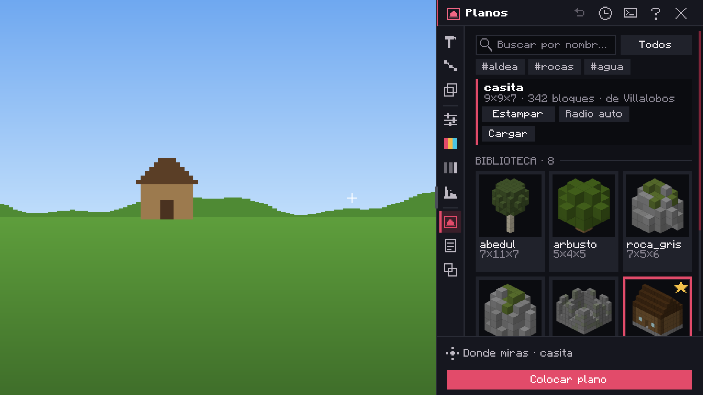

- **Buscador** (clic o `/` en la etapa): lo mismo que `search`. `Esc` lo borra y `Intro` elige el primero. A su lado, **Mostrar**: Todos, Míos o Servidor (un clic o la rueda).
- **Etiquetas:** una fila de pastillas con las más usadas que caben: un clic filtra por la etiqueta y otro la quita.
- **Plano elegido**, en una tarjeta de alto fijo encima de la cuadrícula (así no salta al elegir; si sus botones no caben en una fila, la tarjeta tiene dos): nombre, tamaño, bloques y autor, y los botones **Estampar** (el pincel en la mano con ese plano), **Radio** (auto, o el del pincel, con un clic o la rueda), **Cargar** (al portapapeles) y **Compartir** (en los tuyos, si puedes compartir). Sin plano elegido y con una sola etiqueta activa sale **Estampar #etiqueta**, para estamparla entera. Sin permiso, el botón sale apagado y lo dice al pasar el ratón.
- **Cuadrícula** de miniaturas con el nombre (en dos líneas, partido tras `_` o `-`, si no cabe en una) y el tamaño debajo, tantas columnas como quepan (como poco dos); los compartidos llevan una estrella dorada. Un clic elige el plano.
- La biblioteca se pide al abrir la etapa. Sin planos, **Guardar el portapapeles…** abre el chat con `/komaedit blueprint save ` escrito.
- En el modo compacto no salen las pastillas de etiquetas y la tarjeta del plano elegido enseña el nombre y el tamaño en una sola línea (el resto, en su tooltip).
- Las miniaturas se piden solo para las tarjetas que se ven y llegan **en trozos de 4 KiB**, como mucho 16 KiB por tick y jugador, para no atascar la conexión. El cliente las guarda por su huella (SHA-256): no se vuelven a pedir mientras el plano no cambie, caben 256 en memoria y se borran al salir del servidor.
- La etapa se dibuja con el código común del Studio (ver [Cómo está hecho](#cómo-está-hecho)); sus maquetas son `docs/renders/studio/1080p_gui3_planos_es.png` y `854_gui2_planos_es.png`.

### Permisos y límites

| Nodo | Paquete | Qué da |
| --- | --- | --- |
| `komaedit.blueprint.load` | intermedio (o `komaedit.clipboard`) | Ver la biblioteca (lista, búsqueda, `info`, Studio), cargar al portapapeles y usar planos en `Bp(…)` y en el pincel. |
| `komaedit.blueprint.save` | intermedio (o `komaedit.clipboard`) | Guardar, etiquetar y borrar los planos propios. |
| `komaedit.build.blueprint` | intermedio (o `komaedit.build`) | `/komaedit blueprint place`. |
| `komaedit.build.brush.stamp` | intermedio (o `komaedit.build`) | El pincel estampar. |
| `komaedit.blueprint.share` | avanzado | Compartir los propios y quitar los que uno compartió. |
| `komaedit.admin.blueprints` | admin | Borrar o reemplazar los compartidos de otros. |
| `komaedit.limit.blueprints` | admin | Sin los límites de número y tamaño. |

Los límites están en `config/komaedit/blueprints.json`, que se crea solo y se recarga con `/komaedit reload`:

```json
{
  "format": 1,
  "maxPerPlayer": 64,
  "maxShared": 512,
  "maxVolume": 1000000,
  "maxSide": 512,
  "maxFileKilobytes": 8192,
  "allowSharing": true
}
```

- `maxPerPlayer`: planos propios por jugador; reemplazar uno no cuenta.
- `maxShared`: planos compartidos en todo el servidor.
- `maxVolume` y `maxSide`: bloques de caja (ancho × alto × fondo) y lado más largo de un plano.
- `maxFileKilobytes`: tamaño del esquema comprimido (vale también para `komaedit.limit.blueprints`, para proteger el disco).
- `allowSharing`: con `false` nadie comparte, tenga el permiso que tenga.
- Si el archivo no se puede leer se usan los valores de serie y se avisa en `latest.log`.

### Rendimiento y limitaciones

- Guardar no frena el servidor: leer el portapapeles para escribir el esquema y pintar la miniatura van en el hilo de los planos. La miniatura de un plano de 64×40×64 se pinta en una fracción de segundo (lanza un rayo por píxel a una rejilla de colores, al doble de resolución).
- Colocar y estampar leen el esquema en el hilo del servidor la primera vez; después se queda en una caché de hasta 4 millones de bloques de caja, que se renueva sola si el plano cambia.
- **Colocar y estampar ponen los bloques sin su NBT** (cofres vacíos, carteles en blanco), como el resto de la colocación de KomaEdit. Para conservarlo: `load` y `//paste`.
- El pincel estampar admite planos de hasta 262 144 bloques de caja (64³); para más grandes, `blueprint place`. Una pasada cambia como mucho 1 000 000 de bloques.
- La miniatura pinta cada bloque como un cubo de su color medio: no enseña losas, escaleras, entidades ni el contenido de los bloques.
- Compartir copia el plano: si luego cambias el tuyo, el compartido no cambia hasta que lo vuelvas a compartir.

## Recetas, instancias y paquetes

- Las recetas guardan parámetros reutilizables de forma persistente dentro del mundo.
- Las instancias conservan receta, trayectoria, estados colocados y checksum; permiten actualizar o retirar una construcción sin borrar bloques modificados manualmente.
- Seleccionar una instancia vuelve a cargar sus puntos en el editor antes de actualizarla.
- Los paquetes exportables conservan configuraciones compartibles en `config/komaedit/packages/`.
- Las recetas e instancias guardan figuras procedurales (parámetros y trayectoria); para guardar y compartir bloques ya construidos están los [planos](#biblioteca-de-planos).
- Los datos se aíslan por mundo y UUID de jugador para evitar contaminación entre proyectos.

## Proyecto persistente y recuperación

### Objetivo y acceso

El proyecto persistente evita perder recetas e instancias al desconectarse y permite auditar operaciones interrumpidas. Se administra con:

```text
/komaedit project status
/komaedit project backup
```

### Almacenamiento y migración

- Ruta: `<mundo>/komaedit/players/<uuid>/` con namespaces `recipes`, `instances`, `jobs` y `paths` (recorridos guardados).
- La primera entrada copia de forma no destructiva las recetas e instancias heredadas de `config/komaedit/`; un marcador impide repetir la migración.
- Cada reemplazo conserva el archivo anterior como `.bak` y utiliza un `.tmp` recuperable si el proceso se interrumpe.
- La geometría comprimida de una instancia incluye SHA-256 en sus metadatos. Una discrepancia detiene la carga en vez de aplicar datos dañados.
- `project backup` crea un ZIP en `<mundo>/komaedit/backups/` y conserva las copias más recientes según `backupRetention`.

### Comportamiento y limitaciones

- Los jobs activos escriben progreso como máximo una vez por segundo para no convertir el disco en un cuello de botella.
- Tras un cierre inesperado, los jobs `RUNNING` pasan a `INTERRUPTED`; no se reanudan automáticamente porque el mundo pudo cambiar mientras el servidor estaba apagado.
- Las operaciones ya confirmadas siguen usando el historial de WorldEdit para `//undo`; la bitácora persistente es de diagnóstico, no una sustitución del historial.
- Los backups son manuales y por jugador. Los administradores deben incluir la carpeta `komaedit` del mundo en su estrategia normal de respaldo.
- Una receta o instancia que no se pueda leer (dañada, o de una versión que usaba una figura ya retirada) se omite del catálogo y se registra en `latest.log` con su nombre de archivo; el archivo se queda en disco y el resto del proyecto sigue funcionando.

## Permisos, cuotas y configuración

### Permisos

Los operadores poseen acceso total. Para otros jugadores, KomaEdit consulta permisos a través del actor de WorldEdit (sirve LuckPerms o cualquier gestor que WorldEdit entienda). Hay tres niveles, y basta con cualquiera:

1. **Permisos amplios** (los de siempre; nada cambia para quien ya los usa):
   - Base: `komaedit.use` (o el antiguo `moxia.use`).
   - Trayectorias y construcción: `komaedit.path`, `komaedit.build`, `komaedit.build.<figura>` (`komaedit.build.weather` para Envejecer).
   - Contenido: `komaedit.recipe`, `komaedit.instance`.
   - Edición: `komaedit.select` (selecciones y supervarita), `komaedit.paint`, `komaedit.clipboard`, `komaedit.history`.
   - Administración: `komaedit.project.backup`, `komaedit.admin.reload`, `komaedit.admin.jobs` (`/komaedit jobs`: ver, pausar y cancelar los trabajos de todos), `komaedit.admin.image.url` (imágenes por URL, si `urlsRequireAdmin` está activo), `komaedit.admin.stamps.export` (copiar un sello de serie a `config/komaedit/heightmaps` para retocarlo); excepción de volumen: `komaedit.limit.unrestricted`.
2. **Nodos finos**, uno por orden o modo, como en ezEdits. Un nodo padre da todos sus hijos (`komaedit.build.deform` da todos los modos de deform):
   - `komaedit.build.deform.<modo>`, `komaedit.build.surface.<modo>`, `komaedit.build.texture.<modo>`, `komaedit.build.shape.<forma>`, `komaedit.build.tweak.<modo>`, `komaedit.build.brush.<pincel>`.
   - `komaedit.build.smooth`, `.inflate`, `.deflate`, `.smoothblocks`, `.vines`, `.moss`, `.slabmerge`, `.statecycle`, `.glassgradient`, `.image`, `.noisegen`, `.flowfield`, `.flowline`, `.place`, `.array`, `.scatter`, `.palette.place`, `.palette.swap`, `.text`, `.gravity`, `.snow`, `.drain`, `.waterlog`, `.biome`, `.tree`, `.rock`.
   - `komaedit.build.symmetry.reflectional`, `.rotational` y `.worldedit` (ver [Simetría](#simetría)).
   - `komaedit.build.terrain.ramp`, `.terrain.river`, `.terrain.canyon`, `.terrain.paint`, `.terrain.erode.hydraulic` y `.terrain.erode.thermal` ([Terraformado](#terraformado)).
   - `komaedit.build.roof` y `komaedit.build.loft` (ver [Tejados](#tejados) y [Loft entre curvas](#loft-entre-curvas)).
   - `komaedit.build.brush.sculpt` ([Pinceles de modelado](#pinceles-de-modelado)); escalar y girar el portapapeles va con `komaedit.clipboard`.
   - `komaedit.build.brush.paint` ([Pincel de pintura](#pincel-de-pintura)).
   - Planos: `komaedit.blueprint.load`, `.save` y `.share`, `komaedit.build.blueprint` y `komaedit.build.brush.stamp`; de admin, `komaedit.admin.blueprints` y `komaedit.limit.blueprints` (ver [Permisos y límites](#permisos-y-límites)).
   - `komaedit.analyze` (lista de materiales; la da también `komaedit.use`).
   - `komaedit.palette.<orden>` y `komaedit.noise.<orden>` (`save`, `delete`, `list`, `print`…; los da también `komaedit.use`).
   - `komaedit.color.similar`, `.gradient`, `.palette` y `.hotbar` (los da también `komaedit.use`) y `komaedit.build.shade`.
   - `komaedit.select.<orden>` (`save`, `load`, `next`, `here`, `catenary`…) y `komaedit.select.superwand`.
   - `komaedit.capability.<capacidad>` y `komaedit.capability.flyspeed` (ver [Construir a mano: capacidades](#construir-a-mano-capacidades)); los da también `komaedit.build`.
3. **Paquetes** (`permpack` de ezEdits):

| Paquete | Incluye |
| --- | --- |
| `komaedit.permpack.basic` | Acceso, trayectorias, formas sueltas, `deform rotate`, `slabmerge`, `tweak`, `glassgradient`, `inflate`, `deflate`, `color` (parecidos, degradados, paletas y barra rápida), `analyze`, `gravity`, `snow`, `drain`, `waterlog`, supervarita, selecciones sin guardar (`next`, `here`, `invert`, `delpos2`, `encapsulate`, `encapsulatenear`, `catenary`) y las capacidades Reemplazar, Retocar, Colocar en el aire y Colocación rápida, con la velocidad de vuelo. |
| `komaedit.permpack.intermediate` | Lo básico más pinceles (`paletteshift`, `gradient`, `gradientstroke`, `petalpainter`, `place`, `biome`, `heightmap`, `tree`, `rock`), deform, surface, smooth, texture, `shade`, `vines`, `moss`, `statecycle`, noisegen, flowfield, flowline, `place`, `text`, `biome`, `tree`, `rock`, simetría (espejos y radial), rampas, ríos, cañones y pintar terreno, tejados (`roof`) y lofts (`loft`), paletas y ruidos guardados, selecciones guardadas, pintura, portapapeles, recetas y las capacidades Extruir, Arrastrar, Sin actualizaciones y Alcance largo. |
| `komaedit.permpack.intermediate` | Lo básico más pinceles (`paletteshift`, `gradient`, `gradientstroke`, `petalpainter`, `place`, `biome`, `heightmap`, `tree`, `rock`, `sculpt`), deform, surface, smooth, texture, `shade`, `vines`, `moss`, `statecycle`, noisegen, flowfield, flowline, `place`, `text`, `biome`, `tree`, `rock`, simetría (espejos y radial), rampas, ríos, cañones y pintar terreno, tejados (`roof`) y lofts (`loft`), paletas y ruidos guardados, selecciones guardadas, pintura, portapapeles (con escalar y girar), recetas y las capacidades Extruir, Arrastrar, Sin actualizaciones y Alcance largo. |
| `komaedit.permpack.advanced` | Lo intermedio más `array`, `scatter`, sus pinceles, `smoothblocks`, `symmetry worldedit`, `image`, la erosión física, instancias y todas las figuras propias de KomaEdit (`komaedit.build`). |
| `komaedit.permpack.admin` | `reload`, copias del proyecto, imágenes por URL, sin límite de volumen, cambiar el modo de juego desde el menú rápido (`komaedit.admin.gamemode`) y usar las capacidades fuera de creativo (`komaedit.admin.anymode`). Va aparte: no incluye los otros. |
| `komaedit.permpack.intermediate` | Lo básico más pinceles (`paletteshift`, `gradient`, `gradientstroke`, `petalpainter`, `place`, `biome`, `heightmap`, `tree`, `rock`), deform, surface, smooth, texture, `shade`, `vines`, `moss`, `statecycle`, noisegen, flowfield, flowline, `place`, `text`, `biome`, `tree`, `rock`, simetría (espejos y radial), rampas, ríos, cañones y pintar terreno, paletas y ruidos guardados, selecciones guardadas, pintura, portapapeles, recetas y las capacidades Extruir, Arrastrar, Sin actualizaciones y Alcance largo. |
| `komaedit.permpack.intermediate` | Lo básico más pinceles (`paletteshift`, `gradient`, `gradientstroke`, `petalpainter`, `place`, `biome`, `heightmap`), deform, surface, smooth, texture, `shade`, `vines`, `moss`, `statecycle`, noisegen, flowfield, flowline, `place`, `text`, `biome`, simetría (espejos y radial), rampas, ríos, cañones y pintar terreno, tejados (`roof`) y lofts (`loft`), planos (ver, cargar, guardar, colocar y el pincel `stamp`), paletas y ruidos guardados, selecciones guardadas, pintura, portapapeles, recetas y las capacidades Extruir, Arrastrar, Sin actualizaciones y Alcance largo. |
| `komaedit.permpack.advanced` | Lo intermedio más `array`, `scatter`, sus pinceles, `smoothblocks`, `symmetry worldedit`, `image`, compartir planos, la erosión física, instancias y todas las figuras propias de KomaEdit (`komaedit.build`). |
| `komaedit.permpack.admin` | `reload`, `jobs`, copias del proyecto, imágenes por URL, sin límite de volumen, gestionar los planos compartidos y sin límites de planos, cambiar el modo de juego desde el menú rápido (`komaedit.admin.gamemode`) y usar las capacidades fuera de creativo (`komaedit.admin.anymode`). Va aparte: no incluye los otros. |

- `/komaedit permisos [paquete]` (alias `permissions`) lista los nodos de cada paquete en verde (los tienes) o rojo; al pasar el ratón se ve el nodo completo y su equivalente de ezEdits.
- Las órdenes se ocultan del autocompletado a quien no puede usar ninguno de sus modos; si solo puede usar algunos, el resto da «Te falta el permiso …».
- Las máscaras y patrones de WorldEdit (`#palette`, `#near`…) no piden permiso propio.
- La tabla completa con su equivalente de ezEdits está en `docs/EZEDITS_PARITY.md`.

### Configuración

`config/komaedit/config.json` se crea automáticamente con:

- `maxBlocksPerOperation`: `1500000` de forma predeterminada; rango válido `10000–10000000`.
- `maxConcurrentJobs`: `4` de forma predeterminada; rango válido `1–64`. Ediciones que colocan a la vez; las demás esperan en la cola por orden de llegada (antes se rechazaban).
- `tickBudgetMillis`: `6` de forma predeterminada; rango válido `0.5–40` (admite decimales). Milisegundos por tick que KomaEdit puede usar en el hilo del servidor entre todos los jugadores: leer selecciones, colocar, pintar biomas, preparar vistas previas, pinceles… Ver [Rendimiento](#rendimiento).
- `tickBudgetMinMillis`: `1` de forma predeterminada; rango válido `0.1–tickBudgetMillis`. Lo que usa aunque el servidor vaya por debajo de 20 TPS, para que las ediciones terminen.
- `planCompressAboveBlocks`: `131072` de forma predeterminada; `0` o más. A partir de cuántos bloques el plan de una edición se guarda comprimido por páginas (`0`: siempre).
- `planMemoryMegabytes`: `128` de forma predeterminada; rango válido `0–65536`. Memoria comprimida que puede ocupar el plan de una edición; lo que pase va a un archivo temporal (`0`: nunca a disco).
- `backupRetention`: `5` de forma predeterminada; rango válido `1–50`.
- `confirmBuildAboveBlocks`: `250000` de forma predeterminada; rango válido `0–10000000`. Por encima, un Build pide confirmación; `0` lo desactiva.
- `arraySnapRadius`: `96` de forma predeterminada (como ezEdits); rango válido `1–256`. Hasta dónde busca superficie `-b` en `array` y su pincel.
- `previewTimeoutSeconds`: `90` de forma predeterminada; rango válido `10–3600`. Segundos que una [vista previa](#vista-previa-progreso-y-cancelación) espera a `/komaedit confirm` antes de caducar.
- `previewMaxDisplays`: `1500` de forma predeterminada; rango válido `0–10000`. Block displays como mucho por vista previa; por encima se enseña la superficie o una muestra, y con `0` solo la caja.
- `rootPermissionGrantsAll`: `false` de forma predeterminada. Si se activa, `komaedit.use` concede todos los subpermisos como compatibilidad con instalaciones antiguas.

Los campos que falten (un `config.json` de una versión anterior, como el de la 1.4.0, que no tiene los de la vista previa, `arraySnapRadius` ni los del presupuesto por tick y el plan) toman su valor por defecto; el archivo no se reescribe. Una configuración inválida se rechaza completa y el servidor utiliza límites seguros. Los cambios se aplican con `/komaedit reload` (permiso `komaedit.admin.reload`) o al reiniciar.

`config/komaedit/capabilities.json` guarda los límites de las capacidades de construcción a mano (alcance, bloques por capa, largo del arrastre, velocidad de vuelo y acciones por tick; ver [Configuración de las capacidades](#configuración-de-las-capacidades)); también se recarga con `/komaedit reload`.

`config/komaedit/blueprints.json` guarda los límites de la [biblioteca de planos](#permisos-y-límites) (planos por jugador, compartidos, tamaño y si se puede compartir); también se recarga con `/komaedit reload`.

`config/komaedit/palettes.json` guarda las paletas de serie del servidor (ver [Paletas guardadas](#paletas-guardadas)); también se recarga con `/komaedit reload`. `config/komaedit/images.json` configura `/komaedit image` (ver [Configuración de imágenes](#configuración-de-imágenes)) y también se recarga. `/komaedit info` muestra la versión del mod y cuántas paletas y ruidos de serie hay.

## Rendimiento

KomaEdit está pensado para usarse en un servidor con gente: una edición enorme (millones de bloques) no baja los TPS ni deja a nadie esperando. Las figuras, los cálculos sobre la selección y la geometría van en hilos aparte; en el hilo del servidor solo se lee y se escribe el mundo, y eso tiene un presupuesto por tick.

### Presupuesto por tick

- Todo lo que KomaEdit hace en el hilo del servidor sale de un mismo presupuesto: `tickBudgetMillis` (**6 ms** de serie) por tick, entre todos los jugadores y todas las fases. Antes cada parte tenía el suyo (la colocación 12 ms, la lectura 4, los pinceles 5, la vista previa 4…) y podían sumarse.
- **Baja solo si el servidor va justo.** KomaEdit mide lo que duran los ticks y a qué ritmo llegan: si el servidor ya gasta casi todo el tick por su cuenta, usa solo lo que sobre hasta 45 ms; si va por debajo de 20 TPS, solo el mínimo (`tickBudgetMinMillis`, **1 ms**). Cuando el servidor se recupera, en un segundo o dos vuelve al presupuesto entero.
- Se trabaja por tiempo, no por número de bloques: el mismo presupuesto da más bloques por tick en un mundo sencillo y menos donde cada bloque cuesta más (luz, vecinos, entidades de bloque).
- Lo interactivo (pinceles, vista previa, fantasma, pintura) va primero, pero si hay ediciones pesadas en marcha usa como mucho la mitad del presupuesto.
- Un servidor con poca gente puede subir `tickBudgetMillis` (por ejemplo a 15) para que las ediciones vayan más rápido; uno muy cargado, bajarlo. Se aplica con `/komaedit reload`.

### Cola justa

- Lo pesado (leer una selección, colocar, pintar biomas) se reparte **por turnos entre jugadores** en cada tick: cada uno recibe su parte, lo que uno no gasta pasa a los demás y el primero del turno cambia cada tick. Una edición de 20 millones de bloques no bloquea la de 2 000 de otro jugador: las dos avanzan en cada tick y la pequeña acaba en unos ticks.
- Como mucho `maxConcurrentJobs` ediciones **colocan** a la vez; las demás esperan en la cola por orden de llegada, con su puesto y el tiempo estimado en la barra y en `/komaedit job status`. El tiempo sale del ritmo medido de la cola (las que colocan se lo reparten a partes iguales).
- `/komaedit cancel` saca tu edición de la cola o la para en cualquier fase.

### Colocar sin picos

- WorldEdit no escribe en el mundo al hacer `setBlock`: lo guarda en un búfer de la sesión hasta vaciarla, y en su modo rápido (el de serie) deja la luz, los vecinos y el envío a los clientes para después. Hasta ahora KomaEdit no vaciaba ese búfer mientras colocaba, así que **toda la edición caía en el tick final**: con un millón de bloques, varios segundos con el servidor parado, y hasta el final nadie veía nada.
- Ahora la colocación va **por ventanas**: escribe un tramo, lo pasa al mundo (agrupado por chunk y sección, como hace WorldEdit) y aplica su luz, vecinos y envío a los clientes, repartido entre ticks si hace falta; luego el siguiente. El tamaño de cada ventana se ajusta a lo que cuesta de verdad cada bloque, para que quepa en el tick. Los bloques aparecen poco a poco y ningún tick pasa del presupuesto.
- Se respetan los ajustes de WorldEdit de cada jugador (`//perf`, `//fast`, `//reorder`): lo que cambia es cuándo se aplican, no cuáles.
- Sigue siendo **una sola entrada de //undo** aunque dure cientos de ticks, y cancelar deja exactamente lo colocado hasta ahí.
- De paso se arregla la captura de las instancias del Studio (Construir): leía el mundo cuando lo escrito aún estaba en el búfer y apuntaba el bloque de antes; ahora lee lo colocado.

### Memoria

- **El plan de una edición grande va comprimido** (por encima de `planCompressAboveBlocks`, 131 072 bloques de serie): en páginas de 4 096 entradas con una paleta propia, como las secciones de un chunk, y las posiciones seguidas en tramos. Un relleno o una operación sobre la selección ocupan **0,2 bytes por bloque** en vez de 16; un plan desordenado (estructuras sueltas), unos 10.
- Si aun así un plan pasa de `planMemoryMegabytes` (**128 MB** de serie), el resto de sus páginas va a un **archivo temporal** (`<temporal del sistema>/komaedit-plans`) y se lee de ahí al colocar. El archivo se borra al acabar (en Linux ni siquiera se ve en la carpeta: se lee por el archivo ya abierto); los que deje un servidor de Windows parado de golpe se borran al arrancar.
- El plan se monta y se comprime en el hilo del cálculo, no en el del servidor, y ya no hace falta reservar los arrays enteros: montar un plan de 20 millones pasa de unos 2 GB de memoria a menos de 100 MB (muestreado; varía entre ejecuciones).
- Lo que sigue ocupando memoria en una edición enorme es de Minecraft y WorldEdit: la foto de la selección (4 bytes por bloque leído, hasta 16 millones) y el historial de //undo de WorldEdit (decenas de bytes por bloque cambiado). En un servidor de 3,5 GB, con el límite de serie (1,5 millones de bloques por edición y 4 a la vez), sobra; para ediciones de decenas de millones con `komaedit.limit.unrestricted`, mejor de una en una.

### Límites claros

- Una edición que pasa del límite se avisa **antes de empezar**, con su tamaño, el límite y en cuántos trozos partirla (y, si la selección es una caja, los trozos listos con `/komaedit trozo <n>`). Ver [Estimación antes de empezar](#estimación-antes-de-empezar).
- Las operaciones sobre la selección ya no se cortan en 1,5 millones de cambios para quien no tiene límite: llegan a la foto entera.

### Administración: `/komaedit jobs`

- `/komaedit jobs` (alias `trabajos`, permiso `komaedit.admin.jobs`) enseña el estado del servidor (TPS, milisegundos por tick, lo que usa KomaEdit de su presupuesto, cuántas colocan a la vez y el ritmo de la cola) y una línea por jugador con trabajo: fase, bloques, porcentaje, tiempo y, si el plan es grande, su memoria, con botones **[pausar]** / **[reanudar]** y **[cancelar]**.
- `/komaedit jobs pause <jugador>` (alias `pausar`) para sus lecturas, colocaciones y pintados de biomas sin perder nada: termina la ventana que estaba vaciando (para que nada quede sin luz ni sin enviar) y deja de leer y escribir; una edición en pausa no ocupa sitio en la cola. Los cálculos en hilos aparte siguen, y lo que salga espera en la cola hasta reanudar. `resume <jugador>` (alias `reanudar`) sigue donde iba.
- `/komaedit jobs cancel <jugador>` (alias `cancelar`) hace lo mismo que su `/komaedit cancel`: lo para todo y lo ya colocado queda en su //undo.
- El jugador recibe un aviso cuando un administrador pausa, reanuda o cancela lo suyo.

### Números

Medido fuera del juego con `./gradlew benchmark` (la prueba `HugeEditBenchmarkTest` con `KOMAEDIT_FULL_TESTS=1` y 3 GB de memoria; Ryzen 7 3800XT, Java 21) sobre un mundo de mentira: lo que hace KomaEdit por bloque en cada fase, sin lo que cuesta Minecraft al leer o escribir (que no se puede medir sin el juego). «Antes» es la 1.9.0.

| Bloques | Leer (ns/bl) | Calcular (ns/bl) | Empaquetar (ns/bl) | Plan | Pico al montar el plan | Recorrer (ns/bl) |
| ---: | ---: | ---: | ---: | ---: | ---: | ---: |
| 1 000 000 | 24,4 → 18,5 | 2,2 | 34,3 → 48,5 | 16 MB → 0,2 MB | 76 MB → 20 MB | 34,3 → 43,9 |
| 5 017 600 | 17,7 → 10,0 | 2,3 | 41,4 → 26,6 | 80 MB → 1 MB | 238 MB → 29 MB | 31,8 → 36,7 |
| 19 998 784 | 15,9 → 10,6 | 2,2 | 80,0 → 26,8 | 310 MB → 4 MB | 1 987 MB → 69 MB | 31,7 → 36,3 |

Plan desordenado (posiciones al azar, 300 estados esperados y 20 bloques distintos), el peor caso para la compresión: 1 millón, 10 MB; 5 millones, 49 MB; 20 millones, 129 MB en memoria y 66 MB en disco (antes, 16 bytes por bloque y el mismo pico de 2 GB al montarlo).

Peor tick al colocar, con un modelo de lo que cuesta WorldEdit por bloque (2 µs escribir en la sesión, 1 µs pasar al mundo y 4 µs luz, vecinos y envío; supuestos, no medidos):

| Bloques | Peor tick antes | Peor tick ahora | Duración ahora (a 20 TPS) |
| ---: | ---: | ---: | ---: |
| 1 000 000 | 5 s | 6 ms | 58 s |
| 5 000 000 | 25 s | 6 ms | 4 min 51 s |
| 20 000 000 | 1 min 40 s | 6 ms | 19 min 26 s |

La duración es el precio de no parar el servidor; con `tickBudgetMillis` a 15 tarda unas 2,5 veces menos.

### Limitaciones

- Leer o colocar en chunks sin cargar los carga en el hilo del servidor, como WorldEdit: el tramo que lo hace puede pasarse del presupuesto en ese tick. Lo normal es editar cerca, con los chunks cargados.
- `//undo` y `//redo` son de WorldEdit y se hacen de golpe: deshacer una edición de millones de bloques para el servidor unos segundos.
- Si un plan escribe dos veces en la misma posición y la segunda es condicional, y caen en ventanas distintas, gana la primera (la segunda ve el bloque ya cambiado y lo respeta como un cambio a mano). Antes ganaba la última.
- Las demás protecciones de antes siguen: cálculos asíncronos y cancelables, límites de seguridad de los generadores, hologramas por secciones con caras expuestas, bitácora de cada trabajo y //undo de lo parcial.

## Versiones descargables

Todas las compilaciones de integración quedan visibles en GitHub Releases además de los artefactos temporales de GitHub Actions.

### Canal staging

- La versión interna del mod incluye la versión de desarrollo y el SHA corto: `komaedit-4.8.0-alpha.1.c0d75e5.jar`.
- La prerelease se muestra con el formato `komaedit-staging-4.8.0-c0d75e5`.
- Cada merge genera una prerelease independiente apuntando al commit exacto compilado.
- Estas versiones son de prueba y no sustituyen una publicación estable.

### Canal main

- Utiliza únicamente `release_version`.
- El nombre estable sigue el formato `komaedit-1.0.0`.
- No incluye `staging`, sufijos alpha ni SHA.
- Antes de publicar otro commit en `main` se incrementa la versión, por ejemplo de `1.0.0` a `1.0.1`.
- GitHub Actions rechaza una publicación si intenta reutilizar una versión estable asociada a otro commit.

## Política de actualización

Cada nueva función debe documentar:

1. Qué problema resuelve.
2. Cómo se abre o ejecuta.
3. Sus parámetros y materiales.
4. Su interacción con puntos, hologramas y modificadores.
5. Consideraciones de rendimiento.
6. Comandos de ejemplo cuando correspondan.
